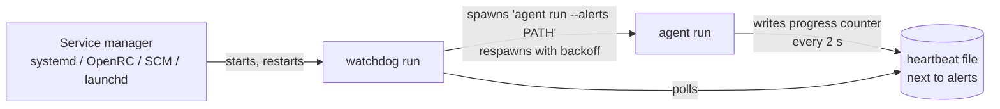
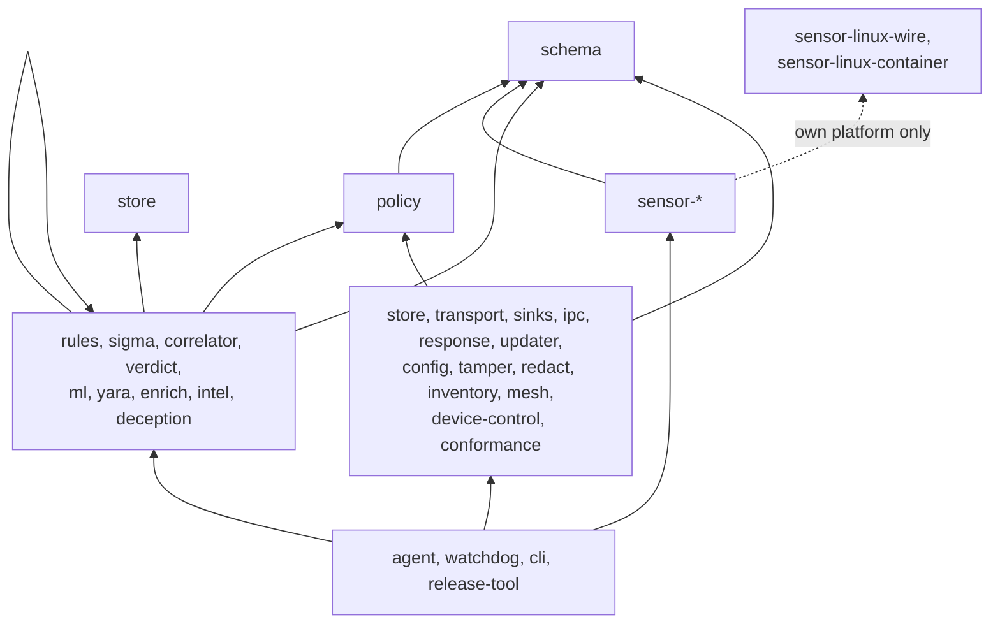

# Architecture overview

This page covers how the agent side of Synthaea is put together: which binaries ship, how the workspace crates divide the work, which way dependencies may point, and where platform-specific code lives. For what happens to one event from capture to upload, and for startup and shutdown on each OS, see [Event lifecycle, threads, startup and shutdown](lifecycle.md).

## Binaries

The workspace builds four binaries. Only `agent` and `watchdog` run on an endpoint as a service. `cli` is an unprivileged admin client. `release-tool` never runs on an endpoint.

| Binary | Entry point | Role |
| --- | --- | --- |
| `agent` | [`try_main`](../apps/agent/src/main.rs) | Hosts the detection pipeline (`agent run`) and the one-shot maintenance commands: `status`, `capture-events`, `capture-baseline`, `check-content-manifest`, `apply-content-manifest`, `apply-release`, `apply-key-rotation`, `quarantine list/restore`. |
| `watchdog` | [`run_cli`](../apps/watchdog/src/main.rs) | The process the service manager starts. It spawns the agent, restarts it with crash-loop backoff, kills it when its progress heartbeat stalls, pins the agent binary hash, and runs post-update probation and rollback. |
| `cli` | [`main`](../apps/cli/src/main.rs) | Talks to a running agent over the local IPC endpoint (`status`, `health`, `detections`, `policy`, `suppress`, `unsuppress`). Also inspects and writes the local config (`config init/check/path`). It holds no privileges of its own. |
| `release-tool` | [`main`](../tools/release/src/main.rs) | Offline tool that builds and signs release, content and key-rotation manifests. Signs with a PKCS#11 token in production, or with a key file / the public test key in labs. |

All three endpoint binaries load the same TOML configuration first, through [`config::load`](../crates/config/src/load.rs). The path comes from `--config`, then the `SYNTHAEA_CONFIG` environment variable, then the OS default ([`config::discover`](../crates/config/src/discovery.rs)). If the file is missing or invalid, the binary stops with an error that lists every path it tried. Nothing falls back to built-in defaults. A mis-installed watchdog that kept respawning an agent unable to find its own config would only waste restarts.

### Two layers of kill resistance

Summary only; the full mechanism, its limits and its platform coverage are in [Self-protection](self-protection.md#two-layers-of-kill-resistance).

The service manager supervises the watchdog, never the agent. The watchdog's supervision loop ([`supervise_loop`](../apps/watchdog/src/supervise.rs)) supervises the agent:

- **Crash-loop backoff** ([`Backoff`](../apps/watchdog/src/supervise.rs)). An exit within 10 s of spawn counts as a fast crash. Each fast crash doubles the delay, starting from `--restart-delay` (5 s by default) and capped at 300 s. An exit after a longer run resets the delay to that floor. A failed spawn and a refused (tampered) binary feed the same backoff.
- **Progress liveness** ([`HeartbeatMonitor`](../apps/watchdog/src/supervise.rs)). The agent's [`heartbeat`](../apps/agent/src/heartbeat.rs) thread writes the pipeline's progress counter to a file next to the alerts file. That counter only advances after `DetectionSink::on_event` finishes an event. After `--heartbeat-miss-limit` (6) checks in a row with no advance, at `--heartbeat-interval-secs` (5 s) each, the watchdog kills the agent and restarts it through the backoff. A missing or unreadable file is never counted as a miss. Both crates compute the heartbeat path separately ([`heartbeat_path_for`](../apps/agent/src/heartbeat.rs) and [`heartbeat_path_for`](../apps/watchdog/src/paths.rs)) because the watchdog cannot depend on the agent binary. The two functions must stay in sync.
- **Binary pinning.** The watchdog hashes the agent binary once at startup ([`BinaryPin`](../apps/watchdog/src/tamper.rs)) and checks the hash again before every spawn. On Linux it also compares the installed service definition against a snapshot taken at startup.
- **Probation** ([`Probation`](../apps/watchdog/src/probation.rs)). After `apply-release` promotes a new version, the watchdog must see the heartbeat advance within `PROBATION_DEADLINE` (120 s). Otherwise it rolls `current` back to the previous version and bans the failed one.
- **Parent-death signal (Linux)** ([`die_with_parent`](../apps/watchdog/src/supervise.rs)). The agent child gets `PR_SET_PDEATHSIG=SIGKILL`, so killing the watchdog cannot leave behind an unsupervised agent that has been reparented to PID 1.

The watchdog tells the agent how often it was restarted and how many self-protection events it saw, through two environment variables. The agent reads them in [`WatchdogReport::from_env`](../apps/agent/src/host_counters.rs) and reports them in the health beacon.

## Crate map

All crates live under `crates/`. Platform sensors live under `crates/sensors/<platform>/<mechanism>`, with package names `sensor-*`.

| Tier | Crates | Responsibility |
| --- | --- | --- |
| Base | `schema`, `policy` | `schema` holds the normalized `Event` enum, `Detection`, `HealthBeacon`, and the `Sensor`/`EventSink` contract ([`sensor.rs`](../crates/schema/src/sensor.rs)). `policy` holds the policy types shared with the control plane, such as `ResponsePolicy` and `EventLogPolicy`. |
| Sensors | `sensor-linux` (eBPF userspace), `sensor-linux-ebpf` (kernel probes, own target), `sensor-linux-wire` (ring-buffer ABI), `sensor-linux-container` (container attribution), `sensor-linux-audit`, `-netlink`, `-journal`, `-uprobes`, `-lsm`, `-logs`, `-procmem`; `sensor-windows` (ETW), `-eventlog`, `-sockets`, `-minifilter`; `sensor-macos` (EndpointSecurity), `-unifiedlog`, `-sockets`, `-network-extension` | Turn one OS facility into `schema::Event`s. Each crate either implements `Sensor` or exposes poll/stream functions that a caller drives. |
| Detection | `rules`, `sigma`, `correlator`, `verdict`, `ml`, `yara`, `enrich`, `intel`, `deception` | Detection engines and the work they need. `rules` holds the stateless and stateful rules. `correlator` holds co-occurrence and Bayesian belief per process. `verdict` fuses findings per entity. `ml` does ONNX scoring. `yara` holds the budgeted file and memory scan queues. `enrich` handles hashing and signature verdicts. `deception` handles canary tripwires. |
| Leaf | `store`, `transport`, `sinks`, `ipc`, `response`, `updater`, `config`, `tamper`, `redact`, `inventory`, `mesh`, `device-control`, `conformance` | Self-contained services. `store` holds bounded maps and the on-disk spool. `transport` holds the mTLS client and upload loops. `sinks` holds the JSONL writers. `ipc` holds the local control-channel protocol. `response` holds the kill/quarantine/escalate decisions. `updater` handles manifest verification and the release layout. `tamper` handles heartbeats, the silence monitor and integrity checks. `redact` holds pure redaction functions. |
| Test support | `siblings` | Dev-only helper. Any crate may use it as a dev-dependency, never as a normal one. |
| Binaries | `agent`, `watchdog`, `cli`, `release-tool` | Composition points. Only binaries may depend on anything. |

Some crates are excluded from the default build because they need a special toolchain or target. `sensor-linux-ebpf` targets `bpfel-unknown-none` and is built by `sensor-linux`'s build script. The Windows and macOS sensor crates compile to stubs on other targets, so `cargo check` works anywhere. The `fuzz` crate is excluded from the workspace entirely. See the comments in the root [`Cargo.toml`](../Cargo.toml).

## Dependency direction

[`tools/check-deps.py`](../tools/check-deps.py) enforces which way dependencies may point. CI runs it on every push ([`ci.yml`](../.github/workflows/ci.yml)). It reads `cargo metadata` and fails on any edge its `allowed` function rejects:

The rules:

- `schema` depends on no workspace crate. `policy` depends only on `schema`.
- A `sensor-*` crate depends on `schema`, plus its own platform's shared crates. For example, `sensor-linux` and `sensor-linux-uprobes` may use `sensor-linux-wire` and `sensor-linux-container`. A shared crate depends only on `schema`.
- Detection crates may use the base tier, each other, and `store`. They may never use a sensor crate.
- Leaf crates may use only the base tier. In particular, `transport` and `store` do not know each other, `updater` does not know `transport`, and `response` does not call the OS.
- Only binaries may depend on anything. No crate depends on a binary.
- A crate that the script does not know makes it exit with code 2. A new crate must be added to the script.

Some consequences show up in the agent's code:

- **The binary bridges types that two crates may not share.** [`upload.rs`](../apps/agent/src/upload.rs) adapts `store::EventSpool` to `transport::EventDrain`. [`content.rs`](../apps/agent/src/content.rs) composes `updater` verification with `transport` downloads. [`eventlog_config`](../apps/agent/src/commands/windows.rs) maps `policy::EventLogPolicy` to `sensor-windows-eventlog`'s own config type field by field.
- **The binary injects OS calls.** `response::kill_process` takes the actual kill as a closure. On Linux that closure is [`terminate_process`](../apps/agent/src/commands/linux.rs), which sends `SIGKILL`.

## Where platform code lives

All `cfg(target_os)` dispatch in the agent sits in [`apps/agent/src/commands/`](../apps/agent/src/commands/mod.rs):

| Module | Contents |
| --- | --- |
| [`commands/mod.rs`](../apps/agent/src/commands/mod.rs) | `RunOptions` (all `run` flags and config sections, bundled), and the re-export of the current platform's `cmd_status` / `cmd_run` / `cmd_capture_events` / `cmd_capture_baseline`. On an unsupported OS these compile but fail at runtime. |
| [`commands/common.rs`](../apps/agent/src/commands/common.rs) | The platform-independent part of `run`: [`wire_run_pipeline`](../apps/agent/src/commands/common.rs) (transport, detection sink, correlator ticker, banner, heartbeat, IPC), [`apply_detection`](../apps/agent/src/commands/common.rs) (local time zone and odd-hour calibration), [`plant_canaries`](../apps/agent/src/commands/common.rs), and [`health_collector`](../apps/agent/src/commands/common.rs). |
| [`commands/linux.rs`](../apps/agent/src/commands/linux.rs) | eBPF preflight, sensor selection (eBPF or the audit fallback), and every Linux worker thread. |
| [`commands/windows.rs`](../apps/agent/src/commands/windows.rs) | ETW plus the Event Log, socket-table and minifilter sources. |
| [`commands/macos.rs`](../apps/agent/src/commands/macos.rs) | EndpointSecurity plus the unified log, socket-table and NetworkExtension sources. |

The detection sink ([`sink/mod.rs`](../apps/agent/src/sink/mod.rs)) has no platform dispatch of its own. A few agent modules are compiled only on Linux because the mechanism exists only there: `integrity`, `inventory`, `kill_loudness`, `journal_cursor`, `log_sources`, `memscan`, `captures`. See the `mod` declarations in [`main.rs`](../apps/agent/src/main.rs).

## Agent modules at a glance

| Module | Responsibility |
| --- | --- |
| [`sink`](../apps/agent/src/sink/mod.rs) | `DetectionSink`, the `EventSink` that runs every engine, records findings and drives response. Also [`BaselineSink`](../apps/agent/src/sink/baseline.rs) for ML baseline capture. |
| [`enrich_queue`](../apps/agent/src/enrich_queue.rs) | Bounded worker that moves hashing, signature checks, raw-event logging and spool appends off the capture thread. |
| [`alerts`](../apps/agent/src/alerts.rs) | `AlertLog`, the single alert funnel: `alerts.ndjson`, stderr, and the 256-entry in-memory buffer that `cli detections` reads. |
| [`upload`](../apps/agent/src/upload.rs) | The event spool and detection spool, plus their upload threads. Resolves which control plane `run` talks to. |
| [`silence`](../apps/agent/src/silence.rs) | Per-sensor heartbeats, the silence-monitor thread, and `PulsingSink`. |
| [`health`](../apps/agent/src/health.rs) | Health-beacon collector, sent every 30 s by default. |
| [`heartbeat`](../apps/agent/src/heartbeat.rs) | Progress-counter file for the watchdog. |
| [`ipc_handler`](../apps/agent/src/ipc_handler.rs) | IPC server thread answering `cli` requests and content reloads. |
| [`shutdown`](../apps/agent/src/shutdown.rs) | `ShutdownPlan`, a bounded join of the registered workers. |
| [`kill_loudness`](../apps/agent/src/kill_loudness.rs) | Attributes SIGTERM/SIGHUP/SIGQUIT to their sender before exiting (Linux). |
| [`redact`](../apps/agent/src/redact.rs) | `RedactingSink` and `redact_event`, which redact data at the point where events leave the process. |
| [`content`](../apps/agent/src/content.rs), [`release`](../apps/agent/src/release.rs), [`rotation`](../apps/agent/src/rotation.rs), [`trust`](../apps/agent/src/trust.rs) | Signed content, release and key-rotation commands. |
| [`protected`](../apps/agent/src/protected.rs), [`integrity`](../apps/agent/src/integrity.rs), [`inventory`](../apps/agent/src/inventory.rs) | Linux self-protection and inventory monitors. |

## Known gaps

- macOS runs no silence monitor and sends no health beacon. Its supplementary sources are not restarted when they exit. Tracked in [#34](https://github.com/synthaea-lab/agent/issues/34).
- `apply-release` (binary self-update) is Linux only. Tracked in [#60](https://github.com/synthaea-lab/agent/issues/60). Nothing triggers `apply-release` or `apply-content-manifest` on a timer yet. Tracked in [#44](https://github.com/synthaea-lab/agent/issues/44).
- The default dev build does not link on older glibc/libstdc++ distributions because of the prebuilt ONNX Runtime. Tracked in [#53](https://github.com/synthaea-lab/agent/issues/53).
