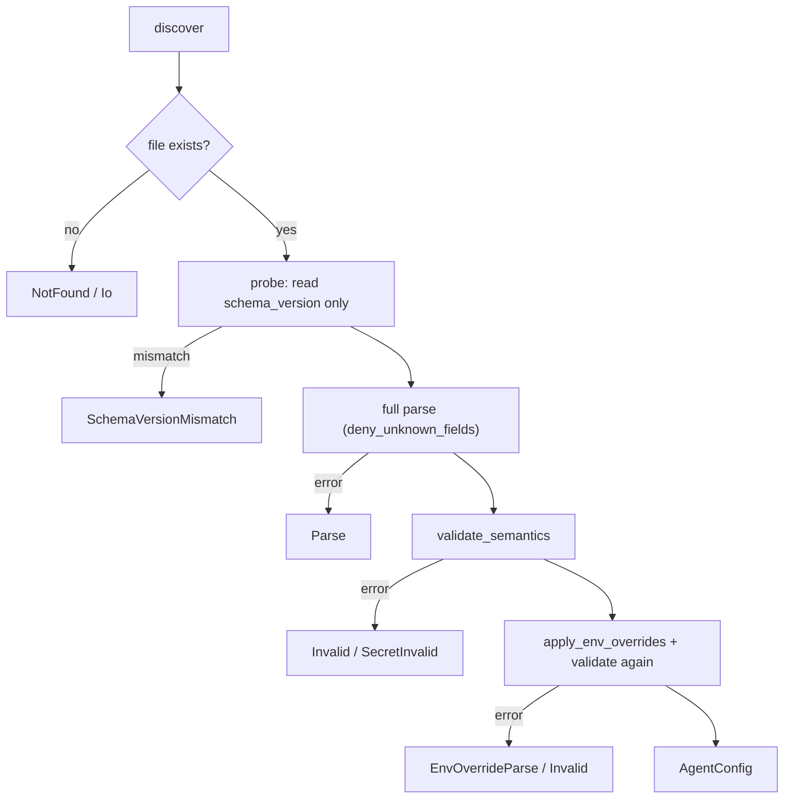

# Configuration and policy

The agent has two configuration channels:

| | `agent.toml` (local configuration) | Policy |
|---|---|---|
| Crate | [`crates/config`](../crates/config/src/lib.rs) | [`crates/policy`](../crates/policy/src/lib.rs) |
| Who writes it | the operator or installer, per host | the control plane (not distributed yet, see below) |
| Format | TOML, loaded once at startup | signed canonical JSON |
| Content | paths, endpoints, budgets, logging, host facts | which actions are allowed, sensor toggles, compliance modes |
| Changes take effect | on the next restart | (planned) on receipt of a newer signed version |

`config` is a leaf crate shared by the `agent`, `watchdog` and `cli` binaries,
so no binary parses its own dialect. `policy` is in the base tier beside
`schema`, and both the agent and server-side code may depend on it.

## agent.toml

### Discovery order

[`discover`](../crates/config/src/discovery.rs) picks exactly one file. Files
are never merged:

1. `--config <path>` on the command line;
2. otherwise the `SYNTHAEA_CONFIG` environment variable
   ([`ENV_CONFIG_PATH`](../crates/config/src/discovery.rs)), if set and
   non-empty (an empty value counts as unset);
3. otherwise [`DEFAULT_CONFIG_PATH`](../crates/config/src/discovery.rs):

| OS | Default path |
|---|---|
| Linux (and other Unix dev hosts) | `/etc/synthaea/agent.toml` |
| Windows | `C:\ProgramData\Synthaea\agent.toml` |
| macOS | `/Library/Application Support/Synthaea/agent.toml` |

`discover` only chooses a path and never touches the disk, so "which file would
be used?" can be answered without reading it. It returns a
[`DiscoveredPath`](../crates/config/src/discovery.rs) tagged with its
[`DiscoverySource`](../crates/config/src/discovery.rs). The tag decides the
error on a missing file: at the default path the error is
`ConfigError::NotFound` (the operator never chose that path, so the error lists
what was searched). At an explicit `--config` or env path it is
`ConfigError::Io` (the operator chose it, so a typo must not be hidden).

### Load pipeline



- [`load`](../crates/config/src/load.rs) runs the whole pipeline. Every binary
  calls it once at boot, and the agent exits non-zero on any error.
- [`load_from`](../crates/config/src/load.rs) reads one known path and does not
  apply env overrides (used by tests and the template check).
- `parse_and_validate` first deserializes a minimal `SchemaProbe`, so a file for
  another schema version fails with an explicit version error rather than an
  obscure "missing field".

The agent **fails fast**. No in-memory default is built when the file is
missing. Every error names the field path, the expected shape, the value found,
and the file it came from ([`ConfigError`](../crates/config/src/error.rs)).
`RUST_LOG` still overrides `log.level` for ad-hoc debugging
([`apps/agent/src/main.rs`](../apps/agent/src/main.rs)).

### Schema rules

[`AgentConfig`](../crates/config/src/schema.rs) is the file format. All structs
use `deny_unknown_fields`, so a typo in a key is an error.

- `schema_version` must equal [`SCHEMA_VERSION`](../crates/config/src/schema.rs)
  (currently 1). It is bumped only on a breaking change. A new field with a
  default does not need a bump. This version is unrelated to the event schema
  version.
- The sections `server`, `log`, `storage`, `ipc` and `resources` are required.
  A missing section is a parse error, never a silent default.
- The sections `updates`, `logs`, `deception` and `detection` are optional. An
  absent section means "off": no ring assigned, no log source, no canary, no
  host facts. It never means a discovered or default value.
- Inside a section, primitive fields with a documented default use
  `#[serde(default = "...")]`.

### Reference

| Key | Type / default | Validation | Used by |
|---|---|---|---|
| `server.control_plane_url` | string, required | must start with `https://` | upload, content, release |
| `server.mtls_cert`, `server.mtls_key` | path, required | absolute | transport client |
| `server.mtls_passphrase` | [`SecretRef`](../crates/config/src/secret.rs), required | `envvar:` or `file:` prefix | validated only (see [gaps](#gaps-and-discrepancies)) |
| `server.ca_cert` | path, optional | absolute | when set, **only** these roots are trusted |
| `server.offline_fallback` | bool, `true` | | [`upload::start_or_disable`](../apps/agent/src/upload.rs): when uploads cannot be set up (unreadable key, missing CA, spool directory), keep detecting locally instead of exiting |
| `log.dir` | path, required | absolute | read and printed; not yet used to write the agent's log |
| `log.level` | string, `info` | `trace` / `debug` / `info` / `warn` / `error`, any case | tracing filter |
| `log.max_mb` | u64, `1024` | > 0 | validated only |
| `storage.state_dir` | path, required | absolute | release/rotation state, content, inventory, deception |
| `storage.spool_max_mb` | u64, `4096` | > 0 | cap of **each** of the two upload spools ([State and storage](state-and-storage.md#how-the-agent-uses-it)) |
| `ipc.endpoint` | string, required | named pipe `\\.\pipe\...` on Windows, absolute path elsewhere | `crates/ipc`, `cli` |
| `resources.worker_threads` | u32, `0` | | validated only |
| `resources.max_reconnect_backoff_ms` | u64, `60000` | | validated only |
| `updates.ring` | string, optional | one of [`CONTENT_RINGS`](../crates/config/src/schema.rs) | `apply-content-manifest` (requires `--ring` when absent, so an install never lands in `prod` by default) |
| `logs.sources[]` | `{path, kind}`, empty | at most [`MAX_LOG_SOURCES`](../crates/config/src/schema.rs) (16), absolute, no duplicates; `kind` is `access_common`, `access_combined` or `mysql_error` | log-source tailer |
| `deception.canary_dirs[]` | path, empty | at most 16, absolute, no duplicates | canary planting |
| `deception.allow_exe[]` | path, empty | at most 32, absolute, **not** a shell, interpreter or launcher (`is_interpreter`) | canary touch exclusions |
| `detection.utc_offset_minutes` | i32, optional | -720 to 840 | ODD-HOUR-LOGON: overrides the platform time zone (fixed offset, no daylight saving) |
| `detection.work_hours` | `[start, end]`, optional (`[7, 20]` when absent) | start 0 to 23, end 1 to 24, start differs from end; start > end wraps midnight | ODD-HOUR-LOGON |
| `detection.odd_hour_exempt_accounts[]` | strings, empty | at most 64; `NAME` or `NAME\|SID`; SID is `S-1-...` or a prefix ending in `-*`; at most 256 bytes | ODD-HOUR-LOGON |

Notes on the less obvious rules:

- **Absolute paths everywhere.** `agent` runs under a service manager and `cli`
  runs in a user's shell. A relative path would resolve against a different
  working directory for each.
- **`log.max_mb = 0` and `spool_max_mb = 0` are refused.** Unbounded logging
  has to be written as an explicit large value, not left to omission.
- **`allow_exe` refuses interpreters.** Allowing `python3` would exempt every
  script it runs from the canary. The check matches the file name exactly, or by
  family prefix (`python3.12`, `perl5.38`). It deliberately over-matches: being
  too eager only means the operator must name a more specific binary.
  `policy::service_main_path_is_trusted` keeps a similar list for the opposite
  risk (see [below](#compile-time-policy-helpers)). The two lists are
  maintained separately because `correlator` cannot depend on `config`.
- **Exempt account entries.** A bare `NAME` matches the account name as the
  logon event reports it. On Windows that is the bare `TargetUserName` with no
  domain, so a bare entry also exempts a local look-alike account that an
  intruder creates with the same name. `NAME|SID` binds the entry to a SID,
  which an intruder cannot choose. A SID prefix (`...-*`) exempts any account of
  that name the prefix's authority can create. The grammar is shared with the
  rules crate through one vector file,
  [`data/exempt-entry-vectors.txt`](../crates/config/data/exempt-entry-vectors.txt),
  which both test suites read
  (`the_exempt_entry_grammar_matches_the_vectors_the_rules_use`).

### Environment overrides

[`apply_env_overrides`](../crates/config/src/load.rs) maps a fixed list of
variables. Each field has an explicit match arm, so the set of fields that can
be overridden is auditable in one place:

| Variable | Field | Parse |
|---|---|---|
| `SYNTHAEA_SERVER_URL` | `server.control_plane_url` | string |
| `SYNTHAEA_OFFLINE_FALLBACK` | `server.offline_fallback` | exactly `true` or `false` |
| `SYNTHAEA_LOG_LEVEL` | `log.level` | string |
| `SYNTHAEA_LOG_MAX_MB` | `log.max_mb` | u64 |
| `SYNTHAEA_SPOOL_MAX_MB` | `storage.spool_max_mb` | u64 |
| `SYNTHAEA_IPC_ENDPOINT` | `ipc.endpoint` | string |
| `SYNTHAEA_WORKER_THREADS` | `resources.worker_threads` | u32 |

An empty variable counts as unset. A value that does not parse gives
`EnvOverrideParse`, naming the variable. After overrides, the full semantic
validation runs again. Key and certificate paths are deliberately **not**
overridable: a variable left set on a workstation must never redirect a
production agent's key.

### Secrets

Secret fields never hold cleartext. A [`SecretRef`](../crates/config/src/secret.rs)
is written as one of:

- `envvar:NAME`: read from the process environment (systemd
  `EnvironmentFile=`, the Windows service entry, a launchd plist);
- `file:/absolute/path`: the file's contents with trailing whitespace trimmed
  (`0600 root:root`, or an ACL limited to LocalSystem).

Deserialization never fails on a secret. A string with no known prefix becomes
the transient `SecretRef::Invalid`, and `validate_semantics` turns it into
`ConfigError::SecretInvalid` naming the field path. A serde error could not name
the field. [`SecretRef::resolve`](../crates/config/src/secret.rs) returns
`SecretResolve` for a missing, empty or unreadable source, and panics on
`Invalid`, since a validated config never contains one. Adding a provider (a
vault, a credential store) is a new variant and `resolve` arm, not a schema
change.

### Template

[`data/default-agent.toml`](../crates/config/data/default-agent.toml) is a
hand-written, committed template, embedded verbatim as
[`DEFAULT_TEMPLATE`](../crates/config/src/template.rs).
[`write_default_template`](../crates/config/src/template.rs) (behind
`cli config init`) refuses to overwrite an existing file unless forced. Without
force it creates the file with `create_new`. With force it writes a sibling temp
file and renames it over the target, so a crash never leaves a truncated config.
The file is created with mode `0644` because it holds only secret references.
[`tests/default_template.rs`](../crates/config/tests/default_template.rs) loads
the template on every CI run so it cannot drift from the schema. The template
uses Linux paths, so `write_default_template` returns `UnsupportedPlatform` on
Windows and macOS.

### Observable identity names

[`config::identity`](../crates/config/src/identity.rs) holds every name that
someone on the host can see and hard-code to find or stop the agent: service
names, the launchd label, watchdog environment variables, the ETW session
prefix. Binaries and leaf crates use these constants instead of literals.
Sensors cannot depend on `config`, so the agent passes them the names at
construction. Nothing is randomized per install yet.

## Policy

### The signed policy document

[`crates/policy/src/document.rs`](../crates/policy/src/document.rs) defines the
format the control plane and the agent will exchange:

```text
Policy
├── metadata: PolicyMetadata   schema_version, policy_version (monotonic), issued_at_ns, signature
└── payload:  PolicyPayload
    ├── sensors          map-typed: windows_eventlog {4 channel toggles, redaction?}
    ├── response         flat: kill_enabled, quarantine_enabled, isolate_enabled (deny by default)
    ├── compliance_mode  flat, safety-critical: none | pci_dss | hipaa
    ├── rules / models / thresholds   empty placeholders
    └── experimental     map<string, JSON>: the only place unknown keys are accepted
```

Metadata is kept apart from the payload so a release gate can check the
version and signature without reading the payload. Every struct is
`deny_unknown_fields` except `experimental`.

**Canonical form.** [`to_canonical_bytes`](../crates/policy/src/canonical.rs)
serializes to a JSON tree, replaces `metadata.signature` with `""` (the field is
present and empty, never omitted or null, so the shape is the same before and
after signing), then writes it with keys sorted at every level, 2-space indent
and no trailing whitespace. String escaping reuses `serde_json`'s, so the bytes
match any other `serde_json` output. This is the only canonicalizer for this
document. Signing and verifying must hash identical bytes.

**Signature.** [`verify`](../crates/policy/src/signature.rs) checks an Ed25519
signature (via `ring`) over the canonical bytes. The public key must be 32
bytes, and the signature exactly 128 **lowercase** hex characters (uppercase is
rejected, so one signature cannot have two valid spellings). Errors tell a
malformed key, a malformed or non-hex signature, and a signature that does not
match apart, because each has a different fix
([`PolicyError`](../crates/policy/src/error.rs)). [`sign`](../crates/policy/src/signature.rs)
exists for tests. Production signing belongs to the control plane. Key
provisioning and rotation are the caller's responsibility.

**Override merge.** [`apply_overrides`](../crates/policy/src/merge.rs) computes
the effective policy from a baseline and a per-host override:

| Section kind | Rule |
|---|---|
| metadata | taken from the override as a whole (its version and signature identify the result) |
| flat (`response`, `compliance_mode`, `rules`, `models`, `thresholds`) | an override that has the section replaces it whole, otherwise the baseline's is kept |
| map-typed (`sensors`, `experimental`) | per key: an override's `sensors.windows_eventlog` replaces only that key |
| `sensors.windows_eventlog.redaction` | an override that **omits** it inherits the baseline's. An override that wants redaction off must say `{"pii_scrub_enabled": false}`. |
| safety-critical sub-objects ([`SAFETY_CRITICAL_PATHS`](../crates/policy/src/merge.rs): `compliance_mode`, `sensors.*.redaction`) | must be complete. Every field is serde-required (no `#[serde(default)]`), so a partial object fails to parse before any merge happens. |

The redaction carve-out exists because a whole-object replace would silently
turn a security control off for an operator who only meant to flip one channel
toggle. The parse-time check catches a redaction object that is present but
incomplete. The merge rule catches one that is absent.

### Compile-time policy helpers

Some "policy" is not distributed configuration but a fixed truth shared by
several detection crates, kept here so they cannot drift apart:

| Function | Question it answers |
|---|---|
| [`name_exclusion_applies`](../crates/policy/src/lib.rs) | May an exclusion keyed on a process **name** apply to this image path? Only if the path is in a trusted system location (`is_trusted_system_path`: `C:\Windows\` minus its writable subtrees, `Program Files`, `/usr/`, `/bin/`, `/sbin/`, `/lib/`, `/opt/`, `/System/`, `/Applications/`). An unknown path keeps the exclusion, because a sensor limitation is not evidence of masquerade. Every name-keyed exclusion in the rules must go through this gate. |
| [`parent_exclusion_applies`](../crates/policy/src/lib.rs) | For commonly impersonated Windows system processes (`smss`, `csrss`, `wininit`, `services`, `svchost`, `lsass`, `explorer`...), is the parent the expected one? An unknown parent keeps the exclusion. |
| [`service_main_path_is_trusted`](../crates/policy/src/lib.rs) | Stricter: may a process started by init be exempt from a correlator kill? It rejects `/opt/`, `/usr/local/`, any `..` component, and shells and interpreters (matched exactly, or by family plus a version suffix only, because over-matching here would strip protection from a real daemon). |
| [`is_login_session`](../crates/policy/src/lib.rs) | Is this exec the per-connection `sshd` process holding someone's login (`sshd-session` under `sshd` on OpenSSH 9.8 and later, `sshd` under `sshd` before that)? Both images must pass the stricter path check. |
| [`is_address_selection_probe`](../crates/policy/src/lib.rs) | Is a connect the `sshd` address-selection probe (the unspecified address on port 65535 only)? Shared by the beacon rule and the correlator. |

The flat structs [`ResponsePolicy`](../crates/policy/src/lib.rs) and
[`EventLogPolicy`](../crates/policy/src/lib.rs) are what the binaries consume
today. `ResponsePolicy` defaults to everything off (observe-only). The agent
builds it from the `--enable-kill` and `--enable-quarantine` flags
([`apps/agent/src/commands/linux.rs`](../apps/agent/src/commands/linux.rs)) and passes it
into each response call. `EventLogPolicy` defaults to every Windows channel group
enabled and is converted into the sensor's own config in
[`apps/agent/src/commands/windows.rs`](../apps/agent/src/commands/windows.rs), because
sensors cannot depend on `policy`. The document sections
`sensors.windows_eventlog` and `response` are meant to replace these flat
structs once policy distribution exists.

## Gaps and discrepancies

The code is the reference. Where a doc comment says otherwise, the code wins:

- **Policy distribution is not built.** Nothing in the agent loads, verifies or
  applies a `Policy` document yet. `verify` and `apply_overrides` are used only
  by the crate's own tests. As a result:
  - The `Policy` doc says a document with an unknown `schema_version` fails
    with `SchemaVersionMismatch`. No code performs that check yet.
  - `policy_version` must strictly increase (anti-rollback). That is also left
    to the future loader.
  - `PolicyError::SafetyCriticalPartial` is never constructed. A partial
    safety-critical object surfaces as `PolicyError::Parse`.
  - `RedactionPolicy` and `ComplianceMode` have no behaviour attached.
- **`server.mtls_passphrase` is validated but not used.** The transport client
  refuses an encrypted private key with an explicit error
  ([`crates/transport/src/client.rs`](../crates/transport/src/client.rs)).
  Provide an unencrypted key.
- **Some knobs are only validated.** `log.dir`, `log.max_mb`,
  `resources.worker_threads` and `resources.max_reconnect_backoff_ms` are
  parsed, validated and shown by `cli`, but the agent does not act on them yet.
  Transport uses its own retry constants.
- **The spool does not live in `state_dir`.** `storage.state_dir`'s doc lists
  the spool, but the upload spools are created next to the `--alerts` file
  ([`upload::start`](../apps/agent/src/upload.rs)).
- **`offline_fallback` covers setup failures, not reachability.** It decides
  whether a failure to *set up* uploads stops the agent. An unreachable control
  plane at run time never stops it: the spool buffers events.
- **No hot reload.** Changes take effect on the next restart.
- **Template is Linux-only.** Windows and macOS installs need a hand-adapted
  file.
