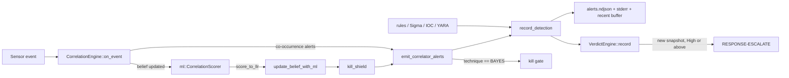
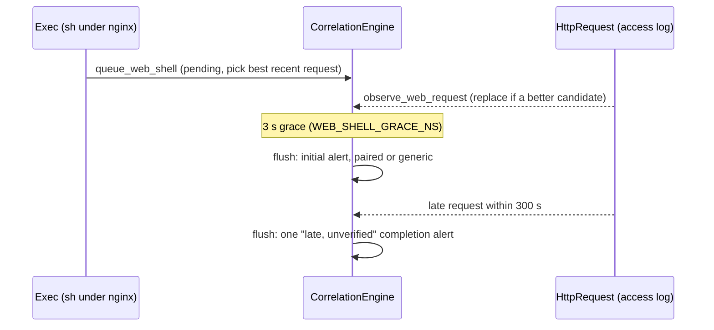

# Correlation and verdicts

How the agent turns single events and single-engine findings into multi-event
alerts, a per-entity compromise belief, and one fused verdict per entity. This page
covers the `correlator` crate, the `verdict` crate, and the glue in the agent's
detection sink that connects them. What the agent *does* with the result (kill,
quarantine, escalate) is on [Response](response.md).

## Where correlation sits in the pipeline

Every normalized event reaches [`DetectionSink::on_event`](../agent/src/sink/mod.rs) on
the sensor's capture thread. The first thing it does is call
[`DetectionSink::correlate`](../agent/src/sink/mod.rs); the stateless and stateful rules,
Sigma, IOC matching and the canary checks run afterwards. Every finding from every
engine then goes through one funnel, [`record_detection`](../agent/src/sink/mod.rs), which
writes the alert log and folds the finding into the fused verdict.

Two outputs of the correlator matter downstream:

- **Co-occurrence alerts** ([`CorrelationAlert`](../crates/correlator/src/rules.rs)):
  named multi-event patterns such as "spawned, connected out and wrote a payload
  within the window".
- **The `BAYES` alert**: raised once when an entity's belief crosses the threshold.
  It is the only alert that can make a process eligible for an automated kill
  ([`crosses_kill_gate`](../agent/src/sink/mod.rs)).

## The event bus: the correlator's short-term memory

[`EventBus`](../crates/correlator/src/bus.rs) is a `VecDeque` of recent events,
evicted by time. The engine uses a 60 s window
([`CorrelationEngine::new`](../crates/correlator/src/engine.rs)).

- **Which events enter.** Only the variants
  [`is_correlated`](../crates/correlator/src/event.rs) accepts: `Exec`, `Connect`,
  `FileOpen`, `DnsQuery`, `AssemblyLoad`, `SmbConnect`, `UdpSend`, `NetworkFlow` and
  `HttpRequest`. Everything else only advances the web-shell clock (below) and
  returns. `NetworkFlow` is stored but no co-occurrence rule or feature reads it:
  beacon detection over polled flows lives in the `rules` crate, and folding it into
  the `Connect`-keyed rules here would double-alert when both a discrete connect and
  a polled flow see the same connection, or shift features the ML side is calibrated
  on. Adding a new variant to `is_correlated` means handling it in
  [`BehaviorVector::from_window`](../crates/correlator/src/behavior.rs) and in every
  exhaustive match of `rules.rs`.
- **Eviction cuts against the greatest timestamp ever seen**, not the last insert
  ([`EventBus::push`](../crates/correlator/src/bus.rs)). Sensors drain several ring
  buffers independently, so an older event delivered late must not move the cutoff
  back and resurrect history.
- **Process identity.** Lookups go through
  [`EventBus::events_for_pid`](../crates/correlator/src/bus.rs), which filters on pid
  *and* process incarnation (`process_generation`) with
  [`same_generation`](../crates/correlator/src/bus.rs): two known, different stamps
  are two processes; a missing stamp on either side cannot disprove identity (the
  behavior on platforms or paths that do not stamp). The same rule is applied by
  every pid-keyed map in the correlator, by the verdict engine, and by the
  ransomware join in the sink.
- **Bounds.** The bus is bounded by time only. A flood of correlated events inside
  one window grows it, and every per-pid lookup is a linear scan of it. The
  long-lived state next to it is count-bounded (see
  [Bounds and observability](#bounds-and-observability)).

## Co-occurrence rules

[`CorrelationEngine::evaluate`](../crates/correlator/src/engine.rs) runs the rules of
[`rules.rs`](../crates/correlator/src/rules.rs) for the pid of the current event,
over that pid's events in the window. Order inside the window is unconstrained unless
a rule says otherwise.

| Rule id | Technique | Pattern (same pid, same window unless noted) |
| --- | --- | --- |
| `spawn_connect_filewrite` | T1105/T1059/T1071 | exec + connect + payload write (full dropper chain) |
| `spawn_connect` | T1059/T1071 | exec + connect; suppressed when the full chain fires |
| `connect_filewrite` | T1105 | connect + write of a payload-looking file (executable/script extension or temp path) |
| `respawn_connect` | T1059/T1071 | at least `RESPAWN_THRESHOLD` (3) execs of one `(ppid, comm)` plus connects: correlated by `(ppid, comm)`, because a real respawn gets a new pid each time |
| `dns_exfil` | T1048.003/T1071.004 | at least 10 distinct leftmost labels longer than 30 characters with entropy above 3.5 bits/char under one parent domain |
| `assembly_smb` | T1021.002/T1055 | in-memory .NET assembly load + SMB connect |
| `assembly_connect` | T1055/T1620 | in-memory assembly load + connect; suppressed when `assembly_smb` fires |
| `exec_smb` | T1021.002 | exec + SMB connect; suppressed when `assembly_smb` fires |

Details that are easy to miss:

- **The network leg ignores sshd's address-selection probe** (a `connect()` to
  `0.0.0.0:65535` or `[::]:65535`), using the same predicate as the beacon rule,
  [`policy::is_address_selection_probe`](../crates/policy/src/lib.rs). Without it every
  SSH login raised `spawn_connect`, and a few logins raised `respawn_connect`. Only
  that exact port is excluded: a connect to the unspecified address on any other port
  reaches the local host on Linux and still counts. The behavior-vector features are
  deliberately *not* filtered, so the ML calibration does not shift.
- **DNS parent-domain grouping is "last two labels"**. It over-groups under
  multi-label public suffixes (`co.uk`), which can only make the rule fire less, never
  produce a false positive.
- **Once per window per rule and pid.** A satisfied pattern stays satisfied for every
  later event in the window, so each `(rule_id, pid)` is remembered in the `fired` map
  with the time it last alerted and the pid's incarnation. It alerts again only after
  a full window has passed or for a new incarnation. The key is the rule id, not the
  technique, because `spawn_connect` and `respawn_connect` share a technique but are
  different findings.

### Excluded processes and the masquerade check

[`IGNORED`](../crates/correlator/src/engine.rs) is a list of noisy system process
names (svchost, WmiPrvSE, msedge, ...). Their events still enter the bus, so later
parent/child correlation can see them, but they skip the rules and the `BAYES` alert.
[`BAYES_NAME_EXCLUSIONS`](../crates/correlator/src/engine.rs) is narrower (`wget`,
`chronyd`): those keep the co-occurrence rules and only lose the `BAYES` alert, because
a single CLI download or an NTP resync already fires the "fast connect after exec" and
"external destination" features.

Both lists are name-keyed, which would be a trivial bypass. At the process's `Exec`,
the engine marks the pid as **masquerading** when the name is on either list and
either the image path is not a trusted system location
([`policy::name_exclusion_applies`](../crates/policy/src/lib.rs)) or the parent is not
the expected one
([`policy::parent_exclusion_applies`](../crates/policy/src/lib.rs)). A masquerading pid
(`/tmp/svchost.exe`, or svchost under `cmd.exe`) gets full evaluation. The mark is
stamped with the incarnation, so a recycled pid does not inherit it.

### Web request plus web-server shell (T1505.003)

An `HttpRequest` comes from a web access log
(the request matched a detection signature) and has pid 0, so it cannot join the
pid-keyed rules. The engine pairs it **by time** with a shell exec whose direct
parent is a web server ([`is_web_server_shell`](../crates/correlator/src/rules.rs):
`nginx`, `apache2`, `httpd`, `lighttpd`, `php-cgi`, and `php-fpm*` by prefix). Either
can arrive first: the log line is written when the request ends, after the shell it
caused. The engine returns before every pid-keyed step for an `HttpRequest`, so it
never creates a belief for a pid-0 pseudo-process.

- The shell is held in a bounded pending queue
  ([`CorrelationEngine::queue_web_shell`](../crates/correlator/src/engine.rs)) for
  `WEB_SHELL_GRACE_NS` (3 s). At the deadline it alerts once, naming the earliest
  matching request at or after the shell if one was read, or generically otherwise
  ([`rule_web_request_shell`](../crates/correlator/src/rules.rs)).
- A generic alert can get **one** late completion if a request arrives within
  `WEB_SHELL_LATE_REQUEST_NS` (300 s). The completion says it is unverified: on an
  Internet-facing site scanner requests matching a signature arrive constantly, and a
  longer window would mostly pair unrelated probes.
- Candidate choice is deterministic: [`web_request_key`](../crates/correlator/src/rules.rs)
  orders by timestamp, then path, status, method, signature and client, so the result
  does not depend on delivery order.
- The matched parameter's *value* never reaches the alert, only its name.
- **Clock.** The grace deadline runs on a watermark: the greatest event time seen,
  clamped to the host's wall clock
  ([`advance_web_shell_watermark`](../crates/correlator/src/engine.rs)), so an event
  stamped in the future cannot expire its own grace period. When the stream is idle,
  the sink's `correlator-tick` thread calls
  [`CorrelationEngine::advance_time`](../crates/correlator/src/engine.rs) every second
  ([`DetectionSink::start_correlator_ticker`](../agent/src/sink/mod.rs)). The thread holds
  only a `Weak` reference to the sink and releases the correlator lock before writing
  alerts.
- **Bounds.** At most 256 pending shells (`MAX_PENDING_WEB_SHELLS`; past that a shell
  alerts generically at once) and 512 recent requests (`MAX_RECENT_WEB_REQUESTS`).
  Each kind of loss is counted in
  [`WebShellShedding`](../crates/correlator/src/engine.rs):
  `pending_overflow`, `requests_evicted`, `late_window_expired`.

This is co-occurrence on one host, not proof of causality: a log line names no
process. The stateless `rules` alert on the shell itself still fires independently.

## The Bayesian belief

### Entity: `(ppid, comm)`, not pid

A belief ([`BeliefState`](../crates/correlator/src/bayes.rs)) is kept per logical
entity `(ppid, comm)`, so it survives respawns: `fork`+`exec` gives a new pid but the
same parent and name. The pid-to-entity mapping comes from `Exec` events
(`pid_entities`): on Windows the ETW sensor leaves `ppid` at 0 on connect events, so
this table is what lets a connect find its entity. When a pid was never seen
exec'ing, its entity falls back to `(pid, comm)`.

Each stored belief is stamped with the **parent's** incarnation. A recycled parent
pid that spawns a child with the same `comm` is a different entity, so a stored belief
with a different known stamp is replaced, not inherited
([`belief_or_insert`](../crates/correlator/src/engine.rs)). A belief created before any
stamp was seen adopts the first one that arrives, so a later, different one is
recognised. Pinned by
[`tests/parent_generation.rs`](../crates/correlator/src/tests/parent_generation.rs).

Because siblings share one belief, the evidence of every child of one parent with one
name accumulates together. The pid the `BAYES` alert names, and that the kill gate
acts on, is the one whose event made the shared belief cross.

### Features

[`BehaviorVector`](../crates/correlator/src/behavior.rs) is nine features computed
from the current pid's events in the window. It is a separate feature space from the
command-line vector the ML scorer uses; the two are never merged into one model.

| # | Feature | LLR (from [`log_likelihood_ratio`](../crates/correlator/src/bayes.rs)) |
| --- | --- | --- |
| 0 | `has_exec` | 0 (a data artifact: pids seeded without an exec in the window) |
| 1 | `has_connect` | +1.19 / -0.93 |
| 2 | `has_filewrite` | 0 (no empirical signal yet) |
| 3 | `time_exec_to_connect_ms` | +1.90 under 2 s, -0.22 above, -0.09 absent |
| 4 | `time_exec_to_filewrite_ms` | 0 |
| 5 | `is_suspicious_path` (AppData, `\Temp\`, Downloads, Desktop, `\Public\`) | +3.60 / -0.20 |
| 6 | `connect_count` | -0.96 (0), +0.41 (<5), +2.22 (<15), +0.87 (15+) |
| 7 | `distinct_dports` | +0.02 (<=1), -0.54 (<=3), 0 otherwise |
| 8 | `dest_is_external` | +1.23 / -0.44 |

`dest_is_external` treats RFC 1918, loopback and `0.0.0.0` as internal for IPv4,
and loopback, unspecified, link-local, unique-local and multicast as internal for
IPv6; every other address counts as external. The LLR table is calibrated offline
against labelled captures; the ML pipeline's calibration step regenerates the body of
`log_likelihood_ratio`, and the suspicious-path list mirrors the one in `crates/ml`.
Treat both as a parity seam.

### Update rule

On every correlated event for a pid that has events in the window,
[`update_belief`](../crates/correlator/src/bayes.rs) does, in order:

1. **Decay toward the prior.** With `dt` the event-time gap since the last update,
   `log_odds += (PRIOR - log_odds) * (1 - exp(-dt / 300 s))`. The prior is -4.6
   (about 1 %).
2. **Add the sum of the nine feature LLRs** for the pid's current vector (naive
   independence).
3. Record the update time.

The whole window's evidence is re-added on each event, damped only by the decay since
the previous one. A belief therefore grows with the *rate* of suspicious activity, not
only with which features are present, and benign events push it below the prior. There
is no clamp in either direction.

Two more terms can be added on top of an already-updated belief. Neither re-runs the
feature sum, which would count the same evidence twice:

- **ML score.** After `on_event`, the sink scores the pid with
  `ml::CorrelationScorer` over the same bus, converts the score with
  [`ml::score_to_llr`](../crates/ml/src/scorer/correlation.rs) (clamped to
  [-1.0, +3.0]: a behavior model exonerates more weakly than it accuses) and calls
  [`CorrelationEngine::update_belief_with_ml`](../crates/correlator/src/engine.rs),
  which adds it through [`apply_ml_llr`](../crates/correlator/src/bayes.rs). `None`
  (fewer than three events, a feature out of training bounds, a runtime error) means
  "no evidence", not "benign". The ML crate depends on the correlator for `EventBus`,
  so the correlator cannot call the scorer; the agent computes the term and injects it.
- **Fleet rarity.** When the enrichment worker learns an exec's hash and the fleet's
  common-set snapshot says the image is not common, it calls
  [`CorrelationEngine::apply_rarity_evidence`](../crates/correlator/src/engine.rs)
  ([`apply_rarity_evidence` caller in the sink](../agent/src/sink/mod.rs)). Each call adds
  `RARITY_LLR` (0.35) within a total allowance of `RARITY_MAX_TOTAL_LLR` (1.0) that
  decays with the belief ([`apply_rarity_llr`](../crates/correlator/src/bayes.rs)).
  Together with the prior this keeps rarity alone about 7 log-odds under the
  threshold: it can only tip a belief other evidence has already raised. The value is
  provisional. The evidence is withheld when no snapshot is loaded, the snapshot is
  past its maximum age, it covers fewer than 10 hosts, or the event carries no hash;
  `withheld`, `applied` and `unapplied` are counted in `RarityStats` for the health
  beacon. Pinned by [`tests/rarity.rs`](../crates/correlator/src/tests/rarity.rs).

### The `BAYES` alert

[`bayes_alert`](../crates/correlator/src/engine.rs) raises one `Critical` alert with
technique `BAYES` when `log_odds > 2.0` (about 88 %) and the entity has not alerted
yet. The flag resets when decay brings the belief back to 2.0 or below, so a later
crossing alerts again. The ML and rarity terms do not alert by themselves: the belief
is judged at the entity's next event.

## Kill shields: provenance recorded at exec

The correlator also records, at each `Exec`, facts the kill gate needs about what a
process *is*. Detection and belief never read them.

| Shield | Set when | Cleared when |
| --- | --- | --- |
| [`KillShield::ServiceMain`](../crates/correlator/src/engine.rs) | `ppid == 1` and the image passes [`policy::service_main_path_is_trusted`](../crates/policy/src/lib.rs) | any later exec of that pid that does not qualify |
| [`KillShield::LoginSession`](../crates/correlator/src/engine.rs) | the image/parent-image pair is `sshd-session` under `sshd`, or `sshd` under `sshd` (OpenSSH before 9.8 re-execs itself), both under trusted paths ([`policy::is_login_session`](../crates/policy/src/lib.rs)) | any later exec that does not qualify |

[`CorrelationEngine::kill_shield`](../crates/correlator/src/engine.rs) returns the
shield for a pid and incarnation. The rules behind it:

- **Provenance, not evidence.** A shield is about what the process is; no amount of
  corroboration lifts it.
- **Unknown is not trusted.** An exec with an empty image path, or a pid whose exec
  was never seen, has no shield.
- **Children are not shielded.** A shell spawned by a compromised daemon or inside an
  SSH session has a different parent and image, so it stays killable.
- **Re-exec clears.** A service main that later `execve`s `/tmp/x` loses the shield.
- `service_main_path_is_trusted` is stricter than the masquerade check: it rejects
  `/opt/` and `/usr/local/`, any `..` component, and shells, interpreters and
  script runners (by exact name or by family plus version suffix), because otherwise
  every payload run through `/usr/bin/python3` from a unit would be immune. A daemon
  whose own image is an interpreter (firewalld, tuned) therefore stays killable.
- It is a path-and-parent heuristic, not package verification. A binary replaced
  under `/usr/sbin` by root is not caught by it, and a unit that runs a non-listed
  tool from a trusted path (`socat`, `ncat`) gets the shield.
- `ppid == 1` excludes user services, containerised processes, and daemons under
  non-systemd init that are not direct children of pid 1. Those stay killable.
- The login-session parent is identified by its image (`parent_image_path`, which the
  sensor resolves from `/proc` for processes that predate the agent), not by having
  seen it start.

**Known gap:** the service-main shield is filled only from exec events the correlator
sees. A daemon started before the agent never gets one, so on a typical host most
services are not shielded
([#52](https://github.com/synthaea-lab/agent/issues/52)).

## Verdict fusion

[`VerdictEngine`](../crates/verdict/src/lib.rs) turns "N engines each raising a hand"
into one verdict per entity. The sink owns one behind `Arc<Mutex<_>>`, constructed
with a 30 s dedup window (`VERDICT_DEDUP_WINDOW_NS` in
[`sink/mod.rs`](../agent/src/sink/mod.rs)).

- **Key.** [`EntityKey`](../crates/verdict/src/lib.rs) is `(ppid, comm)` plus the
  parent incarnation, built by [`entity_key`](../agent/src/sink/mod.rs) from the event's
  metadata: the correlator's join key, so a verdict and a belief describe the same
  entity. Same stamp rule as everywhere else: a recycled parent pid drops the old
  state.
- **Inputs.** Real [`Detection`](../crates/schema/src/detection.rs) values: rule,
  Sigma, IOC and correlator findings from `record_detection`, YARA file matches keyed
  to the writing process through the scan context
  ([`fuse_yara_match`](../agent/src/sink/mod.rs)), and memory-scan matches
  ([`report_memory_matches`](../agent/src/sink/mod.rs)). Each finding is redacted before
  it enters the verdict, the alert log and the detection spool.
- **Composition.** Severity is the max over everything recorded for the entity; score
  is the max over sources that carried one (no weighted blend until there is
  calibration for it). Techniques and sources are kept as ordered, distinct lists.
- **Dedup.** [`VerdictEngine::record`](../crates/verdict/src/lib.rs) returns `None`
  (absorbed) when the technique is already recorded for the entity inside the dedup
  window and the finding raises neither severity nor score. The window is measured
  from the *first* sighting that opened it, and duplicates do not slide it, so steady
  recurring activity still yields a fresh verdict at least once per window. It returns
  `Some(snapshot)` on a first sighting, a severity or score raise, or a recurrence
  after the window.
- **Evidence** is bounded to the last 16 detections per entity (`EVIDENCE_CAP`).
  Fusion is a live-triage view; the alert log is the audit trail and gets every
  finding, absorbed or not.
- **Suppression.** An operator can mark `(entity, technique)` with `cli suppress
  <ppid> <comm> <technique>` (IPC to
  [`DetectionSink::suppress_verdict`](../agent/src/sink/mod.rs)); matching findings are
  dropped from fusion, and so from escalation, but still logged. Marks made from the
  CLI carry no parent stamp and so cover every incarnation; marks have no expiry, are
  bounded by [`MAX_SUPPRESSIONS`](../crates/verdict/src/lib.rs) (1024, `Full` past
  that), and are lifted with `unsuppress`. They are runtime state: a restart clears
  them.
- **Escalation** is the only consumer that acts on a snapshot: see
  [Response: escalation](response.md#escalation).

The fused severity is deliberately **not** what gates a kill. It is a sticky max over
everything an entity ever did, and gating on it would let one sibling's crossing
condemn every later, unrelated sibling with the same parent and name. The kill gate
reads only whether the alert raised by *this* event is `BAYES`; see
[Response: the kill gate](response.md#the-kill-gate).

## Concurrency

- The engine is `Arc<Mutex<CorrelationEngine>>` inside the sink. `correlate` holds it
  for `on_event`, the ML scoring (inference reads the bus under the same lock; it is
  fast and the capture thread is single-threaded) and the shield lookup, then drops it
  before writing alerts or touching the kill gate.
- Other lockers: the `correlator-tick` thread (`advance_time`) and the enrichment
  worker (`apply_rarity_evidence`). None holds it across I/O.
- The verdict engine is `Mutex`-guarded and shared by the capture thread, the
  enrichment worker (signature-gated findings), the YARA file worker and the memory
  scanner. A finding the worker records late keys on its own event timestamp; the
  dedup check saturates, so a late arrival can at most be absorbed as a duplicate.
- All locks use `lock().unwrap()`. A panic while one is held poisons it and turns the
  next event into a panic; the progress heartbeat then stops and the watchdog's hang
  detection restarts the agent ([Self-protection](self-protection.md#liveness-and-hang-detection)).

## Bounds and observability

| State | Bound | Overflow behavior |
| --- | --- | --- |
| `EventBus` | 60 s of events | time-evicted only; no count cap |
| beliefs | 16 384 (`BELIEF_CAP`) | LRU eviction (`store::BoundedMap`), counted |
| `pid_entities`, `masquerading`, `service_mains`, `login_sessions` | 65 536 (`ENTITY_CAP`) | LRU eviction, counted |
| `fired` (alert dedup) | 16 384 | LRU eviction: at worst one repeated alert |
| pending web shells | 256 | generic alert at once, `pending_overflow` |
| recent web requests | 512 | oldest dropped, `requests_evicted` |
| verdict entities | 16 384 | LRU eviction |
| evidence per verdict entity | 16 | oldest dropped |
| suppressions | 1024 | refused (`SuppressOutcome::Full`) |

[`BoundedMap`](../crates/store/src/bounded.rs) counts its evictions. An evicted belief
restarts at the prior; an evicted shield entry means the pid is no longer shielded,
which is the safe direction for detection and the unsafe one for the kill gate.

## Platform differences

The correlator and verdict engine are platform-neutral and run on every OS the agent
runs on. What differs is the telemetry:

- **Windows (ETW):** `ppid` is 0 on connect events, so `pid_entities` is load-bearing;
  `AssemblyLoad`, `SmbConnect` and DNS-client events feed the .NET, SMB and DNS rules.
- **Linux (eBPF):** `ppid` is set on every event and `process_generation` stamps are
  present, so incarnation checks are effective. The kill shields assume the sensor
  reports the real parent, which the eBPF sensor does.
- Events without generation stamps fall back to pid-only identity everywhere.

## Configuration

There are no runtime knobs for the correlator: the window, thresholds, LLR table,
exclusion lists and caps are compile-time constants listed above. What changes
behavior at runtime is content: the ML model (`<state_dir>/ml/registry/...`, loaded by
[`DetectionSink`](../agent/src/sink/mod.rs); without it the hand-calibrated features still
work) and the common-set snapshot (`<content_root>/snapshots/common-set.bin`).

## Testing

- Rules, windows, dedup, masquerade, sshd probe:
  [`tests/rules.rs`](../crates/correlator/src/tests/rules.rs).
- Behavior vector, belief updates, service-main and login-session shields:
  [`tests/behavior.rs`](../crates/correlator/src/tests/behavior.rs).
- Web-shell pairing, ordering, bounds, clock watermark (including a property test on
  delivery order): [`tests/web.rs`](../crates/correlator/src/tests/web.rs).
- Parent incarnation: [`tests/parent_generation.rs`](../crates/correlator/src/tests/parent_generation.rs).
- Rarity: [`tests/rarity.rs`](../crates/correlator/src/tests/rarity.rs).
- Fusion, dedup window, suppression, incarnations, evidence bound: unit tests in
  [`verdict/src/lib.rs`](../crates/verdict/src/lib.rs).
- End to end through the sink (escalation, the kill gate reading only `BAYES`, siblings):
  tests in [`agent/src/sink/tests.rs`](../agent/src/sink/tests.rs), for example
  `a_siblings_weak_alert_never_triggers_kill_from_anothers_bayes_crossing` and
  `a_critical_sigma_hit_never_triggers_a_kill`.
