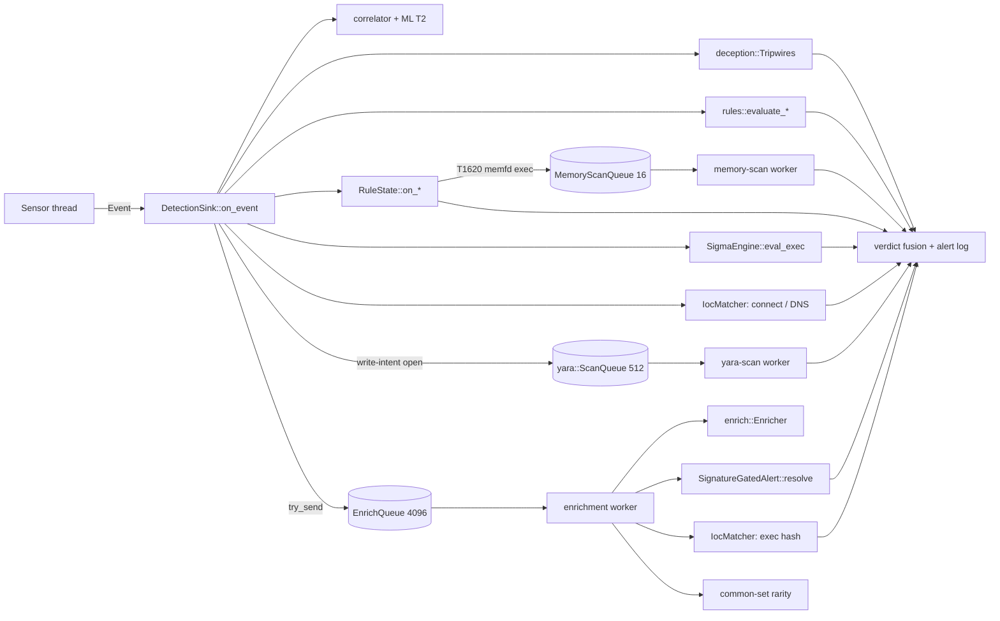

# Detection engines

The agent judges every event on the endpoint, with no help from the network. Seven crates do
the judging. Each one handles a different kind of evidence, and the agent's detection sink
connects them:

| Crate | What it judges | Runs on | Page |
| --- | --- | --- | --- |
| [`rules`](../../crates/rules/src/lib.rs) | Hard-coded ATT&CK detections: one event at a time (stateless) or a bounded history (stateful, [`RuleState`](../../crates/rules/src/state.rs)) | capture thread | [rules.md](rules.md) |
| [`sigma`](../../crates/sigma/src/lib.rs) | Sigma `process_creation` rules shipped as content | capture thread | [sigma.md](sigma.md) |
| [`yara`](../../crates/yara/src/lib.rs) | YARA-X rules over written files and, on Linux, process memory | its own worker threads | [yara.md](yara.md) |
| [`intel`](../../crates/intel/src/lib.rs) | Atomic indicators (SHA-256, IP, domain) | capture thread and enrichment worker | [ioc.md](ioc.md) |
| [`enrich`](../../crates/enrich/src/lib.rs) | Not a detector: SHA-256, code signature and PE version strings of executed images | enrichment worker | [enrichment.md](enrichment.md) |
| [`ml`](../../crates/ml/src/lib.rs) | ONNX Isolation Forests over feature vectors, with attribution | capture thread (T2) | [ml.md](ml.md) |
| [`deception`](../../crates/deception/src/lib.rs) | Canary files planted per install; any touch is a detection | capture thread | [deception.md](deception.md) |

The correlator and verdict fusion consume what these engines produce. They are documented
separately; this section stops at the point where a finding leaves an engine.

## Data flow

Every sensor hands events to one `EventSink`, the agent's
[`DetectionSink`](../../agent/src/sink/mod.rs). `DetectionSink::on_event` runs synchronously on the
thread that delivered the event (on Linux, the thread that drains the eBPF ring buffer). Only
in-memory work may run there. Anything that reads files or runs a crypto check goes behind a
bounded queue.

What `on_event` does, in order (see [`DetectionSink::on_event`](../../agent/src/sink/mod.rs)):

1. **Correlate.** The event goes to the correlator. If an ML correlation scorer is loaded, it
   scores the pid's window and the score is added to the belief state
   ([ml.md](ml.md#t2-in-the-agent)).
2. **Canary check.** Held canary touches are expired against this event's clock, then the event
   is matched against the planted canaries ([deception.md](deception.md#detection-path)).
3. **Per-type dispatch.** A `match` on the event variant calls the stateless dispatchers
   (`rules::evaluate_exec`, `evaluate_connect`, ...) and the matching `RuleState::on_*` method.
   For an `Exec` it also runs Sigma. For a write-intent `FileOpen` it queues a YARA scan. For a
   `Connect`, `NetworkFlow` or `DnsQuery` it runs the IOC check.
4. **Hand-off.** The event goes to the enrichment worker with a non-blocking send. For an
   `Exec`, the signature-gated finding of `RuleState::on_exec_signature_gated` travels with it.
   When the queue is full, the gated finding is raised at once as "not verified" instead of
   being lost.
5. **Progress.** A counter is bumped last. The watchdog's heartbeat samples it, so a hang
   anywhere above (a poisoned lock, a stuck engine) shows up as a stall.

## Shared conventions

These hold across the engines. When a rule's comment points here, this is the section it means.

### Findings

- The rules produce [`rules::Alert`](../../crates/rules/src/lib.rs): an ATT&CK technique, a
  [`Severity`](../../crates/schema/src/detection.rs) (Low, Medium, High, Critical) and a
  message. Severity ranks and fuses findings. It never gates a destructive action on its own.
- Sigma produces `SigmaAlert`, YARA produces `YaraMatch` and the IOC matcher produces
  `IocHit`. The sink turns each one into a `schema::detection::Detection` with a
  `DetectionSource` that names the engine, and records it through `record_and_emit`. That
  writes the alert log (the audit trail: every finding, duplicates included) and folds the
  finding into verdict fusion.
- Every finding is keyed to the entity `(ppid, comm)`, plus the parent's incarnation when the
  sensor stamps one ([`entity_key`](../../agent/src/sink/mod.rs)). Engines that work off the capture
  thread (YARA, memory scans) carry this identity with the request
  ([`yara::ScanContext`](../../crates/yara/src/queue.rs)). A late match then joins the same
  entity, stamped with the triggering event's time.

### Process incarnations

The kernel recycles pids, and the schema has no exit event. A cache keyed on the pid alone
would give a new process the facts of the one that held the number before it. Sensors stamp
each event with `process_generation` (the incarnation, set at fork) and
`parent_process_generation`. Every per-pid table in the engines compares that stamp:

- [`PidFact`](../../crates/rules/src/state.rs) in `rules` misses when the recorded generation
  and the wanted one differ. `None` on either side means "cannot tell" and counts as a match.
  That covers entries seeded at startup and platforms with no stamp (macOS).
- The memory-scan cooldown is keyed on `(pid, generation)`
  ([memory.rs](../../crates/yara/src/memory.rs)).
- The ML extractors read events through `EventBus::events_for_pid(pid, generation)`.
- The canary cooldown and the hold for a late exec key on `(canary, pid, generation)`.

### Bounded memory, counted loss

The agent runs for months on hosts an attacker controls. Every table and queue in this section
has a hard cap. Reaching the cap sheds work, and the shedding is counted, never silent:

| Structure | Bound | On overflow |
| --- | --- | --- |
| `RuleState` per-pid tables | 65,536 entries ([`PID_COMM_CAP`](../../crates/rules/src/state.rs)) | LRU eviction of the oldest eighth |
| `RuleState` counters | 16,384 keys ([`COUNTER_CAP`](../../crates/rules/src/state.rs)) | same |
| Sliding counter timestamps | 256 per key ([sliding.rs](../../crates/rules/src/sliding.rs)) | oldest dropped |
| YARA file queue | 512 requests ([queue.rs](../../crates/yara/src/queue.rs)) | dropped, `ScanStats::dropped` |
| YARA memory queue | 16 requests, 6 scans/min, 5 min per process | dropped, counted by reason |
| Enrichment queue | 4,096 events ([enrich_queue.rs](../../agent/src/enrich_queue.rs)) | event not enriched, gated finding raised unverified |
| Enrichment cache | 16,384 files ([lib.rs](../../crates/enrich/src/lib.rs)) | LRU |
| IOC set | 64 MiB budget ([set.rs](../../crates/intel/src/set.rs)) | the whole set is refused |
| IOC cooldown | 4,096 indicators ([ioc.rs](../../agent/src/ioc.rs)) | LRU |
| Canary hold | 256 touches ([sink/mod.rs](../../agent/src/sink/mod.rs)) | judged at once, counted |

[`store::BoundedMap`](../../crates/store/src/bounded.rs) is the LRU used throughout. It is a
`HashMap` with a use counter. Past the cap it evicts the least recently used eighth in one
batch, which keeps inserts amortized O(1). `get` refreshes recency and `peek` does not.

### Content loading and reload

Sigma rules, YARA rules, IOC feeds and the common-set snapshot are content under
`<content_root>/`. They are loaded at startup and again on `reload_content` (IPC
`ReloadContent`). Each loader returns `Load::Loaded`, `Load::Absent` or `Load::Failed`:

| Outcome | Effect on the running engine |
| --- | --- |
| Loaded | swapped in |
| Absent (directory or file missing) | engine unloaded, which is not an error |
| Failed (content present but broken) | **previous engine kept**, error logged |

[`DetectionSink::reload_content`](../../agent/src/sink/mod.rs) parses and compiles everything
before it takes any lock, and holds each lock only for the swap. The capture thread takes the
same locks for every exec and write-open, so loading under them would stall capture. The
replaced engines are dropped after the locks are released, because dropping a `ScanQueue`
joins its worker thread.

ML models are not reloaded. The correlation scorer is loaded once at construction
([ml.md](ml.md#loading-and-degraded-mode)).

### Platform matrix

| Engine | Linux | Windows | macOS |
| --- | --- | --- | --- |
| rules (stateless + stateful) | yes | yes | yes (fewer event sources) |
| Sigma | `linux/` | `windows/` | `macos/` + `linux/` |
| YARA file scan | yes, with per-user read check | yes, no uid check | yes, with per-user read check |
| YARA memory scan | yes | no | no |
| IOC (hash, IP, domain) | yes | yes | yes |
| Signature verdict | always `Unsupported` | Authenticode + catalog | `codesign` (chain not verified) |
| PE version strings | no | yes | no |
| ML T2 scorer | when a model is present | when a model is present | when a model is present |
| Canary files | yes | yes (default metadata) | yes |

## Testing approach

- **Unit tests** live next to each engine. The `rules` crate keeps one file per rule family
  under [`crates/rules/src/tests/`](../../crates/rules/src/tests/mod.rs), and a few rules also
  have proptest suites ([`rdp.rs`](../../crates/rules/src/rdp.rs),
  [`sudo.rs`](../../crates/rules/src/sudo.rs)).
- **Sink-level tests** in [`agent/src/sink/tests.rs`](../../agent/src/sink/tests.rs) drive real events
  through `DetectionSink::on_event` and assert on `alerts.ndjson`. They cover the routing,
  redaction, canary hold and cooldown, YARA quarantine and reload.
- **Contract tests** against the sibling public repos (`rules`, `ml`, `server`) read their
  half through the [`siblings`](../../crates/siblings/src/lib.rs) crate. Without the sibling
  checkout they print `skipped:` and pass. With `SYNTHAEA_REQUIRE_SIBLINGS=1` (set in CI) a
  missing sibling fails the test, so a contract test cannot pass by not running.
