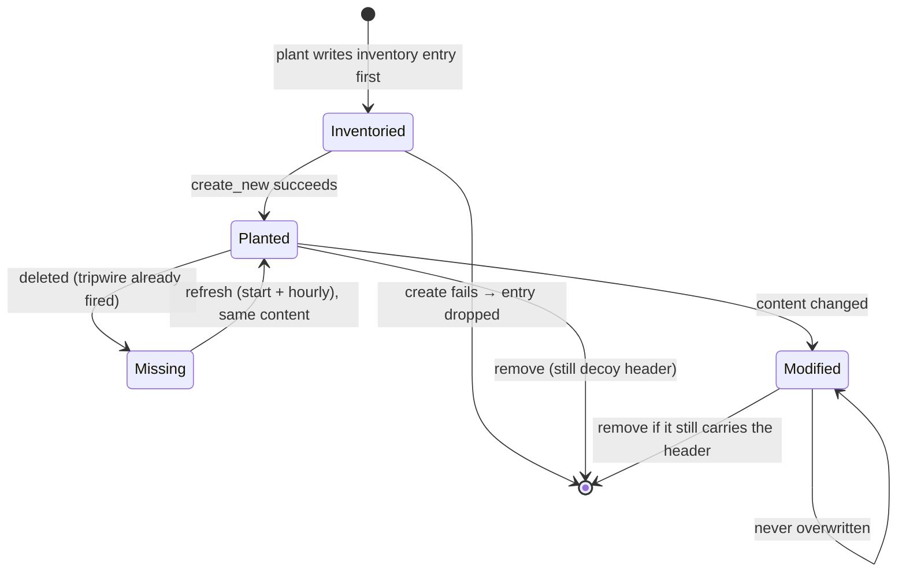

# Deception (`deception`)

The agent can plant **canary files**: decoys that nothing legitimate reads. A touch by any other
process is a High detection. Canaries need no baseline and almost never produce false
positives, which makes them good at catching the post-compromise reconnaissance that
behavioural rules can miss. Some canaries also carry a **decoy credential**. The control plane
recognises it if it is ever presented, anywhere in the fleet.

The work is split in two:

- [`crates/deception`](../../crates/deception/src/lib.rs) holds the pure parts: the plan
  ([`plan.rs`](../../crates/deception/src/plan.rs)), the lifecycle with its on-disk inventory
  ([`lifecycle.rs`](../../crates/deception/src/lifecycle.rs)) and event matching
  ([`tripwire.rs`](../../crates/deception/src/tripwire.rs)). It does I/O only in `plant`,
  `verify`, `refresh` and `remove`, and has no platform branches.
- The agent holds the wiring: seed storage, planting at start, the hourly refresh, metadata
  matching, the allow list and decoy registration
  ([`apps/agent/src/deception.rs`](../../apps/agent/src/deception.rs)), and the detection path in
  [`DetectionSink`](../../apps/agent/src/sink/mod.rs).

## Configuration

```toml
[deception]
canary_dirs = ["/srv/share", "/var/www/uploads"]          # absolute, existing, at most 16
allow_exe   = ["/usr/libexec/plocate/updatedb.plocate"]   # at most 32
```

| Key | Default | Meaning |
| --- | --- | --- |
| `canary_dirs` | empty (feature off) | each directory gets one canary per kind; the agent never creates or removes a directory |
| `allow_exe` | empty | executables whose touches are not a detection, matched on the resolved executable path, never the process name; each entry must be in a trusted system location |

[`DeceptionConfig`](../../crates/config/src/schema.rs), with the limits `MAX_CANARY_DIRS` and
`MAX_CANARY_ALLOW_EXES`. Removing the table (or emptying `canary_dirs`) and restarting removes
every planted canary and the inventory. The seed file stays.

## The plan

[`plan(seed, placements)`](../../crates/deception/src/plan.rs) is pure and deterministic in the
install's 32-byte [`Seed`](../../crates/deception/src/plan.rs). The same seed and directories
always give the same files, and a different seed gives different names and contents. A list of
decoys learned on one host therefore does not describe another.

- **Seed.** `<state_dir>/deception/seed`, generated once with `getrandom` and written with
  mode `0600` (`load_or_create_seed`). A seed of the wrong length is an error and is never
  regenerated: new names would orphan the canaries already planted.
- **Kinds.** `Credentials`, `Finance`, `Config`, `Notes`, one canary of each per directory.
- **Names.** The stem (from a public vocabulary of real-looking words), the template,
  separator, qualifier, extension, and the way a 32-bit token is written all derive from the
  seed. No single pattern matches every canary of every install. An attacker can still skip
  every file whose name contains such a word, but that costs them the real files they are
  after. That is the limit of the claim.
- **Content.** The first line is [`DECOY_HEADER`](../../crates/deception/src/plan.rs), which
  says the file is a machine-generated, inert decoy. Seed-derived rows that look like the kind
  follow. `Credentials` and `Config` canaries also carry a decoy token:
  [`DECOY_TOKEN_PREFIX`](../../crates/deception/src/plan.rs) (`syn_dk_`) followed by 32 hex
  digits, unique per install and per canary. The token opens nothing.

## Lifecycle



- **`plant`** writes each canary into the inventory **before** creating the file, and drops the
  entry if creation fails. A crash in between leaves an inventoried path with no file (harmless
  to `remove`), never a file the inventory does not know. Files are created with `create_new`,
  so an existing file is never overwritten and a symlink placed at the path is never followed.
  Planting again is idempotent. Each skip is reported with a reason: `NoDirectory`, `Occupied`
  (someone else's file) or `Missing` (this install's canary was deleted).
- **Modification times** are seed-derived and distinct within a directory. When the
  neighbouring regular files span a wide enough range of mtimes, the canaries are placed inside
  that range. Otherwise each gets a different time between 1 and 365 days in the past
  (`planned_mtimes`).
- **Owner and mode (Unix, agent side).** When it has permission, the agent copies the majority
  owner, group and permission bits of the regular files next to each canary. It logs once per
  directory which fields it could not match. It always keeps owner-read, so that it can verify
  the canary. Windows keeps the platform defaults.
- **`refresh`** puts back a canary that is gone, with the content it had, at start and every
  hour (`REFRESH_INTERVAL`). It never touches a modified or replaced file. Restoring hides
  nothing, because the deletion already raised a detection.
- **`verify`** compares the inventory with the disk and reports `Drift` (`Missing`,
  `NotARegularFile`, `Modified`). A drift is a fact to report, not an alert. The tripwire says
  who touched the file.
- **`remove`** deletes every inventoried canary that is unchanged or still carries the decoy
  header. Content replaced by something else is someone's data: it is left in place and
  reported as `foreign`. A path that is no longer a regular file is refused. The inventory is
  deleted only when nothing was refused. Each file is judged from one open descriptor and the
  path is checked again afterwards. That narrows a swap-in-progress race without closing it
  (closing it needs `O_NOFOLLOW` and an inode check, which would mean a platform branch).

## Decoy credentials

After planting, the agent reads the decoy tokens back **from the files on disk**
(`start_with_decoys`). It does not take them from the plan, because a canary planted by an
earlier build keeps its old content. It sends only their SHA-256 hashes to the control plane, in
a detached `decoy-register` thread (`register_decoys_in_background`), so startup and shutdown
never wait on it. A token never leaves the host.

Registration retries on a fixed schedule (5 s, 15 s, 1 min, 5 min, 15 min, 30 min, then
hourly; 12 attempts, about half a day), because a control plane that is down at boot is the
ordinary case. A response that cannot change on retry (400, 409, 413, 422, or a serialization
or configuration error) stops it at once. Everything else is retried, including 401, 403, 408
and 429 from a proxy. If canaries exist but none holds a token (planted by an older build), the
agent warns that a stolen decoy will not raise an alarm for this host.

## Detection path

[`DetectionSink::detect_canary`](../../apps/agent/src/sink/mod.rs) runs on every event, before the
per-type dispatch.

1. [`Tripwires::matches`](../../crates/deception/src/tripwire.rs) looks the event up: a
   `FileOpen` (with its flags), a `FileDelete`, or a `FileRename` from or onto a canary path.
   Keys are case-folded with separators unified, on every platform. A relative path (the Linux
   sensor reports `openat` names as the caller passed them, so `cd dir && cat name` arrives as
   a bare name) falls back to a match on the file name. Canary names end in random hex, so a
   name match is nearly collision-free. A name shared by two canaries matches neither. A
   `FileWrite` names a descriptor, not a path, so a write shows up as the open before it.
2. Touches by the agent's own pid are ignored (it plants and verifies the canaries).
3. The allow list decides (`canary_verdict`): **Allowed** (dropped), **Raise**, or **Unknown**
   (held, see below).
4. `raise_canary` records a `DetectionSource::Rule { rule_id: "DECEPTION-CANARY" }` detection
   with technique `T1083` and severity High.

### Allow list

[`CanaryAllow`](../../apps/agent/src/deception.rs) allows a process only if its executable is listed
and the process is in the agent's mount namespace and not in a container. Entries outside a
trusted system location ([`policy::name_exclusion_applies`](../../crates/policy/src/lib.rs))
are dropped with a warning. Entries are canonicalised at start, so a listed symlink is compared
as its target. The path as written is also matched, but only if it is itself trusted, so a
user-writable link to a listed binary does not pass.

The image comes first from the agent's own record of the process's last `Exec` at or before the
touch ([`ExecImages`](../../apps/agent/src/deception.rs), 8,192 processes, keyed by incarnation).
That avoids a `/proc` read, which needs ptrace access for another user's process. If `/proc`
shows the process now running a different image, the record is stale and the touch is not
allowed. The exec table is filled only when `allow_exe` is non-empty.

### Holding a touch for its exec

The sensor stamps an `exec` before the opens that follow it, but the merged stream can deliver
the open first. A cron-started `tar` was seen about 80 events before its own exec, and had
already exited, so `/proc` said nothing. With a non-empty allow list, a touch whose process the
agent does not know and whose `/proc` entry names no executable is **held** for up to 500 ms of
event time (`CANARY_EXEC_HOLD_NS`):

- Only an `Exec` of the same incarnation (a generation stamp is required) at or before the
  touch's own time can excuse it. When there are several, the latest wins (`bash -c "tar ..."`
  is judged as `tar`). An allowed exec after the touch does not count.
- The hold ends on the clock of the file and exec stream only. DNS, conntrack and log threads
  have their own clocks and must not end it early.
- When the hold ends, the touch is judged on what is known. Anything not allowed is raised
  (late) and counted.
- At most 256 touches are held (`MAX_HELD_CANARY_TOUCHES`). Past that a touch is judged at once
  and the overflow is counted. A flood must not grow memory, and must not delay findings
  either.
- An empty allow list, a container or a foreign mount namespace raises at once: no image could
  excuse the touch.

### Cooldown

A process re-reading one canary raises one detection per 60 s (`CANARY_COOLDOWN_NS`), keyed on
`(canary, pid, generation)` with 1,024 keys remembered. **Only read opens are absorbed**
(`absorbable`). A delete, a rename or a write-intent open is the destructive touch an encryptor
makes after reading, and it always raises.

### Ransomware reflex

Every canary touch is also reported to the ransomware join. When the same process incarnation
has also triggered the T1486 burst rule, the agent may kill it: this reflex needs both signals,
and neither severity nor a Bayesian score triggers it on its own. A touch judged late, after a
hold, never kills, because its pid may already belong to another process.

## Limits

| Limit | Consequence |
| --- | --- |
| The Linux sensor drops read-only opens under `/tmp`, `/var/tmp`, `/dev/shm`, `/dev`, `/sys`, `/proc` | a canary there fires on delete, rename and write, not on a read; the agent warns at start (`read_blind_dirs`) |
| Ring-buffer overflow under heavy open load | touches can be missed (measured: 9 of 20 caught under a synthetic flood, 20 of 20 on a quiet host), and these drops are not in the health beacon |
| Packaged Linux unit (`ProtectSystem=strict`) | a canary directory must be in `ReadWritePaths` and writable by the agent user, or planting fails for that directory only |
| A pid reused within the 500 ms hold by an allowed image | could excuse a held touch with no image (narrow) |
| Honeypot listeners | not built |

## Testing

- [`plan.rs`](../../crates/deception/src/plan.rs) tests: determinism per seed, distinct names
  across seeds, header, token shape and `decoy_tokens`.
- [`lifecycle.rs`](../../crates/deception/src/lifecycle.rs) tests: inventory-first planting,
  never overwriting, refresh restoring only missing canaries, `remove` sparing foreign content,
  mtime placement.
- [`tripwire.rs`](../../crates/deception/src/tripwire.rs) tests: exact, case-folded and
  relative-name matches, ambiguous names, rename in both directions.
- [`apps/agent/src/deception.rs`](../../apps/agent/src/deception.rs) tests: seed handling, the allow-list
  rules, the registration retry schedule.
- Sink tests in [`sink/tests.rs`](../../apps/agent/src/sink/tests.rs) (`another_process_opening_a_canary_raises_a_deception_detection`
  and the `held` and cooldown families) drive real events through `on_event`.
