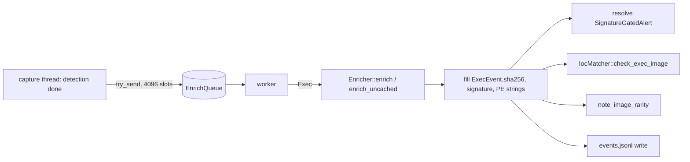

# Enrichment (`enrich`)

The [`enrich`](../../crates/enrich/src/lib.rs) crate does not detect anything. It answers three
questions about an executed image that other engines need:

- its **SHA-256**, used by IOC hash matching, the fleet common-set rarity check and the
  control plane's cross-host joins;
- its **code-signature verdict**, used by the signature-gated rules;
- its **PE version strings** (Windows), used by Sigma's `OriginalFileName`, `Company`,
  `Description` and `Product` fields.

There is one implementation for every platform, behind one cache.

## Where it runs

Hashing a file and verifying a signature read the file and run crypto. On a cache miss that
can take milliseconds, and misses come in clusters: a software rollout, first boot, an attacker
unpacking many payloads. Doing that on the capture thread would let the kernel buffer fill and
drop telemetry. So enrichment runs on a dedicated worker behind the
[`EnrichQueue`](../../agent/src/enrich_queue.rs):

No engine on the capture thread needs the hash or the signature. Rules, Sigma (except the PE
fields) and the correlator work on command lines, lineage, paths and ports. The one finding
that needs the signature travels with its event as a
[`SignatureGatedAlert`](../../crates/rules/src/signature_gate.rs)
([rules.md](rules.md#signature-gated-findings)).

**Overflow.** When the queue is full, the event is not enriched or logged by the worker, and
the drop is counted (`EnrichQueue::dropped`). A gated finding riding with it comes back to the
caller and is raised as "not verified". Overload can cost an enriched record, never a
detection and never capture time. Detections are also persisted through this worker, and a
full queue falls back to a direct append.

**Shutdown.** `EnrichQueue::flush(timeout)` sends a marker and waits, up to the timeout, for
everything queued before it. The kill-loudness exit path uses it so that an event captured in
the same instant as a termination signal still reaches `events.jsonl`. The wait is bounded,
because that path must not let a wedged process outlast the signal.

**Known gap: Sigma runs before the PE strings exist.** Sigma evaluates an `Exec` on the
capture thread, in `DetectionSink::detect_exec`. The PE strings are written into the
`ExecEvent` later, by this worker (in
[`enrich_queue.rs`](../../agent/src/enrich_queue.rs)), and no sensor fills them itself. So in
the running agent, a `windows/` Sigma rule that relies on `OriginalFileName`, `Company`,
`Description` or `Product` sees the field as absent and does not match. The engine handles
these fields correctly when they are present, and the unit and content tests use events that
carry them. What is missing is a Sigma pass after enrichment
([sigma.md](sigma.md#fields)).

## The cache

[`Enricher`](../../crates/enrich/src/lib.rs) owns a `BoundedMap<PathBuf, CacheEntry>` of 16,384
entries. Pids churn but images repeat, so most execs hit the cache.

A hit requires the same path, mtime, size **and file identity**:

| Platform | Identity |
| --- | --- |
| Unix | `(st_dev, st_ino)` |
| Windows | `(volume serial, 128-bit file id)` from the open handle |
| other | none: the entry is never trusted |

mtime and size alone are not enough, because an attacker can set both (`touch -r`,
`SetFileTime`). Swapping the underlying file always changes its identity.

### One handle, one file

`Enricher::enrich_with` opens the file **once**. The metadata, the identity, the signature and
the hash all come from that handle. Whatever happens to the path after the open (a rename, a
replacement), the verdict and the hash describe the same file object, and the cache key is that
object's identity. `FileEnrichment::file_id` exposes the identity as a token
(`"{volume:016x}:{id:032x}"`). The worker compares it with the identity the sensor recorded at
exec (`ExecEvent::image_file_id`) before it trusts a `Valid` verdict.

`enrich_uncached` skips the cache lookup, though it still refreshes the entry. The gated
T1204.002 path uses it: when the decision rests on the verdict, a cached `Valid` that belonged
to a file the path used to hold must not count.

## Budget and refusals

| Case | Result |
| --- | --- |
| Not a regular file (checked by path before the open **and** on the handle after it) | `Signature::Unsupported`, no hash: a FIFO with no writer would block forever |
| Cannot open | same |
| Size > [`MAX_HASH_BYTES`](../../crates/enrich/src/lib.rs) (64 MiB) | no hash, no PE strings; the signature is still verified |
| Read error mid-hash | no hash |

The hash streams in 64 KiB blocks. The signature is verified before the hash, and the handle is
rewound between the two.

## Signature verification

[`sig.rs`](../../crates/enrich/src/sig.rs), per platform:

- **Windows**: Authenticode through `WinVerifyTrust`, with a hand-written FFI binding instead
  of the whole `windows-sys` surface. Revocation is checked offline only (cache-only URL
  retrieval), because the event path must never wait on the network. Two modes are tried in
  order:
  1. the embedded signature (`WTD_CHOICE_FILE`);
  2. only if (1) says `Unsigned`: catalog membership (`WTD_CHOICE_CATALOG` through the
     `CryptCATAdmin*` chain). Most System32 binaries are catalog-signed, not embedded-signed.
     Every failure in the catalog chain falls back to `Unsigned`, never to `Valid` or
     `Invalid`. `Invalid` and `Unsupported` from mode 1 are final.
- **macOS**: `codesign --verify` as a subprocess, then `codesign --display` to tell "not
  signed" from "signed but invalid". `Valid` here includes ad-hoc signatures, so the gate does
  not treat it as chain-verified ([`ImageSignature::chain_verified`](../../crates/rules/src/signature_gate.rs)).
- **Linux**: there is no standard userland code-signing scheme (IMA is a kernel policy
  matter), so the verdict is always `Signature::Unsupported`. On Linux a signature-gated
  finding therefore always raises.

## PE version strings

[`pe_info.rs`](../../crates/enrich/src/pe_info.rs) reads `OriginalFilename`, `CompanyName`,
`FileDescription` and `ProductName` through the Version API (`version.dll`). This is the main
SigmaHQ signal for a renamed binary: `cmd.exe` copied to `svchost.exe` still says
`OriginalFilename: Cmd.Exe`. It runs on Windows only; elsewhere `PeInfo` is empty.

Known gap: the Version API takes a path and reopens the file, so this one field does **not**
share the single-handle guarantee. A file swapped between the two opens could have its four
strings describe the replacement. The hash and the signature are not affected, and the window
is one extra open a few instructions later. Closing it fully would mean parsing the PE resource
directory from the open handle.

## Testing

- [`lib.rs`](../../crates/enrich/src/lib.rs) unit tests: hash correctness, cache hit and miss on
  mtime, size and identity change, the uncached path, the size budget, non-regular files.
- [`pe_info.rs`](../../crates/enrich/src/pe_info.rs): empty result off Windows, parsing on
  Windows.
- [`enrich_queue.rs`](../../agent/src/enrich_queue.rs): the worker fills the hash off the
  enqueue thread, a detection reaches its callback with its exec's hash, flush semantics, and
  `image_confirmed`.
