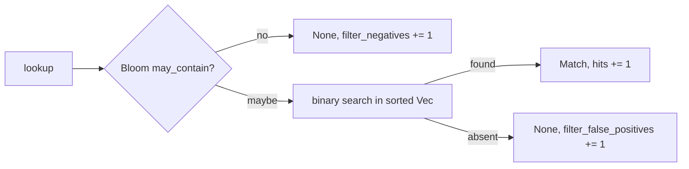

# IOC matching (`intel`)

The [`intel`](../../crates/intel/src/lib.rs) crate answers one question quickly and within a
fixed memory budget: is this SHA-256, IP address or domain on a loaded indicator list?
[`apps/agent/src/ioc.rs`](../../apps/agent/src/ioc.rs) wires it to the event stream and turns a match
into a detection.

Behavioural indicators (IOAs) are deliberately not part of this crate. They are what `rules`,
Sigma and the correlator already express, and an IOA feed is converted into rule content on
the server. This crate handles set membership of atomic values only.

## Components

| Type | Responsibility |
| --- | --- |
| [`SetBuilder`](../../crates/intel/src/set.rs) | collects indicators with their feed id; enforces the memory budget while building |
| [`IndicatorSet`](../../crates/intel/src/set.rs) | immutable; a Bloom pre-filter in front of exact sorted arrays; lookup counters |
| [`Bloom`](../../crates/intel/src/filter.rs) | the pre-filter: 10 bits per entry, 7 positions, about 1% false positives |
| [`Intel`](../../crates/intel/src/engine.rs) | the handle: `RwLock<Arc<IndicatorSet>>`, swapped whole on reload |
| [`IocMatcher`](../../apps/agent/src/ioc.rs) | agent side: feed loading, cooldown, own-traffic skip, counters |

## Feed format

One indicator per line. Blank lines and `#` comments are ignored
([`SetBuilder::add_lines`](../../crates/intel/src/set.rs)):

```text
sha256:<64 hex digits, any case>
ip:<IPv4 or IPv6 address>
domain:<DNS name, 2 to 8 labels, ASCII>
```

A line that does not parse is counted in `LoadReport::rejected` and skipped. One bad line never
discards a feed. These are rejected:

- a CIDR range, a loopback or unspecified address. IPv4-mapped IPv6 addresses are folded to
  IPv4, and every address is stored as a canonical 128-bit value;
- a domain with one label (`com`) or more than 8, an empty label, a label over 63 bytes, a name
  over 253 bytes, characters outside `a-z 0-9 - _`, a hyphen at a label edge, an all-numeric
  last label (that is an IP literal: list it as `ip:`), or non-ASCII text. Internationalised
  names are listed and queried as punycode; the engine does not convert.

The two-label floor does not stop a public suffix such as `co.uk`. The device carries no
public-suffix list, so the feed builder on the server must refuse public suffixes before they
reach a set.

## Data structure



- **The filter only saves work, it never decides.** Every "maybe" is confirmed by the exact
  tier, so a filter false positive costs one binary search and never a detection.
- Each kind has its own filter and its own sorted array of `(value, FeedId)`. `build` sorts and
  deduplicates them; when a value appears in several feeds, one entry is kept.
- Filter keys: a SHA-256 is already uniform, so two of its words are used as they are. An
  address goes through a SplitMix64 mixer. A domain is hashed with FNV-1a and then mixed. Two
  positions per key are combined by double hashing (`h1 + i * h2`, with `h2` forced odd).
- The filter is never persisted or shared, so its layout can change freely. The common-set
  snapshot is also a Bloom filter, but it is a server-written format with a frozen layout; the
  two deliberately share no code ([ml.md](ml.md#rarity-and-the-common-set)).

### Domains

A listed domain matches itself and every name below it, on a label boundary: `evil.example`
covers `www.evil.example` but not `notevil.example`. A listed subdomain does not cover its
parent. Case and one trailing dot are ignored. `lookup_domain` normalises the name into a
stack buffer and probes its suffixes of 2 to 8 labels. That is at most
[`MAX_DOMAIN_PROBES`](../../crates/intel/src/set.rs) (7) filter checks and searches, whatever
the name's length, with no allocation. When several listed suffixes match, the lowest feed id
wins. A domain lookup counts once in the stats.

### Memory budget

The default is [`DEFAULT_MEMORY_BUDGET_BYTES`](../../crates/intel/src/set.rs) = 64 MiB.
`SetBuilder::has_room_for` charges each indicator (34 bytes per hash, 18 per address, the
name's length plus a fixed overhead per domain, plus filter bits) before storing it. If any
indicator did not fit, `build` fails with `BuildError::BudgetExceeded` and **the whole set is
refused**. A partial set would mean an unknown subset of the feed is silently missing.
`estimated_bytes` and `estimated_bytes_with_domains` let the server size a feed in advance.
`IndicatorSet::memory_bytes` reports actual use.

The budget and the filter sizing are provisional. They come from arithmetic and a synthetic
test (100,000 absent hashes against 20,000 listed, under 3% filter false positives), not from
fleet data.

### Concurrency

`Intel::load` replaces the `Arc` under a write lock. A lookup in flight finishes on the set it
started with, and the next lookup sees the new one. There is never a half-loaded set, and no
restart is needed. Counters belong to a set, so they restart at a reload.

## In the agent

### Loading

[`IocMatcher`](../../apps/agent/src/ioc.rs) reads `<content_root>/ioc/`:

- each `*.txt` file is one feed, named by its file stem. Files over 512 MiB are refused;
- feed ids follow the sorted file names, so two agents with the same files agree on which feed
  wins an overlap;
- an optional `VERSION` file (first line) names the release, and `unversioned` is used without
  one;
- feed names and versions are trimmed, stripped of control characters and cut at 64
  characters, because they travel in every detection.

Loaded at startup and on `reload_content`. A present directory replaces the set, and an absent
one unloads it. An unreadable or over-budget directory keeps the previous set. The set and its
feed names are swapped together, so a match never reports another feed's name.

Delivery is the signed content manifest, with `ioc/<feed>.txt` entries of type `ioc`. In
production that needs the production content-signing keys
([#43](https://github.com/synthaea-lab/agent/issues/43)). Until then a feed in the field is a
file someone put there, which is one reason a match never kills or quarantines.

### Where it matches

| Event | Thread | Indicator | Severity |
| --- | --- | --- | --- |
| `Exec` | enrichment worker, once the image hash is known (`check_exec_image`) | SHA-256 | High |
| `Connect`, `NetworkFlow` | capture / conntrack thread (`check_connect`) | destination address | Medium |
| `DnsQuery` | DNS thread (`check_dns_query`) | queried name, any status | Medium |

A match becomes a `DetectionSource::Ioc` detection carrying the normalised indicator, the feed
name and the feed version. For a domain, the indicator is the *listed* domain that matched,
not the subdomain the host asked for. Its technique label is `IOC`
([`IOC_TECHNIQUE`](../../apps/agent/src/ioc.rs)) and it carries no ATT&CK technique: an indicator
says a thing is known bad, not which tactic it served.

File writes are not matched. A `FileWriteEvent` carries a descriptor and a byte count, with no
path and no hash.

### Cooldown

The same indicator raises at most one finding per 10 minutes (`COOLDOWN_NS`, provisional). A
repeat inside the window is counted in `IocStats::cooled_down` and dropped, so a hash run in a
loop, or a flow re-reported on every conntrack poll, is one finding. The cooldown remembers
4,096 indicators, least recently seen evicted first.

### The agent's own traffic

An address or domain match **made by the agent itself toward its own control plane** is
skipped, before the cooldown. Otherwise a feed that lists the control plane's address (or a CDN
address it sits behind) would make every agent alert on itself at every fetch. Worse, that
finding would start the indicator's cooldown and hide a real process reaching the same address
right after.

The skip needs both conditions ([`OwnTraffic`](../../apps/agent/src/own_traffic.rs)):

- **The destination is the configured control plane.** A DNS query must name its host exactly;
  a subdomain still raises, so DNS tunnelling under it is not hidden. A connect address must be
  the URL's literal address or one its host resolved to. The agent resolves the host itself
  every 60 s and keeps at most 32 addresses.
- **The process is the agent.** That is the agent's own pid, or a *sibling*: a process on the
  agent's own executable, such as `agent apply-content-manifest`. A sibling counts only if the
  agent saw its `Exec` (at most 64 remembered), with the same incarnation and an earlier time,
  under the agent's uid, outside any container. All of this comes from what the sensor captured
  with the event, never from a `/proc` read at judgement time, and never from `comm`.

Hash matches are never skipped. Every other process reaching the control plane's address still
raises. Skips are counted separately for the agent and for siblings (`IocStats::own_skipped`,
`sibling_skipped`), and each distinct pair is logged once as a warning: a feed that lists the
control plane is a feed problem the operator should see.

The residual cases all fail toward raising: no control plane configured, a host not resolved
yet, a sibling whose exec the agent did not see, no incarnation stamps (macOS), no uid
(Windows: only the agent's own pid is skipped), and a binary swapped by the updater.

### Counters

The health beacon reports `ioc_indicators` (a gauge), `ioc_findings`, `ioc_cooled_down`,
`ioc_own_skipped` and `ioc_sibling_skipped`. With these the server can tell a host with no feed
from a host with a feed and no match. `IndicatorSet::stats()` adds lookups, filter negatives,
filter false positives and hits.

## Testing

| Test | What it pins |
| --- | --- |
| [`tests/engine.rs`](../../crates/intel/tests/engine.rs) | build, lookup, budget refusal, reload swap, counters |
| [`tests/domains.rs`](../../crates/intel/tests/domains.rs) | label-boundary suffix matching, normalisation, rejection rules, probe bound |
| [`tests/robustness.rs`](../../crates/intel/tests/robustness.rs) | proptest: arbitrary feed text never panics and every line is counted; hashes round-trip |
| [`tests/feed_golden.rs`](../../crates/intel/tests/feed_golden.rs) | every line of the server feed builder's golden output loads unchanged (sibling `server` repo) |
| [`tests/content.rs`](../../crates/intel/tests/content.rs) | every line of every shipped feed in the `rules` sibling repo loads (a refused line would be dropped silently on a device) |
| [`tests/draft_golden.rs`](../../crates/intel/tests/draft_golden.rs) | the draft indicator set the server's hunt graduation writes loads whole and every line matches (sibling `server` repo) |
| [`apps/agent/src/ioc.rs`](../../apps/agent/src/ioc.rs) unit tests | feed loading, version labels, cooldown, own-traffic and sibling skips |
