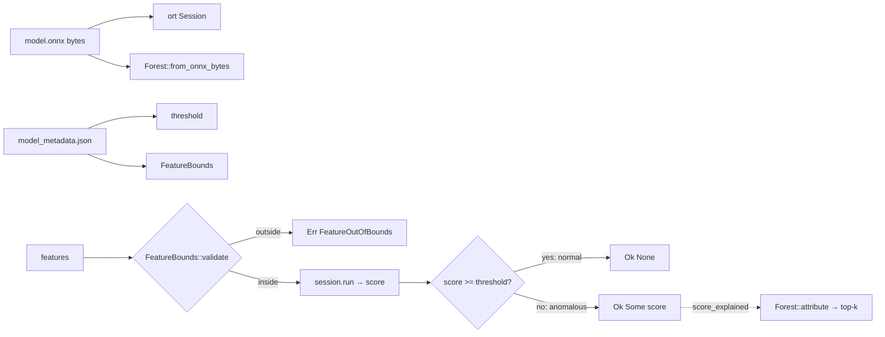

# On-device ML (`ml`)

The [`ml`](../../crates/ml/src/lib.rs) crate turns events into feature vectors and scores them
with Isolation Forest models trained by the Python pipeline in the public `ml` repo. Inference
runs through onnxruntime ([`ort`](../../crates/ml/src/scorer.rs)). Every score can come with a
per-feature attribution, computed from the same model bytes.

Models are data. They are read from disk at load time, never embedded in the binary. A model
that is missing or broken degrades the agent to "no ML evidence"; it never stops detection.

## Tiers

| Tier | Scorer | Input | Output | Wired into the agent |
| --- | --- | --- | --- | --- |
| T0 | [`CmdlineScorer`](../../crates/ml/src/scorer.rs) | one command line, 9 features | anomaly score, alert on its own budget | **no** |
| T1 | [`BehaviorScorer`](../../crates/ml/src/scorer/behavior.rs) | one process incarnation, 17 features (cmdline 9 + correlation 8) | anomaly score | **no**, waits for a model trained on a real capture |
| T2 | [`CorrelationScorer`](../../crates/ml/src/scorer/correlation.rs) | one pid's correlator window, 8 features | a log-odds term for the correlator's belief, never an alert on its own | **yes**, when a model is present |

The tiers differ in when their input is available and in what it measures. A command line is
ready the moment an `Exec` arrives. A behaviour vector needs several events in the correlator
window, and it measures counts and spans rather than text. That is why they are separate models
and are never merged into one vector.

## Feature extractors and parity

Each extractor in [`features/`](../../crates/ml/src/features.rs) mirrors one Python definition
in `synthaea_ml/features/`. A model trained on Python vectors scores correctly only if Rust
builds the same vector for the same input, so **each extractor is a parity seam pinned by a
golden fixture that both sides test against**. Changing a feature on one side without the other,
and without retraining, silently breaks the model.

| Module | Features | Golden test |
| --- | --- | --- |
| [`cmdline`](../../crates/ml/src/features/cmdline.rs) | `length`, `entropy`, `suspicious_token_count`, `token_count`, `max_token_length`, `shell_metachar_count`, `digit_ratio`, `is_suspicious_win_path`, `is_legit_win_path` | [`features_golden.rs`](../../crates/ml/tests/features_golden.rs) |
| [`correlation`](../../crates/ml/src/features/correlation.rs) | `spawn_count`, `connect_count`, `filewrite_count`, `unique_daddr_count`, `unique_dport_count`, `has_full_chain`, `span_s`, `event_count` | [`capture_parity.rs`](../../crates/ml/tests/capture_parity.rs) (a real capture against the Python aggregator) |
| [`t1`](../../crates/ml/src/features/t1.rs) | cmdline (9) then correlation (8) | [`t1_golden.rs`](../../crates/ml/tests/t1_golden.rs) |
| [`lineage`](../../crates/ml/src/features/lineage.rs) | 6 parent-lineage flags | [`lineage_golden.rs`](../../crates/ml/tests/lineage_golden.rs) |
| [`rarity`](../../crates/ml/src/features/rarity.rs) | `rarity_known`, `image_in_common_set` | [`rarity_golden.rs`](../../crates/ml/tests/rarity_golden.rs) |
| [`common_set`](../../crates/ml/src/features/common_set.rs) | snapshot reader, not a feature | [`common_set_snapshot_golden.rs`](../../crates/ml/tests/common_set_snapshot_golden.rs), [`common_set_snapshot_robustness.rs`](../../crates/ml/tests/common_set_snapshot_robustness.rs) |

Notes on the definitions:

- **Command line.** The input is `ExecEvent::cmdline` with argv joined by `\0`, exactly as the
  training side joins it. The token and path lists are copied verbatim from Python. They are a
  known weakness (an attacker who reads them can avoid them, as with a static rule), and
  replacing them with hashed n-grams is future work.
- **Correlation.** Only process spawns, outbound connects, file opens and netlink flows count,
  because those are the event types the Python aggregator keeps. `span_s` and `event_count`
  are computed over the same subset. Counting a `DnsQuery` would inflate both relative to the
  training vectors.
- **Incarnations.** T1 and T2 read events through `EventBus::events_for_pid(pid, generation)`.
  A recycled pid's earlier life feeds neither the counts nor the command line. With no
  generation stamp, the lookup falls back to the pid alone.
- **No lineage in T1.** Six lineage columns were measured on lab captures. They improved
  detection of the few attacks with an unusual parent and made the forest worse for the
  majority whose lineage is ordinary (aggregate AUC down by about 0.08 on every split). The
  parent is judged by rules instead: a web or database service spawning a shell
  (`check_web_server_spawns_shell`) and an Office or PDF application spawning an interpreter
  (`check_parent_suspect`), both in [`state.rs`](../../crates/rules/src/state.rs). The
  `lineage` extractor stays, parity-tested, so the measurement can be repeated.

The golden fixtures live in the `ml` sibling repo and are read through the
[`siblings`](../../crates/siblings/src/lib.rs) crate. The tolerance is `1e-4` relative: Python
computes in f64 and Rust in f32.

## Scoring

All three scorers follow the same shape:

- **Score.** The model computes `IsolationForest.decision_function`: negative is anomalous,
  positive is normal.
- **Conformal threshold.** `threshold` in `model_metadata.json` is calibrated in the pipeline
  against a false-positive budget on held-out benign data. A score at or above it returns
  `Ok(None)`. A normal point contributes nothing, so the budget is enforced on the device.
- **Out-of-distribution guard.** [`FeatureBounds`](../../crates/ml/src/bounds.rs) holds a
  per-feature `[min, max]` from training, with a margin. A vector outside it returns
  `ScorerError::FeatureOutOfBounds`. Callers treat that as **no score**, not as benign: an
  Isolation Forest scores a value beyond its training range no more anomalous than the range's
  edge, so its score there means nothing. `check_invariant` refuses bounds whose three arrays
  differ in length at load time, so `validate` cannot index out of range.
- **Arity.** Every scorer refuses a model whose input width differs from its extractor
  (`ScorerError::FeatureArity`). That catches a T0 model shipped to the T2 slot.
- **Metadata modes.** T0 and T2 accept metadata with either field or none (legacy: no
  threshold, no guard). T1 is stricter: metadata must carry **both** the threshold and bounds for
  exactly the 17 T1 features, in order, or the model is refused. Without metadata T1 runs
  uncalibrated. A half-calibrated model would leave one guard off without anyone noticing.
- **T2 gate.** `CorrelationScorer::score` returns `None` while the pid's window holds fewer
  than [`MIN_EVENT_COUNT`](../../crates/ml/src/scorer/correlation.rs) (3) events. The vector is
  then almost all zeros, and training excluded such points too.
- **One runtime environment.** onnxruntime allows one environment per process, so the
  scorers share one created on first use (`session_builder`).

### Attribution

[`forest/`](../../crates/ml/src/forest/mod.rs) parses the tree structure back out of the ONNX
file. onnxruntime returns only the score, and an explanation needs the path through the trees.
The parser reads `ai.onnx.ml` `TreeEnsembleRegressor` nodes as skl2onnx emits them for an
`IsolationForest`: one node per tree behind a `Gather` that selects input columns, and the two
`LabelEncoder`s that map a leaf to its path length and its training-sample count.

The attribution is Saabas-style path attribution over **effective depth**. A leaf's value is
`depth + c(n)`, where `n` is the number of training samples that reached the leaf and `c` is
scikit-learn's average path length of an unbuilt subtree. Each internal node gets the
sample-weighted mean of the leaf values below it. As an input walks a tree, each split moves
that mean, and the move is charged to the split's feature. Per tree the sum is exact: leaf
value = root mean + sum of moves. Contributions are averaged over the trees and negated, so a
positive contribution pushes toward anomalous. A model without the sample-count encoder falls
back to uniform weights and no `c(n)` term. The Python reference implementation and this one
are pinned together by [`attribution_golden.rs`](../../crates/ml/tests/attribution_golden.rs).

The ONNX file comes from the update channel, so its parser is a minimal hand-written protobuf
reader ([`proto.rs`](../../crates/ml/src/proto.rs)). It handles only the wire types it needs,
skips unknown fields, is bounded, and fails closed with `ParseError` (`Truncated`,
`Malformed`). Because score and attribution come from the same bytes, the explanation always
describes the model that produced the score.

`score_explained` (top-k attributions) exists on every scorer, but the agent does not call it
yet. The T2 path uses `score` only.

## T2 in the agent

### Loading and degraded mode

At construction, [`DetectionSink::load_correlation_scorer`](../../agent/src/sink/mod.rs) looks for
`correlation-iforest-{linux,windows,macos}/0.1.0/model.onnx` under
`<state_dir>/ml/registry` (`model_root`), then under `ml/registry` relative to the working
directory (for a source checkout). The `model_metadata.json` next to it is optional. On any
failure it logs `ML correlation scorer unavailable — agent works without ML` and runs with
`None`. The correlator's hand-calibrated features keep working. Models are not reloaded on
`reload_content`.

### Per event

[`DetectionSink::correlate`](../../agent/src/sink/mod.rs) runs on the capture thread, inside the
correlator lock (inference takes microseconds):

| `score()` result | Effect |
| --- | --- |
| `Ok(Some(s))` | `update_belief_with_ml(pid, gen, Some(score_to_llr(s)))` |
| `Ok(None)` (gated or normal) | `update_belief_with_ml(.., None)`: no evidence |
| `Err(FeatureOutOfBounds)` | warning with the feature and its bounds, no evidence |
| other `Err` | error logged, no evidence (fail open) |

The correlator cannot call `ml` itself, because `ml` depends on `correlator` for `EventBus`. So
the sink computes the score and hands it over.

[`score_to_llr`](../../crates/ml/src/scorer/correlation.rs) maps the score linearly:
`(-score × 20).clamp(-1.0, 3.0)`. The cap of +3.0 moves an entity from the roughly 1% prior to
about 29% on its own: enough to matter next to the hand-calibrated likelihood ratios, never
enough to cross the alert threshold without corroboration. The floor is lower in magnitude
because a behaviour model clears a process much more weakly than it accuses one. The gain of
20 is **provisional**, pending calibration on a benign multi-event baseline.

No T2 model is trained on real multi-event captures yet. The extractor and the scorer exist so
that data can be scored as soon as it does.

## Rarity and the common set

The fleet's **common set** is the set of image hashes seen on at least K hosts of the tenant.
The server publishes it as a Bloom filter snapshot, and the agent loads it from
`<content_root>/snapshots/common-set.bin` (at most 64 MiB, `MAX_COMMON_SET_BYTES` in
[`sink/mod.rs`](../../agent/src/sink/mod.rs)).

- [`CommonSetSnapshot::parse`](../../crates/ml/src/features/common_set.rs) is strict and
  total. An unknown magic or version, an out-of-range size, or a length that is not exactly
  header plus body is an error, never a guess. No input panics, and no allocation is sized by
  an untrusted header field. The byte layout is pinned against the server's writer by the
  golden test.
- [`rarity::extract_features`](../../crates/ml/src/features/rarity.rs) takes the hash, any
  `CommonSet` (a membership test and the number of hosts covered) and a minimum coverage, and
  returns two numbers. `rarity_known` keeps "rare" separate from "no basis to say": a fleet
  that has just enrolled has an empty snapshot, and without this every binary would look rare.
- In the agent, [`note_image_rarity`](../../agent/src/sink/mod.rs) runs on the enrichment worker
  (only it knows the hash). It uses the same extractor, so the agent and a future model cannot
  disagree about what is known. "Not in the common set" becomes capped evidence in the
  correlator (`apply_rarity_evidence`). The evidence is withheld when there is no snapshot,
  when it covers fewer than `RARITY_MIN_HOSTS_COVERED` (10) hosts, when it is older than three
  days (`updater::snapshot::DEFAULT_MAX_AGE_SECS`), or when the exec has no hash. The outcomes
  are counted (`applied`, `withheld`, `unapplied`) for the health beacon.

K, the minimum coverage, the maximum age and the filter's false-positive rate are all
provisional.

## Build

The default `dynamic-onnx` feature downloads a prebuilt onnxruntime for development builds.
Release builds use `--no-default-features` and link a static onnxruntime from
`ORT_LIB_LOCATION` ([`Cargo.toml`](../../crates/ml/Cargo.toml)). The prebuilt library needs a
recent libstdc++ and does not link on older distributions
([#53](https://github.com/synthaea-lab/agent/issues/53)).

## Testing

| Test | What it pins |
| --- | --- |
| [`scorer.rs`](../../crates/ml/tests/scorer.rs) | T0: Rust extraction through `ort` reproduces the Python/onnxruntime scores (`scorer_golden.json`) |
| [`correlation_scorer.rs`](../../crates/ml/tests/correlation_scorer.rs) | T2: scores from an `EventBus` window match the Python reference, including the `MIN_EVENT_COUNT` gate |
| [`t1_scorer.rs`](../../crates/ml/tests/t1_scorer.rs) | T1: score parity, recycled pids scored as their own incarnation, threshold, out-of-bounds error, metadata strictness |
| golden tests above | Rust/Python feature parity, attribution parity, snapshot format |
| `threshold_tests` in [`scorer.rs`](../../crates/ml/src/scorer.rs) | legacy mode returns every score; a threshold filters normal ones |

The fixture models are trained on synthetic vectors. They pin that Rust and Python inference
agree, not how well the model detects anything.
