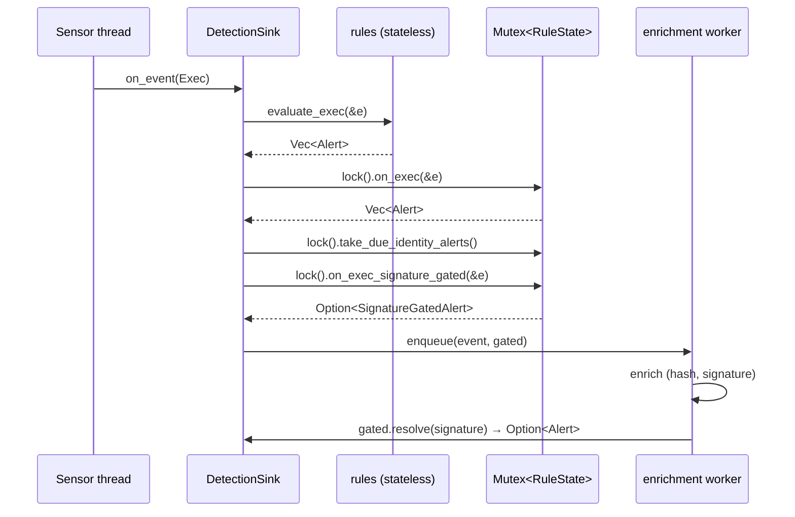
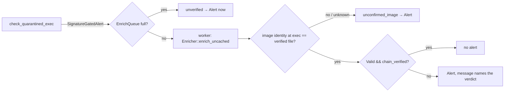

# Rule engine (`rules`)

The [`rules`](../../crates/rules/src/lib.rs) crate holds the agent's built-in detections. Each
one is a Rust function aimed at one ATT&CK technique. They come in two kinds:

- **Stateless rules**, in [`stateless/`](../../crates/rules/src/stateless/mod.rs) (one module per tactic) and a few small
  modules. A single event decides. They are pure functions of the event.
- **Stateful rules**, the methods of [`RuleState`](../../crates/rules/src/state.rs) and the
  helper modules it owns. They need a bounded history of recent events: a download followed
  by an execution, N connections to one host in a window, an authentication success after a
  run of failures.

The crate depends only on `schema`, `policy` and `store`, so it does no I/O of its own beyond
a few explicit startup seeds and one `/proc` fallback (see
[Seeding at startup](#seeding-at-startup)).

## Public contract

Callers use the dispatchers and nothing else. The individual `check_*` functions are
crate-internal; they are re-exported under `#[cfg(test)]` only, for the tests under
`src/tests/`.

| Entry point | Event | Kind |
| --- | --- | --- |
| [`evaluate_exec`](../../crates/rules/src/stateless/mod.rs) | `ExecEvent` | stateless |
| `evaluate_file_open`, `evaluate_file_delete`, `evaluate_file_set_time`, `evaluate_raw_volume_open` | file events | stateless |
| `evaluate_connect`, `evaluate_signal`, `evaluate_log_cleared`, `evaluate_kerberos_delegation_failure` | as named | stateless |
| [`evaluate_amsi_content`](../../crates/rules/src/amsi.rs), [`evaluate_defender_event`](../../crates/rules/src/defender.rs), [`evaluate_ldap_search`](../../crates/rules/src/ldap.rs), [`evaluate_ntlm_auth`](../../crates/rules/src/ntlm.rs), [`evaluate_package_change`](../../crates/rules/src/inventory.rs) | Windows/inventory events | stateless |
| `RuleState::on_exec`, `on_connect`, `on_network_flow`, `on_dns_query`, `on_listen_port`, `on_file_open`, `on_file_delete`, `on_file_rename`, `on_file_write`, `on_file_set_time`, `on_memfd_create`, `on_auth`, `on_session`, `on_policy_denial`, `on_ldap_search`, `on_process_access`, `on_remote_thread`, `on_file_quarantine`, `on_file_setxattr`, `on_bits_job`, `on_unit_stop`, `on_identity_change` | as named | stateful |
| `RuleState::on_exec_signature_gated` | `ExecEvent` | stateful, waits for the signature |
| `RuleState::take_due_unit_stops`, `take_due_identity_alerts` | none (clock-driven) | deferred findings |

Every dispatcher returns `Vec<Alert>` (or nothing, for the record-only methods).
[`Alert`](../../crates/rules/src/lib.rs) carries a `&'static str` technique, a `Severity` set
where the alert is built, and a human message. The sink turns each one into a
`DetectionSource::Rule { rule_id: technique }` detection
([`DetectionSink::record_rule_alerts`](../../apps/agent/src/sink/mod.rs)).

Two techniques get extra handling there:

- **T1620** (memfd exec) also asks for a YARA memory scan of the process
  ([yara.md](yara.md#process-memory-scanning)).
- **T1486** (ransomware burst) carries a damage manifest. That is the process incarnation's
  recent renames and deletions, from `RuleState::touched_files`. The burst can also trigger
  the ransomware reflex when a canary touch by the same process corroborates it.

## How the agent calls it

`RuleState` sits behind one `Mutex` in the sink. The `EventSink` trait only gives `&self` and
must be `Send + Sync`. On Linux almost all events arrive on one thread, so the lock is
uncontended. The DNS uprobe, conntrack and log-source threads take it too. **Never hold the
lock while calling `record_rule_alerts`**: that path takes it again (for the damage manifest).
The sink binds the alerts to a local first, then records them.

## `RuleState` internals

[`RuleState`](../../crates/rules/src/state.rs) is one struct with one field per stateful
concern. Each field is a [`store::BoundedMap`](../../crates/store/src/bounded.rs) or a small
dedicated type. The struct's field docs say which rule reads each table. A family that has been
split out keeps its tables in its own type, held by `RuleState` as one field: the network rules
(`beacon`, `beacon_flow_dedup`, `scan_*`, `egress_*`, `dns_class`, `archive_*`, `staged_archives`)
live in [`NetworkState`](../../crates/rules/src/network_state.rs), and the file-impact rules
(`ransomware_*`, `recent_creates`, `pending_unlinks`, `write_volume`, `rename_count`,
`touched_files`, `set_time_alerted`) in [`ImpactState`](../../crates/rules/src/impact_state.rs),
the authentication rules (`auth_failures`, `logon_baseline`, `odd_hours`, `rdp_success`,
`sudo_success`, `session_hijack`) in [`AuthState`](../../crates/rules/src/auth_state.rs), and
SETUID-ROOT-REQUEST's deferred judgement (`pending_identity`, `exec_history`,
`setuid_root_alerted`) in `IdentityRequests` ([`privesc.rs`](../../crates/rules/src/privesc.rs)),
the download-to-execution joins (`recent_writes`, `recent_quarantines`,
`recent_bits_downloads`, `recent_motw_removals`) in
[`DownloadState`](../../crates/rules/src/download_state.rs), the T1620 memfd-exec
correlation (`recent_memfd_creates`, `pending_proc_fd_exec`) in
[`MemfdState`](../../crates/rules/src/memfd_state.rs), LISTENER-DRIFT and
POLICY-DENIAL-DRIFT (`known_listeners`, `known_policy_denials`, `policy_denial_budgets`) in
[`DriftState`](../../crates/rules/src/drift_state.rs), and the file-open readers in their rule's
module: STAGING-DIR's reads and creates in
[`StagingState`](../../crates/rules/src/staging.rs), CREDENTIAL-READ's alert windows in
[`CredentialReads`](../../crates/rules/src/credfiles.rs), and the T1053.005 registration dedup
in [`TaskRegistrations`](../../crates/rules/src/task_registration.rs). The main families:

| Family | Fields (examples) | Key | Feeds |
| --- | --- | --- | --- |
| Process facts | `pid_comm`, `pid_image_path`, `exec_history`, `exec_lineage` | pid ([`PidFact`](../../crates/rules/src/state.rs) carries the generation) | parent-name checks (T1059), rename exclusions, SETUID-ROOT-REQUEST |
| Download provenance | `recent_writes`, `recent_quarantines`, `recent_bits_downloads`, `recent_motw_removals` | case-folded path | T1105, T1204.002, T1197, T1553.005 |
| Sliding counters | `self_spawn`, `beacon`, `auth_failures`, `ransomware_rename`, `credential_reads`, `lsass_access` | rule-specific | threshold-in-window rules |
| Distinct sets | `scan_vertical`, `scan_spread`, `ssh_fanout`, `security_discovery`, `service_stop` | pid or lineage | N distinct things in a window |
| Exfiltration chain | `archive_writers`, `staged_archives`, `archive_readers`, `egress_flow_last`, `egress_volume`, `dns_class`, `staging` | pid / path / (comm, addr) | ARCHIVE-EXFIL, EGRESS-VOLUME, EGRESS-DOMAIN, STAGING-DIR |
| First-seen shapes | `known_listeners`, `known_policy_denials`, `logon_baseline` | shape tuple | LISTENER-DRIFT, POLICY-DENIAL-DRIFT, FIRST-SEEN-LOGON |
| Joins | `rdp_success`, `sudo_success`, `session_hijack`, `unit_stops`, `pending_identity` | per module | failure-then-success, deferred judgements |

### Calibration lives in `exclusions.rs`

Thresholds, windows, process lists and false-positive exclusions are constants in
[`exclusions.rs`](../../crates/rules/src/exclusions.rs), not in the rule bodies. Examples:
`DOWNLOAD_EXEC_WINDOW_NS` (60 s), `BEACON_THRESHOLD`/`BEACON_WINDOW_NS` (3 in 60 s),
`SELF_SPAWN_THRESHOLD` (3). Each exclusion entry is data with provenance. It records why it
exists: the false positive it removes and the lab scenario that produced it. Do not trim it as
noise.

**Name-keyed exclusions are gated on the image path.** An entry such as "`svchost.exe` may do
X" applies only when the process's image is under a trusted system location
([`policy::name_exclusion_applies`](../../crates/policy/src/lib.rs)). A copy of a trusted name
running from `%TEMP%` or `/tmp` does not inherit the exclusion. An unknown image path keeps
the exclusion, because a sensor limitation is not evidence of masquerade.

### Incarnation-aware facts

The process-fact tables store [`PidFact`](../../crates/rules/src/state.rs) values: the fact and
the `process_generation` it was recorded for. `PidFact::current` misses when both generations
are known and differ, so a recycled pid never inherits its predecessor's name or image. See
[Process incarnations](README.md#process-incarnations).

`RuleState::resolve_comm` looks up a parent's name in this order: the cache, then a live
`/proc/<ppid>/comm` read. The fallback covers processes that forked after startup and never
exec'd, such as a web server's respawned workers. Without it, a shell spawned by such a worker
would not be recognised as a web-server child.

`IdentityRequests::image_as_of(pid, generation, t)` answers "which image did this pid run at time
*t*", from the last few execs per pid (`exec_history`). SETUID-ROOT-REQUEST needs it, because
an identity change can be judged after the process exec'd again.

### Sliding windows

[`sliding.rs`](../../crates/rules/src/sliding.rs) has the shared window types:

- `SlidingCounter` is a true sliding window. `record(ts, window)` drops timestamps older than
  the window, pushes the new one and returns the in-window count. `try_alert(ts, window)`
  allows one alert per window. A reset-bucket scheme would lose events that straddle a bucket
  boundary (spawns at 0 s, 29 s and 31 s never reach 3-in-30 s), which is why it is not used.
  Each key keeps at most 256 timestamps: enough to prove the threshold, not to archive a
  burst.
- `FlowPortDedup` is for poll-based sources (conntrack). A live flow is reported on every poll,
  so one long SSH session would otherwise count as many connections. The local port identifies
  one flow for its lifetime, so a port counts once per window.
- `SlidingSum` sums a value (bytes written) over a window, in coalesced time slots. The
  ransomware write-volume signal uses it.
- `SlidingDistinct<T>` counts distinct values (ports, destinations, commands) in a window.

All windows run on **event time** (`meta.timestamp_ns`), never on the wall clock. That makes
the rules deterministic under replay and in tests.

### First-seen shapes

LISTENER-DRIFT and POLICY-DENIAL-DRIFT alert on a *new shape*, not on volume:

- **Listeners** are keyed on `(local_addr, local_port, protocol)`. The protocol is part of the
  key because a UDP and a TCP listener on the same port are different services.
  `RuleState::seed_listen_ports` fills the baseline from one startup snapshot. Otherwise every
  service already listening when the agent starts would look like a planted backdoor on the
  first poll.
- **Policy denials** are keyed per mechanism. SELinux keys on
  `(scontext, tcontext, class, normalised permissions)`; the permission set is sorted and
  deduplicated by `normalized_permissions`. AppLocker and WDAC events carry no object context,
  so they key on the file (lowercased) and the collection or loading process instead. Keyed
  like SELinux, they would collapse to a handful of classes and only the first blocked binary
  would ever alert. There is no startup baseline, because past denials cannot be enumerated.
  Alerts are budgeted per subject type (`POLICY_DENIAL_ALERT_CAP` per window,
  `POLICY_DENIAL_SUBJECT_CAP` subjects), so one noisy domain cannot spend another's budget.
  A shed shape is not remembered and can alert again in a later window. Sheds and evictions
  are counted and logged once per rise.

### Deferred findings

Some judgements need events that may arrive after the one that triggers them:

- **Identity changes to uid 0** (SETUID-ROOT-REQUEST, [`privesc.rs`](../../crates/rules/src/privesc.rs))
  wait in `pending_identity` until an exec or identity event moves the stream clock past them.
  Only then is the process's image as of that time known. The sink drains them with
  `take_due_identity_alerts` after every exec.
- **Security-unit stops** (UNEXPLAINED-UNIT-STOP, [`unitstop.rs`](../../crates/rules/src/unitstop.rs))
  are held until the clock passes a grace window. During that window an exec that explains
  the stop (`systemctl stop` by an administrator, a package upgrade) cancels it. Drained with
  `take_due_unit_stops`.

### Seeding at startup

These are called once, before the sensors start
([`RuleState`](../../crates/rules/src/state.rs)):

| Method | Fills | Why |
| --- | --- | --- |
| `seed_from_proc` (Unix) / `seed_pid_comm` (Windows) | `pid_comm` | services started before the agent (nginx at boot) must be known as parents |
| `seed_listen_ports` | `known_listeners` | existing listeners are the baseline |
| `seed_ld_trust_from_system` | extra trusted library dirs from `/etc/ld.so.conf` (`include`s followed) | `LD_PRELOAD` of an `ldconfig`-registered vendor directory is not a hijack (T1574.006) |
| `seed_own_pid` | `own_pid` | the Event Log sensor's own `wevtutil`/`auditpol` children are excluded narrowly, still requiring a trusted image path |

Every seed is best effort. A missing file or an unreadable `/proc` entry only means the rule
judges against its built-in baseline.

## Signature-gated findings

Some findings are only true when the executed image is not validly signed. T1204.002 (a
downloaded file run within the provenance window) is the current one: almost every installer a
user downloads and runs is signed. But the signature is computed on the enrichment worker,
after the rules have run ([enrichment.md](enrichment.md)). So the rule returns a
[`SignatureGatedAlert`](../../crates/rules/src/signature_gate.rs) instead of an `Alert`:

`resolve(ImageSignature)` suppresses the alert only for `Signature::Valid` **with**
`chain_verified`. That is Authenticode on Windows. On macOS `Valid` also covers ad-hoc
signatures, which the linker puts on every arm64 binary, attacker-built ones included. Losing
the verdict (queue full, unreadable image) raises the alert; it never drops it.

The verdict describes the file at the image path when the worker opens it. A dropper on
Windows can rename itself and put a signed binary at its old path before the worker gets
there. To catch that, the sensor records the image's file identity at exec
(`ExecEvent::image_file_id`). The worker compares it with the identity of the file it verified
(`image_confirmed` in [`enrich_queue.rs`](../../apps/agent/src/enrich_queue.rs)), and on a mismatch
the alert resolves as not verified. Identity is captured on Windows only, and only as early as
the ETW callback. The window between process start and that callback is still open
([#46](https://github.com/synthaea-lab/agent/issues/46)).

## Configuration

The rules read only the `[detection]` table of `agent.toml`
([`DetectionConfig`](../../crates/config/src/schema.rs)). All three knobs serve ODD-HOUR-LOGON:

| Key | Default | Effect |
| --- | --- | --- |
| `utc_offset_minutes` | absent (platform zone used) | fixed offset, -720..=840, overrides the platform zone; does not follow daylight saving |
| `work_hours` | `[7, 20]` | ordinary local hours `[start, end)`; `start > end` wraps midnight |
| `odd_hour_exempt_accounts` | empty | `NAME` or `NAME\|SID` (SID prefix with `*`); at most 64 |

Each setter (`set_local_utc_offset_minutes`, `set_work_hours`, `set_odd_hour_exempt_accounts`,
`set_local_zone`) refuses an invalid value and keeps the previous one. Platform time-zone
verification and window calibration are tracked in
[#15](https://github.com/synthaea-lab/agent/issues/15).

## Failure modes

| Condition | Behaviour |
| --- | --- |
| A table reaches its cap | LRU eviction. A forgotten key can re-alert once; first-seen tables log each eviction rise |
| Parent not in the cache and gone from `/proc` | parent-name rules cannot fire for that exec |
| Linux `comm` truncated to 15 bytes | T1105 compares `comm` to the downloaded file's basename, so a longer name does not match |
| A downloaded script run through an interpreter | image is the interpreter; T1204.002 and T1105 do not join |
| Linux download mark (T1204.002) | `on_file_setxattr` maps a `user.xdg.origin.url` set to a `FileQuarantine` mark and the macOS/Windows join runs unchanged. The sensor sends the xattr name, not its value, so the finding says `origin: unrecorded`, and `marked by` is the writer's `comm`. `fsetxattr`/`lsetxattr` are not hooked, so a browser using them leaves no mark. `cp -a`, `rsync -X` and restores copy the xattr and re-mark a file. Unit-tested only; no real Linux capture |
| Events out of order across sensor threads | windows tolerate it; deferred findings wait for the clock |
| No generation stamp (macOS) | pid-only behaviour, recycled pids possible |

## Testing

- [`crates/rules/src/tests/`](../../crates/rules/src/tests/mod.rs) has about 30 files, one per
  rule family (`linux.rs`, `windows.rs`, `logon.rs`, `privesc.rs`, ...), with over 800 tests.
  [`tests/mod.rs`](../../crates/rules/src/tests/mod.rs) holds the event builders. Each family
  pins the positive case, its benign lookalikes (one per exclusion) and the window edges.
- [`rdp.rs`](../../crates/rules/src/rdp.rs) and [`sudo.rs`](../../crates/rules/src/sudo.rs)
  carry proptest suites for the failure-then-success joins.
- Sink-level tests in [`apps/agent/src/sink/tests.rs`](../../apps/agent/src/sink/tests.rs) check that each event type
  reaches its rule through the real dispatcher, for example
  `set_time_event_reaches_the_timestomp_rule_through_the_real_sink`.
