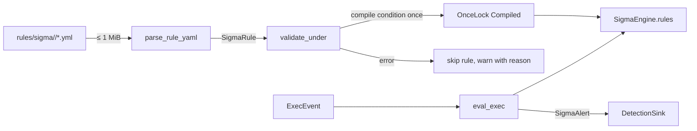

# Sigma engine (`sigma`)

The [`sigma`](../../crates/sigma/src/lib.rs) crate evaluates a deliberately small subset of
[Sigma](https://sigmahq.io) against process-creation events. Its main design rule: **a rule
that would not mean what it says is refused at load, loudly, with the reason**. A rule never
loads and then silently never matches. Every validation choice below follows from that rule.

## Components

| File | Responsibility |
| --- | --- |
| [`engine.rs`](../../crates/sigma/src/engine.rs) | `SigmaEngine`: directory walk, per-platform loading, YAML parsing (`parse_rule_yaml`), `eval_exec` |
| [`rule.rs`](../../crates/sigma/src/rule.rs) | `SigmaRule`, `Detection`, `Selection`, `ValueList`, `LogSource`, `SigmaAlert`; the `level` mapping |
| [`validate.rs`](../../crates/sigma/src/validate.rs) | load-time validation: fields, modifiers, logsource, metadata, platform |
| [`condition.rs`](../../crates/sigma/src/condition.rs) | the bounded condition grammar: tokenizer, parser, `Compiled::eval` |
| [`eval.rs`](../../crates/sigma/src/eval.rs) | per-event evaluation: `Haystacks`, modifiers, wildcard glob |

## Lifecycle



1. **Load.** [`load_sigma_rules`](../../apps/agent/src/sink/mod.rs) in the agent calls
   `SigmaEngine::load_dir_for(<content_root>/rules/sigma, Platform::host())`. A rule that fails
   to parse or validate is skipped with a warning naming the file and the reason. The rest of
   the set loads. Only an unreadable directory is an error (`Load::Failed`, and the previous
   engine is kept).
2. **Evaluate.** For every `Exec`, `DetectionSink::detect_exec` calls `SigmaEngine::eval_exec`.
   Each matching rule becomes a detection with `DetectionSource::Sigma { rule_id: title }`. Its
   technique label is the rule's tags joined with `/`, or `Sigma` when the rule has no tags.
3. **Reload.** On `reload_content` a new engine is built outside the lock and swapped in
   ([README.md](README.md#content-loading-and-reload)).

Sigma sees the **raw** command line, before redaction. Only the alert text and the persisted
event are redacted. A rule therefore matches what actually ran, and a credential in the
command line never reaches the alert log
(`sigma_sees_raw_exec_but_alert_and_event_outputs_are_redacted` in
[`sink/tests.rs`](../../apps/agent/src/sink/tests.rs)).

## Which rules a host loads

Content is organised by platform directory. [`Platform::rule_dirs`](../../crates/sigma/src/engine.rs)
says which directories each host loads:

| Host | Loads |
| --- | --- |
| Linux | `linux/` |
| Windows | `windows/` |
| macOS | `macos/` **and** `linux/` |

macOS also runs `linux/`, because those are Unix-family command-line rules (shells, `curl`,
`base64`) that apply there too. This is a choice, and the alternative is a shared `unix/`
directory. One test pins the set: `EXPECTED` in
[`tests/platform.rs`](../../crates/sigma/tests/platform.rs). Changing it therefore shows up in
a diff.

A rule's platform is **where it sits under the rules directory**, never a word anywhere in its
full path. `load_dir_for` walks only `<dir>/<platform>/`. `load_dir` (all platforms, for
content tests and tooling) validates each rule against its path relative to the root. So a
content root such as `/home/linux/content/rules/sigma` does not turn `windows/x.yml` into a
Linux rule. `load_rule` alone has no root to measure from, so it takes the innermost
`/linux/`, `/windows/` or `/macos/` component of the path it is given. A rule outside any
platform directory fails validation.

## Supported subset

### Fields

Every field is read from an `ExecEvent` (in `Haystacks::get`, [`eval.rs`](../../crates/sigma/src/eval.rs)):

| Sigma field | `ExecEvent` field | Note |
| --- | --- | --- |
| `Image` | `image_path` | |
| `CommandLine` | `cmdline` | raw, before redaction |
| `ParentImage` | `parent_image_path` | absent when the sensor has no lineage; the field then never matches |
| `OriginalFileName`, `Company`, `Description`, `Product` | `original_file_name`, `company_name`, `file_description`, `product_name` | PE version strings from [enrichment](enrichment.md#pe-version-strings); **`windows/` rules only** |

Any other field is refused at load, naming it. The PE fields are refused in `linux/` and
`macos/` rules, because they would load and never match on the platforms that run them
(`WINDOWS_ONLY_FIELDS` in [`validate.rs`](../../crates/sigma/src/validate.rs)). A single
Windows event can still lack one (no version resource, a parse failure, an image over the
enrichment budget). That is a per-event gap, the same as `ParentImage` without lineage, not a
load-time refusal.

**Known gap in the agent:** the sink runs Sigma on the capture thread, before the enrichment
worker has read the PE strings. Sensors leave those fields `None`, so in the running agent a
rule that needs one of the four PE fields does not match yet. The engine evaluates them
correctly when the event carries them, which is what the tests check. See
[enrichment.md](enrichment.md#where-it-runs).

Field names are case-insensitive. Values are lowercased once per event and field: a condition
over many blocks costs at most one allocation per field, not one per field specification
(`Haystacks`).

### Modifiers and values

- `contains`, `startswith`, `endswith`, optionally followed by `|all`. `all` must come last,
  after exactly one matching modifier.
- No modifier means an exact match with a `*` wildcard allowed only at the start or the end
  (`glob_match`). A `*` inside a value is refused.
- A value list is an OR, or an AND with `|all`. An empty list is refused.
- The same field and modifiers written twice with different case (`Image|endswith` and
  `image|EndsWith`) is refused. Fields are ANDed, so the rule's meaning would be unclear.
- Matching is case-insensitive. Modifiers are lowercased before dispatch, so validation and
  evaluation agree on `Image|EndsWith`.
- Not supported: `windash`, `re`, `base64offset`, `fieldref` and the rest.

### Selections

A block in `detection` is one of three shapes ([`Selection`](../../crates/sigma/src/rule.rs)):
a field map (AND between fields), a list of field maps (OR between maps), or a list of
keywords (substring or edge-wildcard match against the whole command line). Serde picks the
shape by structure. A list that mixes maps and strings matches none of the three and is refused
as invalid YAML.

### Conditions

[`condition.rs`](../../crates/sigma/src/condition.rs) implements this grammar:

```text
expr  := or
or    := and ( "or" and )*
and   := not ( "and" not )*
not   := "not" not | atom
atom  := "(" expr ")" | quant | NAME
quant := ( "1" | "all" ) "of" ( "them" | PATTERN )
```

- `NAME` is any block of the rule. There is no special `selection`. `PATTERN` is a name or a
  prefix ending in one `*`. Keywords are case-insensitive, block names are not.
- A pattern is expanded at load. **A pattern that matches no block is a load error**, not a
  vacuously true or false match. A reference to a missing block is a load error too.
- Every referenced block is validated. Blocks the condition never references are neither
  validated nor evaluated.
- Refused by name: aggregations (`count()`, `near`, any `|` pipe), `timeframe`, `N of` for N
  other than 1, `any of`, a misplaced `*`, a keyword where a name belongs, unbalanced
  parentheses, and characters outside names.

**Bounds**, checked before evaluation: `MAX_CONDITION_BYTES` = 1024, `MAX_TOKENS` = 128,
`MAX_DEPTH` = 8 (parentheses and `not` together; the parser's recursion is capped by it),
`MAX_BLOCKS` = 64 distinct referenced blocks. The condition is compiled once into
`SigmaRule::compiled` (a `OnceLock`) and never re-parsed per event. `Compiled::eval`
short-circuits and memoises each block's result in a fixed array on the stack, so the cost per
event is bounded by the referenced blocks, whatever the shape of the expression.

### Log source

`logsource` exists so that a rule written for other telemetry is refused instead of being
evaluated against process creations (`validate_logsource`):

| `logsource` | Result |
| --- | --- |
| absent | treated as `process_creation` |
| `category: process_creation` | loads |
| `product: <p>` | loads only if `<p>` is the rule's platform directory |
| any other `category` | refused, naming it |
| a `service` (`security`, `sysmon`, `auditd`, ...) | refused: log channels are not mapped |
| a `logsource` block with no `category` | refused |

An upstream SigmaHQ `process_creation` rule therefore loads unchanged from the directory of its
product, as long as its fields and modifiers are in the subset.

### Metadata

`validate_metadata` requires:

- `level`: one of `informational` (mapped to Low), `low`, `medium`, `high`, `critical`. An
  unknown value is a parse error, not a silent `None`.
- `falsepositives`: non-empty.
- At least one ATT&CK tag `attack.tNNNN[.NNN]`. `technique_id` normalises tags to `T1059.004`
  for `SigmaAlert::techniques`. The same parser serves validation and extraction, so they
  cannot disagree.

## Parsing hardening

Rule files arrive as signed content on every agent, and what the YAML parser accepts is part
of what a rule means. [`parse_rule_yaml`](../../crates/sigma/src/engine.rs) uses `serde-saphyr`
(safe Rust) and sets every option that could change a rule's meaning explicitly, so a changed
library default cannot change it later:

- duplicate keys, merge keys (`<<`) and unknown tags are errors. A second `selection:` would
  otherwise silently replace the first, which would let a rule be weakened without a trace;
- only the literals `true` and `false` are booleans, so `yes`, `no` and `on` stay strings;
- a `!!binary` value stays its literal text instead of being decoded;
- a budget sized for a rule: 20,000 nodes, depth 16, 100 aliases and anchors, 1 MiB of
  scalars. Files over 1 MiB are refused before they are read;
- error messages are kept on one line, without a source snippet. The parser's hint to relax
  the duplicate-key policy is stripped (`describe_yaml_error`).

## Testing

| Test | What it pins |
| --- | --- |
| [`src/tests.rs`](../../crates/sigma/src/tests.rs) | field, modifier, keyword, logsource and metadata validation; evaluation semantics |
| [`src/condition_tests.rs`](../../crates/sigma/src/condition_tests.rs) | grammar, precedence, bounds, every refusal message |
| [`tests/platform.rs`](../../crates/sigma/tests/platform.rs) | which directories each host loads; root-relative platform detection |
| [`tests/content.rs`](../../crates/sigma/tests/content.rs) | every shipped rule in the `rules` sibling repo validates, fires on its matching sample and ignores its benign lookalike (`<rule>.samples.json` beside each rule) |

A content rule that no sample can trigger is dead content and fails the content suite.
