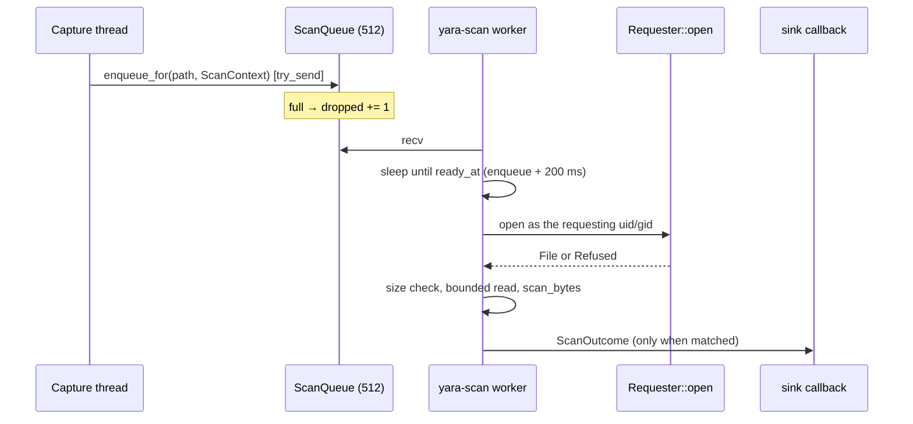

# YARA engine (`yara`)

The [`yara`](../../crates/yara/src/lib.rs) crate scans bytes with
[YARA-X](https://virustotal.github.io/yara-x/), the pure-Rust YARA implementation. It scans in
two places:

- **written files**: every file opened with write intent, scanned shortly afterwards
  ([`ScanQueue`](../../crates/yara/src/queue.rs));
- **process memory** (Linux only): the executable, file-less memory of one process, when a
  detection about that process asks for it ([`MemoryScanQueue`](../../crates/yara/src/memory.rs)).

Both use the same rule set, from `<content_root>/rules/yara/`. Neither ever scans on the
capture thread.

## Rule set and metadata

[`RuleSet::load_dir`](../../crates/yara/src/lib.rs) compiles every `.yar`/`.yara` file under
the directory into one `yara_x::Rules`. Unlike Sigma, **one bad file fails the whole load**:
shipped content must compile (the content suite enforces it). The agent then keeps the
previous rule set (`Load::Failed`).

Every compiled rule must carry three `meta:` strings, checked by `extract_metadata`:

| Key | Accepted |
| --- | --- |
| `severity` | `low`, `medium`, `high`, `critical` |
| `technique` | `T1234` or `T1234.001` |
| `falsepositives` | non-empty |

A rule missing one is a `YaraError::MissingMetadata` naming the rule identifier. Each match
comes back as a [`YaraMatch`](../../crates/yara/src/lib.rs) carrying the identifier, severity
and technique, so the sink never has to look them up.

`RuleSet::rule_count` counts compiled rules, not files: a file can hold several rules, and the
content suite pairs one sample per rule.

## File scanning

### Trigger

[`DetectionSink::detect_file_open`](../../apps/agent/src/sink/mod.rs) queues a scan for every
`FileOpen` whose flags include `O_WRONLY | O_RDWR | O_CREAT` (`0o103`). The request carries a
[`ScanContext`](../../crates/yara/src/queue.rs): the writer's `(ppid, comm)`, the parent's
incarnation, the event time and the requester's uid/gid. A match is attributed to that
process, not to whoever is running when the scan finishes.

### Settle delay

A write-intent open fires before the content lands. Each request is stamped
`ready_at = enqueue time + 200 ms` (`SETTLE`), and the worker sleeps only until that deadline.
Because the deadline is set at enqueue time, the waits of queued items overlap. A per-item
sleep would cap throughput at five scans per second.

### Reading on the requester's behalf

The agent reads with `CAP_DAC_READ_SEARCH`. The Linux sensor fires at `sys_enter_openat`,
before the kernel's permission check, so an open that fails with `EACCES` still queues the
path. Without a check, any local user could aim the agent at any file by name.
[`Requester::open`](../../crates/yara/src/access.rs) closes that hole:

1. Root (uid 0) is not restricted.
2. The path is canonicalised, so a planted symlink is judged by its target.
3. Every ancestor directory must grant the requester search permission (mode bits).
4. The file is opened, and read permission is checked **on the opened handle**, so a path
   swapped in between does not change which inode is judged.

Only the owner/group/other mode bits count. ACLs, supplementary groups and capabilities are
ignored, so the check fails closed: a file the user can reach only through those is not
scanned. On Unix, an event whose user the sensor could not resolve is not scanned at all, and
a warning is logged. On Windows there is no uid, and every path is scanned.

### Bounds

- `MAX_SCAN_BYTES` = 64 MiB. A larger file is skipped. The read is bounded with `take`, so a
  file that grows during the read is also skipped.
- Non-regular files (FIFOs, devices) are skipped: a FIFO would block the worker forever, and
  `/dev/zero` would never end.
- A vanished file is the normal case for a dropper that deletes its payload. The error is
  logged at debug level.
- `ScanStats { scanned, dropped }`. `scanned` is bumped only after the match callback returns,
  so a test or a shutdown that waits on it never misses a delivered match.

### What a match does

The callback built in [`start_yara`](../../apps/agent/src/sink/mod.rs) does three things:

1. **Fuses** each match into the writer's verdict entity (`fuse_yara_match`), keyed by the
   rule's technique. A native rule or Sigma finding of the same technique on that entity
   inside the dedup window stays one finding.
2. **Records** a `YARA` line per rule in the alert log, then escalates when the fused verdict
   warrants it.
3. **Quarantines** the matched file through `response::quarantine_file`, when response is
   enabled (Linux) and policy allows it. Otherwise it records an observe-only line. A file
   already inside the quarantine directory is never quarantined again: the quarantine write is
   itself a write-intent open and would otherwise match its own copy.

## Process-memory scanning

File scans cannot see a payload that only ever exists in memory: a `memfd` exec, reflectively
loaded shellcode. A memory scan reads one process's executable, file-less regions and runs the
same rules over them.

### Trigger, never a sweep

A scan is requested only by a detection about that process. Today that is the memfd-exec
rule: any `rules::Alert` with technique `T1620` makes
[`DetectionSink::record_rule_alerts`](../../apps/agent/src/sink/mod.rs) call `request_memory_scan`.
Scanning every process would cost too much, and the gain over a targeted scan is small.

### Policy and mechanism are split

The crate holds the policy: what to read, how much and how often
([`memory.rs`](../../crates/yara/src/memory.rs)). The platform holds the mechanism behind the
[`MemorySource`](../../crates/yara/src/memory.rs) trait. On Linux that is
[`ProcMemSource`](../../apps/agent/src/memscan.rs), which reads `/proc/<pid>/maps` and
`/proc/<pid>/mem` through `sensor-linux-procmem`. No other platform has a source yet, so
[`start_memscan`](../../apps/agent/src/sink/mod.rs) returns `Load::Absent` there.

### What is read

`MemoryRegion::is_candidate`: readable **and** executable **and** not file-backed. That means
anonymous mappings (named `[anon:...]` ones included), `memfd:` mappings and `(deleted)`
mappings. File-backed mappings are left out because the file scan owns them, and so are
`[stack]`, `[vdso]` and other special mappings. Candidates are read in priority order:

1. writable and executable (the strongest injection tell);
2. `memfd` and deleted-file mappings;
3. other executable anonymous memory.

### Budget

Every bound is a hard cap, and every skip is counted:

| Bound | Value | Where |
| --- | --- | --- |
| Regions per scan | 16 | `MemoryBudget::max_regions` |
| Bytes per region | 16 MiB (truncated, counted) | `MemoryBudget::max_region_bytes` |
| Bytes per scan | 64 MiB | `MemoryBudget::max_total_bytes` |
| Per process | one scan per `(pid, generation)` per 5 min | `COOLDOWN_NS`, 4,096 processes remembered |
| Host-wide | 6 scans per rolling minute | `MAX_SCANS_PER_MINUTE` |
| Queue | 16 requests | `QUEUE_CAP` |

`MemoryScanQueue::enqueue` applies the cooldown, then the rate cap, then the queue. Only an
admitted request spends the cooldown and the rate, so a shed request does not block a later
one. [`MemoryScanStats`](../../crates/yara/src/memory.rs) counts `scanned`,
`shed_queue_full`, `shed_cooldown`, `shed_rate` and `unreadable`.
[`MemoryScanReport`](../../crates/yara/src/memory.rs) records per scan the regions scanned,
skipped, unreadable and truncated, and the bytes read.

### The ptrace right

Reading another process's memory requires `CAP_SYS_PTRACE`, or that the target runs as the
agent's own uid. The packaged unit does **not** grant that capability, because it lets the
agent read and write the memory of any process, which is close to root. Without it, a scan of
another user's process fails with `PermissionDenied` and is counted as `unreadable`. An
operator who accepts the trade-off can add `CAP_SYS_PTRACE` to the unit's bounding and ambient
sets with a drop-in. `kernel.yama.ptrace_scope` can restrict access further, and the
capability overrides it.

### What a memory match does

[`report_memory_matches`](../../apps/agent/src/sink/mod.rs) fuses each matching rule into the scanned
process's entity (the same path as a file match) and records a `YARA-MEM` line with the region
counts. It quarantines nothing: there is no file to move.

## Platform differences

| | Linux | Windows | macOS |
| --- | --- | --- | --- |
| File scan | yes, per-user read check | yes, no uid check | yes, per-user read check |
| Quarantine on match | when response is enabled | observe-only | observe-only |
| Memory scan | yes, needs `CAP_SYS_PTRACE` for other uids | no (needs injection telemetry, [#32](https://github.com/synthaea-lab/agent/issues/32)) | no (needs task-port access, [#37](https://github.com/synthaea-lab/agent/issues/37)) |

## Testing

- Unit tests in [`queue.rs`](../../crates/yara/src/queue.rs): only matching files are
  delivered, and a match carries its `ScanContext`.
- [`access.rs`](../../crates/yara/src/access.rs): owner, group and other permission classes,
  directory search, symlinks, non-regular files.
- [`memory.rs`](../../crates/yara/src/memory.rs): a fake `MemorySource` covers candidate
  selection, priority order, every budget, the cooldown keyed on generation, the rate cap and
  queue shedding.
- [`tests/content.rs`](../../crates/yara/tests/content.rs): every shipped rule in the `rules`
  sibling repo compiles and fires on its crafted sample.
- Sink tests: `a_yara_match_with_quarantine_disabled_leaves_the_payload_and_says_observe_only`,
  `a_yara_match_with_quarantine_enabled_moves_the_payload_and_audits_it`, and the T1620 →
  memory-scan path in [`sink/tests.rs`](../../apps/agent/src/sink/tests.rs).
