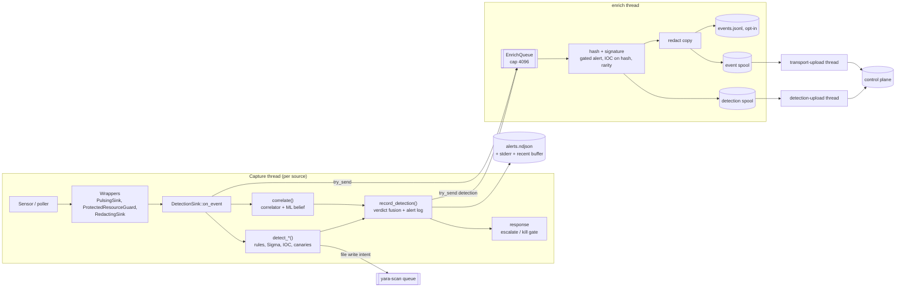
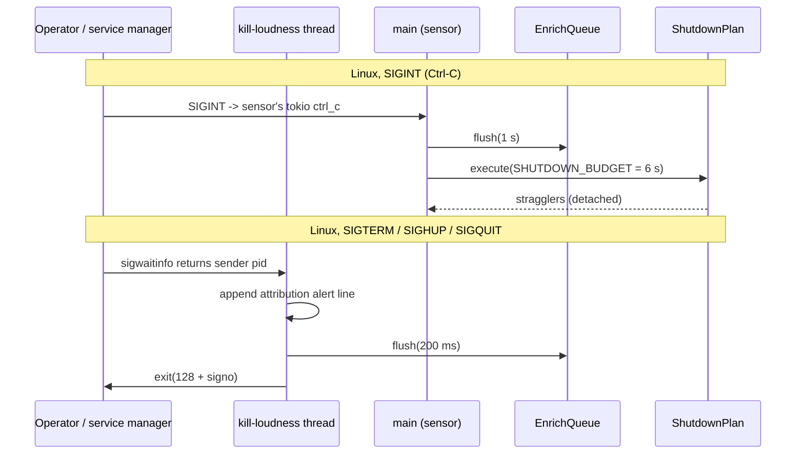

# Event lifecycle, threads, startup and shutdown

This page follows one event through `agent run`, from the sensor to the alert log and the control plane. It also lists the threads involved, the queues and their bounds, what happens under overload, and how `run` starts and stops on Linux, Windows and macOS. For the crate layout see [Architecture overview](architecture.md).

## The pipeline end to end

### 1. Sensor to `schema::Event`

Every source produces `schema::Event` values and hands each one by value to `EventSink::on_event`. The contract is in [`schema::sensor`](../crates/schema/src/sensor.rs):

- `Sensor::run(&mut self, sink: Box<dyn EventSink>)` blocks until `stop` is called or an error occurs. A sensor usually runs on its own thread, so it owns its sink for its whole lifetime.
- `EventSink::on_event(&self, Event)` takes `&self`, and implementations must be `Send + Sync`. A blanket `impl EventSink for Arc<T>` lets several producers share one sink. This is how the primary sensor and every poller thread feed the same `DetectionSink`.
- `Event` is `#[non_exhaustive]`, so a new variant does not break existing sinks. `DetectionSink` matches the variants it understands and only logs the rest.

Only the primary sensor implements `Sensor` (`LinuxSensor`/`AuditSensor`, `WindowsSensor`, `MacosSensor`, plus `EventLogSensor` and `UprobesSensor`). The other sources are poll or stream functions, and the platform module drives them on its own thread. The netlink poller, journal tail, socket pollers, unified-log tail and NE receiver all work this way.

### 2. Wrappers in front of the sink

Before an event reaches `DetectionSink`, it passes through these wrappers:

| Wrapper | Where | Purpose |
| --- | --- | --- |
| [`PulsingSink`](../agent/src/silence.rs) | Linux primary and uprobes. Windows ETW. | Pulses the sensor's `SensorHeartbeat` on every event, so the silence monitor can tell a silent sensor apart. Pollers pulse on each successful poll instead, whether or not it returned events. |
| [`ProtectedResourceGuard`](../agent/src/protected.rs) | Linux primary only | Raises an alert when a foreign process writes to the agent's own files: config, alerts file, events file. |
| [`RedactingSink`](../agent/src/redact.rs) | Windows and macOS, all commands. Linux capture commands. | Redacts URL secrets and similar fields at the boundary. In `run` mode (`redact_commands = false`), events that carry command text (`Exec`, `ReadlineInput`, `ScriptBlock`, `AmsiContent`, `WmiActivity`) pass through unredacted, because the rules must read the raw command line. The capture commands redact everything. |

The Linux `run` path does not put a `RedactingSink` in front of the detection sink. Redaction there happens only on the output copies (step 6).

### 3. Detection on the capture thread

[`DetectionSink::on_event`](../agent/src/sink/mod.rs) runs on whatever thread called it, synchronously, entirely in memory:

1. **`correlate`.** The event goes to `correlator::CorrelationEngine::on_event`. If an ML model loaded, `ml::CorrelationScorer` scores the process's behavior over the correlator window and feeds the log-likelihood ratio into the Bayesian belief. Results:
   - Out-of-distribution features are logged and give no evidence.
   - Scorer errors fail open.
   - `kill_shield` is read while the correlator lock is still held. The lock is released before any alert I/O.
2. **Canary hold expiry and tripwires** (`expire_held_canary`, `detect_canary`). Expiry runs only for events from the primary capture stream (exec and file events), because the hold window is measured on that stream's clock.
3. **Per-type dispatch** (`detect_exec`, `detect_file_open`, …). For an exec, the order is: stateless rules (`rules::evaluate_exec`), stateful rules (`RuleState::on_exec`), due identity and unit-stop alerts, then Sigma. A file open with write intent also enqueues a budgeted YARA scan ([`yara::ScanQueue`](../crates/yara/src/queue.rs)), which runs on the `yara-scan` thread.
4. **Signature-gated findings.** Some exec findings depend on the image's signature, which is not known yet. `RuleState::on_exec_signature_gated` returns them, and they travel with the event into the enrichment queue.
5. **Progress.** Only after all of the above does `on_event` increment the progress counter. A hang anywhere above, such as a poisoned lock or a wedged engine call, therefore stops the watchdog heartbeat.

No detection engine needs the file hash or signature synchronously. Rules, Sigma and the correlator work on command lines, lineage, paths and ports. This is why enrichment can run behind a queue.

### 4. Recording a finding

Every engine's finding goes through [`record_detection`](../agent/src/sink/mod.rs), which is a free function so that the enrichment worker and the YARA worker record findings the same way the capture thread does:

1. Builds a `schema::detection::Detection` from **redacted** copies of the trigger event and any extra evidence. Ransomware alerts carry a damage manifest of up to 100 renamed or deleted files (the server keeps 128 events per detection). The message has the raw command line replaced by its redacted form ([`safe_detection_message`](../agent/src/sink/mod.rs)).
2. Folds the detection into [`verdict::VerdictEngine`](../crates/verdict/src/lib.rs), keyed by `EntityKey` (`ppid`, `comm`, parent incarnation when known), with a 30 s dedup window (`VERDICT_DEDUP_WINDOW_NS`).
3. **Always** writes a line to [`AlertLog`](../agent/src/alerts.rs), even when the verdict engine absorbs the finding as a duplicate. `alerts.ndjson` is the complete audit trail. The verdict is a bounded view for triage.
4. If a new verdict snapshot comes out at `High` severity or above ([`response::should_escalate`](../crates/response/src/escalate.rs)), writes a `RESPONSE-ESCALATE` alert.
5. Hands the detection to the durable detection spool, when one is configured (step 6).

The worker records gated findings when it reaches them, which can be after the capture thread has recorded findings for later events of the same entity. Fusion keys on the event's own timestamp, so a late finding can at most be absorbed as a duplicate. It cannot reopen a window.

### 5. Automated response

Response is wired only on Linux, by [`DetectionSink::enable_response`](../agent/src/sink/mod.rs) in `cmd_run`. It is observe-only unless `--enable-kill` / `--enable-quarantine` is given.

- **Kill gate.** Only a correlator `BAYES` alert ([`crosses_kill_gate`](../agent/src/sink/mod.rs)) makes a process eligible for a kill. A Sigma `level: critical` does not. The gate looks only at the triggering event's own alert, never at the entity's accumulated verdict. That verdict is a running maximum over every process sharing `(ppid, comm)`, so gating on it would let one sibling's crossing condemn another. A `KillShield` from the correlator refuses the kill, even in observe mode, for a system service's main process or a login-session holder. Every outcome is audited as `RESPONSE-KILL`.
- **Ransomware reflex.** A T1486 burst that is corroborated by a canary touch from the same process incarnation goes through the same policy-gated kill, without the shield.
- **Quarantine.** A YARA match on a written payload is moved to `quarantine/` next to the alerts file when quarantine is enabled ([`quarantine_matched_payload`](../agent/src/sink/mod.rs)).

### 6. Enrichment, output and upload

[`EnrichQueue`](../agent/src/enrich_queue.rs) is a single `enrich` thread behind an `mpsc::sync_channel` of `QUEUE_CAP = 4096` items. It is a FIFO carrying three kinds of item:

- `Event(event, gated)`. The worker hashes and checks the signature of exec images (the `enrich::Enricher` cache is owned by this thread only). Then it:
  - resolves the gated alert against the signature, and records it only if the verified file is confirmed to be the image that ran;
  - checks the image hash against the IOC sets;
  - adds image-rarity evidence to the correlator;
  - redacts a copy of the event, then appends that copy to `events.jsonl` (only with `--events`) and to the event spool.
- `Detection`. The worker adds the hash to the detection's exec events (a cache hit for the event that follows in the queue), then persists it through [`persist_detection`](../agent/src/upload.rs). That function stores a retry key generated with the detection, so a redelivery after a crash carries the same identity.
- `Flush(tx)`. A marker used by shutdown to wait until everything queued before it has been processed.

With a control plane configured, [`upload::start`](../agent/src/upload.rs) opens two [`store::EventSpool`](../crates/store/src/spool.rs) directories next to the alerts file, `spool/` and `detection-spool/` (the latter has one record per segment). Each spool is capped at `storage.spool_max_mb` (default 4096 MiB), so the worst case on disk is twice that value. One `transport::UploadLoop` thread per spool drains it:

- Delivery is at-least-once. A segment is redelivered until it is acked.
- A segment the server rejects permanently is skipped.
- When the spool is empty, the loop polls every 5 s.
- Past the byte cap, the spool drops its oldest segments and counts the loss. The health beacon reports it as `spool_dropped`.

### Bounds and overload behavior

| Where | Bound | When full |
| --- | --- | --- |
| Enrichment queue, events | 4096 items | The event is dropped from enrichment, logging and upload, and `enrich_dropped` is incremented in the health beacon. A gated alert riding with it is handed back and raised **unverified** on the capture thread. Capture never blocks. |
| Enrichment queue, detections | Same channel | The capture thread appends to the detection spool itself and logs a warning. A finding is never dropped. Under sustained overload this puts file I/O on the capture thread, by design. |
| Event / detection spool | `storage.spool_max_mb` each | The oldest segments are dropped and counted. |
| Alert recent buffer | 256 alerts | The oldest is dropped from the buffer. `alerts.ndjson` still has every alert. |
| Verdict evidence | Bounded per entity in `verdict` | Duplicates within 30 s are absorbed, but still logged. |
| YARA file and memory scans | Budgeted queues in `yara` | Requests are shed and counted. |

### Hot content reload

`agent apply-content-manifest` downloads, verifies and writes content under `<state_dir>/content`. It then notifies the running agent over IPC. The [`AgentHandler::reload_content`](../agent/src/ipc_handler.rs) handler calls [`DetectionSink::reload_content`](../agent/src/sink/mod.rs), which swaps in new Sigma and YARA engines and a new common-set snapshot under their mutexes. A missing content directory unloads that engine. A broken one keeps the previous engine running and is reported as failed. If the notification fails, the command still succeeds, and the content is loaded at the next start.

## Threads in `agent run`

| Thread | Platforms | Started by | Stops how |
| --- | --- | --- | --- |
| main (primary sensor) | all | `cmd_run`: `LinuxSensor`/`AuditSensor` (own tokio runtime), ETW, or ES | Returns on Ctrl-C or sensor failure |
| `enrich` | all | `DetectionSink::new` | When the queue is dropped, i.e. with the process |
| `correlator-tick` | all | [`start_correlator_ticker`](../agent/src/sink/mod.rs). Advances the correlator clock every second so window-expiry alerts fire without new events. Holds only a `Weak` reference to the sink. | When the sink is dropped |
| `yara-scan`, `yara-memscan` | all (memscan Linux only) | `start_yara` / `start_memscan` when `rules/yara` exists | With the process |
| `transport-upload`, `detection-upload` | all, with a control plane | [`upload::start`](../agent/src/upload.rs) | `ShutdownPlan` on Linux (with a 3 s final drain), otherwise with the process |
| `heartbeat` | all | `wire_run_pipeline` | With the process |
| `ipc-server` | all | [`ipc_handler::spawn`](../agent/src/ipc_handler.rs) (current-thread tokio) | With the process. A failure there is logged and never stops detection. |
| `snapshot-fetch`, `ioc-control-plane`, `decoy-register`, `deception-refresh` | all, when enabled | `wire_run_pipeline` / `plant_canaries` | With the process |
| `sensor-silence` | Linux, Windows | [`silence::spawn_monitor`](../agent/src/silence.rs). Polls every 10 s and turns each confirmed stall into a T1562 alert. | With the process |
| `health-beacon` | Linux, Windows | `health_collector(...).spawn()` | `ShutdownPlan` on Linux, otherwise with the process |
| `kill-loudness` | Linux | [`kill_loudness::spawn_watcher`](../agent/src/kill_loudness.rs) | Ends the process itself |
| `netlink-poll` | Linux | [`spawn_netlink_poller`](../agent/src/commands/linux.rs), every 10 s | `ShutdownPlan` |
| `journal-tail`, `journal-canary` | Linux | [`spawn_journal_tail`](../agent/src/commands/linux.rs) | With the process |
| `avc-reader` | Linux, eBPF primary | [`spawn_avc_reader`](../agent/src/commands/linux.rs) | `ShutdownPlan` |
| `log-sources` | Linux, if `[logs]` is configured | [`log_sources::spawn`](../agent/src/log_sources.rs) | `ShutdownPlan` |
| `uprobes-supervisor`, `uprobes` | Linux | [`spawn_uprobes_supervisor`](../agent/src/commands/linux.rs) | With the process |
| `self-integrity`, `inventory` | Linux | `integrity::spawn_monitor`, `inventory::spawn_monitor` | With the process |
| `socket-poller`, `minifilter`, Event Log thread | Windows | [`run_windows_sensors`](../agent/src/commands/windows.rs) | Shutdown flag, then joined |
| `socket-poller`, `unifiedlog-tail`, `ne-receiver` | macOS | [`run_macos_sensors`](../agent/src/commands/macos.rs) | Stop flag, or the `log stream` child being killed |

Shared mutable state in `DetectionSink` is behind `Mutex`es (`RuleState`, correlator, Sigma, YARA, verdict), because several producer threads call `on_event` at once. Code takes a lock, collects alerts, and releases the lock before recording them. `record_rule_alerts` takes the rule-state lock again, so callers bind the alerts first (see the `FileSetTime` and `ProcessAccess` arms of `on_event`).

## Startup

Common to every OS ([`try_main`](../agent/src/main.rs)):

1. Parse the CLI and load the config. A failure here stops the binary.
2. Set up `tracing` from `log.level`, unless `RUST_LOG` overrides it.
3. Resolve the upload target ([`resolve_run_target`](../agent/src/upload.rs)):
   - `--standalone` uploads nothing.
   - `--server` uploads only to that server, which never receives the configured client certificate (pass `--cert`/`--key` explicitly).
   - With neither flag, the agent uploads to `server.control_plane_url` with the configured mTLS pair.
   - The CA bundle (`--ca-cert`, then `server.ca_cert`) applies in all cases.
4. Resolve the content directory. The default is `<storage.state_dir>/content`.

Then [`wire_run_pipeline`](../agent/src/commands/common.rs), in this order:

1. Transport first, because the sink needs the spool handles. If setting up upload fails and `server.offline_fallback` is on (the default), the agent runs without upload and raises an `UPLOAD-DISABLED` alert ([`start_or_disable`](../agent/src/upload.rs)). Without this fallback, an agent missing its certificates would detect nothing, and the watchdog would roll back an otherwise healthy release.
2. `DetectionSink::new`: alert log, enrichment worker, correlator, ML scorer, Sigma, YARA, IOC, common set. Absent content is not an error.
3. Correlator ticker. Then the control-plane URL is registered so the agent's own traffic does not raise IOC findings. Then snapshot fetch, the banner, the heartbeat writer and the IPC server.

After that, each platform calls `set_stderr_details`, `apply_detection` and `plant_canaries` before any sensor starts, so the first canary touch is already matched.

### Linux

[`linux::cmd_run`](../agent/src/commands/linux.rs) runs these steps in order:

1. `kill_loudness::block_termination_signals()`. This **must** come before any other thread exists, because threads inherit the signal mask when they are created.
2. `wire_run_pipeline` with a `RuleState` seeded from `/proc`, the `ld.so.conf` library directories and a `sock_diag` listener snapshot. A failed snapshot leaves the listener baseline empty.
3. Start the kill-loudness watcher.
4. Select the sensor ([`select_sensor`](../agent/src/commands/linux.rs)). eBPF is used if [`can_use_ebpf`](../agent/src/commands/linux.rs) passes: privileges (root, or `CAP_BPF`+`CAP_PERFMON` / `CAP_SYS_ADMIN`), BTF present, object loads, first program accepted by the verifier. Otherwise the audit fallback is used, at lower fidelity.
5. `enable_response`.
6. Register silence heartbeats:
   - primary sensor and journal: 120 s, since they have no self-generated canary;
   - netlink: 30 s (three missed polls);
   - AVC: about 6 s, registered only if its worker will run;
   - uprobes: registered only while it runs.
7. Start the silence monitor, the integrity and inventory monitors, and the health beacon (each one registered with a `ShutdownPlan` where noted in the thread table).
8. Start the netlink poller, journal tail, AVC reader (only when eBPF is primary, because `AuditSensor` already reads AVC records), log sources and uprobes supervisor. Attach the observation-only BPF-LSM `file_open` hook, best-effort; its `Ebpf` handle must stay alive.
9. Run the primary sensor behind `PulsingSink(ProtectedResourceGuard(sink))`. This blocks.

`agent status` on Linux is a non-invasive preflight. It loads every raw-tracepoint program through the verifier without attaching any, and exits non-zero if one is rejected ([`cmd_status`](../agent/src/commands/linux.rs)).

### Windows

[`windows::cmd_run`](../agent/src/commands/windows.rs) wires the pipeline with a `RuleState` seeded from `tasklist`, then starts the silence monitor and the health beacon. [`run_windows_sensors`](../agent/src/commands/windows.rs) then:

1. puts a `RedactingSink` in front of the sink;
2. registers the heartbeats: ETW 120 s, socket poller 30 s, each Event Log channel 60 s, minifilter 30 s;
3. installs a Ctrl-C handler that sets every stop flag;
4. starts the socket poller, the minifilter receiver (only if the driver is loaded) and the Event Log thread;
5. runs ETW on the calling thread.

The Event Log, socket and minifilter sources are supplementary. Their failure is logged and never fatal. The reverse also holds: if ETW fails before shutdown, [`hold_after_primary`](../agent/src/commands/windows.rs) keeps the run alive on the supplementary sources until Ctrl-C. The `windows-etw` heartbeat that never pulses then becomes a silence alert. The ETW error is still the run's exit result. Response flags and uprobe flags are accepted and ignored.

### macOS

[`macos::cmd_run`](../agent/src/commands/macos.rs) wires the pipeline and calls [`run_macos_sensors`](../agent/src/commands/macos.rs). That function starts the NetworkExtension receiver (best-effort: nothing connects without the packaged system extension), the socket poller and the unified-log tail, installs a Ctrl-C handler, and runs EndpointSecurity on the calling thread. ES needs root, the ES entitlement and Full Disk Access. There is no silence monitor and no health beacon yet ([#34](https://github.com/synthaea-lab/agent/issues/34)).

## Shutdown

Linux has two shutdown paths:

- **SIGINT.** `LinuxSensor::run` returns on its own Ctrl-C handler. `cmd_run` then flushes the enrichment queue (with a 1 s bound) so that accepted findings reach the spool. Then it calls [`ShutdownPlan::execute`](../agent/src/shutdown.rs):
  - every registered worker is signalled first;
  - each one is then joined against a single shared 6 s deadline (`SHUTDOWN_BUDGET`), which covers the upload loop's 3 s final drain plus margin;
  - a worker still running at the deadline is logged and detached;
  - whatever is still spooled is redelivered at the next start.
- **SIGTERM, SIGHUP, SIGQUIT** (for example `systemctl stop`, which signals the whole cgroup). These are blocked on every thread and taken synchronously by the `kill-loudness` thread. It writes an alert line naming the sender pid and `comm`, flushes the enrichment queue for at most 200 ms, and calls `exit(128 + signo)`. The final upload drain is skipped on purpose. This path must stay a bounded hard exit, so that a compromised or wedged process cannot use its own teardown to outlast a termination signal. SIGINT is not blocked, because the sensor needs it for its own clean stop.

SIGKILL cannot be caught or attributed by the agent itself. The eBPF sensor records SIGKILLs aimed at the agent from the kernel side, and the restarted agent reports the sender. Under the audit fallback this gap remains. The watchdog stops its child with `Child::kill`, which is SIGKILL on Unix.

On Windows and macOS, Ctrl-C sets the sensors' stop flags. The primary sensor returns, the supplementary threads are joined (Windows) or end with the process (macOS). Upload, health and enrichment threads end with the process: there is no `ShutdownPlan` and no enrichment flush. This loses no spooled data, since the spool redelivers, but it does skip the final upload drain.

## Degraded modes

| Condition | Behavior |
| --- | --- |
| eBPF cannot load (no BTF, no privileges, verifier refusal) | Audit fallback sensor. No BPF-LSM hook, no AVC reader (the audit sensor covers AVC itself). |
| `NETLINK_AUDIT` unavailable on an SELinux host | The AVC reader retries with exponential backoff from 1 s to 60 s, pulsing its heartbeat while it waits. The source is reported down as `linux-avc` in the health beacon, not reported as a silent sensor. Without SELinux, the reader is simply not started. |
| `journalctl` missing (non-systemd init) | Journal tail logged and skipped. A hard stream error ends the tail; it does not reconnect. |
| Upload setup fails | With `offline_fallback`: local detection only, plus an `UPLOAD-DISABLED` alert. Without it: `run` fails. |
| Control plane unreachable | Events and detections stay spooled until the byte cap. Heartbeat POST failures are logged at debug level. |
| IPC endpoint cannot bind | Logged. `cli` cannot reach the agent, detection continues. |
| No ML model / Sigma / YARA content | That engine is absent. Everything else runs. |
| Enrichment overload | See [Bounds and overload behavior](#bounds-and-overload-behavior). |
| ETW fails (Windows) | The run continues on the Event Log, socket and minifilter sources, and a silence alert is raised. |
| A uprobes capture set changes | The uprobes sensor restarts with the new set. Capture has a gap while it reloads. |

## Configuration knobs that shape the lifecycle

| Knob | Effect |
| --- | --- |
| `--config` / `SYNTHAEA_CONFIG` | Config path discovery. |
| `log.level` / `RUST_LOG` | Tracing filter. |
| `--alerts` (default `alerts.ndjson`) | Alert log. The heartbeat file, `spool/`, `detection-spool/`, `quarantine/` and the journal cursor are all derived from this path. |
| `--events` | Opt-in raw event log, redacted, unbounded. The packaged service never sets it. |
| `--server`, `--standalone`, `--cert`, `--key`, `--ca-cert`; `server.*` | Upload target and TLS material. |
| `server.offline_fallback` | Whether a failure to set up upload is fatal. |
| `storage.spool_max_mb` | Byte cap of **each** spool. |
| `storage.state_dir` | Content, model registry, release layout, key rotations. |
| `--content-dir` | Where Sigma, YARA, IOC and snapshot content are loaded from. |
| `--enable-kill`, `--enable-quarantine` | Leave observe-only mode (Linux). |
| `--enable-tls-capture`, `--enable-readline-capture`, `--enable-dns-capture` | Uprobe captures (Linux). DNS also enables socket-level UDP DNS capture. |
| `--alert-details` | Full alert message on stderr. |
| `ipc.endpoint` | Unix socket or named pipe served to `cli`. |
| `[logs]`, `[deception]`, `[detection]` | Linux service-log sources, canary directories, local time and odd-hour calibration. |
| watchdog `--restart-delay`, `--heartbeat-interval-secs`, `--heartbeat-miss-limit` | Backoff floor and hang detection. |

## How this is tested

- **Sink end to end:** the `tests` module of [`sink/tests.rs`](../agent/src/sink/tests.rs) drives a real `DetectionSink` in a temp directory. It covers rule routes, raw command lines reaching Sigma while outputs are redacted, the correlator ticker firing with no further events, quarantine on and off, canary holds and cooldowns, and response scenarios.
- **Enrichment queue:** [`enrich_queue.rs`](../agent/src/enrich_queue.rs) tests `overflow_sheds_and_counts_instead_of_blocking`, `a_shed_event_hands_its_gated_alert_back`, `flush_waits_for_already_enqueued_events_to_finish` and `flush_times_out_rather_than_waiting_forever_on_a_wedged_worker`.
- **Shutdown:** [`shutdown.rs`](../agent/src/shutdown.rs) tests the shared budget, signalling before the first join, wedged and panicked workers.
- **Upload:** [`upload.rs`](../agent/src/upload.rs) tests target resolution, redeliver-until-ack, poison-segment skip, retry keys surviving a reopen, and the offline fallback.
- **Pipeline wiring:** [`common.rs`](../agent/src/commands/common.rs) checks that the beacon and `cli health` read the same silence monitor.
- **Platform runners:** [`windows.rs`](../agent/src/commands/windows.rs) tests `hold_after_primary` and socket heartbeats. [`linux.rs`](../agent/src/commands/linux.rs) tests the AVC worker's backoff and recovery, SELinux detection, and the journal-to-rules sudo join.
- **Watchdog:** [`supervise.rs`](../watchdog/src/supervise.rs) tests backoff, `HeartbeatMonitor` and restart counting.
- **Not unit-tested:** the full SIGTERM path, because it exits the process. It is validated on a lab host.
- **Dependency rules:** `python3 tools/check-deps.py` runs in CI.
