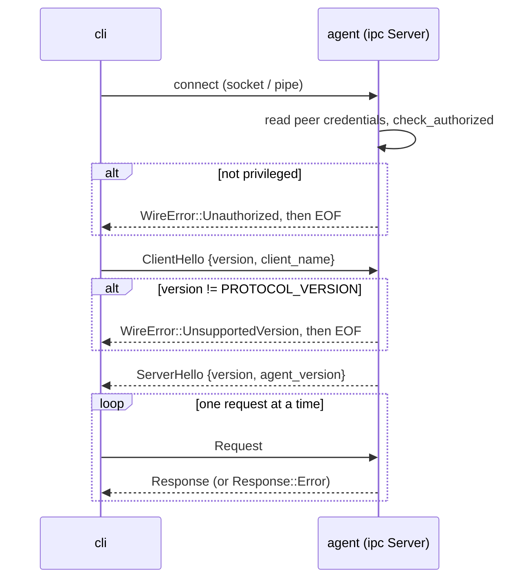

# Local interfaces: IPC, CLI and JSONL outputs

Besides the control plane, the agent talks to two local audiences: administrators on the host,
through a local control channel used by `cli` (and later the endpoint UI), and files on disk that
other tools read (the alert log, the optional raw event capture). This page explains both.

## Local control channel

The [`ipc`](../crates/ipc/src/lib.rs) crate implements a small request/response protocol over a Unix
domain socket (Linux, macOS) or a named pipe (Windows). The agent hosts the server
([`ipc_handler.rs`](../agent/src/ipc_handler.rs)); [`cli`](../cli/src/main.rs) and
`agent apply-content-manifest` are clients.

| Module | Responsibility |
| --- | --- |
| [`stream`](../crates/ipc/src/stream.rs) | OS-native `Listener`/`Stream` and the peer-credential read; the only place with `cfg(target_family)` code. |
| [`frame`](../crates/ipc/src/frame.rs) | JSON-lines framing with a 1 MiB per-message cap. |
| [`protocol`](../crates/ipc/src/protocol.rs) | Wire types: `ClientHello`, `ServerHello`, `Request`, `Response`, `WireError`. |
| [`server`](../crates/ipc/src/server.rs) | Accept loop, per-connection task, dispatch to a [`Handler`](../crates/ipc/src/server.rs). |
| [`client`](../crates/ipc/src/client.rs) | Connect, handshake, typed calls; maps errors to messages an operator can act on. |

### Connection lifecycle

- **Peer authentication** ([`PeerCreds::check_authorized`](../crates/ipc/src/stream.rs)) happens
  before a byte of the handshake is read: `uid == 0` on Unix (`SO_PEERCRED`, or `LOCAL_PEERCRED` on
  macOS), an elevated token on Windows (`TokenElevation` of the client process). Elevation, not
  group membership, is what an administrator running `cli` passes. The check is in code rather than
  in a pipe security descriptor so that a non-elevated client still connects and gets an explicit
  refusal. `client_name` is informational only.
- **Versioning** is strict equality on [`PROTOCOL_VERSION`](../crates/ipc/src/protocol.rs)
  (currently 3). A new request variant bumps the version; additive fields on existing variants do
  not.
- **Serial per connection, parallel across connections.** One tokio task per client; there are no
  correlation IDs because only one request is in flight per connection. A slow handler blocks its
  own connection, not the server. A failed `accept` is logged and the loop continues.
- **Framing** ([`read_message`](../crates/ipc/src/frame.rs)): one UTF-8 JSON object per line. JSON
  escapes newlines inside strings, so the delimiter is unambiguous. A line over
  [`MAX_MESSAGE_BYTES`](../crates/ipc/src/frame.rs) (1 MiB, newline included) or not valid UTF-8 ends
  the connection; the reader enforces the cap itself, since tokio's `read_line` has none. JSON lines
  were chosen so the wire is readable with standard tools and matches every other artifact the
  project writes.
- **Endpoints.** `ipc.endpoint` in `agent.toml`: an absolute socket path such as
  `/var/run/synthaea/agent.sock`, or `\\.\pipe\synthaea-agent`. On Unix a stale socket file is
  removed before binding, so a restart after a crash does not fail with "address in use".

### Requests

| Request | Effect | Notes |
| --- | --- | --- |
| `Status` | version, start time, pipeline health, active suppressions | |
| `SensorHealth` | per-sensor state | |
| `RecentDetections { limit }` | the most recent detections, oldest first | clamped to [`RECENT_DETECTIONS_HARD_LIMIT`](../crates/ipc/src/server.rs) (256), no error |
| `PolicyVersion` | applied policy metadata | |
| `ReloadContent` | re-read Sigma/YARA content and swap it into the running pipeline | sent by `apply-content-manifest` after it has verified and written content |
| `SuppressVerdict` / `UnsuppressVerdict` | silence or restore one technique on one entity `(ppid, comm)` in the fused verdict | reversible, audited, never touches the alert log |

The channel is read-mostly by design. The three mutating requests are exceptions because they act
only on the agent's own state: `ReloadContent` loads content that was already signature-checked
over the mTLS channel, and suppressions change only the agent's verdict view. Commands that act on
other processes or files (kill, quarantine, isolate) are not on this channel; they need a
per-capability authorization model first.

A handler error becomes `Response::Error(WireError::HandlerFailed)` and the connection stays open;
authentication, version and framing failures close it.

### Client errors

[`Client::connect`](../crates/ipc/src/client.rs) separates "the agent is not there"
([`ClientError::Connect`](../crates/ipc/src/error.rs)) from "the agent said no"
([`ClientError::Refused`](../crates/ipc/src/error.rs)). Permission denied on the socket, Windows
error 5, and an `Unauthorized` reply are all reported as access denied rather than as a missing
agent; a pipe closed during the handshake is reported as such. There is no connection pool and no
reconnect: clients are short-lived.

## `cli`

[`cli`](../cli/src/main.rs) holds no privileges of its own; it is a pure client of the IPC channel
(installed on Linux as `/usr/bin/synthaea-ctl`).

| Command | Does |
| --- | --- |
| `config init [--force]` | Write the default `agent.toml` template to the discovered path; refuses to overwrite without `--force`. |
| `config check`, `config path` | Validate the configuration, print where it was found. No network. |
| `status`, `health`, `detections [--limit 20]`, `policy` | IPC reads. |
| `suppress PPID COMM TECHNIQUE`, `unsuppress ...` | IPC suppressions. |

Configuration discovery: `--config`, then `SYNTHAEA_CONFIG`, then the OS default path. Every IPC
command accepts `--json` (one line of JSON) and exits non-zero with a copy-pasteable message when the
agent is unreachable or refuses.

## JSONL outputs

The [`sinks`](../crates/sinks/src/lib.rs) crate writes local JSON Lines. The agent speaks only
neutral formats; vendor SIEM connectors belong to the control plane's export, not to each agent.

- [`JsonlWriter`](../crates/sinks/src/lib.rs): one `Mutex<BufWriter<File>>` opened in append mode,
  one serialized value per line, **flushed per line** (the files are tailed while the agent runs,
  and losing buffered lines on a crash costs more than the syscall). A write error is ignored: a
  missed local log line must not stop capture.
- **Torn-tail repair.** On open, if the file is non-empty and does not end in a newline (a crash
  mid-write), a newline is appended first, so the first new record does not fuse with the torn
  line and make both unreadable.
- **Escaping** is `serde_json`'s: a process renamed to contain quotes or control bytes still yields
  valid JSON (tested in [`tests.rs`](../crates/sinks/src/tests.rs)).
- [`JsonlEventSink`](../crates/sinks/src/lib.rs) writes every normalized event in the schema's
  canonical serialization, unfiltered; used by `agent capture-events` and by the optional raw event
  log of `agent run`. [`AlertRecord`](../crates/sinks/src/lib.rs) is the alert-log record shape.

In `agent run` the raw event log is written by the enrichment worker, after redaction, never by a
capture thread, and is off unless requested: it grows without bound and only labs and ML calibration
need it ([`DetectionSink::new`](../agent/src/sink/mod.rs)).

Syslog/CEF and OCSF/ECS mappings are planned additions to this crate.

## Testing

| Test | What it proves |
| --- | --- |
| [`crates/ipc/tests/e2e.rs`](../crates/ipc/tests/e2e.rs) | A real server and client round-trip every request; a wrong version is refused. Run privileged in CI (see [Development](development.md#privileged-tests)). |
| Unit tests in [`stream.rs`](../crates/ipc/src/stream.rs), [`frame.rs`](../crates/ipc/src/frame.rs), [`client.rs`](../crates/ipc/src/client.rs) | Authorization policy, framing limits, error classification. |
| [`crates/sinks/src/tests.rs`](../crates/sinks/src/tests.rs) | Round trip, hostile strings, append across reopen, torn-tail repair. |

`cli` has no tests of its own; its IPC calls are covered by the `ipc` tests.
