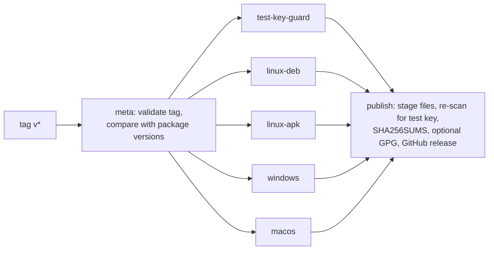

# Packaging

This page explains how build output becomes an installable, running agent on each OS: what each
package installs, how it cooperates with the self-updater, which build constraints apply (static
ONNX Runtime, embedded eBPF probes, no public test key), and how tagged releases are published.

Self-update itself is described in [Updates and releases](updates-and-releases.md). Building and
testing during development is in [Development](development.md).

## Status by platform

| Platform | Artifact | Built in CI | Published on tag | Service integration |
| --- | --- | --- | --- | --- |
| Debian/Ubuntu x86_64 | static musl `.deb` | yes ([`linux-deb-portability.yml`](../.github/workflows/linux-deb-portability.yml)) | yes | systemd unit, sysusers, tmpfiles |
| Alpine x86_64 | static musl `.apk` | yes ([`linux-apk-portability.yml`](../.github/workflows/linux-apk-portability.yml)) | yes (throwaway signing key) | OpenRC (`supervise-daemon`) |
| RHEL/Fedora | `.rpm` | no ([`build-rpm.sh`](../packaging/linux/build-rpm.sh) only) | no | systemd, SELinux file contexts |
| Windows x86_64 | MSI ([`build.ps1`](../packaging/windows/build.ps1)) | agent `.exe` only ([`windows-static-agent.yml`](../.github/workflows/windows-static-agent.yml)) | bare `.exe`, no MSI | SCM service registered by the watchdog |
| macOS arm64 | `.pkg` not built | agent binary only ([`macos-static-agent.yml`](../.github/workflows/macos-static-agent.yml)) | bare binary tarball | launchd + system extension (design only) |

Gaps tracked publicly: signed per-OS artifacts and the missing packages
([#54](https://github.com/synthaea-lab/agent/issues/54)), Authenticode signing
([#55](https://github.com/synthaea-lab/agent/issues/55)), the notarized macOS package
([#26](https://github.com/synthaea-lab/agent/issues/26)), arm64 builds
([#62](https://github.com/synthaea-lab/agent/issues/62)).

## The bootstrap model

Package managers and the updater must never fight over the same files. On Linux:

- the **package owns** `/var/lib/synthaea/bootstrap/{agent,watchdog,cli}`, the systemd unit, the
  system user and directories, and `/etc/synthaea/agent.toml`;
- the **updater owns** `/var/lib/synthaea/versions/` and the `current` symlink
  ([`Layout`](../crates/updater/src/layout.rs)).

`current` starts pointing at `bootstrap`. A package upgrade replaces the bootstrap binaries and
leaves `versions/` alone; the updater never writes `bootstrap/`. Day-0 trust is the package
manager's job; the updater's signature chain starts at the first update. The full tree is drawn in
[Updates and releases](updates-and-releases.md#on-disk-layout).

`/usr/bin/synthaea-ctl` is a root-owned **copy** of `cli`, not a symlink into `current/`: the
unprivileged service user owns `current` and could otherwise repoint it to get root through
`sudo synthaea-ctl`.

## Linux

### systemd unit

[`synthaea-agent.service`](../packaging/linux/systemd/synthaea-agent.service), shared by `.deb` and
`.rpm`:

- runs as user `synthaea` ([`synthaea.sysusers`](../packaging/linux/systemd/synthaea.sysusers)),
  with directories from [`synthaea.tmpfiles`](../packaging/linux/systemd/synthaea.tmpfiles)
  (`/run/synthaea`, `/var/log/synthaea`, `/var/lib/synthaea`, `/sys/fs/bpf/synthaea`);
- `ExecStartPre` recreates a missing `current -> bootstrap` and `versions/`, then runs
  `bootstrap/watchdog recover --base-dir /var/lib/synthaea`, which rolls back a release whose
  watchdog cannot execute ([`recovery.rs`](../apps/watchdog/src/recovery.rs));
- `ExecStart` is `current/watchdog run --agent-bin current/agent --alerts /var/log/synthaea/alerts.ndjson`;
  the watchdog supervises the agent and runs release probation;
- `Restart=always`; capabilities granted as an ambient set (`CAP_BPF`, `CAP_PERFMON`,
  `CAP_SYS_RESOURCE`, `CAP_DAC_READ_SEARCH`, `CAP_NET_ADMIN`, `CAP_KILL`, `CAP_AUDIT_READ`) with a
  matching bounding set; `NoNewPrivileges`, `ProtectSystem=strict`, and write access limited to the
  state, log, runtime and BPF directories.

The Alpine package uses OpenRC's `capabilities=` directive under `supervise-daemon` for the same
ambient set; file capabilities (`setcap`) are not used because they broke self-update and the
watchdog's die-with-parent protection.

### Static `.deb`

[`build-deb.sh`](../packaging/linux/build-deb.sh) must run on an x86_64 Alpine (musl) host
provisioned by [`alpine-toolchain.sh`](../packaging/toolchain/alpine-toolchain.sh). The output is fully static,
so one `.deb` runs on any glibc Debian/Ubuntu without inheriting the build host's glibc or libstdc++.
The script:

1. pins `cargo-deb` to 3.8.0 and reinstalls any other version: the `#DEBHELPER#` snippet injected
   into `postinst` is cargo-deb's own template and changes between releases;
2. builds ONNX Runtime from source unless `ORT_LIB_LOCATION` points at a musl static build, and
   derives the extra link flags with [`ort-static-link-flags.sh`](../packaging/toolchain/ort-static-link-flags.sh)
   (failing loudly if it produces none);
3. runs the `ml` tests and builds `agent`, `watchdog`, `cli` for `x86_64-unknown-linux-musl` with
   `--no-default-features` and `+crt-static`;
4. refuses any binary with a program interpreter, scans the binaries for the test key, checks that
   both eBPF probe objects were embedded, and runs `agent --help`;
5. packages with `cargo deb --no-build`, then extracts and `sh -n`-parses the generated maintainer
   scripts, because only the generated text proves the `#DEBHELPER#` substitution is valid.

CI ([`linux-deb-portability.yml`](../.github/workflows/linux-deb-portability.yml)) then runs the
packaged agent in `ubuntu:22.04`, `debian:12` and `rockylinux:9`, installs the package in containers
without systemd, and installs it on a systemd host to check the first start.

### `.apk`

[`APKBUILD`](../packaging/linux/alpine/APKBUILD) builds the same static musl binaries with the
rustup toolchain pinned by the repository (not Alpine's system Rust). CI builds, installs, upgrades
and removes it, and runs the binaries on glibc userlands. The published `.apk` is signed only by a
throwaway `abuild` key, so it installs with `apk add --allow-untrusted`.

### `.rpm`

[`build-rpm.sh`](../packaging/linux/build-rpm.sh) builds dynamically against the system ONNX Runtime
(`--no-default-features --features agent/dynamic-onnx`), scans for the test key and runs `rpmbuild`
with [`synthaea-agent.spec.template`](../packaging/linux/rpm/synthaea-agent.spec.template). No CI job
runs it.

On SELinux hosts the binaries under `/var/lib/synthaea` would otherwise carry `var_lib_t`, which
`init_t` cannot execute (`status=203/EXEC`). The spec's `%post` adds `semanage fcontext` rules that
label `bootstrap/` and `versions/<n>/*` as `bin_t`; `apply-release` runs `restorecon` on each new
release ([details](updates-and-releases.md#binary-self-update)). `dnf remove` keeps data and these
rules; a full cleanup is manual, documented in [`packaging/linux/README.md`](../packaging/linux/README.md).

## Windows

[`Product.wxs`](../packaging/windows/Product.wxs) (WiX v3) installs `agent.exe` and `watchdog.exe`
into `Program Files\Synthaea`. Custom actions run `watchdog.exe install` / `uninstall`, so the
watchdog registers the `SynthaEDR` service itself instead of WiX's service elements. On uninstall a
`CleanupInstallFolder` action deletes the whole install folder, including runtime files the MSI never
installed (`alerts.ndjson`, `alerts.heartbeat`, `events.jsonl`): uninstall must leave no residue, at
the cost of the local logs' forensic value.

Build: `cargo build --release --no-default-features --features agent/dynamic-onnx -p agent -p watchdog`
then [`build.ps1`](../packaging/windows/build.ps1), which refuses binaries carrying the test-key
marker. There is no binary self-update on Windows yet
([#60](https://github.com/synthaea-lab/agent/issues/60)), and the MSI and binaries are unsigned
([#55](https://github.com/synthaea-lab/agent/issues/55)).

[`windows-static-agent.yml`](../.github/workflows/windows-static-agent.yml) builds ONNX Runtime from
source (cached by build-script hash), links the agent statically, and fails if
[`check-pe-imports.py`](../tools/check-pe-imports.py) finds `onnxruntime.dll`, `directml.dll` or
`d3d12.dll` among the imports.

## macOS

There is no `.pkg` yet. [`packaging/macos/README.md`](../packaging/macos/README.md) records the
design: a signed app bundle in `/Applications` hosting the network system extension (Apple only
activates system extensions from one), a launchd daemon for the agent with the Endpoint Security
entitlement, a shared app group, and MDM payloads that pre-approve the extension, filter and Full
Disk Access. The restricted entitlements require Apple's grant before any build can run them on a
SIP-enabled host.

[`macos-static-agent.yml`](../.github/workflows/macos-static-agent.yml) builds ONNX Runtime from
source on Apple Silicon (Intel only on manual dispatch), runs the `ml` tests, links the agent
statically and fails if [`check-macho-imports.py`](../tools/check-macho-imports.py) finds a non-OS
library or one naming onnxruntime.

## Test-key exclusion

The `agent` crate's default features include `test-key`, which embeds updater keys derived from
public seeds: anyone able to serve the release routes could sign for such a build. Packaged builds
therefore always use `--no-default-features`, and several independent checks keep it that way:

| Check | Where | What it looks at |
| --- | --- | --- |
| [`check-no-test-key.sh`](../tools/check-no-test-key.sh) | CI `lint`, release `test-key-guard` | `cargo tree` feature resolution for the packaged flag sets on Linux, Windows and macOS targets (with a positive control on the default build), that each packaging script still builds without default features and scans its output, and that the binary scan can see the marker. |
| [`assert-no-test-key.sh`](../tools/assert-no-test-key.sh) | `build-deb.sh`, `build-rpm.sh`, static workflows, release `publish` | the marker string in the actual binaries. |
| marker scan in [`build.ps1`](../packaging/windows/build.ps1) | MSI build | `agent.exe`, `watchdog.exe`. |

Feature unification is how the key would sneak back in (any crate in the build asking for
`updater/test-key` is enough), which is why the check resolves features rather than reading
`Cargo.toml`.

## Release workflow

[`release.yml`](../.github/workflows/release.yml) runs on a pushed `vX.Y.Z[-suffix]` tag or by hand
for an existing tag; it never creates a tag. A tag with a `-` suffix becomes a pre-release.

- The four packaging workflows are reused through `workflow_call` with `upload-artifact: true`, so
  the release builds exactly what guards `main`.
- `meta` warns (does not fail) when the tag differs from the version in `apps/agent/Cargo.toml` or
  `APKBUILD`; package file names carry the package version, bare binaries carry the tag.
- `publish` re-scans every binary it is about to publish (extracted from the `.deb`, `.apk` and
  macOS tarball, plus the `.exe`), so a mix-up between jobs cannot ship the test key.
- `SHA256SUMS` covers every file. If the `release` environment holds `RELEASE_GPG_PRIVATE_KEY`
  (and optionally `RELEASE_GPG_PASSPHRASE`), a detached `SHA256SUMS.asc` and the public key are
  published; otherwise the release is still published with an "UNSIGNED BUILD" banner. Required
  reviewers on that environment put a second person in front of every publish.
- The workflow signs **no** updater or content manifest: those are signed offline from hardware
  tokens with [`release-tool`](updates-and-releases.md#building-and-signing-releases-release-tool).

## Toolchain scripts

| Script | Purpose |
| --- | --- |
| [`linux-toolchain.sh`](../packaging/toolchain/linux-toolchain.sh), [`arch-toolchain.sh`](../packaging/toolchain/arch-toolchain.sh), [`alpine-toolchain.sh`](../packaging/toolchain/alpine-toolchain.sh) | Provision a build/test machine (apt, dnf, pacman, apk): Rust, the eBPF nightly with `rust-src`, `bpf-linker`, and lab packages. Idempotent. If the `bpf-linker` download fails, the machine is replay-only. |
| [`windows-toolchain.ps1`](../packaging/toolchain/windows-toolchain.ps1) | Same for Windows build machines. |
| [`build-onnxruntime-static.sh`](../packaging/toolchain/build-onnxruntime-static.sh), [`.ps1`](../packaging/toolchain/build-onnxruntime-static.ps1) | Build ONNX Runtime 1.30.0 from source as static libraries (Linux glibc/musl, macOS, Windows MSVC). |
| [`ort-static-link-flags.sh`](../packaging/toolchain/ort-static-link-flags.sh), [`.ps1`](../packaging/toolchain/ort-static-link-flags.ps1) | Emit the link flags `ort-sys` omits: it walks the build output for every static library actually produced (abseil, `utf8_range`, model package...) rather than maintaining a list. |
| [`onnxruntime-static-build.md`](../packaging/toolchain/onnxruntime-static-build.md), [`onnxruntime-static-build-macos.md`](../packaging/toolchain/onnxruntime-static-build-macos.md) | Step-by-step guides and measurements. |

The eBPF probe toolchain is pinned separately in [`packaging/toolchain/ebpf-toolchain.txt`](../packaging/toolchain/ebpf-toolchain.txt); the
`bpf-linker` version and its SHA-256 are pinned in CI's `linux-ebpf` job and must match the
provisioning scripts.

Static linking of ONNX Runtime exists so the agent ships as one binary: no runtime shared library
to hijack, and a release manifest that covers everything that executes.
