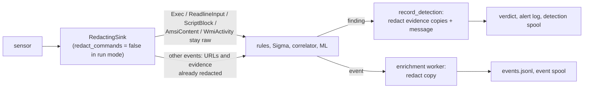

# Credential redaction

Telemetry carries credentials that people type or that tools receive on their
command line: `curl -u user:pass`, `mysql -pS3cret`, a presigned S3 URL, a
`net use \\host\share P@ss`, a PowerShell `ConvertTo-SecureString 'x'`. The
agent removes the recognizable ones **from every copy that leaves the process**.
The in-memory event that detection evaluates stays untouched.

Sources: the pure functions in [`crates/redact`](../crates/redact/src/lib.rs)
(plus [`text.rs`](../crates/redact/src/text.rs)) and the event-level boundary in
[`apps/agent/src/redact.rs`](../apps/agent/src/redact.rs).

## Where redaction happens

The core rule is **raw for detection, redacted for output**. Redacting at the
sensor would hide the very indicators rules look for (a credential in a command
line is itself a signal). Not redacting output would turn the spool, the alert
log and the baseline corpus into credential stores. A hash of the raw command
line would not help either: across a fleet it would act as a dictionary oracle
for guessing the secret. The agent emits no command-line hash. The `sha256` on
an exec is the hash of the image file.

| Boundary | Code | What is redacted |
|---|---|---|
| Sensor sink wrapper | [`RedactingSink`](../apps/agent/src/redact.rs), built by [`redacting`](../apps/agent/src/redact.rs) | Always: URL and evidence fields (below). Command text only when `redact_commands` is set, which the capture commands do. Live `run` pipelines leave command events raw ([`carries_command_text`](../apps/agent/src/redact.rs)). |
| Event output | enrichment worker in [`sink/mod.rs`](../apps/agent/src/sink/mod.rs) | A redacted clone goes to `events.jsonl` and the event spool. |
| Detection output | [`record_detection`](../apps/agent/src/sink/recording.rs) and `safe_detection_message` | Every evidence event, and the detection title when a rule quoted the command line or an AMSI excerpt. The raw quote is replaced with the matching excerpt from the redacted copy. |
| Baseline capture | baseline writer in [`sink/mod.rs`](../apps/agent/src/sink/mod.rs) | The training corpus stores the redacted `argv` and `cmdline`. Training and runtime scoring must use the same redacted canonical input. |
| Service-log events | [`log_sources::deliver`](../apps/agent/src/log_sources.rs) | `HttpRequest` evidence before it reaches the sink. |

[`redact_event`](../apps/agent/src/redact.rs) is the single per-variant dispatcher:

| Event | Field(s) | Function |
|---|---|---|
| `FileQuarantine` | `origin_url`, `referrer_url` | `redact_url_secrets` |
| `BitsJob` | `url` | `redact_url_secrets` |
| `HttpRequest` | `evidence.value`, only when `evidence.param` is secret-named (the name is kept so the finding still reads) | `is_secret_key` |
| `Exec` | `argv` in place, then `cmdline = argv.join(" ")`; or `cmdline` alone when `argv` is empty (Windows) | `redact_argv` / `redact_command_line` |
| `ReadlineInput` | `input` | `redact_command_text(Posix)` |
| `ScriptBlock` | `text` | `redact_command_text(PowerShell)` |
| `AmsiContent` | `text` (PowerShell dialect when `app_name` starts with `PowerShell`, opaque otherwise), and `content_name` when it is a URL | both |
| `WmiActivity` | `query` | `redact_command_text(Opaque)` |

Every other event passes through unchanged. The schema does not change:
redaction replaces values in place, so the `SCHEMA_VERSION` rules in
[Event schema](schema.md) are not involved.

## The redaction functions

All functions are pure, never panic, and are **idempotent**: running them
twice gives the same result as running them once. Each replaces only the secret
**value** with the literal [`REDACTED`](../crates/redact/src/lib.rs), and keeps
option names, separators, quoting and argument count.

### URLs: `redact_url_secrets`

[`redact_url_secrets`](../crates/redact/src/lib.rs) follows RFC 3986: the
fragment starts at the first `#`, and the query at the first `?` before it.

- `userinfo@` in the authority becomes `REDACTED@`. The **last** `@` ends the
  userinfo, as in browsers.
- A non-empty fragment is always redacted, whatever it contains.
- A query parameter's value is redacted when its name is secret-named (below).
  Order, separators, and valueless or empty parameters are kept.
- Input that is not a hierarchical URL keeps everything except a query or
  fragment.

### Secret-named keys: `is_secret_key`

[`is_secret_key`](../crates/redact/src/lib.rs) decides for query parameters,
`--long-option` names, header names, shell variables and PowerShell
parameters. The name is lowercased, any trailing `[]` is dropped, and the name is
checked both as written and after two rounds of percent-decoding, so
`pass%77ord` does not slip through. It matches when the name:

- equals one of `SECRET_KEYS` (`sig`, `code`, `pwd`, `pass`, `sid`, `jwt`),
- contains one of `SECRET_KEY_PARTS` (`signature`, `token`, `secret`, `passw`,
  `credential`, `session`, `sessid`, `authoriz`, `cookie`, `passphrase`), or
- ends with one of `SECRET_KEY_SUFFIXES` (`key`, `keyid`, `auth`). This covers
  `api_key`, `AWSAccessKeyId`, `oauth`, and SharePoint's `tempauth` download
  links.

Names ending in `_file` (or `file`/`path` for PowerShell parameters) are kept:
they point to where a secret is stored, not to the secret itself.

### Command lines: `redact_command_line` and `redact_argv`

[`redact_command_line`](../crates/redact/src/lib.rs) works on a flat string.
[`redact_argv`](../crates/redact/src/lib.rs) works in place on an argument
vector and keeps the number and order of arguments. Both pick the tool from the
**basename of the image**, lowercased, with `.exe` dropped. Tokenization follows
`CommandLineToArgvW` quoting for `.exe` images and POSIX-like rules otherwise.
An unbalanced quote falls back to splitting on whitespace from that token on.

Recognized shapes (see [`credential_option`](../crates/redact/src/lib.rs) and
[`should_redact_next`](../crates/redact/src/lib.rs)):

| Shape | Examples |
|---|---|
| Secret-named long option | `--password=x`, `--token x`, `--api-key=x` (not for `*_file`). MySQL-family `--password x` is kept, because the MySQL client reads the next word as a database name. |
| Tool-specific options | curl/wget `-u`/`--user user:pass` (only when the value has a `:`), curl `--proxy-user`, clustered `-su...`; wget `--http-password=`; mysql-family, `psexec`, `sshpass`, `7z` attached `-pVALUE`; `docker login -p`; `redis-cli -a`; `ldapsearch`/`ldapmodify`/`ldapadd -w`; `sqlcmd`/`bcp -P`; `zip -P`; `openssl -pass pass:x` (only after `pass:`); `smbclient -U user%pass` (only after `%`); `cmdkey /pass:`; `schtasks`/`wmic /p`, `/rp`, `/password` |
| `net` / `net1` positional password | `net user bob S3cret`, `net use \\host\share S3cret` (values starting with `/` and `*` are kept) |
| Headers | `-H 'Authorization: Bearer x'`, `--header=Cookie: ...`, any secret-named header, also as plain arguments (httpie, `--proxy-header`). The scheme word (`Bearer`, `Basic`...) is kept. |
| curl form bodies | `-d`/`--data*`: secret-named form fields only |
| URLs anywhere | handed to `redact_url_secrets` |

**Wrappers** are followed so the real command underneath is matched: `sudo`,
`doas`, `nohup`, `env`, `timeout`, `nice`, `cmd /c|/k`, `sh|bash|zsh|dash -c`,
and `powershell|pwsh -Command|-c`. At most eight wrapper layers are followed,
and at most one shell-string layer is parsed. A quoted wrapped command is one
token, so a trailing `&& echo done` stays outside it.

### Free command text: `redact_command_text`

[`redact_command_text`](../crates/redact/src/text.rs) handles text that holds
many commands: a typed shell line, a script block, an AMSI buffer, a WQL query.
[`statement_ranges`](../crates/redact/src/text.rs) splits it into statements at
unquoted newlines, `;`, `|`, parentheses and braces, `&` (PowerShell: only `&&`,
since `&` alone is its call operator) and the POSIX backtick. Each statement is
then redacted as a command line of its own first word.

| [`CommandDialect`](../crates/redact/src/text.rs) | Extra shapes |
|---|---|
| `Posix` | Secret-named `NAME=value` assignments before a command or after `export`, `declare`, `local`, `readonly` or `typeset` |
| `PowerShell` | Secret-named `-Param value` and `-Param:value`. The first literal after `ConvertTo-SecureString`. A quoted `$name = '...'` assigned to a secret-named variable (scope prefixes such as `env:` are ignored). A leading `&` or `.` call operator is skipped. Values computed at run time (`$var`, `(Read-Host)`, `@splat`, `[type]`) are kept, because they show the analyst where the secret came from. |
| `Opaque` | Grammar not parsed (VBScript, JScript, VBA, .NET, WQL). Only tool-independent shapes: URL credentials, secret headers, secret-named `--option=value` pairs. |

A redacted value keeps its quote and escape characters
([`redacted_keeping_syntax`](../crates/redact/src/text.rs); `R` stands in for
any other escaped character). This way a second pass splits the text in the
same places. On hostile quoting the statement splitter and the command-line
tokenizer can still disagree, so the function runs to a fixed point, at most
[`MAX_PASSES`](../crates/redact/src/text.rs) (16) passes. Text without a secret
costs one pass. Four passes were not enough for the property tests' quote and
escape noise, and 100,000 cases pass at sixteen.

## Known limits

This is best-effort text parsing, not a shell interpreter. Not recognized:

- secrets in environment variables, files or stdin; PowerShell
  `-EncodedCommand`; here-strings; string concatenation; shell expansions and
  aliases; `cmd` caret escapes
- unknown tool-specific options and unknown positional values (except the `net`
  forms)
- an ambiguous `tool --password --verbose S3cret`, where the later value cannot
  be safely identified
- tools invoked under a name the module does not know (a renamed binary, an
  unlisted wrapper, an interpreter calling a library instead of spawning a
  process). The tool is chosen from the basename only, with no path, hash or
  signature check.
- shell strings nested more than one level deep, and a shell string inside a
  typed line (`bash -c "a; mysql -p..."` is read as one command)
- a script block that ETW splits into fragments is redacted fragment by
  fragment, so a secret cut across two fragments is not recognized; AMSI text
  cut at the sensor's limit may end in the middle of a secret

In the other direction, a benign value after a recognized secret option is also
replaced.

There is no policy switch to turn output redaction off. The policy document
reserves a `RedactionPolicy` section (see
[Configuration](configuration.md#the-signed-policy-document)), but nothing reads
it yet.

The Linux uprobes sensor applies its own, separate regex scrubbing to TLS
plaintext, readline input and DNS queries before emitting
([`crates/sensors/linux/uprobes/src/redact.rs`](../crates/sensors/linux/uprobes/src/redact.rs)).
That module is defense in depth inside one sensor. The agent-level boundary
above applies regardless.

## Testing

- Table tests in [`crates/redact/src/lib.rs`](../crates/redact/src/lib.rs)
  (`redacts_supported_command_line_shapes_and_keeps_near_misses` and others)
  pin each supported shape **and** near misses that must be kept.
- Property tests (`proptest`) check that redaction never panics on arbitrary or
  truncated input, that it is idempotent (`redaction_is_idempotent`,
  `malformed_quote_context_does_not_make_redaction_non_idempotent`), that the
  `argv` and joined-cmdline paths agree, and, in `text.rs`, that free text is
  panic-free and idempotent. Past failing seeds are checked in under
  `crates/redact/proptest-regressions/` and replayed first.
- Boundary tests in [`apps/agent/src/redact.rs`](../apps/agent/src/redact.rs) check that
  the sink redacts URLs, leaves unrelated events unchanged, and that the real
  output wrapper redacts both Linux `argv` and raw Windows command lines.

## Adding a shape

1. Add the recognition in `credential_option` / `should_redact_next` (command
   lines), the `redact_argv_inner` loop (argv), or the dialect function in
   `text.rs`.
2. Add a positive case **and** a near miss to the table test.
3. Run the property tests locally with a high case count. Any new seed they
   find goes into `proptest-regressions/`.
4. Never move redaction into a rule or a sensor. Detection must keep reading
   the raw event.
