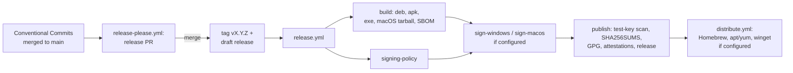

# Releasing

How a version of the agent goes from merged commits to a published GitHub release: the release
PR, the tag, the builds, signing when it is configured, and the package channels. Every secret and
variable the pipeline reads is listed in [Secrets and variables](#secrets-and-variables).

What each package installs and how the builds are made is in [Packaging](packaging.md). Updater
release manifests and content manifests are a different thing, signed offline (see
[What CI never signs](#what-ci-never-signs)).

## Overview



1. **Release PR.** [`release-please.yml`](../.github/workflows/release-please.yml) runs on every
   push to `main`. [release-please](https://github.com/googleapis/release-please) reads the
   [Conventional Commits](https://www.conventionalcommits.org/) merged since the last release and
   keeps one PR open, titled `chore: release X.Y.Z`, that writes `CHANGELOG.md` and bumps the
   version everywhere it is declared (below). A `lockfile` job then refreshes `Cargo.lock` on the
   PR branch, because the package builds run with `--locked`.
2. **Merge.** Merging the release PR is the release decision. On that push release-please creates
   the tag `vX.Y.Z` and a **draft** GitHub release holding the changelog section.
3. **Build.** [`release.yml`](../.github/workflows/release.yml) starts on the tag. It reuses the
   four packaging workflows through `workflow_call`, so the release builds exactly what guards
   `main`, plus the test-key guard and the SBOM job.
4. **Sign if configured.** `signing-policy` decides per platform from which secrets exist;
   `sign-windows` and `sign-macos` run only for platforms that have them.
5. **Publish.** `publish` scans every binary it is about to ship for the test key, writes
   `SHA256SUMS`, GPG-signs it when the key exists, attests every file, uploads to the draft and
   publishes it.
6. **Distribute.** [`distribute.yml`](../.github/workflows/distribute.yml) pushes the release to
   each package channel whose variables are set; with none set it does nothing.

Only commits whose subject follows Conventional Commits reach the changelog, which is why pull
request titles must follow them (the squash commit takes the PR title).

## Versions

One version for the whole workspace: every crate has `version.workspace = true` and the number
lives in `[workspace.package]` in [`Cargo.toml`](../Cargo.toml). The release PR updates it together
with the packaging files that repeat it, as listed in
[`release-please-config.json`](../release-please-config.json):

| File | Field |
| --- | --- |
| [`Cargo.toml`](../Cargo.toml) | `[workspace.package] version` |
| `Cargo.lock` | the workspace crates' entries (the `lockfile` job) |
| [`APKBUILD`](../packaging/linux/alpine/APKBUILD) | `pkgver` |
| [`synthaea-agent.spec.template`](../packaging/linux/rpm/synthaea-agent.spec.template) | `Version` |
| [`Product.wxs`](../packaging/windows/Product.wxs) | `Version` (`X.Y.Z.0`) |

[`.release-please-manifest.json`](../.release-please-manifest.json) records the last released
version (`0.0.0` before the first release). `release.yml` fails when a tag does not match
`Cargo.toml`, `APKBUILD` and the rpm spec, so a hand-made tag cannot publish files named after
another version.

**The 0.0.x alpha line.** While the version is `0.0.x`, the config
(`bump-minor-pre-major`, `bump-patch-for-minor-pre-major`) turns a `feat:` or `fix:` into a patch
bump: 0.0.1, 0.0.2, and so on. A breaking change (`feat!:` or a `BREAKING CHANGE:` footer) bumps
the minor version and leaves 0.0.x. Leaving 0.0.x is a team decision, and it is only possible once
every platform can sign (see [The unsigned-alpha rule](#the-unsigned-alpha-rule)); to pick the
version explicitly, add a `Release-As: 0.1.0` footer to a commit on `main`.

## Cutting a release

Merge the open release PR. Nothing else: do not push a tag by hand.

- With the [release app](#secrets-and-variables) configured, the release PR is opened by the app,
  so CI runs on it like on any PR, and the tag it creates starts `release.yml`.
- Without it, release-please works with `GITHUB_TOKEN`: CI does not run on the release PR (events
  made with `GITHUB_TOKEN` start no workflow, so required status checks never report), and
  `release-please.yml` calls `release.yml` itself after tagging.

If a release run fails, fix the cause on `main` and run `release.yml` by hand
(*Actions > Release > Run workflow*) with the existing tag: it rebuilds, re-uploads files of the
same name and replaces the notes above the changelog. The `draft` input leaves the release
unpublished for a manual check.

### The first release: v0.0.1

1. Make sure Actions are enabled for the repository, and that the `release` environment exists
   (*Settings > Environments*; add required reviewers there if a person must approve every
   release).
2. On the first push to `main` after this pipeline landed, `release-please.yml` opens the release
   PR `chore: release 0.0.1` (the config sets `initial-version` to 0.0.1 and starts the changelog
   at `bootstrap-sha`, so earlier history is not listed). If no PR appears, run *Release PR* by hand
   from the Actions tab.
3. Check the PR: `CHANGELOG.md`, `version = "0.0.1"` in `Cargo.toml`, the three packaging files,
   and the `Cargo.lock` commit from the `lockfile` job.
4. Merge it. The tag `v0.0.1` and a draft release appear; `release.yml` builds for a few hours
   (a cold ONNX Runtime build dominates on Windows and macOS).
5. With no signing secrets set, the result is the pre-release **"v0.0.1 — Alpha (unsigned)"**,
   whose notes open with a warning listing which platforms are unsigned.

## Signing

Each platform signs when **all** of its secrets exist and is unsigned when **none** do. A platform
with some but not all of its secrets fails the release (`signing-policy`): a typo in a secret name
must not silently ship an unsigned build. Secret values are only ever passed through `env:` to the
step that uses them, and only their presence is tested.

| Platform | What is signed | How | Job |
| --- | --- | --- | --- |
| Windows | the agent `.exe` (and the `.msi` once it is built in CI) | Authenticode through Azure Trusted Signing, with [`trusted-signing-cli`](https://github.com/levminer/trusted-signing-cli) 0.11.0; checked with `Get-AuthenticodeSignature` | `sign-windows` |
| macOS | the agent executable inside the tarball | `codesign` with the Developer ID Application identity and the hardened runtime, then `notarytool` (a bare executable cannot carry a stapled ticket; Gatekeeper looks the ticket up online). A `.pkg`, once built, is `productsign`ed with the Developer ID Installer identity, notarized and stapled. | `sign-macos` |
| Linux | `SHA256SUMS` (which covers every file, packages included) | detached GPG signature `SHA256SUMS.asc`, with the public key published beside it; the apt and yum repository metadata is signed with the same key by `distribute.yml` | `publish`, `package-repo` |

The `.apk` stays signed only by a throwaway `abuild` key until an Alpine repository exists.

### The unsigned-alpha rule

- **Every platform signed:** the release is titled `Synthaea vX.Y.Z` and is a full release (a
  pre-release only when the tag has a `-` suffix).
- **Any platform unsigned:** the release is a pre-release titled `vX.Y.Z — Alpha (unsigned)`, and
  its notes start with a warning naming each unsigned platform. Pre-releases are not sent to the
  package channels unless `DISTRIBUTE_PRERELEASES` is set.
- **Above 0.0.x** (major or minor not zero) with any platform unsigned, `signing-policy` fails and
  nothing is published.

### Turning signing on

Add the secrets of one platform at a time to the `release` environment, then cut the next 0.0.x
release and check its signing summary (the `signing-policy` job summary, and the per-platform
lines in the release notes warning).

- **Windows:** an Azure Trusted Signing account with a certificate profile, and an app
  registration (service principal) holding the *Trusted Signing Certificate Profile Signer* role on
  it. Set the six `AZURE_*` secrets.
- **macOS:** an Apple Developer ID Application certificate exported with its key as `.p12`
  (base64-encoded into `APPLE_CERTIFICATE`), its password, the identity name, and an App Store
  Connect API key for notarization (`.p8`, base64-encoded). Add the Developer ID Installer
  identity to the same `.p12` and set `APPLE_INSTALLER_SIGNING_IDENTITY` once a `.pkg` is built.
- **Linux:** an armored GPG secret key (`gpg --armor --export-secret-keys KEYID`) in
  `RELEASE_GPG_PRIVATE_KEY`, and its passphrase if it has one. Publish its fingerprint in
  [SECURITY.md](../SECURITY.md) so users can check it.

## What is published

| File | Notes |
| --- | --- |
| `synthaea-agent_<version>-1_amd64.deb` | static musl, installed and started in CI first |
| `synthaea-agent-<version>-r0.apk` | `apk add --allow-untrusted` (throwaway `abuild` key) |
| `synthaea-agent-<version>-windows-x86_64.exe` | the agent executable alone, no MSI yet |
| `synthaea-agent-<version>-macos-arm64.tar.gz` | the agent executable alone, no `.pkg` yet |
| `synthaea-{agent,watchdog,cli}-<version>.cdx.json` | CycloneDX 1.5 SBOM per binary, from [`cargo-cyclonedx`](https://github.com/CycloneDX/cyclonedx-rust-cargo) 0.5.9 with the packaged feature set (`--no-default-features`) for every target |
| `SHA256SUMS` | covers every file above |
| `SHA256SUMS.asc`, `synthaea-release-key.asc` | only when Linux signing is configured |

Every file also gets a [build provenance attestation](https://docs.github.com/en/actions/security-for-github-actions/using-artifact-attestations)
(`actions/attest-build-provenance`, keyless through Sigstore, no secret). To verify a download:

```sh
sha256sum --check --ignore-missing SHA256SUMS
gh attestation verify synthaea-agent-0.0.1-windows-x86_64.exe --repo synthaea-lab/agent
gpg --verify SHA256SUMS.asc SHA256SUMS   # signed releases only
```

`publish` re-scans every binary it is about to upload (extracted from the `.deb`, `.apk` and macOS
tarball, plus the `.exe`) for the updater test key, after signing, so a mix-up between jobs cannot
ship it ([Test-key exclusion](packaging.md#test-key-exclusion)).

## Distribution channels

[`distribute.yml`](../.github/workflows/distribute.yml) runs after `publish` (and by hand for any
tag). Each channel is switched on by a repository variable and skipped while it is unset. No
Microsoft Store channel.

| Channel | Switched on by | Also needs | What it does |
| --- | --- | --- | --- |
| Homebrew tap | `HOMEBREW_TAP_REPOSITORY` (`owner/name`) | the release app, installed on the tap | writes `Formula/synthaea-agent.rb` (Apple Silicon tarball, binary installed as `synthaea-agent`) and pushes it |
| apt / yum repository | `PACKAGE_REPO_REPOSITORY` (`owner/name`, served as static files, for example by GitHub Pages) | the release app, installed on that repository; `RELEASE_GPG_PRIVATE_KEY` | adds the `.deb` (and `.rpm`, once released) to the pool, regenerates `dists/stable` and `repodata`, signs `InRelease`, `Release.gpg` and `repomd.xml.asc`, publishes the key as `synthaea-archive-key.asc` |
| winget | `WINGET_PACKAGE_IDENTIFIER` | `WINGET_TOKEN` | opens a version PR on `microsoft/winget-pkgs` with [komac](https://github.com/russellbanks/Komac) 2.17.1 (portable `.exe`); the first version of the package must be submitted by hand |

## Secrets and variables

Secrets used by `signing-policy`, the `sign-*` jobs, `publish` and the distribution jobs that
declare `environment: release` can live in that environment (recommended: its reviewers then
guard them) or at repository level. The release app's key is the exception: `release-please.yml`
and the Homebrew job run outside the environment, so `RELEASE_APP_PRIVATE_KEY` must be a repository
(or organization) secret. None is needed for an unsigned 0.0.x release.

| Name | Kind | Used by | What it is |
| --- | --- | --- | --- |
| `RELEASE_APP_CLIENT_ID` | variable | `release-please.yml`, `distribute.yml` | Client ID of a GitHub App installed on this repository (contents, pull requests, issues: write) and on the tap and package repositories (contents: write). Makes the release PR and the tag trigger workflows. Optional. |
| `RELEASE_APP_PRIVATE_KEY` | secret | same | The app's private key (PEM). |
| `AZURE_TENANT_ID` | secret | `sign-windows` | Entra ID tenant of the signing service principal. |
| `AZURE_CLIENT_ID` | secret | `sign-windows` | Its application (client) ID. |
| `AZURE_CLIENT_SECRET` | secret | `sign-windows` | Its client secret. |
| `AZURE_SIGNING_ENDPOINT` | secret | `sign-windows` | Trusted Signing endpoint of the account's region, for example `https://weu.codesigning.azure.net`. |
| `AZURE_SIGNING_ACCOUNT` | secret | `sign-windows` | Trusted Signing account name. |
| `AZURE_SIGNING_PROFILE` | secret | `sign-windows` | Certificate profile name. |
| `APPLE_CERTIFICATE` | secret | `sign-macos` | Developer ID Application certificate and key, `.p12`, base64-encoded. |
| `APPLE_CERTIFICATE_PASSWORD` | secret | `sign-macos` | The `.p12` password. |
| `APPLE_SIGNING_IDENTITY` | secret | `sign-macos` | `Developer ID Application: <name> (<team id>)`. |
| `APPLE_INSTALLER_SIGNING_IDENTITY` | secret | `sign-macos` | `Developer ID Installer: <name> (<team id>)`; needed only once a `.pkg` is built. |
| `APPLE_API_KEY_P8` | secret | `sign-macos` | App Store Connect API key for `notarytool`, `.p8`, base64-encoded. |
| `APPLE_API_KEY_ID` | secret | `sign-macos` | That key's ID. |
| `APPLE_API_ISSUER` | secret | `sign-macos` | Its issuer ID. |
| `RELEASE_GPG_PRIVATE_KEY` | secret | `publish`, `package-repo` | Armored GPG secret key: signs `SHA256SUMS` and the apt/yum metadata. |
| `RELEASE_GPG_PASSPHRASE` | secret | `publish`, `package-repo` | Its passphrase (optional). |
| `HOMEBREW_TAP_REPOSITORY` | variable | `distribute.yml` | `owner/name` of the Homebrew tap. Unset: no Homebrew. |
| `PACKAGE_REPO_REPOSITORY` | variable | `distribute.yml` | `owner/name` of the apt/yum repository. Unset: no apt/yum. |
| `WINGET_PACKAGE_IDENTIFIER` | variable | `distribute.yml` | winget `PackageIdentifier`. Unset: no winget. |
| `WINGET_TOKEN` | secret | `distribute.yml` | Classic token with `public_repo` whose owner has a fork of `microsoft/winget-pkgs`. |
| `DISTRIBUTE_PRERELEASES` | variable | `distribute.yml` | `true` sends pre-releases (unsigned alphas included) to the channels too. |

`GITHUB_TOKEN` covers everything else; each job asks for the least it needs (`publish`:
`contents: write`, `id-token: write`, `attestations: write`; every other job `contents: read`,
except the release-please jobs). No workflow runs on `pull_request_target`, and no secret is read
on a pull request event.

## What CI never signs

The updater's release manifests, content manifests and rotation manifests are signed **offline**,
from a hardware token, by the key holders, with
[`release-tool`](updates-and-releases.md#building-and-signing-releases-release-tool). No workflow
holds an updater or content signing key or signs such a manifest; the keys above sign
distribution artifacts only (Authenticode, Developer ID, GPG over checksums and repository
metadata). A compromised CI can therefore publish a bad package, which the package manager or the
operating system may trust, but it cannot push an update or content release to installed agents.
