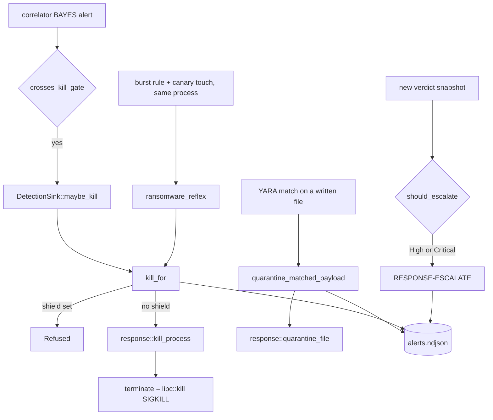

# Response

What the agent does to the endpoint on its own: kill a process, quarantine a file,
escalate an entity, and (library only, not wired) isolate the host. This page covers
the `response` crate, the kill gate and response wiring in the agent's detection sink,
and the operator commands that undo an action. How verdicts are produced is on
[Correlation and verdicts](correlation.md).

## Design rules

These hold for every action and explain most of the code's shape:

- **Off by default, observe-only when off.** [`ResponsePolicy`](../crates/policy/src/lib.rs)
  has one flag per destructive action (`kill_enabled`, `quarantine_enabled`,
  `isolate_enabled`), all `false` by default (pinned by `default_is_observe_only`).
  With a flag off, the same trigger still produces an audit line saying what *would*
  have happened, so a policy can be trialled before it acts.
- **One outcome type per action, acted or not.** [`KillOutcome`](../crates/response/src/kill.rs),
  [`QuarantineOutcome`](../crates/response/src/quarantine.rs) and
  [`IsolateOutcome`](../crates/response/src/isolation.rs) each cover "acted",
  "observe-only", "failed" (and for kill, "refused"). Observing is a variant of the
  result, not a separate code path, and the functions never return `Err`: a caller
  audits every outcome through one path.
- **Every outcome is audited** into the alert log (`alerts.ndjson`) as a `RESPONSE-*`
  line, through the sink's single alert funnel ([`AlertLog`](../apps/agent/src/alerts.rs)).
- **The library is platform-neutral.** `response` depends only on `schema` and
  `policy`. The OS call that acts (the `SIGKILL`, the firewall) is injected by the
  agent binary, which already holds the per-platform code in
  [`commands/`](../apps/agent/src/commands/mod.rs).
- **Undo goes the safe direction without a policy gate.** Restoring a quarantined file
  and lifting an isolation are never gated: refusing them would turn a policy mistake
  into a host nobody can recover.

## Wiring

The hooks live in [`ResponseHooks`](../apps/agent/src/sink/response.rs): the policy, the injected
`terminate` closure and the quarantine directory. They sit in an `Arc<OnceLock<_>>`
rather than a constructor argument because the YARA worker's callback is created inside
[`DetectionSink::new`](../apps/agent/src/sink/mod.rs), before any caller can configure the
sink; the shared cell lets both the capture thread and that callback read whatever was
set later.

[`DetectionSink::enable_response`](../apps/agent/src/sink/response.rs) fills the cell, once:
a second call is ignored with a warning, so the policy in force never changes under a
running agent (pinned by `enable_response_twice_keeps_the_first_policy`). Only the
Linux `run` command calls it ([`commands/linux.rs`](../apps/agent/src/commands/linux.rs)),
from the `--enable-kill` and `--enable-quarantine` flags of `agent run`
([`main.rs`](../apps/agent/src/main.rs)). `isolate_enabled` is always `false` there. When
the cell is empty, every kill and quarantine path returns before doing or logging
anything: on Windows and macOS the flags are accepted and ignored, and no
`RESPONSE-KILL`/`RESPONSE-QUARANTINE` line appears at all (pinned by
`bayes_crossing_without_response_hooks_alerts_but_never_kills`).

## The kill gate

### What can trigger a kill

Exactly two triggers reach [`DetectionSink::kill_for`](../apps/agent/src/sink/response.rs):

1. **A `BAYES` alert raised by this event.** In
   [`emit_correlator_alerts`](../apps/agent/src/sink/mod.rs), after every correlator alert has
   been recorded, the pid of the last alert for which
   [`crosses_kill_gate`](../apps/agent/src/sink/response.rs) is true (technique `BAYES`) is passed to
   [`maybe_kill`](../apps/agent/src/sink/response.rs). The audit reason is "a high-confidence
   correlated verdict".
2. **The ransomware reflex.** [`RansomwareJoin`](../apps/agent/src/ransomware_join.rs)
   records, per process incarnation, the last ransomware burst rule (T1486) and the
   last canary touch. When both are fresh within 60 s of each other, in either order,
   [`ransomware_reflex`](../apps/agent/src/sink/response.rs) kills that pid. Neither signal kills
   alone: a burst alone is a backup or an archiver; a canary touch alone is an indexer
   nobody listed. The join tracks at most 256 incarnations and counts evictions; a
   touch judged only after the canary hold expired does not trigger it.

Nothing else kills. In particular **severity never gates a kill**: a Sigma rule
written with `level: critical`, a High built-in rule, a YARA match or the fused
verdict's composed severity are analyst-facing rankings, not a belief the correlator
earned, and none of them widens what the agent kills. `BAYES` also carries `Critical`,
but that is incidental. Pinned by `a_critical_sigma_hit_never_triggers_a_kill`,
`a_high_severity_built_in_alert_never_triggers_a_kill` and
`a_siblings_weak_alert_never_triggers_kill_from_anothers_bayes_crossing` in
[`sink/tests.rs`](../apps/agent/src/sink/tests.rs).

`BAYES` is raised only from the per-event path, never from the one-second
`advance_time` tick, so the tick passes no shield and cannot reach the gate.

### Shields: refusing by what the process is

[`DetectionSink::correlate`](../apps/agent/src/sink/mod.rs) asks the correlator for
[`CorrelationEngine::kill_shield`](../crates/correlator/src/engine.rs) for the event's
pid and incarnation, before releasing the correlator lock. If a shield is set,
`kill_for` reports [`KillOutcome::Refused`](../crates/response/src/kill.rs) with a
fixed reason ([`shield_refusal`](../apps/agent/src/sink/response.rs)) and never calls the policy or
`terminate`:

| Shield | Refusal text names |
| --- | --- |
| `ServiceMain` | main process of a system service: image under a system path, started by init |
| `LoginSession` | holds a login session: `sshd-session` (or `sshd` before OpenSSH 9.8) exec'd by `sshd` |

The refusal is reported in observe mode too, so the audit line says "refused" rather
than "would have been killed". The `BAYES` alert and any escalation still happen; only
the kill is withheld. Corroborating evidence does not lift a shield. The texts state
exactly what was checked (a path and a parent, not package ownership or a legitimate
session). The ransomware reflex passes no shield: it rests on its own two-signal
evidence, not on a calibrated score. How shields are computed, their limits, and the
open gap for services started before the agent
([#52](https://github.com/synthaea-lab/agent/issues/52)) are on
[Correlation: kill shields](correlation.md#kill-shields-provenance-recorded-at-exec).

Pinned by `a_system_service_crossing_bayes_is_refused_not_killed`,
`an_ssh_login_session_crossing_bayes_is_refused_not_killed`,
`a_shell_inside_an_ssh_login_crossing_bayes_is_still_killed`,
`observe_mode_reports_a_service_as_refused_not_as_would_be_killed` and their
neighbours in [`sink/tests.rs`](../apps/agent/src/sink/tests.rs).

### `kill_process`: protected pids and the policy gate

[`response::kill_process`](../crates/response/src/kill.rs) runs, in order:

1. **Protected pids** ([`protected_reason`](../crates/response/src/kill.rs)) are
   refused whatever the policy says, and reported as `Refused` even with kill off:
   pid 0 and any pid that does not fit a signed `pid_t` (on Unix both address a process
   group, or every process), pid 1, and the agent's own pid. The pid comes from
   telemetry and the kill is a privileged signal by number, so a wrong number must
   fail closed.
2. **Policy.** `kill_enabled == false` returns `ObserveOnly` without calling
   `terminate`.
3. **`terminate(pid)`.** On Linux this is
   [`terminate_process`](../apps/agent/src/commands/linux.rs): `libc::kill(pid, SIGKILL)`.
   `SIGKILL`, not `SIGTERM`, so a process judged compromised cannot catch the signal
   to clean up, hide or persist. An error (already exited, `EPERM`) becomes
   `Failed { error }`.

The packaged unit grants `CAP_KILL`
([`synthaea-agent.service`](../packaging/linux/systemd/synthaea-agent.service)).

### Failure modes and limits

- **Pid reuse.** The pid is the one on the event that raised the verdict. If the
  process exits and the pid is reused before the signal, the new process is killed.
  The window is the time between the event and the gate, normally microseconds on the
  capture thread, but it is not closed: the kill is by number, not by incarnation.
- **Calibration.** The trigger is a behavior belief, not a signature. A short-lived
  tool that execs and repeatedly connects out can cross it whatever its image path.
  Run with kill off first, read the `would have been killed` lines, and enable it on
  hosts where every one of them is something you want killed.
- **Siblings.** The belief is shared by every child of one parent with one name; the
  pid killed is the one whose event made it cross.

## Quarantine

### Trigger

The YARA file worker scans files opened with write intent (budgeted, off the capture
thread). On a match it writes one `YARA` line per rule, fuses the match into the
writing process's verdict, escalates if warranted, then calls
[`quarantine_matched_payload`](../apps/agent/src/sink/tests.rs). Any matching rule triggers it;
the rule's severity is not consulted. A path already under the quarantine directory is
skipped: writing a payload there is itself a file event the sensor sees, and
re-quarantining it would overwrite its own origin record with the wrong path.

The quarantine directory is `quarantine/` next to the alert log
([`quarantine_dir_for`](../apps/agent/src/quarantine_cmd.rs)), the one definition both
`agent run` and `agent quarantine` use. Memory-scan matches never quarantine: there is
no file to move.

### What `quarantine_file` does

[`response::quarantine_file`](../crates/response/src/quarantine.rs) checks the policy,
then [`try_quarantine`](../crates/response/src/quarantine.rs):

1. **Open once.** The source is opened a single time (`O_NOFOLLOW` on Unix, checked as
   a regular file with `fstat`). Hashing, linking or copying, and the final `chmod` all
   go through that descriptor, so swapping the name for a symlink after the check
   cannot redirect the action.
2. **Hash** (SHA-256), bounded to the size the file had when it was opened.
3. **Secure the directory.** Created `0700`, opened without following symlinks;
   tightened when the agent owns it, refused when another user owns it and it is not
   already `0700`. Existing entries are tightened first; a failure there stops the
   quarantine rather than adding to an insecure store.
4. **Reserve a slot.** The payload is filed under its digest; identical payloads from
   different paths get `<sha256>.1`, `<sha256>.2`, ... The `<slot>.origin` sidecar is
   written (`create_new`, `0600`, `fsync`) **before** the source moves, holding a
   magic header, the original path and the original Unix mode. A failed sidecar write
   leaves the source untouched.
5. **Move.** On Linux the open inode is hard-linked into the slot through
   `/proc/self/fd` (`linkat` with `AT_SYMLINK_FOLLOW`) and the original name removed.
   When linking is not possible (another filesystem, no hard links, protected hard
   links) it copies from the descriptor instead
   ([`can_fall_back_to_copy`](../crates/response/src/quarantine.rs)).
6. **Secure the payload** to `0400` (`set_readonly` alone would keep the execute
   bits). If securing fails, the move is rolled back; if the rollback also fails, the
   payload stays in quarantine and the error says so.

**A source being written to** (a dropper still downloading, or an attacker keeping it
busy) is noticed from a size or mtime change since the open. Refusing would let a
writer defeat quarantine, so the agent instead copies the descriptor's bytes into a
private snapshot, hashing as it copies, and files the snapshot under that digest, so
the stored bytes and the digest always agree
([`quarantine_snapshot`](../crates/response/src/quarantine.rs)). The copy is bounded to
the length at open. Snapshots left by a killed agent are swept at the next quarantine
after a grace period; an in-flight one is protected by an advisory lock, or, on a
filesystem without `flock`, only one untouched for an hour is taken.

Known limits, all on Unix:

- `O_NOFOLLOW` covers the last path component only; a symlinked parent directory
  under an attacker's control is still followed.
- The check of the source name and its removal are not atomic. A write after the last
  re-check leaves stored bytes that differ from the digest (restore then reports a
  mismatch). A write that keeps both size and mtime (same timestamp tick, shared
  mapping) can go unnoticed.
- Bytes appended after the open are not stored; the outcome is still `Quarantined`
  with the digest of the prefix.
- When the file is copied rather than linked, only the opened name is removed: other
  hard links to the original inode keep their execute bits.
- `0700` isolates other local users, not a process running as the quarantine owner.

Platform: Windows has no ACL hardening for the quarantine store and does not wire
automated quarantine at all; the non-Unix code path only sets the read-only attribute.

**Packaged unit.** The Linux unit runs as the `synthaea` user with
`ProtectHome=read-only` and a small `ReadWritePaths` set, without `CAP_DAC_OVERRIDE`
or `CAP_FOWNER` ([`synthaea-agent.service`](../packaging/linux/systemd/synthaea-agent.service)).
It can read and scan payloads anywhere, but cannot move a file out of another user's
directory: there, quarantine fails with a logged `failed to quarantine ...` and the
payload stays in place.

### Restore and list

`agent quarantine list|restore --alerts <same path as run>`
([`quarantine_cmd.rs`](../apps/agent/src/quarantine_cmd.rs)):

- [`list_quarantined`](../crates/response/src/quarantine.rs) prints digest and
  original path, skipping (with a warning) a malformed sidecar so one bad entry cannot
  hide the others.
- [`unquarantine`](../crates/response/src/quarantine.rs) refuses anything that is not a
  lowercase SHA-256 (it becomes a file name), re-hashes each slot before giving it
  back (a tampered slot is reported, the next slot is still tried), never overwrites
  an occupied original path (`AlreadyExists`), and restores the original mode (legacy
  path-only sidecars restore as `0400`). Once the file is back the restore has
  succeeded; failing to remove the stored copy afterwards is reported through
  [`is_still_quarantined`](../crates/response/src/quarantine.rs), not as an error.
- The restore is audited as `RESPONSE-UNQUARANTINE`, on success and failure. It is not
  policy-gated: it needs only host access.

## Escalation

[`escalate_if_warranted`](../apps/agent/src/sink/mod.rs) runs whenever the verdict engine
returns a new snapshot (a first sighting, a severity raise, or a recurrence after the
dedup window, never an absorbed duplicate) and
[`response::should_escalate`](../crates/response/src/escalate.rs) says its fused
severity is at least `ESCALATION_THRESHOLD` (`High`). It writes one
`RESPONSE-ESCALATE` line naming the entity, the severity, the number of sources and
the techniques. It is non-destructive, needs no policy flag, and runs on every
platform, with or without `enable_response`. The YARA workers call the same free
function, so a file or memory match escalates exactly like any other finding.

`response` takes the severity as data rather than depending on the `verdict` crate,
which keeps it base-tier.

## Host isolation (library only)

[`isolation.rs`](../crates/response/src/isolation.rs) holds the platform-neutral half
of host isolation: block everything in and out except loopback, DHCP and the agent's
own path to its control plane.

- [`IsolationPlan`](../crates/response/src/isolation.rs) is the allowlist of
  control-plane endpoints, sorted, deduplicated, IPv4-mapped IPv6 normalized, capped
  at `MAX_CONTROL_PLANE_ENDPOINTS` (16). Endpoints that would open more than one
  server are refused (port 0, unspecified, multicast, broadcast, IPv6 link-local).
  Deserializing goes through the same validation, so a hand-edited `isolation.json`
  cannot widen the allowlist.
- [`HostFirewall`](../crates/response/src/isolation.rs) is the trait the binary would
  implement per platform: an atomic `apply`, a `lift` that removes only the agent's own
  objects, and `applied`.
- **Intent first.** [`isolate_host`](../crates/response/src/isolation.rs) persists the
  [`IsolationIntent`](../crates/response/src/isolation.rs) (synced temp file plus
  rename, so a crash leaves the old or the new intent, never a torn one) before it
  changes the firewall. If the firewall refuses, the previous intent is written back.
  Every reader and writer takes a sibling `.lock` file, because the CLI, the agent's
  IPC handler and a lift command are separate processes.
- **Reconcile at start-up.** [`reconcile`](../crates/response/src/isolation.rs) makes
  the firewall match the intent. Re-applying an isolated host's plan also restores a
  permit someone removed beside an intact block. A missing block on an isolated host,
  or a leftover block on a free one, is drift (a tampering signal). An unreadable
  intent changes nothing: guessing could isolate a host nobody asked to isolate or
  free one that should stay contained. Reconcile is not policy-gated: an isolation
  already in force stays enforced if the policy is turned off later.
- **Lift is never gated** ([`lift_isolation`](../crates/response/src/isolation.rs)),
  works over an unreadable intent, and runs even when the lock cannot be taken.

**Status:** fully unit-tested against a fake firewall, but nothing outside the crate
calls it. No platform implements `HostFirewall`, no command or verdict triggers it,
and the agent never emits `HOST-ISOLATE`, `HOST-UNISOLATE` or `HOST-ISOLATION-DRIFT`.
The Windows enforcement primitive (WFP) is tracked in
[#33](https://github.com/synthaea-lab/agent/issues/33).

## Not built yet

- **Live response** ([`live.rs`](../crates/response/src/live.rs)): analyst-driven,
  time-boxed sessions with a fixed, policy-gated command vocabulary, every command and
  output audited, the agent executing but never originating. Documentation only
  ([#28](https://github.com/synthaea-lab/agent/issues/28)).
- **Remediation** beyond quarantine restore: removing or disabling attacker
  persistence (services, scheduled tasks, cron, systemd units), snapshot rollback, and
  cleanup scoped by a case's damage manifest
  ([#31](https://github.com/synthaea-lab/agent/issues/31)). The direction under
  consideration is host-local and reversible: disable rather than delete, bind each
  action to the alert line it answers, keep an archive for undo, gate it with its own
  policy flag, and audit it as `RESPONSE-REMEDIATE*`.
- **Automated response on Windows and macOS.** The library is platform-neutral, but
  neither `run` command calls `enable_response`.
- **A server-to-agent command channel.** Every action today fires from the agent's own
  verdict or from an operator on the host.

## Audit lines

| Technique | Written by | Messages |
| --- | --- | --- |
| `RESPONSE-KILL` | [`kill_for`](../apps/agent/src/sink/response.rs) | `killed pid N on <reason>`, `pid N would have been killed on <reason> (observe-only)`, `failed to kill pid N on <reason>: <error>`, `refused to kill pid N on <reason>: <why>` |
| `RESPONSE-QUARANTINE` | [`quarantine_matched_payload`](../apps/agent/src/sink/tests.rs) | `quarantined <path> (<sha256>) to <dir> ...`, `... would have been quarantined ... (observe-only)`, `failed to quarantine <path> ...: <error>` |
| `RESPONSE-UNQUARANTINE` | [`cmd_quarantine_restore`](../apps/agent/src/quarantine_cmd.rs) | restored, or failed with the error |
| `RESPONSE-ESCALATE` | [`escalate_if_warranted`](../apps/agent/src/sink/mod.rs) | `escalated <ppid>:<comm> at <severity> severity across N source(s): <techniques>` |

`<reason>` is `a high-confidence correlated verdict` or
`a corroborated ransomware signal (burst rule + canary touch)`.

## Configuration

| Knob | Where | Default | Effect |
| --- | --- | --- | --- |
| `--enable-kill` | `agent run` (Linux) | off | `kill_enabled` |
| `--enable-quarantine` | `agent run` (Linux) | off | `quarantine_enabled` |
| `--alerts` | `agent run`, `agent quarantine` | `alerts.ndjson` | audit log; the quarantine directory is its sibling `quarantine/` |
| `isolate_enabled` | `ResponsePolicy` | off | no CLI flag; nothing reads it outside the library |
| `ESCALATION_THRESHOLD` | constant | `High` | lowest fused severity that escalates |

## Concurrency

The response cell is a `OnceLock<ResponseHooks>`: written once by `enable_response`,
then only read, so `kill_for` and `quarantine_matched_payload` take no lock to reach the
hooks. Kills run on the
capture thread; quarantine runs on the YARA worker thread, so a slow move never stalls
event capture.

## Testing

- `kill_process`: policy, protected pids, failures — unit tests in
  [`kill.rs`](../crates/response/src/kill.rs).
- Quarantine: symlink swaps, writers during quarantine, duplicates, rollback, sidecar
  formats, restore refusals — unit tests in
  [`quarantine.rs`](../crates/response/src/quarantine.rs).
- Isolation: plan validation, intent persistence, lock discipline, lift, reconcile —
  unit tests in [`isolation.rs`](../crates/response/src/isolation.rs).
- Gate and wiring: `bayes_crossing_with_kill_enabled_calls_terminate_on_the_verdict_pid`,
  the shield tests, the ransomware reflex tests
  (`a_burst_then_a_canary_touch_by_the_same_process_kills_it`,
  `a_burst_and_a_canary_touch_from_two_processes_kill_neither`),
  `a_beacon_with_a_dropped_payload_is_killed_and_quarantined_and_both_are_audited` and
  the escalation tests, all in [`sink/tests.rs`](../apps/agent/src/sink/tests.rs).
- Restore command: tests in [`quarantine_cmd.rs`](../apps/agent/src/quarantine_cmd.rs).
