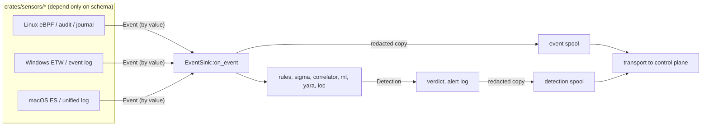

# Event schema

The `schema` crate is the platform boundary of the agent. Every sensor converts
its platform's native records (eBPF ring-buffer structs, ETW events, Endpoint
Security messages, journald and event-log records) into the types defined here.
The rule engine, Sigma, the correlator, the ML feature extractors, the spool and
the uploader read only these types. A detection engine never sees a sensor's
internal format.

Sources: [`crates/schema/src/lib.rs`](../crates/schema/src/lib.rs),
[`sensor.rs`](../crates/schema/src/sensor.rs),
[`detection.rs`](../crates/schema/src/detection.rs),
[`time.rs`](../crates/schema/src/time.rs),
[`fixtures.rs`](../crates/schema/src/fixtures.rs), and the tests under
[`crates/schema/tests/`](../crates/schema/tests/golden.rs).

## Where the crate sits



The crate depends on `serde` and nothing else in the workspace. Every crate may
depend on it, and `tools/check-deps.py` enforces that sensors depend on
nothing else. So any change to a public type here reaches every crate. Treat the
public API as semi-frozen: add things (new optional fields, new variants) rather
than change what already exists.

The crate is **not** a wire ABI. Fixed-size `repr(C)` structs for the eBPF ring
buffer live with the Linux sensor, and ETW layouts live with the Windows sensor.
Those formats have their own version numbers (for example the Linux sensor's
`WIRE_VERSION`) and change independently of
[`SCHEMA_VERSION`](../crates/schema/src/lib.rs). Strings in the model (command
lines, paths, process names) are owned and have no length limit. A platform
limit, such as the kernel's 15-byte `comm`, is a property of the sensor, not of
the schema.

## The sensor contract

[`sensor.rs`](../crates/schema/src/sensor.rs) defines the interface every
platform sensor implements:

| Item | Role |
|---|---|
| [`Sensor`](../crates/schema/src/sensor.rs) | `name()`, `capabilities()`, `run(sink)` blocks until `stop()` is called or a fatal error occurs. `Send`: a sensor usually runs on its own thread. |
| [`EventSink`](../crates/schema/src/sensor.rs) | One method, `on_event(&self, Event)`. `Send + Sync`. Events are passed **by value**, so a sink that forwards across a channel just moves the event. |
| `impl EventSink for Arc<T>` | Lets several producers share one sink. For example, a netlink poller thread runs beside a sensor that owns a `Box<dyn EventSink>`. |
| [`Capabilities`](../crates/schema/src/sensor.rs) | What the sensor actually emits on this platform: exec, file, connect, auth events, real user attribution, parent lineage. It must reflect observed behaviour, never optimistic static values. |
| [`SensorError`](../crates/schema/src/sensor.rs) | A boxed error, so the contract crate needs no error-handling dependency. |

`EventSink` has one method rather than one per event type because
[`Event`](../crates/schema/src/lib.rs) is `#[non_exhaustive]`. A new telemetry
category reaches existing sinks without a breaking trait change. Sinks match the
variants they understand and ignore the rest.

## Event model

### `Event` and `EventMeta`

[`Event`](../crates/schema/src/lib.rs) is an internally tagged enum
(`#[serde(tag = "type", rename_all = "snake_case")]`). The JSON form of an exec
is `{"type": "exec", "meta": {...}, "image_path": ...}`. Every variant holds one
struct that carries an [`EventMeta`](../crates/schema/src/lib.rs):

| `EventMeta` field | Meaning |
|---|---|
| `pid`, `ppid` | Emitting process and its parent. Log-derived events that name no process (`HttpRequest`, `HttpSummary`) carry 0. |
| `user` | [`User`](../crates/schema/src/lib.rs): `Unix {uid, gid}`, `Windows {sid, integrity_level}`, or `Unknown`. A bare `uid` cannot tell SYSTEM from a standard user on Windows. A sensor that cannot attribute a user says `Unknown` and reports it in its capabilities. |
| `timestamp_ns` | Nanoseconds since the UNIX epoch. Sensors convert boot-relative eBPF clocks and ETW `FILETIME` before emitting. [`time::now_ns`](../crates/schema/src/time.rs) is the one shared wall-clock helper. It returns 0 rather than panicking if the clock reads before the epoch. |
| `comm` | Short process name (Linux `comm`, image basename elsewhere). |
| `container` | [`ContainerContext`](../crates/schema/src/lib.rs). Linux fills it from the cgroup path, Windows from the server silo (`silo:<n>` until the Host Compute Service names the container). `image` and `name` stay `None` until a runtime-socket lookup exists. |
| `process_generation`, `parent_process_generation` | An opaque value that tells two incarnations of the same pid apart. It is meaningful **only as equality between two events with the same pid**. It is not a timestamp and does not survive an agent restart. When it is `None`, a consumer must treat the pid as unchanged, never as new. |

[`Event::meta`](../crates/schema/src/lib.rs) returns the shared metadata. Its
`match` has no wildcard arm on purpose. `#[non_exhaustive]` has no effect inside
the defining crate, so a new variant without an arm there is a compile error.

[`HealthBeacon`](../crates/schema/src/lib.rs) is **not** an `Event` variant. It
has no originating process and goes over a separate transport channel. Its
counters (spool bytes and drops, enrichment drops, rarity, IOC, watchdog and
tamper counters, parent-image cache evictions) are all `#[serde(default)]`, so a
beacon from an older agent still parses, with zeros
([`tests/health_beacon.rs`](../crates/schema/tests/health_beacon.rs)).

### Event families

The current version has 61 variants. Grouped by family:

| Family | Variants | Platforms |
|---|---|---|
| Process | `Exec`, `ImageLoad`, `AssemblyLoad`, `RemoteThread`, `ProcessAccess`, `Signal`, `UnitStop` | all, or the platform named in the struct doc |
| File | `FileOpen`, `FileWrite`, `FileDelete`, `FileRename`, `FileSetTime`, `RawVolumeOpen`, `FileChmod`, `FileChown`, `FileSetxattr`, `FileRemovexattr`, `FileQuarantine` | Linux/macOS/Windows depending on variant |
| Network | `Connect`, `DnsQuery`, `UdpSend`, `UdpRecv`, `ListenPort`, `NetworkFlow`, `SocketBind`, `SocketListen`, `SocketAccept`, `SocketCreate`, `SmbConnect`, `TlsCapture` | mostly Linux, `SmbConnect` Windows |
| Identity and sessions | `Auth`, `Session`, `NtlmAuth`, `KerberosDelegationFailure`, `LdapSearch`, `IdentityChange`, `CapSet` | `Auth` is shared, the rest are platform-specific |
| Script and command text | `ScriptBlock`, `AmsiContent`, `WmiActivity`, `ReadlineInput` | Windows, `ReadlineInput` Linux |
| Kernel and isolation | `KernelModule`, `BpfOperation`, `Ptrace`, `ProcessVmRead`, `ProcessVmWrite`, `MemfdCreate`, `Namespace`, `Prctl`, `Mount` | Linux (`Mount` also macOS) |
| OS security mechanisms | `PolicyDenial`, `TccDecision`, `GatekeeperVerdict`, `Defender`, `LogCleared`, `XpcConnect` | `PolicyDenial` is generic (`mechanism` is `selinux`, `applocker` or `wdac`) |
| Persistence and inventory | `RegistrySet`, `BitsJob`, `PackageChange` | Windows, `PackageChange` Linux |
| Service logs | `HttpRequest`, `HttpSummary` | any host with a declared log source |

A variant is platform-neutral when its shape fits more than one OS. `Mount`,
`Signal` and `PolicyDenial` are meant to be reused. Syscall-level Linux
telemetry with no counterpart elsewhere (`Ptrace`, `Namespace`, `Prctl`...) is
deliberately Linux-only rather than forced into a shared shape. Each struct's
doc comment states which sensor fills it and when a field is `None`.

### The exec event and its command line

[`ExecEvent`](../crates/schema/src/lib.rs) is the most heavily used event. It
carries several fields with specific rules:

- `cmdline` is the flat command line that rules, Sigma and the ML command-line
  features evaluate. It must never be a placeholder for the image path.
- `argv` is filled where the platform has one (Unix `execve`). It is empty on
  Windows, where consumers fall back to `cmdline`.
- [`ExecEvent::ml_cmdline`](../crates/schema/src/lib.rs) is the **one canonical
  ML input**: the `argv` tokens each followed by a NUL, or `cmdline` verbatim
  when `argv` is empty. A space-joined string would collapse the token count to
  one. The Python training pipeline mirrors this function exactly.
- [`bound_argv`](../crates/schema/src/lib.rs) cuts `argv` to
  [`ARGV_CAPTURE_BUDGET`](../crates/schema/src/lib.rs) (32 KiB, counting one
  separator per token) and keeps the head. The token that crosses the budget is
  cut on a UTF-8 character boundary, not dropped, because the head of a long
  encoded payload is what rules match. A flood of empty arguments is bounded as
  well. The event is truncated, never rejected: a rejected event would be a
  detection the attacker chose to erase.
  - Why 32 KiB: a benign corpus measured at p99.9 = 347 bytes and a maximum of
    1.6 KiB, and Windows' own `CreateProcess` limit is of the same order. Without
    a budget, a ~2 MiB padded argv is carried twice (`cmdline` and `argv`) and
    can grow up to 6x through JSON escaping. That produces a detection larger
    than the server's request-body limit, and the uploader then drops the whole
    segment it was batched in. The worst case with the budget is about 384 KiB
    per exec.
- `cmdline_truncated` is `true` when the sensor knows bytes are missing.
  `argv_omitted_bytes` is `Some(0)` for a fully captured argument block,
  `Some(n)` when `n` bytes between a head and a tail window were not read, and
  `None` when the size is unknown. A rule must never read `false` or `None` as
  "complete".
- `parent_comm`, `parent_image_path` are captured at exec time, because joining
  on `ppid` later races against pid reuse.
- `sha256`, `signature`, and the PE version-resource fields
  (`original_file_name`, `company_name`, `file_description`, `product_name`) are
  filled by enrichment, not by sensors. `image_file_id` (Windows) lets the
  signature verdict apply only to the file that actually ran.
- `env_security` lists only the loader-hijack variables that are present
  (`LD_PRELOAD`, `LD_LIBRARY_PATH`, `LD_AUDIT`, `LD_DEBUG_OUTPUT`,
  `GLIBC_TUNABLES`). It is a fixed allowlist, never the whole environment.

### `FileOpenEvent::flags` and synthetic flags

`FileOpenEvent::flags` holds the platform's native open flags. On Linux those are
`open(2)` flags. The crate defines the four POSIX constants it needs
(`O_ACCMODE`, `O_WRONLY`, `O_RDWR`, `O_CREAT`) instead of depending on `libc`,
which would drag platform differences into a crate that must compile everywhere.

[`has_write_intent`](../crates/schema/src/lib.rs) is the only write-intent
predicate in the workspace. It treats the access mode as a 2-bit field, as the
kernel does: `O_WRONLY` or `O_RDWR`, or `O_CREAT` with any mode. `0o3` is not
write intent, because `open(2)` refuses it with `EINVAL`. Counting it would let
deliberately failing opens inflate write counters. The Python feature code
mirrors this predicate and is tested against the same fixtures.

The high bits of `flags` carry **synthetic flags**. Some userspace sensors report
an OS record as a `FileOpenEvent` instead of adding a new variant. The Windows
event-log sensor does this for a service install, a scheduled task create or
update, or a local account creation. The journal sensor does it for a systemd
unit's first start, and the macOS sensor for a BTM launch item:

| Constant | Source record |
|---|---|
| [`FLAG_PERSISTENCE_ARTIFACT`](../crates/schema/src/lib.rs) | Windows 7045 service install |
| `FLAG_PERSISTENCE_TASK_ARTIFACT` | Windows 4698 scheduled task created |
| `FLAG_PERSISTENCE_TASK_ACTION_UNKNOWN` | set with the above when the task action could not be read |
| `FLAG_PERSISTENCE_TASK_UPDATE_ARTIFACT` | Windows 4702 task updated (the rule also requires a suspicious action path) |
| `FLAG_PERSISTENCE_ACCOUNT_ARTIFACT` | Windows 4720 local account created |
| `FLAG_PERSISTENCE_SYSTEMD_ARTIFACT` | first start of a systemd unit seen by this agent process (an approximation of install: it is forgotten across agent restarts) |
| `FLAG_PERSISTENCE_BTM_ARTIFACT` | macOS Background Task Management launch-item registration |
| `FLAG_APPLICATION_BLOCKED` | retired (AppLocker now emits `PolicyDenial`). The bit stays reserved so it is never reassigned. |

Invariants:

- Every flag is a distinct bit, so two techniques never fire from one event.
  [`SYNTHETIC_FLAGS`](../crates/schema/src/lib.rs) lists them all. A
  `const` block checks at compile time that they are non-zero and pairwise
  disjoint, and the `every_pub_flag_constant_is_in_synthetic_flags` unit test
  fails if a new `pub const FLAG_*` is missing from the list.
- Only userspace sensors that build their own `FileOpenEvent` set these bits. On
  Linux, the eBPF sensor masks raw `open(2)` flags with
  [`OPEN_FLAGS_MASK`](../crates/sensors/linux/userspace/src/normalize.rs) before
  emitting, because the kernel ignores unknown flag bits and any local user
  could otherwise set a synthetic bit.
- A new bit inside an existing field is **not** a schema change: the field's
  type and presence do not change.

### Detections

[`Detection`](../crates/schema/src/detection.rs) is what an engine concludes.
It is kept apart from `Event` (what a sensor observed), and sinks and transport
handle the two as separate streams. It lives in this crate because it crosses
the same serialization boundary as events and follows the same golden-fixture
rules.

| Field | Notes |
|---|---|
| `timestamp_ns` | Engine clock: when the judgment was made. |
| `severity` | [`Severity`](../crates/schema/src/detection.rs), ordered `Low < Medium < High < Critical`. |
| `source` | [`DetectionSource`](../crates/schema/src/detection.rs), tagged by `"engine"`: `rule`, `sigma`, `ml {tier, model_id, model_version}`, `correlator`, `yara`, `ioc {kind, indicator, feed, feed_version, reference}`. It carries enough identity to reproduce the verdict. |
| `score` | Calibrated score for ML and the correlator, `None` for binary hits. |
| `attributions` | [`ScoreAttribution`](../crates/schema/src/detection.rs) per feature, ordered by absolute contribution. Feature names match the Rust/Python parity fixtures. An ML detection is never a bare score. |
| `techniques` | ATT&CK ids (`T1234`, `T1234.001`). |
| `events` | The triggering events, embedded by value (events have no global id). The emitting engine bounds how many it attaches. |

`Detection` derives no `Eq` because attributions contain floats.

## Versioning and golden fixtures

### The rule

[`SCHEMA_VERSION`](../crates/schema/src/lib.rs) (currently 68) is bumped on
**every serialization-visible change**, including additive ones. A change is
visible in three ways:

1. **A new optional field** on an existing type. A Rust reader is unaffected
   (`#[serde(default, skip_serializing_if = ...)]`), but a non-Rust consumer that
   snapshots the set of fields sees a new shape.
2. **A new variant** of `Event`, `DetectionSource` or another tagged enum. Rust
   matches already need a wildcard arm, but a consumer that switches on the
   `"type"` or `"engine"` tag sees a value it has never seen.
3. **A removal, rename or type change.** This breaks every reader. Widening an
   integer counts too: `CapSetEvent` going from `u32` to `u64` masks was a
   bump, because an older reader rejects a value above `u32::MAX`.

The version is metadata, not a compatibility gate. Nothing refuses an old
payload. Bumping for additive changes costs nothing and gives every consumer an
honest answer to "did this shape exist before version N?".

Not a schema change:

- a new bit inside an existing field (synthetic flags above)
- a new pure helper function (`has_write_intent`, `bound_argv`, `now_ns`)
- a sensor filling an existing field with better values

The version number is not written into each event. It names the fixture
directory and is what a contributor coordinates on. When two open branches claim
the same number, whichever merges second takes the next free number, which is
why the history skips some values.

### Fixture layout and tests

```text
crates/schema/tests/fixtures/
  v1/   frozen forever: 7 files, read by tests/v1_compat.rs
  v2/ … v67/   frozen snapshots of past versions, never edited
                (numbers that were skipped have no directory)
  v68/  current snapshot: every golden fixture as it serializes today
```

| Test | What it proves |
|---|---|
| [`tests/golden.rs`](../crates/schema/tests/golden.rs) | Each test builds one fully spelled-out value and calls `assert_golden`. The value must serialize to exactly `fixtures/v{SCHEMA_VERSION}/<name>.json` **and** round-trip back to an equal value. |
| [`tests/v1_compat.rs`](../crates/schema/tests/v1_compat.rs) | The frozen `v1` events and detection still deserialize under today's types. This is the standing proof that additive changes stayed additive. |
| [`tests/health_beacon.rs`](../crates/schema/tests/health_beacon.rs) | A beacon without the newer counters parses with zeros, and the counters round-trip. |
| [`tests/file_activity_edge_cases.rs`](../crates/schema/tests/file_activity_edge_cases.rs) | Long paths, special and non-ASCII characters, large byte counts survive serialization. |
| unit tests in [`lib.rs`](../crates/schema/src/lib.rs) | `has_write_intent` semantics, `bound_argv` boundaries, synthetic-flag list completeness. |

The golden suite is the one place in the workspace that writes every field of
an event literal by hand, because it pins serialization. Everywhere else, tests
start from the neutral baselines in
[`schema::fixtures`](../crates/schema/src/fixtures.rs) (feature
`test-fixtures`, dev-dependencies only) and set only the fields under test with
struct-update syntax (`..fixtures::exec()`). Baseline values are neutral (zero,
empty, `Unknown`, `None`), so a test that asserts on a field it did not set
visibly asserts on nothing. Addresses default to TEST-NET-1 (`192.0.2.1`).

The control plane's ingest tests also read a pinned agent fixture through their
own sibling-repository helper. A change to a fixture shape therefore also needs
a matching change on the consumer side.

### Recipe: adding a field or variant

1. Add the field with `#[serde(default, skip_serializing_if = "...")]` (or the
   variant). Document when it is `None` and which sensor fills it.
2. For a variant: add its arm to [`Event::meta`](../crates/schema/src/lib.rs)
   (the compiler insists) and a baseline in
   [`fixtures.rs`](../crates/schema/src/fixtures.rs).
3. Bump [`SCHEMA_VERSION`](../crates/schema/src/lib.rs) and record the reason
   in one line.
4. Copy `fixtures/v<old>/` to `fixtures/v<new>/` in full, then add or update
   fixtures **only in the new directory**. Never edit an older directory.
5. Update `tests/golden.rs`: the new field appears in every literal of that
   type.
6. Update consumers outside this repository (control-plane payload schema, ML
   canonicalization) in their own change.

## Failure modes and gaps

- The server has no policy yet for which schema versions it accepts from which
  agent version. Tracked in
  [#59](https://github.com/synthaea-lab/agent/issues/59).
- `Capabilities` is a promise made by each sensor. Checking it automatically
  against observed behaviour is the conformance suite's job, tracked in
  [#25](https://github.com/synthaea-lab/agent/issues/25).
- A field that has no length limit in the schema can still be large. Bounding
  is the producer's job (`bound_argv` for argv, per-sensor caps elsewhere), and
  each sensor's doc states its caps.
