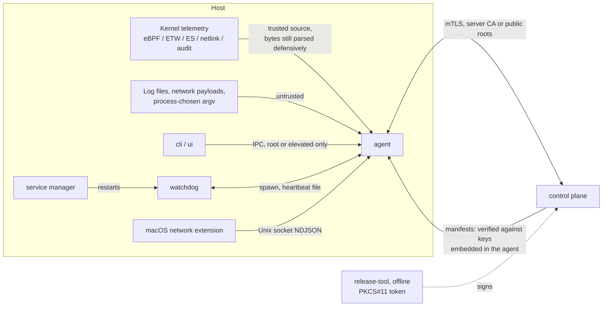
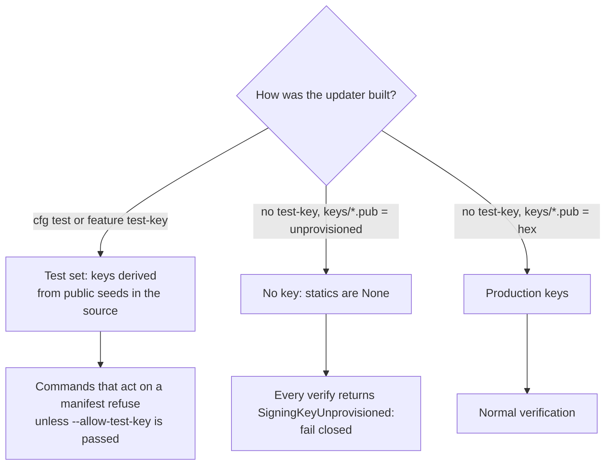

# Security model

This page covers how the agent protects itself and the host it runs on: which privileges
it holds on each OS, what it trusts, where untrusted bytes come in, what an attacker can
and cannot do to it, and how the code enforces each of these. It is written for
contributors. When a code comment needs to explain *why* a security control exists, it
should link the matching section here.

The adversary we design for has **administrator or root on the host, but not kernel
execution**. Above the kernel, we do not try to make the agent impossible to tamper with,
because an adversary with the same privilege can always try. The goal is that **nobody can
tamper with it silently**. Every way of stopping, blinding or cutting off the agent should
end in a restart, a local alert, or a gap the server can see. An adversary who already runs
code in the kernel defeats every user-mode control described here. That is the limit of
this design, stated plainly below in
[What is not defended](#what-is-not-defended).

## Contents

- [Trust boundaries](#trust-boundaries)
- [Privileges per OS](#privileges-per-os)
- [Signing keys and the test-key guard](#signing-keys-and-the-test-key-guard)
- [Secret handling](#secret-handling)
- [Attack surface](#attack-surface)
- [Never-panic parsers and fuzzing](#never-panic-parsers-and-fuzzing)
- [Self-protection](#self-protection)
- [Response actions: fail-closed guards](#response-actions-fail-closed-guards)
- [What is not defended](#what-is-not-defended)
- [Supply chain hygiene](#supply-chain-hygiene)
- [How it is tested](#how-it-is-tested)

## Trust boundaries

| Boundary | What is trusted | What is not | Enforcement |
| --- | --- | --- | --- |
| Agent and control plane | The TLS server certificate (private CA bundle, or public roots) | The network; the server's *content* | mTLS transport; every release, content, snapshot and rotation manifest is verified on the agent against embedded Ed25519 keys, so a compromised server cannot push code or rules |
| Agent and local callers | Root on Unix, elevated token on Windows | Every other local user | Peer credentials checked on every IPC connection |
| Agent and installed files | The signed release manifest persisted at promote time | The live filesystem | Periodic re-hash of the active release; the watchdog pins the agent binary hash |
| Agent and watchdog | Each other | — | Two processes plus the OS service manager; neither is a single point of failure |
| Agent and telemetry bytes | Kernel as the writer | Content of every field (paths, argv, log lines, network payloads) | Bounded, never-panic parsers; fuzzing |

The server is deliberately *not* a root of trust for code. It distributes manifests that
it did not sign and cannot sign. The signing keys are held offline (see
[release-tool](../tools/release/src/main.rs)), and the agent verifies every manifest itself.

## Privileges per OS

| OS | Process identity | How it is granted | Notes |
| --- | --- | --- | --- |
| Linux (packaged) | Unprivileged `synthaea` user plus an explicit ambient capability set | [`synthaea-agent.service`](../packaging/linux/systemd/synthaea-agent.service), [`synthaea.sysusers`](../packaging/linux/systemd/synthaea.sysusers); OpenRC equivalent in [`synthaea-agent.initd`](../packaging/linux/alpine/synthaea-agent.initd) | `NoNewPrivileges=true`, `ProtectSystem=strict`, writable paths limited to state, log, runtime and the bpffs pin directory |
| Linux (`watchdog install`, dev/manual) | `root` | Fallback unit generated by [`cmd_install`](../apps/watchdog/src/service/linux.rs) when no packaged unit exists | No capability scoping or sandboxing: use the package for real deployments |
| Windows | `LocalSystem` (the watchdog service; the agent inherits its token) | `sc create` in [`cmd_install`](../apps/watchdog/src/service/windows.rs) | `sc sidtype unrestricted` puts the service SID `NT SERVICE\SynthaEDR` in the token. The minifilter port only accepts clients that hold it ([`AGENT_SERVICE_SID`](../crates/sensors/windows/minifilter/src/lib.rs)) |
| macOS | `root` (launchd daemon) | Plist written by [`cmd_install`](../apps/watchdog/src/service/macos.rs) | Endpoint Security needs the Apple-granted entitlement and Full Disk Access. See [packaging/macos](../packaging/macos/README.md) |

### Linux capability set

Each capability is granted for one feature. Everything else is removed from the bounding
set, so a bug in a sensor does not become a root bug.

| Capability | Why |
| --- | --- |
| `CAP_BPF`, `CAP_PERFMON` | Load eBPF programs and attach tracepoints and kprobes |
| `CAP_SYS_RESOURCE` | Raise `RLIMIT_MEMLOCK` for BPF maps |
| `CAP_DAC_READ_SEARCH` | Read `/proc/<pid>/*` and other users' files (hashing, command lines, YARA) |
| `CAP_NET_ADMIN` | Conntrack netlink (network flows) |
| `CAP_KILL` | Signal other users' processes. Used only by the kill response, which is off by default |
| `CAP_AUDIT_READ` | Multicast-subscribe to `NETLINK_AUDIT` for SELinux AVC denials |

The following capabilities are deliberately **not** granted: `CAP_SYS_PTRACE` (so
`/proc/<pid>/exe` of other users is not readable) and
`CAP_CHOWN`/`CAP_FOWNER`/`CAP_DAC_OVERRIDE` (so the agent cannot quarantine files it does
not own). Each would be added only after a check on a real host shows a feature needs it.

The unit sets `PrivateTmp=false` and `ProtectHome=read-only` on purpose. Events carry host
paths, and the agent opens them by path to hash or scan them. Hiding `/tmp` or `/home`
would mean payloads dropped there are never scanned.

The eBPF preflight accepts a capability-scoped process as well as root.
[`has_bpf_capabilities`](../apps/agent/src/commands/linux.rs) checks the effective set, so
`agent status` does not report a correctly scoped service as failing.

## Signing keys and the test-key guard

The updater embeds four Ed25519 public keys. Each key has exactly one job
([`crates/updater/src/key.rs`](../crates/updater/src/key.rs)):

| Key | Verifies | Static |
| --- | --- | --- |
| `release` | Binary release manifests ([`ReleaseManifest::verify_signature_with`](../crates/updater/src/manifest.rs)) | `RELEASE_PUBLIC_KEY` |
| `content` | Content (rules) manifests ([`ContentManifest`](../crates/updater/src/content.rs)) | `CONTENT_PUBLIC_KEY` |
| `snapshot` | The common-set snapshot manifest only ([`snapshot.rs`](../crates/updater/src/snapshot.rs)) | `SNAPSHOT_PUBLIC_KEY` |
| `recovery` | Key rotations only ([`KeyRotationManifest`](../crates/updater/src/rotation.rs)); held offline and never rotated itself | `RECOVERY_PUBLIC_KEY` |

Keeping the roles separate limits the damage a stolen key can do. A content signer cannot
sign a release, and a snapshot can never verify as content. The unit test
`committed_keys_are_distinct_per_role_and_not_all_zero` makes sure the four committed key
files hold four different keys.

### Three build states

- **Test set.** The seeds (`[0x42; 32]`, `[0x43; 32]`, `[0x44; 32]`) are public and
  committed to the repository. They are compiled in only under `cfg(test)` or the
  `test-key` cargo feature. A build without either cannot ship them by accident. In the
  test set, `release` and `content` share one key, while `recovery` and `snapshot` each
  have their own.
- **Unprovisioned.** `crates/updater/keys/*.pub` currently hold `unprovisioned`, so a
  production build embeds no key and every verify returns
  `UpdaterError::SigningKeyUnprovisioned`. The agent does not fall back to anything.
  Production keys are tracked in
  [#43](https://github.com/synthaea-lab/agent/issues/43).
- **Provisioned.** Each key file holds 64 hex characters after optional `#` comments
  ([`parse_key_file`](../crates/updater/src/key.rs)). A typo or a truncated key parses to
  `None`. The test `every_committed_key_file_is_unprovisioned_or_a_valid_key` catches it
  at commit time, so it never shows up later as a confusing "no key" error at run time.

`SYNTHAEA_UPDATER_TEST_KEY` follows the feature flag (`cfg!(any(test, feature =
"test-key"))`), so nobody can set it by hand.

### Runtime refusal

[`ensure_key_trusted`](../apps/agent/src/trust.rs) runs before `apply-release`,
`apply-content-manifest` and key rotations act on a manifest:

1. If no key is embedded for this kind of manifest, the command refuses and says why.
2. If the key in force is the public test key, the command refuses unless the operator
   passes `--allow-test-key`. That flag exists only in a `test-key` build. The error
   message spells out the consequence: whoever can serve the release routes could run
   code as root.
3. Once a rotation has replaced the test key, the install is no longer treated as
   test-keyed. [`trust::load`](../apps/agent/src/trust.rs) replays the applied rotations from
   [`TrustState`](../crates/updater/src/trust_state.rs). If that record is corrupt, the
   command refuses. It does not fall back to the embedded keys, because those may already
   have been rotated away.

The self-integrity monitor treats `SigningKeyUnprovisioned` differently from a bad
signature ([`signature_failure_is_tamper`](../apps/agent/src/integrity.rs)). A build with no
key would otherwise raise a false tamper alert on every pass.

### Keeping the test key out of packages

Cargo feature unification is the main way the test key could leak into a package: if any
crate in the build enables `updater/test-key`, every crate gets it. The guards are:

| Guard | What it proves |
| --- | --- |
| [`tools/check-no-test-key.sh`](../tools/check-no-test-key.sh) (CI) | `cargo tree` for the packaged set (`agent`, `watchdog`, `cli`, `--no-default-features`) on Linux, Windows and macOS targets does not enable `test-key`, and the default build still does (positive control). The packaging scripts still build without default features and still scan their output. The updater rlib built without the feature lacks the marker, and with the feature has it |
| [`tools/assert-no-test-key.sh`](../tools/assert-no-test-key.sh) | Scans a built binary for the marker `SYNTHAEA-PUBLIC-TEST-KEY-SET-V1`, which the `test-key` build links in deliberately (`TEST_KEY_MARKER` in [`key.rs`](../crates/updater/src/key.rs)). Run by the deb/rpm build scripts, the Windows `build.ps1`, and the static-agent workflows |
| [`tests/unprovisioned_build.rs`](../crates/updater/tests/unprovisioned_build.rs) (`cargo test -p updater --no-default-features`) | What a packaged build really embeds. Unit tests cannot show this because they always compile with `cfg(test)`, which turns the test set on |
| [`tests/test_key_build.rs`](../crates/updater/tests/test_key_build.rs) | The lab variant embeds the test set and reports it |

Each check also proves it can fail: it confirms the marker *is* found in a test-key build.
Without that, a check that silently looked at nothing would also pass.

### Offline signing

Signing happens only in [`release-tool`](../tools/release/src/main.rs). It never runs on an
endpoint or on the control plane. Production keys sign from a PKCS#11 token
([`pkcs11.rs`](../tools/release/src/pkcs11.rs)), so the private key never leaves the device.
`--key-file` and `--test-key` exist for lab use only. If a key can be read from a file, it
is not a production key.

### What a valid signature does not prove

A signature proves who signed a manifest, not that its contents are safe. The updater
also checks:

- **Paths.** [`validate_entry_paths`](../crates/updater/src/manifest.rs) and
  [`is_safe_content_path`](../crates/updater/src/content.rs) reject the whole manifest if
  any path is absolute, contains `..`, a backslash, NUL or `:`, or uses a Windows device
  name.
- **Anti-rollback.** `release_version` must be strictly greater than the installed one
  ([`check_release_version`](../crates/updater/src/manifest.rs)). Rotations share that
  counter and have a bounded validity window
  ([`check_window`](../crates/updater/src/rotation.rs)).
- **Bounded downloads.** A declared size over the cap is refused before anything is
  fetched, and the HTTP read is capped as well
  ([`TransportClient::get_bytes`](../crates/transport/src/client.rs)). Caps:
  `MAX_RELEASE_ARTIFACT_BYTES` (256 MiB) in [`release.rs`](../apps/agent/src/release.rs),
  `MAX_CONTENT_ARTIFACT_BYTES` (100 MiB) in [`content.rs`](../apps/agent/src/content.rs), and
  the snapshot cap in [`snapshot_fetch.rs`](../apps/agent/src/snapshot_fetch.rs).

## Secret handling

| Secret | Where it lives | Rule |
| --- | --- | --- |
| mTLS client key | PEM file at `server.mtls_key` (absolute path, checked by [`config::load`](../crates/config/src/load.rs)) | Read once when the transport is built. It is never logged and never sent anywhere |
| Key passphrase | `server.mtls_passphrase`, a [`SecretRef`](../crates/config/src/secret.rs) | The config file holds a reference only: `envvar:NAME` or `file:/path`. A bare literal is rejected at load with `ConfigError::SecretInvalid`, and so is an unknown provider such as `vault:` |
| Release signing keys | Offline PKCS#11 token | Never on a host or on the server |
| Credentials inside telemetry | Command lines, URLs, script text | Redacted at output boundaries. See below |

**Current gap.** `server.mtls_passphrase` is parsed and validated, but the transport does
not use it yet. [`build_tls_config`](../crates/transport/src/client.rs) refuses an
encrypted PEM key with an explicit error and asks for an unencrypted one. So today the key
file's protection comes from file permissions only.

**Credentials in telemetry.** Detection needs raw command text, but every copy that
leaves the process should be scrubbed. [`RedactingSink`](../apps/agent/src/redact.rs) applies
that split. Live detection pipelines see `Exec`, `ReadlineInput`, `ScriptBlock`,
`AmsiContent` and `WmiActivity` raw, while capture and output sinks get them redacted.
URL secrets in download provenance, BITS jobs and HTTP evidence are always redacted. The
pure functions ([`redact_command_line`](../crates/redact/src/lib.rs),
[`redact_command_text`](../crates/redact/src/text.rs),
[`redact_url_secrets`](../crates/redact/src/lib.rs)) keep the line's formatting, are
idempotent, and are property-tested. Positional and encoded credential forms are not
recognized.

**Logging.** Event payloads are never logged at `info` level (a workspace convention).

## Attack surface

### Local IPC (cli and ui to agent)

Implemented in [`crates/ipc`](../crates/ipc/src/lib.rs), served by
[`ipc_handler`](../apps/agent/src/ipc_handler.rs).

- **Transport.** A Unix domain socket at `ipc.endpoint` (default
  `/var/run/synthaea/agent.sock`), or a named pipe `\\.\pipe\...` on Windows. The config
  loader checks the endpoint's shape for each OS. The Windows listener uses
  `first_pipe_instance(true)`, so the agent fails to bind if another process already owns
  the pipe name. It does not silently share it.
- **Authorization.** [`PeerCreds::check_authorized`](../crates/ipc/src/stream.rs) allows
  `uid == 0` (read with `SO_PEERCRED` or `LOCAL_PEERCRED`) or `TokenIsElevated` on
  Windows. Any other caller gets one `Unauthorized` reply and the connection closes
  ([`server.rs`](../crates/ipc/src/server.rs)). If no credential is available, access is
  denied. On Unix the check is the peer's uid, not the socket file's mode.
- **Bounds.** One message is one JSON line, capped at
  [`MAX_MESSAGE_BYTES`](../crates/ipc/src/frame.rs) (1 MiB). The server closes the
  connection when a line reaches the cap. `RecentDetections.limit` is clamped to
  [`RECENT_DETECTIONS_HARD_LIMIT`](../crates/ipc/src/server.rs) (256). Every request and
  payload type uses `deny_unknown_fields`.
- **Mutations.** Almost every request is read-only. There are three exceptions:
  `ReloadContent` re-reads content that was already verified and written to disk;
  `SuppressVerdict` and `UnsuppressVerdict` change only the agent's own fused-verdict
  view, are reversible, and write an audit line for every real change. Kill, quarantine
  and isolation are not available over IPC. They wait for a per-capability authorization
  model.
- **Known gaps.** There is no cap on concurrent connections and no idle timeout. The
  client does not authenticate the server endpoint, so a process that binds the
  socket or pipe first could answer the CLI. Both matter only to a caller that already
  holds the required privilege.

### macOS network-extension socket

The NE system extension connects to a Unix socket in the shared app-group container and
writes NDJSON records ([`receiver.rs`](../crates/sensors/macos/network-extension/src/receiver.rs)).
Unknown wire versions and lines that fail to parse are counted (`skew_skipped`) and
skipped, never treated as fatal. The receiver does **not** check the peer's identity and
reads lines without a length cap. Access depends only on the app-group container's
filesystem permissions. Follow-ups for this sensor are tracked in
[#35](https://github.com/synthaea-lab/agent/issues/35) and
[#21](https://github.com/synthaea-lab/agent/issues/21).

### Windows minifilter port

The driver's communication port accepts only a client whose token holds the agent service
SID ([`crates/sensors/windows/minifilter`](../crates/sensors/windows/minifilter/src/lib.rs)).
Messages are decoded by [`wire.rs`](../crates/sensors/windows/minifilter/src/wire.rs).
Property tests check that arbitrary bytes, and headers with consistent lengths, never
cause a panic.

### Network

- **Outbound only.** The agent opens no network listener. Its only network traffic is
  outbound HTTPS to the control plane through
  [`TransportClient`](../crates/transport/src/client.rs), which uses `ureq` over `rustls`
  with a 30 s global timeout by default ([`TransportConfig`](../crates/transport/src/config.rs)).
  `control_plane_url` must be `https://`.
- **Server verification.** If `server.ca_cert` is set, **only** that bundle is trusted,
  not the public roots. An unreadable bundle, or one with no certificates, is an error,
  never a silent fallback ([`load_ca_roots`](../crates/transport/src/client.rs)). Tests:
  [`tests/private_ca.rs`](../crates/transport/tests/private_ca.rs).
- **Identity.** The client certificate is the agent's identity, and the server derives the
  agent from that certificate. The `agent_id` field in request bodies is informational.
- **Enrollment is not built.** No code issues, stores or renews the client certificate. An
  operator places the cert and key on the host by hand. See
  [#56](https://github.com/synthaea-lab/agent/issues/56) (operator guide) and
  [#79](https://github.com/synthaea-lab/agent/issues/79) (install-to-enroll acceptance run).
- **Peer-to-peer mesh.** The [`mesh`](../crates/mesh/src/lib.rs) crate is a design stub
  with no code ([#29](https://github.com/synthaea-lab/agent/issues/29)).

### Parsers of untrusted bytes

Kernel sockets carry bytes the kernel writes, but many fields describe things an attacker
controls: argv and its lengths, file paths, log lines, TLS ClientHellos, event-log XML.
Every such parser has to treat its input as hostile. See the next section.

## Never-panic parsers and fuzzing

**Contract.** A byte parser may return an error on any input and must never panic. A
panic on a sensor's drain path kills that sensor or the whole agent. A malformed input an
attacker can reproduce becomes a way to switch the agent off. The watchdog restarts it,
with backoff, but a reliable crash loop is still a gap in protection.

How it is enforced:

- **Convention, reviewed but not linted.** No `unwrap` or `expect` outside tests and
  provably infallible cases. The workspace lints deny `todo`, `unimplemented` and
  `dbg_macro`, and require a `// SAFETY:` comment on every `unsafe` block (`Cargo.toml`
  `[workspace.lints.clippy]`). `unwrap_used` is not linted.
- **Deterministic robustness suites** in each parser crate's `tests/` directory. They use
  a seeded PRNG corpus plus splices of valid records, so failures reproduce:

| Parser | Suite |
| --- | --- |
| Audit netlink | [`audit/tests/robustness.rs`](../crates/sensors/linux/audit/tests/robustness.rs) |
| sock_diag, proc connector, conntrack | [`netlink/tests/robustness.rs`](../crates/sensors/linux/netlink/tests/robustness.rs) |
| eBPF exec record (variable-length argv) | [`wire/tests/exec_record.rs`](../crates/sensors/linux/wire/tests/exec_record.rs) |
| TLS ClientHello | `tls_client_hello.rs` tests in [`userspace`](../crates/sensors/linux/userspace/src/tls_client_hello.rs) |
| ETW (BITS, Zone.Identifier) | [`etw/tests/robustness.rs`](../crates/sensors/windows/etw/tests/robustness.rs) |
| Event-log XML and per-event decoders | [`eventlog/tests/xml_parser_robustness.rs`](../crates/sensors/windows/eventlog/tests/xml_parser_robustness.rs) and siblings |
| Minifilter wire | proptests in [`wire.rs`](../crates/sensors/windows/minifilter/src/wire.rs) |
| Intel feeds | [`intel/tests/robustness.rs`](../crates/intel/tests/robustness.rs) |

- **Coverage-guided fuzzing** in [`tests/fuzz/`](../tests/fuzz/README.md). It needs libFuzzer and a
  nightly toolchain, so it is excluded from the workspace:

| Target | Exercises | In scheduled CI |
| --- | --- | --- |
| [`audit_parse`](../tests/fuzz/fuzz_targets/audit_parse.rs) | `sensor_linux_audit::parse_audit_message` | yes |
| [`netlink_parse`](../tests/fuzz/fuzz_targets/netlink_parse.rs) | `DiagMsg`, `ProcEvent`, `ConntrackFlow` | yes |
| [`exec_record_parse`](../tests/fuzz/fuzz_targets/exec_record_parse.rs) | `parse_exec_record`. It also checks that an accepted record stays within `ARGV_WINDOW_BYTES` and within the input | no (manual only) |
| [`logs_parse`](../tests/fuzz/fuzz_targets/logs_parse.rs) | Access-log (common and combined) and MySQL error-log parsers | no (manual only) |

The scheduled workflow (`.github/workflows/fuzz.yml`) runs Monday and Thursday for 10
minutes per target. Each run resumes from the corpus cached by the previous run, so
coverage accumulates. It is not a PR gate. When it finds a crash: minimize the input with
`cargo +nightly fuzz tmin --fuzz-dir tests/fuzz`, pin it as a named regression test in the owning crate's
robustness suite, then fix the parser. The corpus is not tracked in the repository.

A new parser of kernel-socket or attacker-influenced bytes must come with a robustness
suite. If it is high-value, it also gets a fuzz target.

## Self-protection

The mechanisms behind each row are explained in [Self-protection](self-protection.md).

These controls make tampering loud. They do not hide the agent. The agent never uses
concealment techniques: no unlinking from process lists, no hidden files, no API hooking.
A defensive agent has to stay visible to the person who installed it, and other security
products rightly flag hiding behavior whatever the intent.

| Attack on the agent | Defense | Code |
| --- | --- | --- |
| Kill the agent | The watchdog respawns it, with exponential backoff for fast crash loops | [`supervise.rs`](../apps/watchdog/src/supervise.rs) |
| Kill the watchdog | The service manager restarts it: systemd `Restart=always`, SCM `sc failure`, launchd `KeepAlive` | [`apps/watchdog/src/service`](../apps/watchdog/src/service/mod.rs) |
| Catchable signal (`SIGTERM`, `SIGHUP`, `SIGQUIT`) | Records who sent it with `sigwaitinfo` before exiting, after a bounded flush | [`kill_loudness.rs`](../apps/agent/src/kill_loudness.rs) |
| `SIGKILL` | Cannot be attributed by the dying process. The eBPF sensor records the sender in a map pinned under `/sys/fs/bpf/synthaea`, and the restarted agent reports it | [`ebpf.rs`](../crates/sensors/linux/userspace/src/ebpf.rs) |
| Freeze or wedge the agent | The agent writes a progress-backed heartbeat file. The watchdog kills the agent after repeated checks see no progress | [`heartbeat.rs`](../apps/agent/src/heartbeat.rs), [`supervise.rs`](../apps/watchdog/src/supervise.rs) |
| Detach a sensor and leave the process running | Per-sensor heartbeat: the silence becomes an alert | [`silence.rs`](../apps/agent/src/silence.rs), [`tamper::heartbeat`](../crates/tamper/src/heartbeat.rs) |
| Swap the agent binary on disk | The watchdog pins its hash at startup and refuses to launch a mismatch. Every 300 s the agent re-hashes the active release against its signed manifest | [`tamper.rs`](../apps/watchdog/src/tamper.rs), [`integrity.rs`](../apps/agent/src/integrity.rs) |
| Write, delete or rename the agent's own files | Any process other than the agent doing so raises a high-severity detection | [`protected.rs`](../apps/agent/src/protected.rs) |
| Edit the service definition | Linux: drift against an install-time snapshot is reported | [`service/linux.rs`](../apps/watchdog/src/service/linux.rs) |
| `sc stop` / `sc delete` as a non-SYSTEM admin | A hardened service DACL removes stop, pause and delete from Administrators. Admins keep `WRITE_DAC`, so this is friction, not a boundary | [`service/windows.rs`](../apps/watchdog/src/service/windows.rs) |
| Install into a world-writable directory | Refused on Unix, and installed binaries are set to root-owned `0755` | [`tamper.rs`](../apps/watchdog/src/tamper.rs), [`service/mod.rs`](../apps/watchdog/src/service/mod.rs) |
| Firewall the agent off the server | The agent sends a periodic health beacon. The server treats an agent that stops sending it as suspicious. The spool keeps events until the link returns | [`health.rs`](../apps/agent/src/health.rs), [`TransportClient::send_heartbeat`](../crates/transport/src/client.rs) |
| Unhook userland APIs, direct syscalls, patch ETW in a process | Nothing to unhook: telemetry comes from the kernel (eBPF, kernel ETW, ES), not inline hooks | — |

## Response actions: fail-closed guards

Response actions run with the agent's privilege, and their targets come from telemetry.
They must fail closed when the target is wrong.

- **Kill.** [`kill_process`](../crates/response/src/kill.rs) refuses pid 0, pids that do
  not fit `pid_t` (they would wrap to a process group, or to every process), pid 1, and
  the agent's own pid. It refuses even when policy enables kill. When policy disables
  kill, the outcome is `ObserveOnly`. Separately, the correlator refuses to kill a system
  service's main process. That refusal currently misses services started before the agent
  ([#52](https://github.com/synthaea-lab/agent/issues/52)).
- **Quarantine.** [`quarantine_file`](../crates/response/src/quarantine.rs) opens the
  source once with `O_NOFOLLOW`, checks it with `fstat`, and hashes and moves it through
  that descriptor, so a swap to a symlink is not followed. The copy is bounded by the
  file's size at open time. The module documents its limits: a symlinked parent
  directory is still followed, and the check and the unlink are not atomic. Windows does
  not wire automated quarantine yet.
- **Isolation.** The host firewall plan always keeps the control-plane endpoints
  reachable and caps their number ([`isolation.rs`](../crates/response/src/isolation.rs)).

## What is not defended

- **A kernel-mode adversary** (a loaded malicious or vulnerable signed driver, a rootkit)
  defeats every user-mode control on this page. Closing that gap needs a kernel component
  per OS: Windows driver and PPL
  ([#27](https://github.com/synthaea-lab/agent/issues/27)), and the macOS Endpoint Security
  system extension for tamper resistance
  ([#42](https://github.com/synthaea-lab/agent/issues/42)). Until then, the defense is
  making the move into the kernel loud, plus the server's check for silent agents.
- **The kill-both-fast race.** An adversary at the same privilege level who kills the
  agent and the watchdog in a tight loop gets a short window, bounded by the restart
  interval. User-mode restarts cannot close it.
- **Admin or root uninstall.** A legitimate uninstall and a malicious one look the same.
  What tells them apart is the recorded actor and the timing, not the act.
- **A kernel stop through resource limits** (prlimit CPU limit, `memory.max` OOM kill,
  `cgroup.freeze`) aimed at a security tool raises no alert on Linux
  ([#49](https://github.com/synthaea-lab/agent/issues/49)).
- **Local-only deployments** have no server-side silence detection, and their evidence
  never leaves the host.
- **Unsigned updates on Windows and macOS.** Self-update is Linux-only today
  ([#60](https://github.com/synthaea-lab/agent/issues/60)). Packaged binaries are not yet
  Authenticode-signed ([#55](https://github.com/synthaea-lab/agent/issues/55)) or
  notarized ([#26](https://github.com/synthaea-lab/agent/issues/26)).
- **Windows install-directory check.** The Unix world-writable-directory refusal has no
  Windows equivalent (a DACL audit). The MSI's Program Files default is the only
  mitigation.

## Supply chain hygiene

- [`deny.toml`](../deny.toml): RUSTSEC advisories and yanked crates fail the build.
  Ignored advisories must still match something in the dependency tree, or CI fails, so
  an ignore cannot go stale. Licenses come from an allow-list, and wildcard version
  requirements are denied.
- Dependency direction is enforced by `tools/check-deps.py`. Sensor crates depend only on
  `schema` and their platform's shared crates, so a sensor cannot reach the transport or the
  updater.
- Platform-specific code is confined to sensors, the updater, and the narrow quarantine
  descriptor helpers.
- GitHub Actions are pinned by commit SHA, and checkout does not persist credentials.

## How it is tested

| Property | Test |
| --- | --- |
| Packaged build has no test key | `tools/check-no-test-key.sh` (CI), [`unprovisioned_build.rs`](../crates/updater/tests/unprovisioned_build.rs) |
| Unprovisioned key fails closed for every manifest kind | [`unprovisioned_build.rs`](../crates/updater/tests/unprovisioned_build.rs) |
| Key roles distinct, key files well-formed | unit tests in [`key.rs`](../crates/updater/src/key.rs) |
| Test-key refusal and its messages | unit tests in [`trust.rs`](../apps/agent/src/trust.rs) and [`release.rs`](../apps/agent/src/release.rs) |
| Cleartext secret rejected | `cleartext_secret_is_rejected_as_secret_invalid` in [`load.rs`](../crates/config/src/load.rs); [`secret.rs`](../crates/config/src/secret.rs) tests |
| Private CA pinning | [`transport/tests/private_ca.rs`](../crates/transport/tests/private_ca.rs) |
| IPC authorization and framing cap | unit tests in [`stream.rs`](../crates/ipc/src/stream.rs) and [`frame.rs`](../crates/ipc/src/frame.rs). [`tests/e2e.rs`](../crates/ipc/tests/e2e.rs) skips when it runs unprivileged |
| Never-panic parsers | robustness suites and fuzz targets above |
| Kill guard | unit tests in [`kill.rs`](../crates/response/src/kill.rs) |
| Hardened Windows service DACL | unit tests in [`service/windows.rs`](../apps/watchdog/src/service/windows.rs) |
| Kill-loudness end to end | Not unit-tested (the flow terminates the process). Validated by hand on a lab VM |
