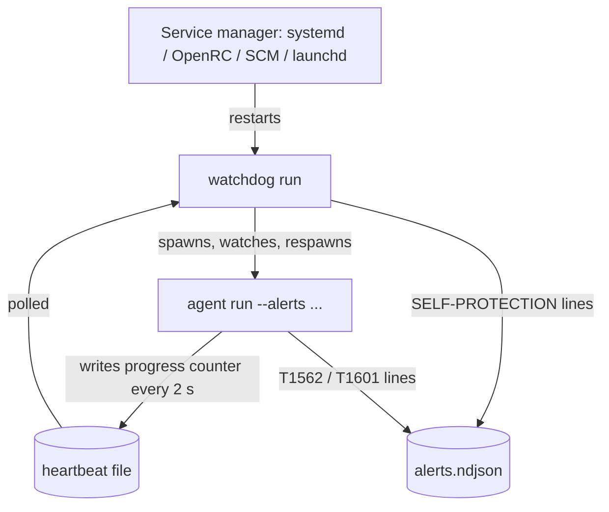

# Self-protection

How the agent and its watchdog defend themselves: staying alive, noticing when they
are blinded or frozen, noticing when their own files change, and recording who tried
to stop them. This page covers the `watchdog` binary, the `tamper` crate, the agent
modules that wire it (`silence`, `integrity`, `protected`, `kill_loudness`,
`heartbeat`), and the planned `mesh` crate. The wider threat model, privileges and
attack surface are in [Security model](security-model.md).

## Threat model in one paragraph

The adversary is assumed to hold administrator or root, but not to run code in the
kernel. A kernel-level adversary defeats any user-mode control, these included; that
ceiling only moves with kernel-side work (a Windows driver with PPL/ELAM, BPF-LSM on
Linux, an Endpoint Security system extension on macOS). Above the kernel, the goal is
not "cannot be tampered with" but **"cannot be tampered with silently"**: every path
that stops the agent, blinds a sensor or changes its files ends either in an automatic
restart or in an alert. Hiding from the operator who installed the agent is out of
scope by design: every restart anchor is a declared, visible service, and every
hardening step can be undone by an administrator through the documented commands.

| Attack | Defense | Where |
| --- | --- | --- |
| Kill the agent | watchdog respawns it | [`supervise.rs`](../apps/watchdog/src/supervise.rs) |
| Kill the watchdog | service manager respawns it; the agent dies with it | [`service/`](../apps/watchdog/src/service/mod.rs), [`die_with_parent`](../apps/watchdog/src/supervise.rs) |
| Freeze or wedge the agent | progress heartbeat stalls, watchdog kills and restarts it | [`heartbeat.rs`](../apps/agent/src/heartbeat.rs), [`HeartbeatMonitor`](../apps/watchdog/src/supervise.rs) |
| Detach or stop one sensor | sensor-silence alert (T1562) | [`tamper::heartbeat`](../crates/tamper/src/heartbeat.rs), [`silence.rs`](../apps/agent/src/silence.rs) |
| Swap the binary on disk | watchdog refuses to launch it; periodic manifest check alerts (T1601) | [`BinaryPin`](../apps/watchdog/src/tamper.rs), [`integrity.rs`](../apps/agent/src/integrity.rs) |
| Edit or disable the service definition | drift report (Linux) | [`drift_report`](../apps/watchdog/src/service/linux.rs) |
| Write, delete or rename the agent's own files | protected-resource alert (T1562) | [`protected.rs`](../apps/agent/src/protected.rs) |
| Send `SIGTERM`/`SIGHUP`/`SIGQUIT` | sender recorded before exit (T1562) | [`kill_loudness.rs`](../apps/agent/src/kill_loudness.rs) |
| Broken release after an update | probation, rollback and ban | [`probation.rs`](../apps/watchdog/src/probation.rs), [`recovery.rs`](../apps/watchdog/src/recovery.rs) |

## Two layers of kill resistance

**Layer 2: the service manager runs the watchdog, never the agent.** On Linux the
packaged unit starts `current/watchdog run` with `Restart=always`, `RestartSec=5s`,
as the `synthaea` user with an ambient capability set
([`synthaea-agent.service`](../packaging/linux/systemd/synthaea-agent.service)).
`watchdog install` uses that packaged unit when present and otherwise generates a
development unit (also `Restart=always`), or an OpenRC script under
`supervise-daemon` ([`service/linux.rs`](../apps/watchdog/src/service/linux.rs)). On
Windows the watchdog is an SCM service with an `sc failure` restart policy and a
hardened service ACL ([`service/windows.rs`](../apps/watchdog/src/service/windows.rs));
on macOS a launchd daemon with `KeepAlive`
([`service/macos.rs`](../apps/watchdog/src/service/macos.rs)). Stopping for good goes
through the service manager. On Unix a stop arrives as `SIGTERM`; the watchdog kills
the agent and exits.

**Layer 1: the watchdog's supervision loop**
([`supervise_loop`](../apps/watchdog/src/supervise.rs)) spawns `agent run --alerts <path>`
with its working directory set to the agent's folder (a Windows service would
otherwise start in System32), watches it every 500 ms, and respawns it on exit.

- **Crash-loop backoff** ([`Backoff`](../apps/watchdog/src/supervise.rs)). An exit after
  less than 10 s is a fast crash: the delay doubles from `--restart-delay` (default
  5 s) up to 300 s. An exit after a longer run resets the delay to the floor, so a
  one-off crash does not inherit a stale long delay. Spawn failures, refused binaries
  and hung agents feed the same backoff. The service manager keeps its own fixed
  cadence for the watchdog; the two layers do not compound.
- **The agent dies with the watchdog** on Linux
  ([`die_with_parent`](../apps/watchdog/src/supervise.rs)): `PR_SET_PDEATHSIG(SIGKILL)` in
  the child before `exec`, then a `getppid()` check that aborts the spawn if the
  watchdog already died between `fork` and `prctl`. Without it a killed watchdog
  leaves an unsupervised agent reparented to pid 1; systemd's cgroup sweep hides
  this, OpenRC by default does not.
- **Counters for the fleet.** Each spawn passes how many times this watchdog has
  started the agent and how many self-protection events it has reported, through two
  environment variables ([`agent_command`](../apps/watchdog/src/supervise.rs), names in
  [`config::identity`](../crates/config/src/identity.rs)). The agent reads them
  ([`host_counters.rs`](../apps/agent/src/host_counters.rs)) and reports them in its
  health beacon. Both restart from zero when the watchdog restarts.

## Liveness and hang detection

A process can be alive and still collect nothing: deadlocked, wedged on a poisoned
lock, its capture thread dead while the main thread parks. A plain "is it running"
check misses all of these.

- **Writer.** [`DetectionSink`](../apps/agent/src/sink/mod.rs) increments a progress counter
  once `on_event` has fully processed an event. A thread in
  [`heartbeat.rs`](../apps/agent/src/heartbeat.rs) writes it to a file next to the alert
  log every 2 s (`WRITE_INTERVAL`). The path transform
  ([`heartbeat_path_for`](../apps/agent/src/heartbeat.rs)) is duplicated in
  [`watchdog::paths::heartbeat_path_for`](../apps/watchdog/src/paths.rs), because the
  watchdog cannot depend on the agent binary; the two must stay identical.
- **Reader.** [`HeartbeatMonitor`](../apps/watchdog/src/supervise.rs) reads the file every
  `--heartbeat-interval-secs` (default 5 s), counted in 500 ms poll ticks so the state
  machine needs no clock and is unit-tested with hand-fed readings. After
  `--heartbeat-miss-limit` (default 6) consecutive reads with no advance, the watchdog
  kills the agent and restarts it through the backoff. A missing or unparsable file is
  never a miss (start-up grace, filesystem hiccups).
- The file is a plain counter, not IPC: cross-platform with no `cfg` split, and the
  watchdog needs none of the agent's types to read it.

Limit: the counter advances only when events reach the sink. With the defaults, a
pipeline that processes no event at all for about 30 s (6 checks of 5 s) is treated
as hung and restarted, whatever the reason the stream was empty.

## Sensor silence: "silence is a detection"

An adversary who cannot beat the detections tries to switch a sensor off instead:
stop the ETW session, detach an eBPF program, kill a poller thread. All of these have
the same observable, telemetry stops, and
[`tamper::heartbeat`](../crates/tamper/src/heartbeat.rs) turns it into an alert.

- Each sensor holds a [`SensorHeartbeat`](../crates/tamper/src/heartbeat.rs), a shared
  `AtomicU64` it pulses with one relaxed increment per event (or per batch with
  `pulse_n`). Sensor crates may not depend on `tamper`, so a sensor exposes a plain
  counter and the binary wraps it with `SensorHeartbeat::from_counter`. On the main
  Linux path, [`PulsingSink`](../apps/agent/src/silence.rs) pulses before forwarding each
  event to the sink.
- A [`SilenceMonitor`](../crates/tamper/src/heartbeat.rs) holds a deadline per sensor.
  [`SilenceMonitor::poll`](../crates/tamper/src/heartbeat.rs) reports a
  [`SilenceVerdict`](../crates/tamper/src/heartbeat.rs) once per silence episode for a
  counter static past its deadline, and re-arms when it advances. A sensor that never
  pulses is caught one deadline after registration. A sensor switched off on purpose
  is unregistered first, so it is not reported.
- [`silence::spawn_monitor`](../apps/agent/src/silence.rs) polls every 10 s
  (`POLL_INTERVAL`) on its own thread and emits each verdict as a `T1562` alert through
  `DetectionSink::emit_tamper`, which also counts it for the health beacon. The same
  monitor feeds per-sensor health to the beacon
  ([`SilenceHealthSource`](../apps/agent/src/silence.rs)).
- A source that is down for a reason the agent knows (a socket that failed to open)
  is reported as degraded through the beacon via
  [`SourceStatus`](../apps/agent/src/silence.rs), not as tampering.

**Determinism.** A healthy sensor on an idle host is indistinguishable from a
blinded one unless it can generate its own traffic. Where a sensor has a canary (a
poller that ticks regardless of host activity, a driver ping) the deadline is tight;
where it has none it is generous:

| Sensor | Deadline | Canary |
| --- | --- | --- |
| Linux eBPF, journal tail | 120 s | none: relies on incidental host activity |
| Linux netlink poller | 3 poll intervals | the poll itself |
| Linux AVC reader | 3 poll timeouts (in practice 10–20 s, the monitor's cadence) | each `drain` return |
| Windows ETW | 120 s | the sensor writes its own temp file every 2 s and fails itself after 30 s with no events ([`sensor.rs`](../crates/sensors/windows/etw/src/sensor.rs)) |
| Windows minifilter | 30 s | driver reachability |
| Windows event log channels | 60 s | |
| Windows socket poller | 3 poll intervals | the poll itself |

Deadlines are constants in [`commands/linux.rs`](../apps/agent/src/commands/linux.rs) and
[`commands/windows.rs`](../apps/agent/src/commands/windows.rs). Without a canary, an
eBPF detach on a truly idle host is caught only as a 120 s stall. The monitor runs on
an agent thread: a suspend of the whole agent freezes it too, and that case is caught
by the watchdog's hang detection instead. macOS wires no silence monitoring yet
([#34](https://github.com/synthaea-lab/agent/issues/34)).

## Integrity of the installed artifacts

Two independent checks, at two privilege points.

**Watchdog binary pin** ([`BinaryPin`](../apps/watchdog/src/tamper.rs), all platforms).
At start the watchdog hashes the agent binary. Before every spawn it re-hashes it;
a mismatch writes a `SELF-PROTECTION` line and the binary is **not launched** (the
loop backs off and retries, so a restored binary starts again). If pinning fails at
start (binary momentarily missing), the check is disabled for that run rather than
refusing to supervise.

**Service definition drift** (Linux). The watchdog snapshots the installed unit or
OpenRC script and its enablement at start
([`snapshot_definition`](../apps/watchdog/src/service/linux.rs)) and, before each spawn,
reports each difference ([`drift_report`](../apps/watchdog/src/service/linux.rs)) as a
`SELF-PROTECTION` line.

**Install-surface hardening** ([`watchdog::tamper`](../apps/watchdog/src/tamper.rs)).
At `install` time on Unix ([`resolve_paths` in `service/mod.rs`](../apps/watchdog/src/service/mod.rs)),
`refuse_world_writable_dir` refuses an agent or watchdog binary whose directory is
world-writable, because anyone who can write there can drop a replacement right after
the pin check. `harden_permissions` and `harden_ownership` set modes and root ownership on
what `install` writes. On Windows, `install` applies a service SDDL in which only
`LocalSystem` may stop, pause or delete the service; administrators keep `WRITE_DAC`
so `watchdog uninstall` can reset it first
([`HARDENED_SERVICE_SDDL`](../apps/watchdog/src/service/windows.rs)). This is friction
against a hand-typed `sc stop`, not a boundary.

**Agent manifest check** ([`tamper::integrity`](../crates/tamper/src/integrity.rs),
wired by [`apps/agent/src/integrity.rs`](../apps/agent/src/integrity.rs), Linux).
Every 300 s (`CHECK_INTERVAL`) a thread reads the active release's signed manifest
from the updater layout, verifies its signature, and hashes every listed file
([`Manifest::verify`](../crates/tamper/src/integrity.rs)). Each
[`IntegrityViolation`](../crates/tamper/src/integrity.rs) (`Modified`, `Missing`,
`Unreadable`, `Oversized`) becomes a `T1601` alert through `emit_tamper`.

- Only regular files are hashed: a FIFO or device planted at a protected path would
  block the check or feed it forever. A file larger than `MAX_VERIFY_BYTES` (256 MiB)
  is itself a violation, not read to the end, and hashing is bounded by the same limit.
- The manifest is the root of trust; its authenticity is the updater's signature
  check. A build without a provisioned release key cannot verify any manifest, and
  that case is not reported as tampering
  ([`signature_failure_is_tamper`](../apps/agent/src/integrity.rs)).
- Before the first promoted release (package-installed bootstrap binaries) there is no
  manifest and nothing is checked.
- The cadence is coarse on purpose: it is real I/O, and an on-disk swap is not a race
  that needs sub-minute detection.

## Protected resources

[`ProtectedResourceGuard`](../apps/agent/src/protected.rs) wraps the main Linux sink and
watches the live event stream for another process touching the agent's own files:

- a `FileOpen` with write intent, a `FileDelete`, or a `FileRename` with either side
  on a protected path, by any pid other than the agent's own, raises a `T1562` alert;
- protected paths ([`protected_paths`](../apps/agent/src/protected.rs)) are the agent
  executable, the resolved config file, and the alert, events and heartbeat files it
  was started with, all made absolute first, because matching is a path-component
  suffix comparison ([`matches_protected`](../apps/agent/src/protected.rs)) that tolerates
  the eBPF sensor's dirfd-relative fragments without matching `myagent` against
  `agent`.

No updater exception is needed: a self-update writes a new `versions/<N>/` directory
and swaps the `current` symlink; it never writes into the running version's directory,
the config, or the runtime files. The watchdog binary and the unit file are not in
this list; the watchdog's own checks above cover them. These alerts go through
`emit`, not `emit_tamper`, so they are not counted in the beacon's tamper counter.

## Kill loudness

[`kill_loudness.rs`](../apps/agent/src/kill_loudness.rs), Linux: before the agent dies
from a catchable termination signal, it records who sent it.

1. `block_termination_signals` blocks `SIGTERM`, `SIGHUP` and `SIGQUIT` on the main
   thread **before any other thread is spawned**, so every thread inherits the mask.
   `SIGINT` is left alone: the sensor uses Ctrl-C for its own clean stop.
2. A dedicated thread waits in `sigwaitinfo(2)`, which returns the sender's pid in
   ordinary thread context (no async-signal-safety constraints), reads its `comm`, and
   appends a `T1562` line to the alert log.
3. Because blocking removed the default disposition, the thread then terminates the
   process (`128 + signo`) after giving the enrichment queue at most 200 ms
   (`SHUTDOWN_FLUSH_BUDGET`) to drain. The bound keeps this from becoming a shutdown
   path a wedged process could use to outlast the signal.

`SIGKILL` and `SIGSTOP` cannot be caught or attributed by the dying process. The eBPF
sensor covers that from the kernel side: its signal probes record a `SIGKILL` aimed
at the agent, and the restarted agent reports the sender through a rule. Under the
audit fallback sensor that gap remains. Kernel-mediated stops that involve no signal
from a process (a CPU rlimit, a cgroup memory limit, `cgroup.freeze`) are read from the
command that causes them: `systemctl freeze|set-property` (a memory or task limit, or a
`CPUQuota` below 10 %, in `%`, `‰` or `‱`) on a listed tool is Medium, and
`prlimit --pid <pid> --cpu|--as` (`--pid` may be abbreviated to `--p` or `--pi`) is Medium when
the pid is a listed tool (comm or image name, from what the rules recorded or from `/proc`) and
Low otherwise.
A direct write to a cgroup control file and the memcg OOM kill raise nothing, because no
event reaches the rules for them ([#49](https://github.com/synthaea-lab/agent/issues/49)). The full
mask-wait-exit flow is not unit-tested because it terminates the test runner; only the
pure helpers are.

## Release probation and recovery

On Linux, where versioned self-update exists:

- **Probation** ([`probation.rs`](../apps/watchdog/src/probation.rs)). A watchdog started
  from a freshly promoted release (it identifies its release from its own executable
  path, never from `current`) requires the agent's heartbeat to advance within
  `PROBATION_DEADLINE` (120 s). Progress observed at the deadline counts as life. If
  it never advances, the release is rolled back to the previous one (or to
  `bootstrap/`) and banned, a `SELF-PROTECTION` line is written, and the watchdog
  exits so the service manager restarts it from the rolled-back `current`. A rollback
  that itself fails is reported and the watchdog stays on the running release rather
  than loop. A watchdog started from `bootstrap/` has no probation: it is the floor.
- **Pre-start recovery** ([`recovery.rs`](../apps/watchdog/src/recovery.rs)). The packaged
  unit's `ExecStartPre` runs `bootstrap/watchdog recover`, which execs
  `current/watchdog --help`; if that fails, `current` is rolled back and the release
  banned before systemd tries to start it.

## Peer mesh (planned)

[`crates/mesh`](../crates/mesh/src/lib.rs) is a design with no code. Its intent: a
killed or silenced agent cannot report its own death, but its neighbours can. Agents
on one segment would exchange signed attestation heartbeats and gossip posture
changes, authenticated with their enrollment identities. The guardrails are part of
the design: messages are signed, typed and read-only, there is no command channel,
posture hints can only raise alertness and are dropped unless signed and fresh, and
fan-out and rates are bounded so the mesh cannot become a scanning signature or an
amplifier. Tracked in [#29](https://github.com/synthaea-lab/agent/issues/29).

## Platform coverage

| Control | Linux | Windows | macOS |
| --- | --- | --- | --- |
| Service restart (layer 2) | systemd / OpenRC | SCM `sc failure` | launchd `KeepAlive` |
| Supervision, backoff, hang detection | yes | yes | yes |
| Agent dies with watchdog | `PR_SET_PDEATHSIG` | no | no |
| Binary pin before spawn | yes | yes | yes |
| Service definition drift | yes | no | no |
| Service ACL hardening | n/a | yes | no ([#42](https://github.com/synthaea-lab/agent/issues/42)) |
| Sensor silence | yes | yes | no ([#34](https://github.com/synthaea-lab/agent/issues/34)) |
| Manifest integrity check | yes | no | no |
| Protected resources | yes | no | no |
| Kill loudness | yes (eBPF covers `SIGKILL`) | no | no |
| Probation and recovery | yes | no ([#60](https://github.com/synthaea-lab/agent/issues/60)) | no ([#60](https://github.com/synthaea-lab/agent/issues/60)) |
| Kernel-level protection (PPL/ELAM, LSM, ES extension) | no | no ([#27](https://github.com/synthaea-lab/agent/issues/27)) | no ([#42](https://github.com/synthaea-lab/agent/issues/42)) |

## Audit lines

| Technique | Source | Meaning |
| --- | --- | --- |
| `SELF-PROTECTION` | watchdog ([`report_self_protection_event`](../apps/watchdog/src/supervise.rs)) | binary pin mismatch, definition drift, probation rollback or its failure |
| `T1562` | agent | sensor silent, protected resource touched, termination signal received |
| `T1601` | agent | an installed artifact no longer matches the signed manifest |

The watchdog and the kill-loudness thread append their own JSON lines with the same
`timestamp_ns`/`technique`/`message` shape as the agent's alert log, without depending
on the agent's types.

## Configuration

| Knob | Where | Default |
| --- | --- | --- |
| `--restart-delay` | `watchdog run` | 5 s (backoff floor) |
| `--heartbeat-interval-secs` | `watchdog run` | 5 |
| `--heartbeat-miss-limit` | `watchdog run` | 6 |
| `--alerts` | `watchdog run` / `install` | platform default; also locates the heartbeat file |
| `--config` / `SYNTHAEA_CONFIG` | watchdog | OS default path; the watchdog fails fast if it is missing or invalid |

Silence deadlines, the integrity cadence, the probation deadline and the backoff cap
are compile-time constants.

## Testing

- Backoff, hang detection, spawn counters, `SELF-PROTECTION` line shape, the agent
  dying with a `SIGKILL`ed watchdog, probation rollback and ban: tests in
  [`supervise.rs`](../apps/watchdog/src/supervise.rs) and
  [`probation.rs`](../apps/watchdog/src/probation.rs).
- Pin, world-writable refusal, permission hardening: [`apps/watchdog/src/tamper.rs`](../apps/watchdog/src/tamper.rs).
- Service SDDL: [`service/windows.rs`](../apps/watchdog/src/service/windows.rs).
- Silence monitor episodes, re-arming, unregister: [`tamper/src/heartbeat.rs`](../crates/tamper/src/heartbeat.rs);
  silence to alert: [`apps/agent/src/silence.rs`](../apps/agent/src/silence.rs).
- Manifest verification: [`tamper/src/integrity.rs`](../crates/tamper/src/integrity.rs) and
  [`apps/agent/src/integrity.rs`](../apps/agent/src/integrity.rs).
- Protected resources (write, delete, rename, relative config path): [`protected.rs`](../apps/agent/src/protected.rs).
