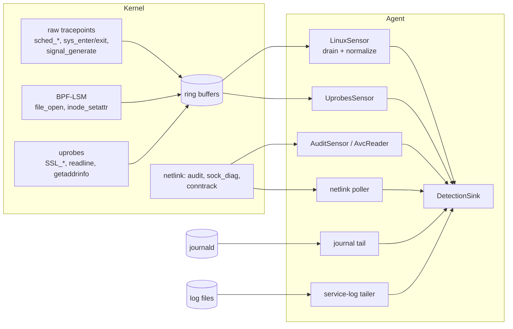

# Linux sensors

The Linux agent sees the host through one primary sensor and several supplementary sources.
The primary sensor is eBPF: kernel programs write fixed-layout records into ring buffers and a
userspace loader turns them into `schema` events. When eBPF cannot load, an audit-netlink
sensor takes its place with less detail. The other sources (netlink polls, the journal tail,
service logs, optional uprobes, BPF-LSM hooks) run next to whichever primary sensor was chosen
and feed the same detection sink.

This page is the map. Each component has its own page:

| Page | Covers |
| --- | --- |
| [eBPF probes](ebpf-probes.md) | The kernel programs: raw tracepoint routers, BTF-patched offsets, maps, in-kernel filters, verifier constraints |
| [Wire format](wire-format.md) | The ring-buffer ABI shared by the probes and userspace, and the variable-length exec record |
| [Userspace loader](userspace-loader.md) | Build, load and attach sequence, the drain loop, normalization, failure handling |
| [Process context](process-context.md) | `ppid`, process generations, argv capture, parent image, environment, container attribution |
| [Signal tamper telemetry](signals.md) | Signals sent to the agent and to listed security tools, the pinned `SIGKILL` slot |
| [BPF-LSM hooks](lsm.md) | `file_open` (observation) and `inode_setattr` (timestamp changes) |
| [Uprobes and DNS capture](uprobes.md) | TLS plaintext, shell readline, `getaddrinfo`, and the UDP/53 query capture |
| [Audit fallback](audit-fallback.md) | `NETLINK_AUDIT` sensor and the SELinux AVC reader |
| [Netlink sources](netlink.md) | `sock_diag`, conntrack, proc connector |
| [Journal tail](journal.md) | sshd, PAM, sudo/su, systemd unit lifecycle |
| [Service logs](service-logs.md) | Web access logs and the MySQL/MariaDB error log |
| [Process memory](procmem.md) | `/proc/<pid>/maps` and `/proc/<pid>/mem` for memory scanning |
| [Testing](testing.md) | Unit tests, robustness suites, fuzz targets, live lab programs |

## Crates

All crates live under [`crates/sensors/linux`](../../../crates/sensors/linux/README.md). A
sensor crate depends only on `schema` and its own wire crate; anything that needs two sensors
or the rules lives in the agent.

| Crate (package) | Role | Runs |
| --- | --- | --- |
| `ebpf` (`sensor-linux-ebpf`) | Kernel programs, `no_std`, target `bpfel-unknown-none`, licensed GPL-2.0-only OR MIT | In the kernel |
| `wire` (`sensor-linux-wire`) | `repr(C)` record layouts, the exec-record parser, the path filter shared by both sides | Both sides |
| `userspace` (`sensor-linux`) | `LinuxSensor`: loads the object, drains rings, enriches, normalizes | Primary sensor thread |
| `uprobes` (`sensor-linux-uprobes`) | `UprobesSensor`: TLS/readline/`getaddrinfo` uprobes, off by default | Own thread, supervised |
| `lsm` (`sensor-linux-lsm`) | Attaches the `file_open` BPF-LSM hook and reads its hit counter | Attached at start |
| `audit` (`sensor-linux-audit`) | `AuditSensor` fallback, `AvcReader` | Primary (fallback) or own thread |
| `netlink` (`sensor-linux-netlink`) | `sock_diag`, conntrack and proc-connector clients | Polled every 10 s |
| `journal` (`sensor-linux-journal`) | `journalctl -f -o json` classifier | Own thread |
| `logs` (`sensor-linux-logs`) | Access-log and MySQL error-log parsers, tailer, budgets | Polled every second by the agent |
| `procmem` (`sensor-linux-procmem`) | Memory-map and memory reads for the YARA memory scan | On demand |

## How the agent composes them

[`cmd_run`](../../../agent/src/commands/linux.rs) builds the pipeline, then:

1. `select_sensor` runs `can_use_ebpf`: root or `CAP_BPF`+`CAP_PERFMON` (or `CAP_SYS_ADMIN`),
   `/sys/kernel/btf/vmlinux` present, the embedded object loads, and the first raw tracepoint
   program passes the verifier. If all pass, [`LinuxSensor`](../../../crates/sensors/linux/userspace/src/sensor.rs)
   is primary; otherwise [`AuditSensor`](../../../crates/sensors/linux/audit/src/sensor.rs).
2. Supplementary workers start: the netlink poller, the journal tail, the AVC reader (only when
   eBPF is primary, because the audit sensor already classifies AVC records), the service-log
   tailer, and the uprobes supervisor (idle unless a capture flag is set).
3. `attach_lsm_hooks` loads a second copy of the eBPF object and attaches the `file_open` LSM
   hook if the kernel supports it.
4. The primary sensor runs on the calling thread until Ctrl-C or `stop()`.

Each source has its own silence heartbeat in the agent, except the service logs (a quiet log is
normal on a quiet site).

## Event coverage

| Telemetry | Source | Schema event |
| --- | --- | --- |
| Process exec (image, argv, env allowlist, parent, container) | eBPF `sched_process_exec` | `Exec` |
| Fork / exit | eBPF, kept in the lineage map only | none (feeds `ppid`, generations) |
| File open, delete, rename, chmod, chown, setxattr, removexattr | eBPF syscall routes | `FileOpen`, `FileDelete`, ... |
| File write (volume only, no path) | eBPF `write` | `FileWrite` |
| Timestamp set by the caller (timestomping) | BPF-LSM `inode_setattr` | `FileSetTime` |
| connect, bind, listen, accept, socket, sendto, recvfrom | eBPF syscall routes | `Connect`, `SocketBind`, ... |
| DNS queries | uprobe `getaddrinfo`, eBPF UDP/53 capture | `DnsQuery` |
| mount/umount, kernel modules, `bpf()`, `prctl` capability options | eBPF | `Mount`, `KernelModule`, `Bpf`, `Prctl` |
| ptrace, `process_vm_readv/writev`, `memfd_create` | eBPF | `Ptrace`, `ProcessVmRead`, ... |
| setuid family, capset, setns/unshare | eBPF | `IdentityChange`, `CapSet`, `Namespace` |
| Signals to the agent or to listed security tools | eBPF `kill`/`tgkill`, `signal_generate` | `Signal` |
| TLS plaintext, shell readline | uprobes (opt-in) | `TlsCapture`, `ReadlineInput` |
| Exec, connect, SELinux denials without eBPF | `NETLINK_AUDIT` | `Exec`, `Connect`, `PolicyDenial` |
| Listening sockets, TCP flows with byte counts | `sock_diag`, conntrack | `ListenPort`, `NetworkFlow` |
| SSH, sudo, su, PAM, unit start/stop | journald | `Auth`, `FileOpen` + flag, `UnitStop` |
| Web attack signatures, MySQL failed logins | declared log files | `HttpRequest`, `HttpSummary`, `Auth` |

## Requirements and platform differences

- **Kernel BTF** at `/sys/kernel/btf/vmlinux` is mandatory for the eBPF sensor: field offsets are
  read from it at start (see [eBPF probes](ebpf-probes.md#btf-patched-offsets)).
- **Privilege**: root, or `CAP_BPF` and `CAP_PERFMON`. Raw tracepoints do not use
  `perf_event_open`, so `kernel.perf_event_paranoid=3` does not block the sensor.
- **Ring buffers** need a 5.8+ kernel. Several code paths carry workarounds for the 5.15 and
  pre-6.6 verifiers (see [verifier constraints](ebpf-probes.md#verifier-constraints)).
- **BPF-LSM** needs `CONFIG_BPF_LSM` and `bpf` in the active `lsm=` list. Both LSM hooks are
  optional; the sensor runs without them.
- **Architectures**: the syscall dispatch table exists for x86_64, i686 and aarch64
  ([`DISPATCH_ENTRIES`](../../../crates/sensors/linux/userspace/src/syscall.rs)). aarch64 has no
  `open`, `unlink`, `rename`, `chmod` or `chown` syscalls, only their `*at` forms. There is no
  arm64 build in CI yet ([#62](https://github.com/synthaea-lab/agent/issues/62)).
- **cgroup v2** is assumed for container attribution.
- `agent status` runs the same checks as `can_use_ebpf` and loads every raw tracepoint program
  through the verifier without attaching it ([`cmd_status`](../../../agent/src/commands/linux.rs)).

## Known gaps at a glance

- The audit fallback reads one record at a time: no lineage, and pid/uid are only as good as
  what the single record carries ([audit fallback](audit-fallback.md#limits)).
- Uprobe events come from a separate copy of the eBPF object: they carry no `ppid` and no
  container ([uprobes](uprobes.md#limits)).
- The `file_open` LSM hook observes but never blocks, and emits no event ([lsm](lsm.md)).
- Ring-buffer overflow is logged from the kernel but not counted, except for signals to security
  tools ([back-pressure](userspace-loader.md#back-pressure-and-loss)).
- `writev`/`pwrite*`, `recvmsg`, `sendmsg`, fd-only `fchmod`/`fchown`/`fsetxattr` and `tkill`
  are not hooked ([eBPF probes](ebpf-probes.md#what-is-not-hooked)).
