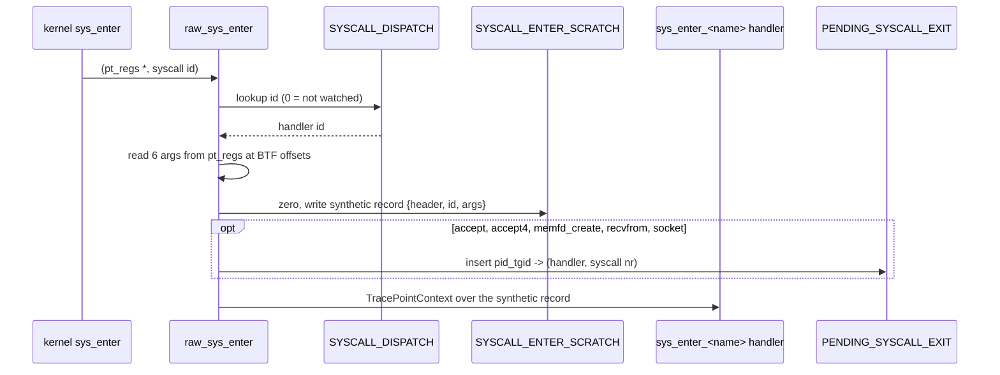

# eBPF probes

The kernel side of the primary sensor is one Rust `no_std` crate,
[`sensor-linux-ebpf`](../../../crates/sensors/linux/ebpf/src/main.rs), compiled with aya for
`bpfel-unknown-none`. It contains every program the Linux sensors attach: raw tracepoints,
BPF-LSM hooks and uprobe handlers. The userspace crates embed the same object (see
[userspace loader](userspace-loader.md#build)).

The object's license string is `Dual MIT/GPL` ([`LICENSE`](../../../crates/sensors/linux/ebpf/src/main.rs)),
which the verifier requires for the GPL-only helpers. The crate is licensed GPL-2.0-only OR MIT;
the rest of the repository is Apache-2.0.

## Programs

| Program | Type | Attach point | Purpose |
| --- | --- | --- | --- |
| `raw_sched_process_fork` | raw tracepoint | `sched_process_fork` | Writes the child's `PROC_LINEAGE` entry |
| `raw_sched_process_exit` | raw tracepoint | `sched_process_exit` | Removes the entry |
| `raw_sched_process_exec` | raw tracepoint | `sched_process_exec` | Emits the exec record |
| `raw_sys_enter` | raw tracepoint | `sys_enter` | Routes 45 syscalls to their handlers |
| `raw_sys_exit` | raw tracepoint | `sys_exit` | Completes the five syscalls that need a return value |
| `raw_dns_udp_enter` | raw tracepoint | `sys_enter` | UDP/53 query capture, attached only on request |
| `raw_signal_generate` | raw tracepoint | `signal_generate` | Signals to listed security tools |
| `file_open` | LSM | `file_open` | Observation-only hit counter ([lsm](lsm.md)) |
| `inode_setattr` | LSM | `inode_setattr` | Caller-chosen timestamps ([lsm](lsm.md)) |
| `ssl_*`, `readline_exit`, `getaddrinfo_*` | uprobe / uretprobe | user libraries | [Uprobes](uprobes.md) |

The scheduler and syscall entry points are in [`raw.rs`](../../../crates/sensors/linux/ebpf/src/raw.rs).
The per-syscall handlers, with their maps and offsets, are grouped by domain in modules under
[`src/`](../../../crates/sensors/linux/ebpf/src/) (for example `file/`, `net/`, `cred/`, `kernel/`),
and the uprobe programs are in `uprobe/`.
[`main.rs`](../../../crates/sensors/linux/ebpf/src/main.rs) holds the maps and helpers they share,
and any handler not yet split into a module. The list of raw tracepoints userspace
attaches is [`RAW_TRACEPOINTS`](../../../crates/sensors/linux/userspace/src/ebpf.rs).

## Why raw tracepoints

Regular tracepoint attachment goes through `perf_event_open`, which `kernel.perf_event_paranoid=3`
(the Debian default on some releases) denies even to a service holding `CAP_BPF` and
`CAP_PERFMON`. Lowering the sysctl changes host-wide policy and granting `CAP_SYS_ADMIN` widens the
service's privilege, so the sensor attaches raw tracepoints instead, which use `BPF_RAW_TRACEPOINT_OPEN`.

Two consequences shape the code:

1. Raw tracepoints hand over raw arguments (`task_struct *`, `pt_regs *`), not the formatted
   tracepoint record. The structure offsets needed to read them come from the running kernel's
   BTF ([BTF-patched offsets](#btf-patched-offsets)).
2. One raw `sys_enter` program serves every syscall, instead of one tracepoint per syscall.

## The syscall router

[`raw_sys_enter`](../../../crates/sensors/linux/ebpf/src/raw.rs) looks the syscall id up in
`SYSCALL_DISPATCH`, a 1024-entry array that userspace fills from the host ABI
([`populate_dispatch`](../../../crates/sensors/linux/userspace/src/syscall.rs)). A zero entry returns
immediately, so unwatched syscalls cost one array lookup. For a watched one it reads the six
argument registers at BTF-derived `pt_regs` offsets and writes a synthetic record shaped like the
regular `syscalls:sys_enter_*` tracepoint record (an 8-byte common header, the syscall id, then the
arguments in 8-byte slots on 64-bit, 4-byte slots on i686) into a per-CPU scratch map. The existing
handlers read that record through `TracePointContext` at fixed offsets, so the `*_OFFSET` constants
next to each handler (for example `OPENAT_FILENAME_PTR_OFFSET` in `file/open.rs`) are offsets into
this synthetic record, not into a kernel structure. They do not drift with the kernel.

The handler ids are plain integers shared by three places: the `match` in `raw_sys_enter`, the
`match` in `raw_dns_udp_enter`, and [`DISPATCH_ENTRIES`](../../../crates/sensors/linux/userspace/src/syscall.rs).
The three ids the DNS capture reacts to are named constants in the wire crate
([`DISPATCH_CONNECT`, `DISPATCH_WRITE`, `DISPATCH_SENDTO`](../../../crates/sensors/linux/wire/src/lib.rs)),
so renumbering them is a compile error. The others are checked by the unit test
`dispatch_actions_are_unique_and_in_range`.

### Exit pairing

Five events need the syscall's return value: `accept`/`accept4` (the peer address is written by
the kernel), `memfd_create` (the fd), `recvfrom` (the sender address and byte count) and `socket`
(the fd). The router stashes `(handler, syscall nr)` in `PENDING_SYSCALL_EXIT`, keyed by
`pid_tgid`, packed by [`encode_pending_syscall_exit`](../../../crates/sensors/linux/wire/src/lib.rs).
[`raw_sys_exit`](../../../crates/sensors/linux/ebpf/src/raw.rs) takes the entry out and dispatches
only when [`matching_pending_syscall_exit`](../../../crates/sensors/linux/wire/src/lib.rs) confirms the
exiting syscall number equals the one stored, so a stale tag from an interrupted call cannot route an
unrelated exit. On arm64 a negative `syscallno` (`NO_SYSCALL`) maps to "no match"
([`syscall_nr_from_i32`](../../../crates/sensors/linux/wire/src/lib.rs)).

`PENDING_SYSCALL_EXIT` is an LRU of 4096 entries: threads blocked in `accept()` hold an entry for as
long as they block, and an LRU keeps new inserts succeeding instead of blinding later calls. Each
handler also keeps its own per-call arguments in its own map (`ACCEPT_ARGS`, `RECVFROM_ARGS`,
`SOCKET_CREATE_ARGS` are LRUs of 1024, `MEMFD_ARGS` a hash of 1024). Two per-CPU counters record
the failure cases: `PENDING_SYSCALL_EXIT_DROPPED` (insert failed even after eviction) and
`PENDING_EXIT_MISMATCH_DROPPED`. Neither is read by the agent yet; `bpftool map dump` shows them.

## BTF-patched offsets

The probes carry no frozen kernel structure layout and no generated vmlinux bindings. The loader
parses `/sys/kernel/btf/vmlinux` itself ([`btf.rs`](../../../crates/sensors/linux/userspace/src/btf.rs))
and writes the offsets into `#[no_mangle]` globals before load with `EbpfLoader::override_global`.

| Globals | Read from BTF | Required | When missing |
| --- | --- | --- | --- |
| `TASK_PID_OFFSET`, `TASK_TGID_OFFSET`, `TASK_COMM_OFFSET`, `BINPRM_FILENAME_OFFSET`, `SYSCALL_ARG_OFFSETS`, `SYSCALL_NR_OFFSET` | `task_struct.{pid,tgid,comm}`, `linux_binprm.filename`, `pt_regs` argument registers and syscall number (`orig_ax` on x86, `syscallno` on arm64) | yes | Sensor start fails: "could not read required fields from kernel BTF" |
| `EXEC_ARGV_ENABLED`, `TASK_MM_OFFSET`, `MM_ARG_START_OFFSET`, `MM_ARG_END_OFFSET` | `task_struct.mm`, `mm_struct.arg_start/arg_end` | no | Exec probe reads no argv; userspace falls back to `/proc` |
| `INODE_SETATTR_ENABLED`, `IATTR_*_OFFSET`, `DENTRY_PARENT_OFFSET`, `DENTRY_NAME_PTR_OFFSET` | `iattr`, `dentry.d_parent`, `dentry.d_name` + `qstr.name` | no | `inode_setattr` emits nothing |

The optional groups each have an `*_ENABLED` flag that stays 0 unless every member resolved, so a
kernel whose layout was not understood emits nothing rather than reading at a wrong offset. The
parser is bounds-checked, rejects bitfield or unaligned members, and looks through anonymous
structs and unions ([`member_offset`](../../../crates/sensors/linux/userspace/src/btf.rs)).

## Building events off the stack

The BPF stack is 512 bytes and an exec record alone is larger. Every event is assembled in a
one-entry `PerCpuArray` scratch map (`EXEC_SCRATCH`, `OPEN_SCRATCH`, ...), zeroed with
`write_bytes`, filled field by field, and emitted with one `RingBuf::output` copy. Two
alternatives were rejected by the verifier on pre-6.6 kernels: a struct literal on the stack leaves
padding uninitialised (and copying it to the ring reads uninitialised stack), and filling a
reserved ring slot needs a per-byte loop over `MAX_PATH_LEN` that exceeds the 1M-instruction budget.
A raw tracepoint is not preemptible on its CPU, so one scratch slot per CPU is enough.

The router's synthetic records use the same pattern (`SYSCALL_ENTER_SCRATCH`,
`SYSCALL_EXIT_SCRATCH`): the verifier counts the whole call chain's stack, and the router's frame
plus a handler's frame exceeded 512 bytes on routes such as `openat`.

Every event starts with an `EventMeta` ([wire format](wire-format.md#eventmeta)) filled from
`bpf_get_current_pid_tgid`, `bpf_get_current_uid_gid`, `bpf_get_current_comm`,
`bpf_ktime_get_ns`, `bpf_get_current_cgroup_id`, and the lineage map
([`fill_lineage`](../../../crates/sensors/linux/ebpf/src/main.rs)).

## Maps

### Ring buffers

| Ring buffer | Size | Notes |
| --- | --- | --- |
| `EXEC_EVENTS` | 512 KiB | Variable-length records (fixed part + argv bytes) |
| `FILE_SET_TIME_EVENTS` | 1 MiB | `tar x` / `cp -a` emit one ~400-byte event per file; 256 KiB lost most of a 3000-file unpack |
| `SIGNAL_EVENTS` | 64 KiB | Filtered to tamper-relevant targets |
| every other ring (`FILE_OPEN_EVENTS`, `CONNECT_EVENTS`, ..., `NAMESPACE_EVENTS`, `TLS_CAPTURE_EVENTS`, `READLINE_EVENTS`, `DNS_QUERY_EVENTS`, `DNS_UDP_EVENTS`) | 256 KiB | One ring per event type |

One ring per event type means a burst of one type (writes during a `docker run`) cannot evict
another type (execs). The userspace drain polls all of them fairly
([drain loop](userspace-loader.md#the-drain-loop)).

### State maps

| Map | Kind, size | Written by | Purpose |
| --- | --- | --- | --- |
| `PROC_LINEAGE` | hash, 65 536 | fork probe, exec probe, userspace priming | pid → parent, parent comm, generation, `execd` ([process context](process-context.md#lineage)) |
| `SYSCALL_DISPATCH` | array, 1024 | userspace | syscall id → handler id |
| `PENDING_SYSCALL_EXIT` | LRU, 4096 | router | in-flight calls awaiting `sys_exit` |
| `BIND_ADDR_MAP` | hash, 4096 | `bind` handler | `(pid, fd)` → bound address, read by `listen`. Never cleaned; inserts fail silently once full |
| `DNS_UDP_FDS` | LRU, 4096 | `connect` in the DNS program | `(tgid, fd)` → destination of a socket connected to port 53 |
| `SIGNAL_WATCH_PID` | array, 1 | userspace | the agent's own pid ([signals](signals.md)) |
| `SIGNAL_WATCH_TOOLS` | hash, 8192 | userspace | tgids of listed security tools → their `SigCgt` |
| `SIGNAL_TAMPER_LAST` | array, 1, pinned | kill/tgkill handlers | last `SIGKILL` aimed at the agent |
| `LSM_FILE_OPEN_HITS`, `SIGNAL_TOOL_DROPS`, `PENDING_*_DROPPED` | per-CPU array | probes | counters |

## In-kernel filters

Filtering happens before the ring buffer wherever volume would otherwise be unbounded.

| Filter | Where | Effect |
| --- | --- | --- |
| Path prefix and write intent | [`is_filtered_path`](../../../crates/sensors/linux/wire/src/path_filter.rs), all 14 file programs | Drops `/sys/` and `/dev/` (except `/dev/shm/`) always; drops `/proc/`, `/tmp/`, `/var/tmp/`, `/dev/shm/` only for read-only opens; never drops `/proc/<pid>/root/...` |
| Agent's own pid | [`is_agent_own_pid`](../../../crates/sensors/linux/ebpf/src/main.rs) in `open`, `write` and the DNS capture | The agent's spool writes would otherwise double write-ring pressure during bursts; userspace drops the rest |
| Address family | `connect`, `bind`, `sendto`, `recvfrom`, `accept` | Only `AF_INET`/`AF_INET6`; a null address (`send`, `recv`) is skipped |
| `bpf(2)` command | `sys_enter_bpf` | Only `BPF_MAP_CREATE`, `BPF_PROG_LOAD`, `BPF_PROG_ATTACH` |
| `prctl(2)` option | `sys_enter_prctl` | Only `PR_SET_SECUREBITS` and `PR_CAPBSET_DROP`; `PR_SET_NAME` runs on every thread rename |
| Signal target | `kill`, `tgkill`, `signal_generate` | Only the agent's pid or a listed tool ([signals](signals.md)) |
| Success only | `accept`, `socket`, `memfd_create` | A failed call has no peer or fd to report |

The path filter is conditioned on intent because `/tmp/`, `/var/tmp/` and `/dev/shm/` are
payload staging areas: a read-only open there is noise, but a write-intent open
(`O_WRONLY|O_RDWR|O_CREAT|O_TRUNC`) or any delete, rename, chmod, chown or xattr change is the
payload lifecycle. `/proc/` follows the same rule because `/proc/self/root/...` and
`/proc/self/cwd/...` reach real files; a write through any procfs alias passes. The filter takes
two primitives `(flags: i64, is_mutation: bool)` rather than an enum, because an enum variant
without payload leaves its payload slot uninitialised and the verifier rejects reading it.

## Verifier constraints

These rules are not style; each one was a verifier rejection on a supported kernel.

- **No panics.** The `no_std` panic handler is an infinite loop, which the verifier rejects
  ("last insn is not an exit or jmp"). Slices are indexed with `.get()`, never `[i]`.
- **No new loops in code inlined into the file programs.** `is_filtered_path` is inlined into 14
  programs; two small slash-skipping loops pushed every one past the 1M-instruction limit on 5.15.
  Prefer a fail-open early return. Bounded loops with a constant bound are fine where needed
  (`MAX_DNS_ANSWERS`, `SET_TIME_COMPONENTS`, `TASK_COMM_LEN` copies).
- **Clamp before a variable-length helper call.** User buffers (argv, TLS, DNS payloads) are read
  with one `bpf_probe_read_user_buf` into a slice whose length was clamped against the buffer size
  first, so the verifier sees an upper bound. A byte loop is never used.
- **Inline helpers shared by two programs.** `read_syscall_args` is `#[inline(always)]`: with two
  callers LLVM emitted a BPF-to-BPF call and the combined stack reached 544 bytes on 5.15. The DNS
  helpers are inlined for the same reason.
- **Separate verifier units for optional features.** The UDP/53 capture is its own program
  (`raw_dns_udp_enter`) because adding its maps and code to `raw_sys_enter` made the 5.15 verifier
  return `E2BIG`. It also keeps the cost off hosts that did not ask for it.
- **LSM return values must be provably in `[-4095, 0]`.** See [lsm](lsm.md#file_open).

## What each syscall route captures

| Event | Syscalls | Captured | Notes |
| --- | --- | --- | --- |
| `FileOpenEvent` | `openat`, `open` | raw path, raw flags | Path not resolved against `dfd`. `open` is needed for musl/busybox. Flags are masked in userspace |
| `FileWriteEvent` | `write` | fd, requested count | No path (no fd → path resolution). `pwrite64`/`writev` are not routed |
| `FileDeleteEvent` | `unlink`, `unlinkat` | raw path | |
| `FileRenameEvent` | `rename`, `renameat`, `renameat2` | both raw paths, both dir fds | Userspace resolves relative paths |
| `FileChmodEvent` / `FileChownEvent` | `chmod`, `fchmodat` / `chown`, `lchown`, `fchownat` | raw path, mode / uid, gid | |
| `FileSetxattrEvent` / `FileRemovexattrEvent` | `setxattr` / `removexattr` | raw path, xattr name (not value) | |
| `ConnectEvent`, `SocketBindEvent`, `UdpSendEvent` | `connect`, `bind`, `sendto` | address, port, fd, requested size | |
| `SocketListenEvent` | `listen` | fd, backlog, address from `BIND_ADDR_MAP` | `addr_resolved: false` when no prior `bind` was seen |
| `SocketAcceptEvent`, `UdpRecvEvent`, `SocketCreateEvent` | `accept{,4}`, `recvfrom`, `socket` | peer/sender address, size, fd, domain/type/protocol | enter/exit pairs |
| `MountEvent` | `mount`, `umount2` (kernel tracepoint name `umount`) | mount point, source, fs type, read-only | |
| `SignalEvent` | `kill`, `tgkill`, `signal_generate` | target pid, signal | [signals](signals.md) |
| `KernelModuleEvent` | `init_module`, `finit_module`, `delete_module` | action, fd, name (delete only) | userspace resolves the `finit_module` fd |
| `BpfEvent`, `PrctlEvent` | `bpf`, `prctl` | command / option, arg2 | filtered in kernel |
| `PtraceEvent`, `ProcessVm{Read,Write}Event`, `MemfdCreateEvent` | `ptrace`, `process_vm_readv/writev`, `memfd_create` | request, target, iovec counts and first length, memfd name/flags/fd | ptrace unfiltered |
| `IdentityChangeEvent`, `CapSetEvent`, `NamespaceEvent` | setuid family, `capset`, `setns`/`unshare` | requested ids, both capability words, flags | `capset` reads the high word unless the header is version 1 |

## What is not hooked

Stated so a reader does not assume coverage:

- `pwrite64`, `writev`, `pwritev`: no path either way, but the write-volume signal misses them.
- `recvmsg`, `sendmsg`, `sendmmsg`: UDP receive/send and DNS sent through them are not seen.
- fd-only variants `fchmod`, `fchown`, `fsetxattr`, `lsetxattr`, and `move_mount`.
- `tkill` toward the agent (a thread id has nothing to compare with the watched pid); tools are
  covered by `signal_generate`.
- `io_uring` submissions do not pass through `sys_enter`. The `file_open` LSM hook fires for them
  but only counts ([lsm](lsm.md)).
- Paths longer than `MAX_PATH_LEN` (256) are truncated; relative paths are not resolved except for
  renames.

## Changing a probe

- A new syscall route needs: a handler in its domain module (for example `net/connect.rs` for
  `connect`, or a new module for a new domain), a handler id in the `raw_sys_enter` match, an
  entry in both `DISPATCH_ENTRIES` tables, a ring buffer, a wire struct, a `WIRE_VERSION` bump, a
  `normalize` function, a `RingBuffers` field and a `drain_wire` branch.
- Verify on the oldest supported verifier (the lab matrix includes 5.14 and 5.15) with
  `agent status`, which loads every raw tracepoint program without attaching it.
- Each per-handler `*_OFFSET` constant is an offset into the router's synthetic record. Keep the
  `syscalls:*` argument order when adding one.
