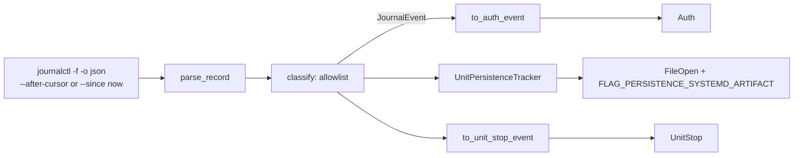

# Journal tail

Authentication and service lifecycle are not expressed by syscalls in a readable way. On systemd
hosts they are in the journal. [`sensor-linux-journal`](../../../crates/sensors/linux/journal/src/lib.rs)
reads `journalctl -f -o json`, keeps an allowlist of records, and maps them to `Auth`,
`FileOpen` (with a persistence flag) and `UnitStop` events. The whole journal is never shipped.

## Why a subprocess

[`spawn_follow`](../../../crates/sensors/linux/journal/src/tail.rs) runs `journalctl` rather than
linking `libsystemd`: it gives cursor-based resume (`--after-cursor`), JSON the crate parses anyway,
and no build-time dependency on `libsystemd-dev` on every build host and target. The cost is a
child process; the agent owns it ([`spawn_journal_tail`](../../../apps/agent/src/commands/linux.rs)).
Restart on unexpected exit is not built.

## Data flow

- [`parse_record`](../../../crates/sensors/linux/journal/src/record.rs) reads one JSON line into a
  `JournalRecord` (cursor, realtime timestamp, identifier, `_PID`, `_UID`, `_COMM`, message, unit
  job fields). A record that fails in an expected way is skipped; an I/O error ends the stream.
- [`classify`](../../../crates/sensors/linux/journal/src/classify.rs) returns a `JournalEvent` for
  allowlisted records only:

| `JournalEvent` | Recognised from |
| --- | --- |
| `SshAccepted`, `SshFailed` | identifier `sshd` or `sshd-session` (OpenSSH 9.8+ re-execs the per-connection worker under that name); "Accepted ...", "Failed password ...", invalid user |
| `PamSessionOpened`, `PamSessionClosed` | `pam_unix(<service>:session):` for any service |
| `PamAuthFailure` | `pam_unix(sudo:auth)` or `pam_unix(su:auth)`: authentication failure (and `pam_sss`) |
| `SudoCommand` | `sudo` command lines (`TTY=... ; USER=... ; COMMAND=...`) |
| `UnitStarted`, `UnitStopped`, `UnitFailed` | `JOB_TYPE`/`JOB_RESULT`/`UNIT`, only from a systemd manager (`_PID=1`, or `_COMM=systemd` for a user manager) |

## Trust in journal fields

Most journal fields are chosen by the client that logged the line. The crate relies on the ones
journald stamps itself:

- **Unit job records** are trusted only from a manager process. `JOB_TYPE` and `UNIT` are
  client-settable, so a `logger`-style record could otherwise claim a start or stop of any unit.
  Stops are reported only from the system manager (`_PID=1`), because a user can name a user unit
  after a security tool.
- **sudo/su lines** are matched on `_COMM`, not `SYSLOG_IDENTIFIER` (`logger -t sudo ...` sets the
  identifier freely). `_COMM` is not a full identity either: a renamed copy of `logger` gets
  `_COMM=sudo`. The rule that joins sudo failures keys on the journald-stamped `_UID` instead.

## Mappings

- [`to_auth_event`](../../../crates/sensors/linux/journal/src/auth.rs) maps to `schema::AuthEvent`,
  the shape Windows logons use too. PAM session records for `sshd` and `sudo` are not mapped,
  because the dedicated `SshAccepted` and `SudoCommand` records already describe the same action;
  `su` and `login` sessions are mapped. A record missing a field the mapping needs is skipped.
- [`UnitPersistenceTracker`](../../../crates/sensors/linux/journal/src/persistence.rs) maps the first
  start of a unit seen by this agent process to a `FileOpenEvent` with
  `FLAG_PERSISTENCE_SYSTEMD_ARTIFACT` (T1543.002). Journald logs a start on every start, so
  "first seen by this process" approximates "newly installed"; the seen-set resets on restart.
  This is one of the few places a synthetic flag is set on Linux, and it is set by a userspace
  sensor, never by the probe (see the open-flag mask in
  [normalization](userspace-loader.md#normalization)).
- [`to_unit_stop_event`](../../../crates/sensors/linux/journal/src/unitstop.rs) emits `UnitStop`
  (T1562.001) only for units of `schema::SECURITY_SERVICES`, from the system manager. The journal
  names no actor: the job record's pid and uid are the manager's.

## PAM failure deduplication

[`ClassifiedJournal`](../../../crates/sensors/linux/journal/src/tail.rs) adjusts two PAM cases
before yielding:

- A `pam_sss` failure is held for one more line in case the next line says the user is unknown to
  sssd (then it is not a real failure). A held failure still pending at end of stream is flushed.
- A failure from the same pid but a different PAM module within
  `DOUBLE_LOG_DEDUP_WINDOW_US` (1 s) is dropped: two stacked modules (`pam_unix` and `pam_sss`) log
  one wrong password twice. Same-module failures on one pid are real retries and are kept. The
  1 s window is a reasoned bound, not a measurement. The last 64 failures are remembered.

## Liveness and resume

The iterator yields allowlisted records only, so an idle host would look like a silent sensor. The
agent pulses the heartbeat from
[`with_line_hook`](../../../crates/sensors/linux/journal/src/tail.rs), which sees every non-blank
line, and writes its own canary line every 30 s over journald's native socket
([`send_canary`](../../../crates/sensors/linux/journal/src/canary.rs), identifier
`synthaea-agent-canary`, priority 7). The canary proves end-to-end delivery: journald accepted,
stored and returned it through `journalctl -f`. It never matches the allowlist.

The last cursor is persisted next to the alerts file by the agent
([`journal_cursor.rs`](../../../apps/agent/src/journal_cursor.rs)) and passed as `--after-cursor` on
restart. The first start begins at "now".

## Limits

- Needs systemd and `journalctl` on `PATH`; without them the tail is skipped with a warning.
- Unprivileged `journalctl` cannot read auth records on some distributions (per-unit read ACLs);
  the agent normally runs with enough privilege.
- `su`/`sshd` failure and `sudo`/`su` wrong-password parsing follow the documented formats and are
  unit-tested; a system-manager `JOB_TYPE=stop` record has not been captured on a real host.
- Unit failures are classified but not mapped to an event.

## Testing

Unit tests in every module use canned journal lines, including real captures where available.
`spawn_follow_and_current_cursor_against_the_real_journalctl` runs against the host's journal and
skips itself when `journalctl` is unusable.
