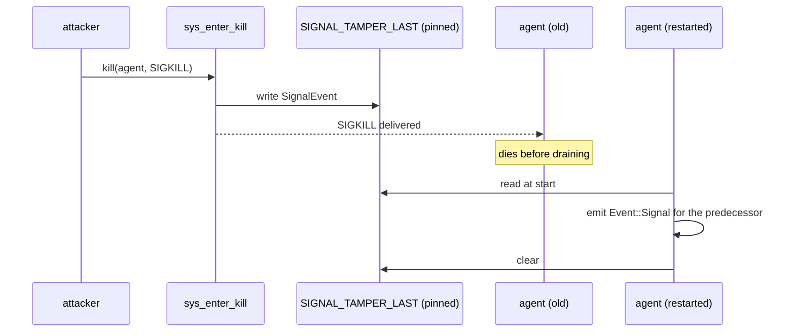

# Signal tamper telemetry

Signals are the cheapest way to blind an EDR: kill the agent, or kill the security tools next to
it. System-wide signal traffic (job control, `SIGCHLD`, supervision) is far too high-volume to
forward, so the sensor only reports signals aimed at two kinds of target, and filters in the kernel.

| Target | Hook | Watch set |
| --- | --- | --- |
| The agent itself | `kill`, `tgkill` syscall routes | `SIGNAL_WATCH_PID` (one slot) |
| Processes of listed security units (`schema::SECURITY_SERVICES`) | `signal_generate` raw tracepoint | `SIGNAL_WATCH_TOOLS` (hash, 8192) |

Both produce `SignalEvent` on the `SIGNAL_EVENTS` ring (64 KiB). The sender is `meta` (so the
container resolved is the sender's), the target is `target_pid`.

## Signals to the agent

Userspace writes its own pid into [`SIGNAL_WATCH_PID`](../../../crates/sensors/linux/ebpf/src/main.rs)
before attaching ([`write_signal_watch_pid`](../../../crates/sensors/linux/userspace/src/ebpf.rs)).
A zero slot means "watch nothing", so attaching first would silently drop early signals. The same
value drives the kernel-side drop of the agent's own file activity.

`kill` and `tgkill` compare the target (`pid`, or `tgid` for `tgkill`) with the slot. `tkill` is
not hooked: it takes a thread id, which cannot be compared with a process id. glibc's
`pthread_kill` uses `tgkill` and `kill(1)` uses `kill`.

### The pinned `SIGKILL` slot

A `SIGKILL` cannot be attributed through the ring buffer: the agent dies before it drains. So the
kill handlers also write the event synchronously into
[`SIGNAL_TAMPER_LAST`](../../../crates/sensors/linux/ebpf/src/main.rs), a one-entry array, at
syscall entry, before the kernel delivers the signal. The map is pinned under
`/sys/fs/bpf/synthaea/signal_tamper_last_v<WIRE_VERSION>`
([`load_ebpf_for_run`](../../../crates/sensors/linux/userspace/src/ebpf.rs)), so it survives the
process.

Only `SIGKILL` goes to the slot: catchable signals are attributed by the agent's own handler, and
`SIGSTOP` does not end the process.

The probe fires at syscall entry, before the permission check, so an unprivileged `kill -9` that
fails with `EPERM` still fills the slot. Left there, it would blame that sender at the next clean
restart. [`sweep_survived_sigkill`](../../../crates/sensors/linux/userspace/src/sensor.rs) runs every
10 s and clears a record aimed at the current pid that is older than one second: delivery happens
inside the sender's `kill(2)`, so an agent alive one second later survived it. The live ring event
already reported the attempt. Waiting rather than clearing on the ring event keeps a real kill from
racing its own record away.

Without bpffs (not mounted, no permission) the object loads unpinned; only cross-restart
attribution is lost.

## Signals to security tools

`SECURITY_SERVICES` are systemd unit names, not process names (`clamav-daemon` runs `clamd`), and
any process can set its comm. [`UnitResolver`](../../../crates/sensors/linux/userspace/src/unit_procs.rs)
reads each unit's `cgroup.procs` (`/sys/fs/cgroup/system.slice/<unit>.service/` and the hybrid v1
layout under `systemd/`) and its sub-cgroups, which is how systemd itself answers "does this process
belong to unit X". For each tgid it records the unit, `/proc/<pid>/exe`, the start time, and the
`SigCgt` mask from `/proc/<pid>/status`, all at scan time: a `SIGKILL`ed target and its `/proc`
entry are gone by drain time.

[`ToolWatch::refresh`](../../../crates/sensors/linux/userspace/src/unit_procs.rs) runs before
attach and every 5 s, and writes the set into `SIGNAL_WATCH_TOOLS` (tgid → `SigCgt`).

| Bound | Value | Reason |
| --- | --- | --- |
| `MAX_PROCS_PER_UNIT` | 256 | Past that it is a fork bomb in the unit; the first ones are the tool's |
| `MAX_DEPTH` | 4 | Sub-cgroup levels below the unit |
| `MAX_CGROUPS_PER_UNIT` | 256 | A delegated unit can hold thousands of siblings; the scan runs on the drain task |
| `MAX_MOVED_OUT` | 256 (all units together) | Processes kept after leaving their unit's cgroup |

A watched process that leaves its unit's cgroup (root can move it with `echo <pid> > cgroup.procs`
to blind the watch) stays watched while the same process (pid and start time) is alive, up to
`MAX_MOVED_OUT`. A compile-time assertion checks that
`SECURITY_SERVICES.len() * MAX_PROCS_PER_UNIT + MAX_MOVED_OUT < SIGNAL_WATCH_TOOLS_ENTRIES`.

### `signal_generate`

[`raw_signal_generate`](../../../crates/sensors/linux/ebpf/src/raw.rs) runs for every generated
signal, whatever the syscall (`kill`, `tgkill`, `tkill`, `pidfd_send_signal`, `rt_sigqueueinfo`),
with the target already resolved in the initial pid namespace and once per target of a group kill.
Its common case is one read of `task->tgid` and one hash lookup. In order, it drops:

1. signal 0 (liveness probe) and the signals that neither end nor stop a process (`SIGCHLD`,
   `SIGCONT`, `SIGURG`, `SIGWINCH`);
2. `SEND_SIG_PRIV`: the kernel's own signals (OOM killer, CPU limit). The sender is not a process;
3. signals the kernel reports as ignored or already pending;
4. targets not in `SIGNAL_WATCH_TOOLS`;
5. reload signals the tool catches (`SIGHUP`, `SIGUSR1`, `SIGUSR2`, real-time), checked against
   the tool's `SigCgt`, so a storm of reloads cannot fill the ring ahead of a `SIGKILL`.
   `SIGTERM`, `SIGINT`, `SIGQUIT`, `SIGABRT` are never treated as reloads; a compile-time assertion
   keeps lethal signals out of that set;
6. a tool signalling itself.

`SEND_SIG_NOINFO` (null siginfo) is kept and attributed to `current`; `echo 1 > cgroup.kill` takes
that path. There is no filter on `si_code`: a process can forge most codes with `rt_sigqueueinfo`
or `pidfd_send_signal`. The three codes the kernel raises from interrupt or completion context
(`SI_TIMER`, `SI_MESGQ`, `SI_ASYNCIO`) set
[`SIGNAL_SENDER_UNRELIABLE`](../../../crates/sensors/linux/wire/src/lib.rs) on the event instead,
because `current` may be a bystander. Permission is checked before this tracepoint, so a refused
`kill` never reaches it.

A tool kill does not take the agent down, so the ring is enough; nothing is written to the pinned
slot. When `SIGNAL_EVENTS` is full the loss is counted per CPU in `SIGNAL_TOOL_DROPS`; the drain
reads it every 5 s, logs the increase, and emits a
[`signals_lost`](../../../crates/sensors/linux/userspace/src/normalize.rs) event, because a flood of
signals ahead of a kill is a way to end a tool unseen.

In the drain, a target found in the watch set gets the tool's exe and unit; the agent's own pid
gets the agent's exe; any other target gets neither, so it cannot read as a signal to the agent.

## Limits

- A restarted tool's new pid is unwatched until the next scan (up to 5 s).
- Tools not run by a systemd unit, and template instances (`clamd@scan.service`), are not watched.
- The kernel can end or freeze a tool without a signal this path reports: a CPU rlimit or a
  `memory.max` OOM kill (`SEND_SIG_PRIV`), or `cgroup.freeze` (no signal). The rules read how
  such a limit is set (exec of `systemctl` or `prlimit`, a write to a cgroup limit file, which
  the open probe now passes); the kill itself stays unreported. Tracked in
  [#49](https://github.com/synthaea-lab/agent/issues/49).
- Only the agent's own pid is watched on the `kill`/`tgkill` path; the watchdog process is not. That
  path compares the pid argument as the sender wrote it, in the sender's pid namespace.
