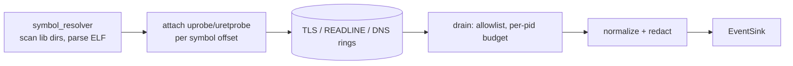

# Uprobes and DNS capture

Some telemetry never crosses a syscall in a readable form: TLS plaintext (the kernel only sees
ciphertext), shell input (builtins never `execve`), and name resolution through libc.
[`sensor-linux-uprobes`](../../../crates/sensors/linux/uprobes/src/lib.rs) attaches eBPF uprobes to
user-space library functions for these. All three captures are off by default and sensitive; the
agent turns them on with `--enable-tls-capture`, `--enable-readline-capture` and
`--enable-dns-capture`.

The UDP/53 query capture is part of the primary eBPF sensor but is described here, because
`--enable-dns-capture` turns it on together with the `getaddrinfo` uprobe.

## How it runs

[`UprobesSensor`](../../../crates/sensors/linux/uprobes/src/sensor.rs) is a separate `Sensor` on its
own thread, started by the agent's uprobes supervisor
([`spawn_uprobes_supervisor`](../../../apps/agent/src/commands/linux.rs)) only when at least one capture is
on. It loads its own copy of the eBPF object (its [`build.rs`](../../../crates/sensors/linux/uprobes/build.rs)
compiles the same `sensor-linux-ebpf` crate), attaches only the uprobe programs, and drains three
rings: `TLS_CAPTURE_EVENTS`, `READLINE_EVENTS`, `DNS_QUERY_EVENTS` (256 KiB each).

The capture set can be widened at run time by the agent
([`CaptureSet`](../../../apps/agent/src/captures.rs)); the sensor reads its configuration once, so a change
restarts the thread, with a capture gap while the object is reloaded.

## Symbol resolution

[`symbol_resolver`](../../../crates/sensors/linux/uprobes/src/symbol_resolver.rs) scans `/lib`,
`/usr/lib`, `/lib64`, `/usr/lib64` and the multiarch directories for:

| Capture | Libraries | Symbols | Probes |
| --- | --- | --- | --- |
| TLS | `libssl.so*`, `libgnutls.so*` | `SSL_write`, `SSL_write_ex`, `SSL_read`, `SSL_read_ex`, `gnutls_record_send`, `gnutls_record_recv` | uprobe on write; uprobe + uretprobe on read |
| readline | `libreadline.so*`, `libedit.so*` | `readline` | uretprobe |
| DNS | `libc.so*`, `libc-*` (glibc), `ld-musl-*` (musl) | `getaddrinfo`, `gethostbyname_r`, `gethostbyname2_r` | uprobe + uretprobe |

Symlinks are deduplicated by inode, and offsets are read from the ELF dynamic symbol table with
`goblin`. A program loaded once is attached to every matching offset (OpenSSL 3 exports both
`SSL_write` and `SSL_write_ex`, which share one program instance). One failed attach warns and
continues; failed resolution of all symbols is an error, because enabling a capture with nothing to
attach is a configuration mistake. Attachment is system-wide
(`UProbeScope::AllProcesses`) on the library file.

## The probes

The handlers are in [`uprobe/`](../../../crates/sensors/linux/ebpf/src/uprobe/): `tls.rs`, `readline.rs` and
`getaddrinfo.rs`.

- **`SSL_write`** (entry): copies the first `MAX_TLS_CAPTURE` (256) bytes of the plaintext buffer
  with one clamped read, before encryption.
- **`SSL_read`**: the buffer is only filled when the call returns. The entry probe stashes
  `(buf, num, lib)` in `SSL_READ_ARGS` keyed by `pid_tgid`, as three `u64`s: a tuple with padding
  is refused by the 5.15 and 6.1 verifiers (#204). The uretprobe reads the buffer with the return
  value as length.
- **`readline`** (return): reads the returned string, up to `MAX_READLINE_INPUT` (512) bytes.
- **`getaddrinfo`**: the entry stashes the query-name pointer and the address of the caller's
  `res` pointer in `GETADDRINFO_ARGS`; the return probe reads the status and walks the `addrinfo`
  list up to `MAX_DNS_ANSWERS` (24) entries, using glibc's LP64 `struct addrinfo` offsets. A failed
  resolution is emitted too (DGA malware produces many).
- **`gethostbyname_r`, `gethostbyname2_r`** (agent#240): the legacy `gethostbyname` and
  `gethostbyname2` never call `getaddrinfo`; on glibc and musl they call these reentrant forms at
  their exported addresses, so two probes cover all four. Each entry stashes the name and the
  `result` pointer in `GETHOSTBYNAME_ARGS`; one shared return probe walks `h_addr_list` of the
  returned `struct hostent` up to `MAX_DNS_ANSWERS`. An `ERANGE` return is skipped: the
  non-reentrant forms retry with a larger buffer. musl's `gethostbyname_r` calls
  `gethostbyname2_r` with the same arguments; the inner return emits and the outer one finds
  nothing, so it is one event. The `h_errno` reason is not read (it is the 7th argument of
  `gethostbyname2_r`, on the stack on x86_64): a lookup with no address reports `EAI_NONAME`, an
  errno return `EAI_SYSTEM`.

## Volume control and redaction

Two layers bound the volume after the ring:

| Knob (`UprobesConfig`) | Default | Effect |
| --- | --- | --- |
| `tls.enabled` / `readline.enabled` / `dns.enabled` | false | Which probes attach |
| `tls.bytes_per_process_per_sec` | 4096 | Per-pid sliding one-second byte budget |
| `readline.commands_per_process_per_sec` | 10 | Per-pid command budget |
| `dns.queries_per_process_per_sec` | 50 | Per-pid query budget |
| `*.process_allowlist` | empty (all) | Only these comms are kept |
| `tls.library_denylist` | empty | Libraries never attached |
| `compliance_mode` | `None` | Presets that lower the budgets (GDPR, HIPAA); `PciDss` is documented as unsafe because PANs are not redacted |

These are API-level knobs ([`config.rs`](../../../crates/sensors/linux/uprobes/src/config.rs)). The
agent builds the config from the three flags only, so in a deployed agent the defaults apply.
Budget and allowlist drops are counted per capture and logged when the sensor stops.

Redaction runs in [`redact.rs`](../../../crates/sensors/linux/uprobes/src/redact.rs) before an event
leaves the crate: `Authorization` and `Cookie` headers, URL credentials and API-key query
parameters in TLS data; password flags, secret exports and similar in readline input; internal TLDs
(`.local`, `.internal`, `.lan`, `.home`, `.corp`, `.intranet`) in DNS names, keeping the TLD. It is
best-effort pattern matching, not a boundary. A pattern that fails to compile logs loudly and leaves
the text unredacted rather than crashing the sensor; `all_patterns_compile` tests the list.

## UDP/53 capture

Resolvers that do not go through libc's `getaddrinfo` (Go, Rust resolvers, `dig`) are invisible to the
`getaddrinfo` uprobe. [`raw_dns_udp_enter`](../../../crates/sensors/linux/ebpf/src/raw.rs) is a second
`sys_enter` program, attached by `LinuxSensor` only with
[`with_dns_udp_capture`](../../../crates/sensors/linux/userspace/src/sensor.rs). It acts on three
syscalls:

- `connect` to port 53: remembers the destination in `DNS_UDP_FDS` (LRU, keyed by tgid and fd).
- `sendto` with an address on port 53: copies the datagram.
- `write`, or `sendto` without an address, on a remembered fd: copies the datagram.

It copies the first `MAX_DNS_UDP_PAYLOAD` (272) bytes with one clamped read, enough for a full
question. Userspace decides whether the bytes are a DNS query at all
([`parse_query`](../../../crates/sensors/linux/userspace/src/dns_udp.rs)): a closed and reused fd, or
a TCP stream to port 53, produces other bytes. A plain message is tried first, then the two-byte TCP
length framing. Anything that is not a well-formed query with one question is dropped. The event
has no answer (`result: None`, `status: 0` means nothing was seen to fail), and the same internal-TLD
redaction applies. `sendmsg`/`sendmmsg` are not hooked.

## Limits

- **No `ppid`, no container on uprobe events.** The uprobes sensor's object is a separate copy whose
  `PROC_LINEAGE` is never primed or fed by the fork probe, so `ppid` and the generations are 0; and
  the uprobe handlers do not set `cgroup_id`, so container attribution always resolves to `None`.
  `UprobesSensor::capabilities` still reports `parent_lineage: true`.
- **No self-exclusion.** The agent's own TLS or DNS calls are captured like any other process's.
- **Dynamically linked libraries only.** Statically linked TLS (Go's `crypto/tls`, BoringSSL inside
  browsers) and non-standard library paths are not found. `LibraryType` is derived from the file
  name, so BoringSSL is never detected as such; its probes default to the OpenSSL shape.
- **zsh** has its own line editor and does not call `readline`; only programs using
  libreadline/libedit are covered.
- No library-update tracking: probes attach to the files present at start.
- TLS ClientHello fingerprinting (SNI, JA4) has a parser
  ([`tls_client_hello.rs`](../../../crates/sensors/linux/userspace/src/tls_client_hello.rs)) but no
  capture feeds it yet ([#22](https://github.com/synthaea-lab/agent/issues/22)).

## Testing

Unit tests cover the config builder, the normalizers (with property tests) and every redaction
pattern; the DNS parser has its own tests in [`dns_udp.rs`](../../../crates/sensors/linux/userspace/src/dns_udp.rs).
Attachment needs root and is exercised in the lab.
