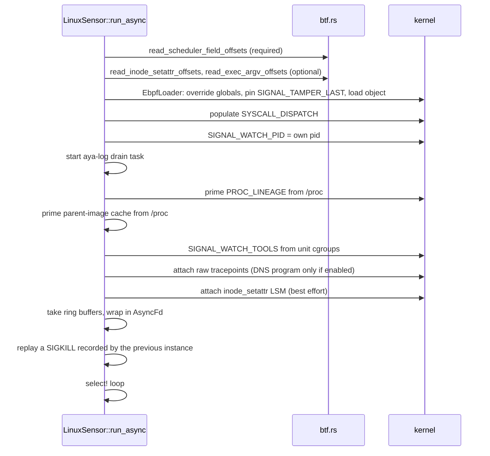

# Userspace loader

[`sensor-linux`](../../../crates/sensors/linux/userspace/src/lib.rs) is the userspace half of the
primary sensor. [`LinuxSensor`](../../../crates/sensors/linux/userspace/src/sensor.rs) loads the
embedded eBPF object, seeds its maps, attaches the programs, drains every ring buffer on one tokio
runtime, enriches each record from `/proc` and cgroupfs, and hands a `schema::Event` to the
`EventSink`.

| Module | Responsibility |
| --- | --- |
| [`ebpf.rs`](../../../crates/sensors/linux/userspace/src/ebpf.rs) | Load the object, patch globals, pin, attach, seed `PROC_LINEAGE`, tamper slot access |
| [`btf.rs`](../../../crates/sensors/linux/userspace/src/btf.rs) | Minimal BTF parser for structure offsets |
| [`syscall.rs`](../../../crates/sensors/linux/userspace/src/syscall.rs) | Fill `SYSCALL_DISPATCH` from the host ABI |
| [`sensor.rs`](../../../crates/sensors/linux/userspace/src/sensor.rs) | `LinuxSensor`, the drain loop |
| [`normalize.rs`](../../../crates/sensors/linux/userspace/src/normalize.rs) | Pure wire → schema mapping, tested on every OS |
| [`proc.rs`](../../../crates/sensors/linux/userspace/src/proc.rs) | `/proc` parsing: cmdline, environ, stat |
| [`container.rs`](../../../crates/sensors/linux/userspace/src/container.rs), [`docker.rs`](../../../crates/sensors/linux/userspace/src/docker.rs) | Container attribution |
| [`parent_image.rs`](../../../crates/sensors/linux/userspace/src/parent_image.rs) | Parent image cache |
| [`unit_procs.rs`](../../../crates/sensors/linux/userspace/src/unit_procs.rs) | Security-tool processes for the signal probe |
| [`dns_udp.rs`](../../../crates/sensors/linux/userspace/src/dns_udp.rs) | DNS question parser for the UDP/53 capture |
| [`tls_client_hello.rs`](../../../crates/sensors/linux/userspace/src/tls_client_hello.rs) | SNI and JA4 from a `ClientHello`; parser only, no capture feeds it yet ([#22](https://github.com/synthaea-lab/agent/issues/22)) |

## Build

[`build.rs`](../../../crates/sensors/linux/userspace/build.rs) compiles `../ebpf` with `aya-build`
into `OUT_DIR` and sets the `ebpf_embedded` cfg. It is skipped on non-Linux targets and when
`bpf-linker` is not on `PATH`; the crate then builds without probes and
[`load_ebpf`](../../../crates/sensors/linux/userspace/src/ebpf.rs) returns an error explaining how to
provision the toolchain. The probe toolchain is the nightly pinned in
[`ebpf-toolchain.txt`](../../../ebpf-toolchain.txt) (override with `SYNTHAEA_EBPF_TOOLCHAIN`);
[`toolchain/linux-toolchain.sh`](../../../toolchain/linux-toolchain.sh) installs it with a matching
`bpf-linker`. An unpinned nightly breaks as soon as its LLVM major moves past the linker's.
`sensor-linux-uprobes` has an identical `build.rs` and embeds its own copy of the same object.

The build reruns when `PATH` changes, so installing the linker invalidates a cached probe-less
build.

## Start-up sequence

The order matters in three places:

- **Maps before attach.** `SIGNAL_WATCH_PID` and `SIGNAL_WATCH_TOOLS` are written before the
  signal programs attach, or the first signals would see an empty map and be dropped.
  `PROC_LINEAGE` is primed before the fork probe attaches; a process that forks in between is
  missed until its next child (accepted, it self-heals).
- **Pinning.** [`load_ebpf_for_run`](../../../crates/sensors/linux/userspace/src/ebpf.rs) creates
  `/sys/fs/bpf/synthaea` (mode 0700) and pins `SIGNAL_TAMPER_LAST` there under a
  `WIRE_VERSION`-suffixed name. A pin left by another user (an agent once run as root, before the
  packaged unprivileged unit) is unlinked, which needs write access to the directory, not the file
  ([`reclaim_foreign_pin`](../../../crates/sensors/linux/userspace/src/ebpf.rs)). Without bpffs the
  object loads unpinned with a warning.
- **Memlock.** `load_ebpf` raises `RLIMIT_MEMLOCK` to infinity for kernels that still charge BPF
  maps against it.

`load_ebpf` and `load_program` are public: the agent's preflight (`agent status`, `can_use_ebpf`)
loads programs through the verifier without attaching them.

## The drain loop

One `tokio::select!` waits on: Ctrl-C, `stop()`, two timers, and one `AsyncFd` per ring buffer.
Readiness of a ring is the epoll edge on its fd.

- [`drain!`](../../../crates/sensors/linux/userspace/src/sensor.rs) reads a fixed-size record
  (length checked, then `read_unaligned`) and passes it to a per-type closure that enriches and
  normalizes it. [`drain_bytes!`](../../../crates/sensors/linux/userspace/src/sensor.rs) does the
  same for the variable-length exec record, which the closure parses with `parse_exec_record`.
- **Fairness.** One drain call takes at most
  [`MAX_ITEMS_PER_DRAIN`](../../../crates/sensors/linux/userspace/src/sensor.rs) (256) items. Reading
  a ring is a synchronous read of shared memory with no `.await`, so under a sustained producer an
  uncapped loop would never return to `select!` and every other ring would starve. When the cap is
  hit the readiness flag is left set, so the next iteration polls the same ring again right away;
  readiness is cleared only when the ring ran dry.
- **Self-exclusion.** An event whose `pid` is the agent's own is dropped before the sink. The
  agent's own writes (its event log, its spool) would otherwise be observed, written again, and
  amplify without bound. The kernel already drops the agent's opens and writes
  ([in-kernel filters](ebpf-probes.md#in-kernel-filters)); this check covers the other events and
  the window before `SIGNAL_WATCH_PID` is written.
- **Optional rings.** A ring whose program is not attached (the `inode_setattr` ring when the hook
  failed) is `None`, and [`readable_or_pending`](../../../crates/sensors/linux/userspace/src/sensor.rs)
  never resolves for it.
- **Timers.** Every 10 s the survived-`SIGKILL` sweep runs; every 5 s the security-tool watch list
  is rescanned and the kernel's tool-signal drop counter is read ([signals](signals.md)).
- **eBPF logs.** `aya_log::EbpfLogger` has its own ring; a spawned task flushes it into `tracing`.

The runtime is multi-threaded, but all ring buffers are drained by the one task that runs
`run_async`. The only spawned work is the eBPF log drain and the Docker lookups.

### Enrichment done on the drain task

| Read | For | Blocking cost |
| --- | --- | --- |
| `/proc/<pid>/cmdline` | exec argv, only when the probe read none | one small read |
| `/proc/<pid>/environ` | exec `env_security` allowlist | one read |
| cgroupfs walk by inode | container id, cached per cgroup id | walk on first sight of a cgroup |
| `/proc/<pid>/cwd`, `/proc/<pid>/fd/<n>` | resolve relative rename paths | one `readlink` per relative path |
| `/proc/<pid>/exe` | rename `executable_path` | one `readlink` per rename |
| `/proc/<pid>/fd/<fd>` | `finit_module` file path | one `readlink` |
| `/proc/<pid>` existence | parent-image eviction preference | on eviction batches |

All of these race the process: a process gone by drain time gives `None` or the raw value, never a
guessed one. The details per field are in [process context](process-context.md).

## Normalization

[`normalize.rs`](../../../crates/sensors/linux/userspace/src/normalize.rs) is pure and
platform-independent; its unit tests run on every CI leg. Invariants it enforces:

- **Timestamps** are `timestamp_ns + boot_epoch_offset_ns`, saturating.
- **Zero means unknown.** A wire generation of 0 becomes `None` in the schema, never
  `Some(0)`. An empty `pcomm` becomes `parent_comm: None`.
- **Open flags are masked.** [`OPEN_FLAGS_MASK`](../../../crates/sensors/linux/userspace/src/normalize.rs)
  (`0x007F_FFFF`) keeps only the bits the kernel's open flags can carry. The kernel ignores unknown
  bits, so without the mask an unprivileged process could set the synthetic `schema::FLAG_*` bits
  other sensors use to mark persistence facts on a `FileOpenEvent`, and raise those alerts at will.
  A compile-time block asserts every synthetic flag lies outside the mask; a new `FLAG_*` must be
  added there. The end-to-end check is [`probe_open_synthetic_bits.rs`](../../../agent/tests/probe_open_synthetic_bits.rs).
- **argv is bounded** to `schema::ARGV_CAPTURE_BUDGET` (32 KiB) in `exec`, the one place every exec
  passes; a cut sets `cmdline_truncated` and makes `argv_omitted_bytes` unknown.
- **The image path is the kernel's** `bprm->filename`, never `argv[0]`.
- **Relative rename paths** are resolved against `/proc/<pid>/cwd` (for `AT_FDCWD`) or
  `/proc/<pid>/fd/<dfd>`. If the link cannot be read, is not absolute (`pipe:[...]`), or ends in
  ` (deleted)`, the raw relative path is kept. A wrong absolute path would be worse: a path-prefix
  exclusion would act on a place the rename never touched.
- **DNS payloads that are not a query** produce no event ([uprobes](uprobes.md#udp53-capture)).
- `file_set_time` joins the dentry names root first into a path and converts the requested Unix
  times to `FILETIME` units, setting only the fields the caller chose.

## Back-pressure and loss

| Where | What happens when full | Visible as |
| --- | --- | --- |
| A ring buffer | `output` fails; the record is lost | an aya-log `warn!` per drop ("ring buffer full, dropping ... event"); not counted |
| `SIGNAL_EVENTS` for tool signals | lost | `SIGNAL_TOOL_DROPS` per-CPU counter, read every 5 s; a `signals_lost` event is emitted so the rules can alert |
| `PROC_LINEAGE` (65 536) | insert fails | events carry `ppid = 0` and no generation |
| `PENDING_SYSCALL_EXIT` | LRU eviction; failed insert counted | `PENDING_SYSCALL_EXIT_DROPPED` (not read by the agent) |
| `BIND_ADDR_MAP` | insert fails silently | `listen` events with `addr_resolved: false` |
| Exec record malformed | dropped | `EXEC_RECORDS_REFUSED`, logged on the first and every thousandth |
| Parent-image cache (32 768) | batch eviction, dead processes first | `ParentImageEvictions` in the health beacon |
| Container id cache (4096) | FIFO eviction | re-walk on next sight |

The drain itself applies no back-pressure to the kernel: ring buffers overwrite nothing, the
producer just fails to reserve. The lab programs in [`examples/`](../../../crates/sensors/linux/userspace/examples/accept_map_pressure.rs)
exercise the pending-exit and accept maps under thousands of blocked threads.

Two probes also log through aya-log on every hit (`raw_sched_process_fork` and the `file_open` LSM
hook), which adds load on the log ring on busy hosts.

## Failure modes

| Failure | Behaviour |
| --- | --- |
| No embedded probes in this build | `load_ebpf` errors; the agent falls back to the audit sensor |
| No `/sys/kernel/btf/vmlinux`, or required members missing | Load fails with "could not read required fields from kernel BTF" |
| Optional BTF members missing | Warning; that feature is disabled |
| A raw tracepoint fails to attach | `run` returns an error (the message names `CAP_BPF`/`CAP_PERFMON`) |
| `inode_setattr` attach fails | Warning; timestamp events are not observed |
| bpffs unavailable | Warning; cross-restart `SIGKILL` attribution is lost |
| `PROC_LINEAGE` priming fails | Warning; `ppid` only known for post-attach forks |
| A ring buffer poll error | `run` returns an error |

## Configuration

The primary sensor has one knob: [`with_dns_udp_capture`](../../../crates/sensors/linux/userspace/src/sensor.rs),
set by the agent's `--enable-dns-capture` flag (which also enables the `getaddrinfo` uprobe). It is
fixed for the life of the sensor. Everything else (ring sizes, map sizes, drain cap, timers) is a
compile-time constant listed on this page and on [eBPF probes](ebpf-probes.md#maps).
