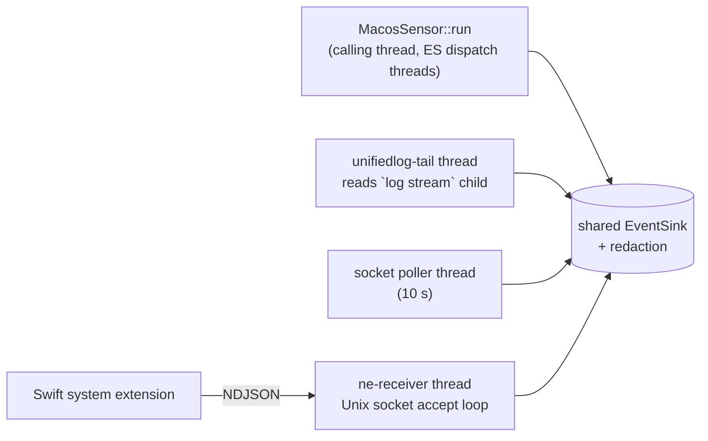

# macOS sensors

The macOS agent collects telemetry through four sources, one crate each under [`crates/sensors/macos`](../../../crates/sensors/macos/README.md). Each depends only on `schema` and compiles to a stub on other operating systems; the pure parsing and normalization halves are compiled and tested on every OS.

| Source | Crate (package) | Mechanism | Needs | Page |
| --- | --- | --- | --- | --- |
| EndpointSecurity | `endpoint-security/` (`sensor-macos`) | ES client through a C shim, NOTIFY events only | root, the ES client entitlement, Full Disk Access | [endpoint-security.md](endpoint-security.md) |
| Unified log | `unifiedlog/` (`sensor-macos-unifiedlog`) | `/usr/bin/log stream --style ndjson` with a strict predicate | root for the full stream | [unified-log.md](unified-log.md) |
| Socket table | `sockets/` (`sensor-macos-sockets`) | libproc fd walk through a C shim | nothing (root for full visibility) | [sockets.md](sockets.md) |
| Network Extension | `network-extension/` (`sensor-macos-network-extension`) + Swift system extension | NDJSON over a Unix socket from `NEFilterDataProvider` and `NEDNSProxyProvider` | a packaged, approved system extension | [network-extension.md](network-extension.md) |

## Why C shims

Apple's structures are large, version-gated unions (`es_message_t`, `socket_fdinfo`), and `es_new_client` takes an Objective-C block. Transcribing them into `#[repr(C)]` Rust would drift silently with each SDK. Instead, small C shims are compiled by `build.rs` against the SDK headers on the build machine, so the C compiler checks every field access, and Rust only sees flat structs the shim owns. The ES shim also defines its own event kind numbers instead of `es_event_type_t` ordinals, which change between SDK releases. Cross-compiling to macOS from another OS is not supported, since the shims need the SDK.

## How the agent runs them

[`run_macos_sensors`](../../../apps/agent/src/commands/macos.rs) wires the four sources into one shared sink (behind the command-line credential redactor):

- EndpointSecurity is the primary sensor and runs on the calling thread; its error ends the run.
- The unified-log tail, the socket poller and the NE receiver are supplementary. Each failure to start is logged and never fatal.
- Ctrl-C stops the ES client, stops the socket poller and kills the `log stream` child (which ends the tail thread).
- At startup, [`seeded_rule_state`](../../../apps/agent/src/commands/macos.rs) seeds the rule state with the running processes (`ps`) and the LISTENER-DRIFT baseline from one socket snapshot.

## Differences from Windows and Linux

- No silence heartbeats are registered for any macOS source, the `log stream` child is not restarted if it dies, and the shed/skew counters are not reported anywhere. Tracked in [#34](https://github.com/synthaea-lab/agent/issues/34).
- Code-signing state comes with the ES exec event, so the sensor fills `ExecEvent::signature` itself instead of leaving it to enrichment.
- Container attribution and process incarnation stamps are not filled on macOS.
- Network flows and DNS are not available from EndpointSecurity; they depend on the Network Extension, which is not yet packaged ([#21](https://github.com/synthaea-lab/agent/issues/21)).

## Validation status

The ES sensor and its parsers are unit-tested against SDK-checked layouts, and its error paths were checked on a SIP-enabled host. Running an *entitled* client and observing real events end to end is tracked in [#78](https://github.com/synthaea-lab/agent/issues/78). The unified-log parsers are pinned against verbatim captures from macOS 26.
