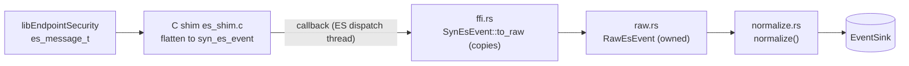

# EndpointSecurity sensor

`sensor-macos` ([`crates/sensors/macos/endpoint-security`](../../../crates/sensors/macos/endpoint-security/src/lib.rs)) is the primary macOS sensor. It is an EndpointSecurity (ES) client, the supported successor to kexts, kauth and OpenBSM. It subscribes to NOTIFY events only: nothing is blocked (no AUTH responses yet).

## Layers

| Layer | File | Platform |
| --- | --- | --- |
| C shim: client creation, subscription, flattening, filtering | [`shim/es_shim.c`](../../../crates/sensors/macos/endpoint-security/shim/es_shim.c), [`shim/es_shim.h`](../../../crates/sensors/macos/endpoint-security/shim/es_shim.h) | macOS, built by [`build.rs`](../../../crates/sensors/macos/endpoint-security/build.rs) with `-fblocks` and warnings as errors |
| Rust mirror of the shim structs | [`src/ffi.rs`](../../../crates/sensors/macos/endpoint-security/src/ffi.rs) | macOS |
| Owned records | [`src/raw.rs`](../../../crates/sensors/macos/endpoint-security/src/raw.rs) | all |
| Mapping to `schema` | [`src/normalize.rs`](../../../crates/sensors/macos/endpoint-security/src/normalize.rs) | all |
| `Sensor` implementation | [`src/sensor.rs`](../../../crates/sensors/macos/endpoint-security/src/sensor.rs) | macOS |

`ffi.rs` must stay field-for-field identical to `es_shim.h`. The shim's `syn_es_event` is a flat struct rather than a union: a few hundred spare bytes per transient event remove any union-offset risk on the Rust side.

String fields in a `syn_es_event` point into the ES message or into shim scratch buffers and are valid only during the callback. `to_raw` copies everything it keeps before returning.

## Subscriptions

The Rust side asks for groups; the shim owns the mapping to concrete `es_event_type_t` values ([`syn_es_subscribe`](../../../crates/sensors/macos/endpoint-security/shim/es_shim.c)). Subscribing to an event type the running OS does not know fails the whole `es_subscribe` call, so newer families are gated with `__builtin_available` and silently skipped on older hosts.

| Group | ES events | Emits | OS |
| --- | --- | --- | --- |
| exec | `NOTIFY_EXEC` | `Exec` with argv, parent image and code-signing state | all |
| file | `NOTIFY_OPEN`, `CREATE`, `RENAME`, `UNLINK`, `MMAP` | `FileOpen`, `FileRename`, `FileDelete` | all |
| persistence | `NOTIFY_BTM_LAUNCH_ITEM_ADD` | `FileOpen` + `FLAG_PERSISTENCE_BTM_ARTIFACT` | 13+ |
| sessions | `NOTIFY_OPENSSH_LOGIN`, `LOGIN_LOGIN`, `LW_SESSION_LOGIN` | `Auth` | 13+ |
| provenance | `NOTIFY_SETEXTATTR` (quarantine only) | `FileQuarantine` | all |
| mount | `NOTIFY_MOUNT`, `UNMOUNT` | `Mount` | all |
| tamper | `NOTIFY_SIGNAL` (to ES clients only) | `Signal` | all |
| xpc | `NOTIFY_XPC_CONNECT` | `XpcConnect` | 14+ |

Filtering done in the shim, before Rust sees anything:

- **mmap**: only `PROT_WRITE` on a `MAP_SHARED` mapping is forwarded, the one mmap case that changes a file. Everything else (dyld mapping libraries) is volume without signal.
- **setextattr**: only `com.apple.quarantine`. The shim then reads back the quarantine string and `com.apple.metadata:kMDItemWhereFroms` with `getxattr` at event time. Either can be absent when the read races the writer.
- **signal**: only signals whose target is an ES client (this agent, other security tools). `meta` describes the **sender**; the target's pid and image are in the event.
- **argv**: at most 128 entries ([`SYN_ES_MAX_ARGV`](../../../crates/sensors/macos/endpoint-security/shim/es_shim.h)); the real count is passed so truncation is flagged.

## Normalization

[`normalize`](../../../crates/sensors/macos/endpoint-security/src/normalize.rs) maps each `RawEsEvent` to one schema event.

- **Open flags.** `FileOpenEvent::flags` is platform-native by contract, but this sensor emits POSIX `O_*` values (shared with Linux for the bits `schema` defines) so `schema::has_write_intent` and the path+write rules work unchanged. The kernel `fflag` (`FREAD`/`FWRITE`) is translated in [`open_fflag_to_flags`](../../../crates/sensors/macos/endpoint-security/src/normalize.rs), never passed through.
- **Signature at the source.** ES provides the kernel's code-signing flags on each exec. [`signature_from_cs_flags`](../../../crates/sensors/macos/endpoint-security/src/normalize.rs) fills `ExecEvent::signature`: no flags is `Unsigned`, `CS_VALID` set is `Valid`, flags without `CS_VALID` is `Invalid` (signed, but the kernel no longer considers it valid, for example after in-memory tampering). This is the kernel's dynamic validity view, not a full chain evaluation. The signing id, team id and platform-binary bit are copied into `RawEsEvent::Exec` but not carried into the schema event yet.
- **argv.** The shim bounds the entry count, but macOS allows about 1 MiB of arguments, so `schema::bound_argv` also applies a byte budget; either cut sets `cmdline_truncated`. `cmdline` is the space-joined argv. `argv_omitted_bytes` is `None` (ES reports a count of dropped arguments, not their bytes).
- **Parent.** `parent_image_path` is the pre-exec image of the exec-ing process, the usual lineage view for fork+exec.
- **comm** is the basename of the executable path (the kernel's `p_comm` is cut at 16 bytes).
- **User** is `User::Unix` with the effective uid and gid from the audit token.
- **Quarantine.** The agent field of the quarantine string (`flags;timestamp;agent;uuid`) is extracted ([`quarantine_agent`](../../../crates/sensors/macos/endpoint-security/src/normalize.rs)), and the origin and referrer URLs are parsed from the binary plist in `kMDItemWhereFroms` with the `plist` crate ([`wherefroms_urls`](../../../crates/sensors/macos/endpoint-security/src/normalize.rs)). Unparseable bytes give no URLs but never drop the event.
- **BTM.** The item type is kept as its raw value plus a decoded view ([`BtmItemType`](../../../crates/sensors/macos/endpoint-security/src/raw.rs)), so a new SDK value degrades to `Other` instead of being lost. The launchd plist's executable, when resolved, is the persistence payload.

## Threading and lifecycle

[`MacosSensor::run`](../../../crates/sensors/macos/endpoint-security/src/sensor.rs):

1. Leaks a boxed callback context holding the sink and creates the client with `syn_es_client_new`. ES spins up its own dispatch threads, which call [`on_event`](../../../crates/sensors/macos/endpoint-security/src/sensor.rs).
2. Mutes the agent's own process (`es_mute_process`) so its spool and alert writes do not feed back. A failure is logged and not fatal.
3. Subscribes to all eight groups.
4. Parks on a condvar until [`StopHandle::stop`](../../../crates/sensors/macos/endpoint-security/src/sensor.rs), using `wait_timeout(500 ms)` so a missed notify can only delay shutdown by one tick.
5. Destroys the client **on the same thread that created it** (a libEndpointSecurity requirement). Destroy waits for in-flight handlers, after which the context is freed.

The sink is called directly from ES dispatch threads, so it must be thread-safe (`EventSink` takes `&self`). `on_event` wraps its body in `catch_unwind`: a panic must not unwind into C, which would abort the agent. A panicking event is logged and dropped. The sensor adds no queue of its own, so a slow sink delays ES delivery to this client.

## Errors

[`MacosSensorError`](../../../crates/sensors/macos/endpoint-security/src/sensor.rs) maps the `es_new_client` result to the action that fixes it:

| Result | Variant | Fix |
| --- | --- | --- |
| 3 | `NotEntitled` | sign with `com.apple.developer.endpoint-security.client` |
| 4 | `NotPermitted` | grant Full Disk Access (TCC) |
| 5 | `NotPrivileged` | run as root |
| other | `ClientCreation(n)` | |
| `es_subscribe` failed | `Subscribe(n)` | |

Unsigned development builds with a restricted entitlement are killed at exec by `amfid` before TCC is involved, even with SIP disabled; a lab VM needs both SIP disabled and `amfi_get_out_of_my_way=1`.

## Capabilities

[`capabilities`](../../../crates/sensors/macos/endpoint-security/src/sensor.rs) claims exec, file, auth, user attribution and parent lineage. `connect_events` is false: network comes from the [Network Extension](network-extension.md). Auth families need macOS 13, which is below the supported floor, so the static claim holds where the agent ships.

## Testing

- `normalize.rs` and `raw.rs` unit tests run on every OS (flag translation, signature mapping, argv bounds, quarantine string and plist parsing, BTM type decoding).
- The shim builds with warnings as errors against the SDK on macOS CI.
- End-to-end runs with an entitled client are not automated; see [#78](https://github.com/synthaea-lab/agent/issues/78).

## Gaps

- NOTIFY only: no AUTH-based blocking.
- Not subscribed yet: injection and tamper process events (task ports, ptrace, CS invalidation, [#37](https://github.com/synthaea-lab/agent/issues/37)), security-subsystem events such as XProtect, Gatekeeper overrides, TCC changes ([#38](https://github.com/synthaea-lab/agent/issues/38)), and anti-forensics file operations such as quarantine removal, timestamp changes and hidden flags ([#20](https://github.com/synthaea-lab/agent/issues/20)).
- Signing id and team id are collected but not emitted.
- No silence heartbeat for this sensor ([#34](https://github.com/synthaea-lab/agent/issues/34)).
