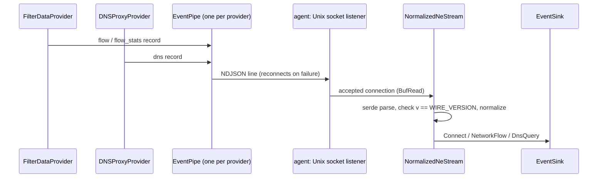

# Network Extension sensor

EndpointSecurity carries no network flows and no DNS. On macOS those come from Apple's NetworkExtension framework, whose providers only run inside a **system extension** (Swift, its own sandbox and entitlements). A Rust agent cannot host them, so this sensor has two halves joined by a local socket:

| Half | Path | Built by |
| --- | --- | --- |
| Swift providers: `NEFilterDataProvider` (flows) and `NEDNSProxyProvider` (DNS) | [`network-extension/extension/Sources`](../../../crates/sensors/macos/network-extension/extension/Sources/FilterDataProvider.swift) | `swiftc` / Xcode, packaged per [`packaging/macos`](../../../packaging/macos/README.md). Not built by Cargo. |
| Agent receiver: wire protocol, socket, normalization | [`sensor-macos-network-extension`](../../../crates/sensors/macos/network-extension/src/lib.rs) | Cargo, all Unix hosts |

## Data flow

**Why the agent listens and the extension connects.** The agent daemon owns its runtime directory and lifetime. The extension is started and stopped by the OS on network activity, so it must be the side that reconnects. A network-extension sandbox may only connect inside its own app group, so the production socket belongs in the shared app-group container. Until the packaged bundle exists, the agent binds the placeholder `MACOS_NE_SOCKET` (`/var/run/synthaea-ne.sock`) from `config::identity`, and a test in that crate checks the Swift side uses the same path.

## Swift side

- [`FilterDataProvider.swift`](../../../crates/sensors/macos/network-extension/extension/Sources/FilterDataProvider.swift) reports each new flow (inbound and outbound) at establishment and its byte counts at close. The pid comes from the flow's source-app audit token (`pidFromAuditToken`) and the path from `proc_pidpath`, best effort.
- [`DNSProxyProvider.swift`](../../../crates/sensors/macos/network-extension/extension/Sources/DNSProxyProvider.swift) proxies DNS, does a minimal wire-format parse and reports query/response pairs.
- [`EventPipe.swift`](../../../crates/sensors/macos/network-extension/extension/Sources/EventPipe.swift) is a reconnecting NDJSON writer. Each record is encoded and written from a serial dispatch queue on a blocking socket. When a write fails (the agent restarted), the record is dropped and the next record reconnects. Its `wireVersion` must equal `wire::WIRE_VERSION`.

The sources are compile-checked scaffolds: they type-check with `swiftc -typecheck -sdk "$(xcrun --show-sdk-path)" Sources/*.swift` (not run by CI), and use the `NWHostEndpoint` APIs deprecated in macOS 15.

## Wire protocol

Newline-delimited JSON ([`wire.rs`](../../../crates/sensors/macos/network-extension/src/wire.rs)). JSON instead of a fixed binary layout because the two sides are built by different toolchains and released on different schedules; a self-describing, versioned format degrades by skipping records instead of corrupting them. Volume is low, so serialization cost does not matter.

[`NeRecord`](../../../crates/sensors/macos/network-extension/src/wire.rs) is tagged by `kind`; every record carries `v`, `ts_ns` (taken by the extension), `pid` and an optional `process_path`.

| `kind` | Extra fields | Normalized to |
| --- | --- | --- |
| `flow` | `direction`, `remote_addr`, `remote_port`, `local_port`, `protocol` | `ConnectEvent` |
| `flow_stats` | `remote_addr`, `remote_port`, `local_port`, `protocol`, `bytes_sent`, `bytes_received` | `NetworkFlowEvent` |
| `dns` | `query`, `qtype`, `result` (semicolon-separated answers), `rcode` | `DnsQueryEvent` |

**Versioning.** [`WIRE_VERSION`](../../../crates/sensors/macos/network-extension/src/wire.rs) is independent of the schema version and is bumped on any change a deployed extension could disagree with, on both sides in the same change.

## Receiver

- [`listen`](../../../crates/sensors/macos/network-extension/src/receiver.rs) removes a stale socket file from a previous run (the agent is the only legitimate owner of the path) and binds.
- [`accept_loop`](../../../crates/sensors/macos/network-extension/src/receiver.rs) accepts connections forever and returns only on a listener error.
- [`NormalizedNeStream`](../../../crates/sensors/macos/network-extension/src/receiver.rs) turns one connection into events. A line that does not parse (an unknown kind or field shape from a newer extension), a record with another `v`, or a record whose remote address is not a literal IP is skipped and counted in `skew_skipped`; the stream continues. An I/O error ends that connection and the agent goes back to accepting.

## Normalization

[`normalize`](../../../crates/sensors/macos/network-extension/src/normalize.rs) adds no schema variants: the BEACON rule and the correlator consume macOS flows exactly like Linux and Windows ones.

- Inbound flows also become `ConnectEvent`. The shape carries the remote peer either way, and an inbound connection to an unexpected local service is a lateral-movement signal. No direction field is emitted.
- `comm` is the basename of `process_path`. `user` is `User::Unknown`: the audit token carries uid/gid, but wire v1 does not forward them.
- `NetworkFlowEvent` carries the volume that a point-in-time connect cannot, the same split as the Linux conntrack source.
- DNS events carry process attribution, which the Windows DNS-Client provider gives too.

## Agent wiring

[`spawn_network_extension_receiver`](../../../agent/src/commands/macos.rs) binds the socket and runs the accept loop on an `ne-receiver` thread. A bind failure (directory missing, not root) is logged and the agent continues without flow and DNS telemetry. Without an installed extension nothing ever connects, which is the normal state today.

## Known gaps

- **Connections are served one at a time.** `accept_loop` hands each accepted connection to a callback that reads it until it ends, and both providers open their own `EventPipe` to the same socket. While one provider's connection is open, the other's connect succeeds (it sits in the listen backlog) but is never read: its socket buffer fills, its blocking `write` stalls the pipe's serial queue, and every later record piles up on that queue in the extension's memory. Serving connections concurrently (a thread per connection) is needed before both providers run together, and a non-blocking or timed write would bound the extension side.
- No user attribution, flow direction field, or macOS 15 endpoint APIs: [#35](https://github.com/synthaea-lab/agent/issues/35).
- The extension is not built, signed or activated; the socket path is a placeholder; DNS-proxy upstream configuration and byte-count reporting are not wired: [#21](https://github.com/synthaea-lab/agent/issues/21).
- No silence heartbeat, and `skew_skipped` is not reported anywhere: [#34](https://github.com/synthaea-lab/agent/issues/34).

## Testing

Unit tests on every OS cover the wire format, normalization, and skew counting. On Unix hosts a socket round-trip test binds a real listener (twice, to check stale-socket replacement) and writes records as a fake extension would ([`receiver.rs`](../../../crates/sensors/macos/network-extension/src/receiver.rs)).
