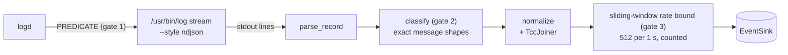

# Unified log sensor

`sensor-macos-unifiedlog` ([`crates/sensors/macos/unifiedlog`](../../../crates/sensors/macos/unifiedlog/src/lib.rs)) tails the macOS unified log for three things EndpointSecurity does not carry:

| Source | Log record | Emits |
| --- | --- | --- |
| sudo outcomes | process `sudo`, message containing `COMMAND=` | `schema::AuthEvent` |
| TCC decisions | subsystem `com.apple.TCC`, `AUTHREQ_CTX` + `AUTHREQ_RESULT` pair | `schema::TccDecisionEvent` |
| Gatekeeper verdicts | process `syspolicyd`, `GK evaluateScanResult` | `schema::GatekeeperVerdictEvent` |

It has no `Sensor` implementation. The agent runs it as a supplementary tail beside the ES sensor ([`spawn_unifiedlog_tail`](../../../apps/agent/src/commands/macos.rs)), like the Linux journal tail.

## Why `log stream` and not `OSLogStore`

The public `OSLogStore` API only reads positioned snapshots. Live streaming uses private `LoggingSupport.framework` interfaces that are neither documented nor stable. `log stream --style ndjson` is the supported surface for live reading, its output is line-oriented JSON, and the predicate is evaluated by the log daemon, so records outside it are never serialized into the pipe. [`spawn_stream`](../../../crates/sensors/macos/unifiedlog/src/stream.rs) starts `/usr/bin/log` with [`PREDICATE`](../../../crates/sensors/macos/unifiedlog/src/stream.rs).

## Pipeline

[`NormalizedLogStream`](../../../crates/sensors/macos/unifiedlog/src/stream.rs) is an iterator over any `BufRead`, so tests feed canned captures and production feeds the child's stdout.

1. **Predicate.** One OR-joined string, kept next to the classifier: a predicate clause without a classifier arm is dead volume, an arm without a clause never fires.
2. **Parse.** [`parse_record`](../../../crates/sensors/macos/unifiedlog/src/record.rs) extracts fields one by one from a `serde_json::Value`. Records without a message (timesync, activity transitions) and `log`'s own banner line are skipped, never ending the stream. Timestamps are parsed from `log`'s fixed `YYYY-MM-DD hh:mm:ss.ffffff+zzzz` format; any deviation fails the record rather than guessing a time.
3. **Classify.** [`classify`](../../../crates/sensors/macos/unifiedlog/src/classify.rs) matches exact message shapes and returns `None` for everything else. Fields are optional where the category is the signal and required where a field is the signal.
4. **Normalize.** [`normalize`](../../../crates/sensors/macos/unifiedlog/src/normalize.rs) builds the schema event; provenance (logging process, time) rides in `meta`.
5. **Rate bound.** A timestamp deque admits at most 512 events per sliding second ([`MAX_EVENTS_PER_WINDOW`](../../../crates/sensors/macos/unifiedlog/src/stream.rs)). Legitimate traffic is a few events per minute; anything beyond is a log storm or a generator. Shed events are counted in `shed_events`.

## sudo mapping

Same semantics as the Linux journal sensor: a root target is a privileged session, another target is explicit credentials, and an incorrect-password message is a failure.

## TCC join

tccd logs a decision as two records: `AUTHREQ_CTX` (the service, keyed by tccd's message id) and later `AUTHREQ_RESULT` (the verdict, same key). Only the pair is an event. [`TccJoiner`](../../../crates/sensors/macos/unifiedlog/src/tcc.rs) holds pending contexts in a bounded map (512 entries, FIFO shedding). Message ids are namespaced by tccd's pid, so one joiner serves both the system and per-user daemons. Shed contexts and results with no context are counted (`shed_contexts`, `unmatched_results`, exposed by `tcc_counters`).

## Gatekeeper

The raw scan result code is kept uninterpreted (Apple does not document it). Team and signing ids are the join keys toward the matching exec event.

## Redaction limits

syspolicyd hash-redacts file paths in the public log stream, so a Gatekeeper event can carry an opaque target token instead of a path; the private-data logging profile reveals them. TCC's requesting-client identity is also redacted in the parsed records, so `TccDecisionEvent::client` is always `None` today ([#36](https://github.com/synthaea-lab/agent/issues/36)).

## Failure modes

| Failure | Behavior |
| --- | --- |
| `log` cannot be spawned | warning, no tail; the agent keeps running |
| Malformed or non-message line | skipped |
| I/O error on the pipe (including the child killed at shutdown) | the iterator yields the error, the tail thread logs it and exits |
| The child dies mid-run | telemetry stops until the agent restarts; no restart, no heartbeat ([#34](https://github.com/synthaea-lab/agent/issues/34)) |
| An OS update changes a message format | classification silently stops matching; the unit tests built from verbatim captures are the tripwire |

## Testing

Record parsing, classification, the TCC join and normalization are unit-tested with verbatim lines captured on macOS 26, on every OS. [`examples/live_tail.rs`](../../../crates/sensors/macos/unifiedlog/examples/live_tail.rs) tails the real stream on a Mac for manual checks.
