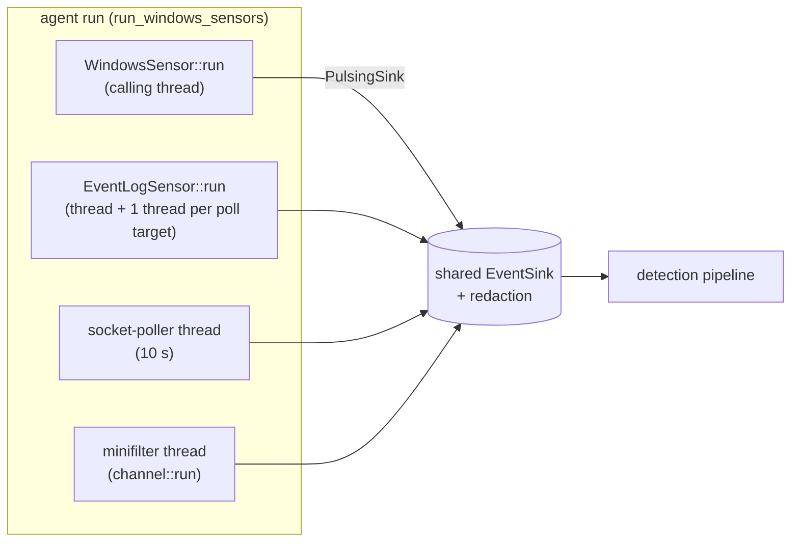

# Windows sensors

The Windows agent collects telemetry through four independent sources. Each one is its own crate under [`crates/sensors/windows`](../../../crates/sensors/windows/README.md), depends only on `schema`, and compiles to an empty stub on other operating systems, so `cargo check --workspace` works on every host.

| Source | Crate (package) | Mechanism | Role | Page |
| --- | --- | --- | --- | --- |
| ETW | `etw/` (`sensor-windows`) | One real-time ETW session, 14 providers | Primary: process, image, file, network, DNS, registry, script, WMI, LDAP, NTLM, BITS, cross-process | [etw.md](etw.md), [etw-enrichment.md](etw-enrichment.md) |
| Event Log | `eventlog/` (`sensor-windows-eventlog`) | `EvtQuery` polling (default) or `EvtSubscribe` | Supplementary: logons, service/task/account persistence, AppLocker, WDAC, Defender, RDP sessions, log clears, Kerberos | [eventlog.md](eventlog.md) |
| Socket table | `sockets/` (`sensor-windows-sockets`) | `GetExtendedTcpTable` / `GetExtendedUdpTable` snapshots | Supplementary: listening ports for the LISTENER-DRIFT rule | [sockets.md](sockets.md) |
| Minifilter | `minifilter/` (`sensor-windows-minifilter`) + `driver/minifilter` (C) | Filter Manager communication port | Optional: file deletes, renames, timestamp changes, raw volume opens | [minifilter.md](minifilter.md) |

## How the agent runs them

All four are started by [`run_windows_sensors`](../../../agent/src/commands/windows.rs) and write into one shared sink (wrapped in the command-line credential redactor). ETW is the primary sensor and runs on the calling thread. The other three run on background threads.

Startup order and failure handling:

- Silence heartbeats are registered **before** ETW starts ([`register_heartbeats`](../../../agent/src/commands/windows.rs)), so an ETW session that never starts becomes a silence alert instead of nothing.
- An ETW failure does not end the run. [`hold_after_primary`](../../../agent/src/commands/windows.rs) logs the error, prints a hint (`not elevated?` for a refused start, or "stopped or blinded from outside" when the error comes from the in-sensor liveness check, see [`etw_failure_hint`](../../../agent/src/commands/windows.rs)), and keeps the thread parked until Ctrl-C so the Event Log, socket and minifilter sources keep running.
- Failures of the supplementary sources are logged and never fatal.
- Ctrl-C sets the ETW stop flag, the Event Log stop flag and a shared `shutdown` flag, which also stops the socket poller and the minifilter thread.

## Silence monitoring

Each source has a heartbeat registered on the agent's `SilenceMonitor` (a silence raises a T1562-style alert). They pulse on different things, so the deadlines differ:

| Heartbeat | Pulsed by | Deadline | Constant |
| --- | --- | --- | --- |
| `windows-etw` | every event the ETW sensor forwards (`PulsingSink`) | 120 s | [`ETW_SILENCE_DEADLINE_NS`](../../../agent/src/commands/windows.rs) |
| `windows-eventlog:<target>` | every successful poll tick of that target (one per enabled target) | 60 s | [`EVENTLOG_SILENCE_DEADLINE_NS`](../../../agent/src/commands/windows.rs) |
| `windows-sockets` | every successful snapshot | 30 s (3 polls) | [`SOCKET_SILENCE_DEADLINE_NS`](../../../agent/src/commands/windows.rs) |
| `windows-minifilter` | every driver message, idle heartbeats included | 30 s | [`MINIFILTER_SILENCE_DEADLINE_NS`](../../../agent/src/commands/windows.rs) |

The ETW sensor also has its own 30 s in-process canary that fails the trace (see [ETW liveness](etw.md#liveness-canary-and-blind-session-diagnosis)). The Event Log `Subscribe` transport exposes no liveness counters, so it is not watched (see [eventlog.md](eventlog.md#liveness)). The minifilter heartbeat is only registered when the driver is loaded at startup.

## Shared conventions

- **Paths.** NT device paths (`\Device\HarddiskVolume3\...`) are rewritten to drive-letter form through a live `QueryDosDeviceW` map. The ETW sensor ([`normalize_nt_path`](../../../crates/sensors/windows/etw/src/normalize.rs)) and the minifilter client ([`VolumeMap`](../../../crates/sensors/windows/minifilter/src/events.rs)) each carry a copy, because sensor crates may not depend on each other. Unknown devices keep the raw path rather than a guessed drive.
- **Byte parsers are hostile-input code.** Anything that reads attacker-influenced bytes (Zone.Identifier streams, BITS URLs, Event Log XML, minifilter messages) lives in a platform-independent module with unit tests on every CI leg and a never-panic robustness suite.
- **Bounded and counted.** Every in-memory map has a cap, and anything dropped or forgotten at the cap is counted and logged at power-of-two intervals.
- **Container attribution** is filled only by the ETW sensor. Event Log, socket and minifilter events carry `container: None`.

## Platform requirements

| Source | Needs |
| --- | --- |
| ETW | Administrator (kernel providers). `ProcessMembershipInformation` (Windows 11 22H2 / Server 2025) for container attribution. |
| Event Log | Administrator to read Security and run `auditpol`. Some channels are off by default (Task Scheduler Operational, Kerberos Operational). |
| Socket table | Nothing: the IP Helper tables are readable by everyone. |
| Minifilter | The test-signed `SynthaeaFilter` driver loaded, and the agent running as the `SynthaEDR` service (its service SID is checked by the driver). |
