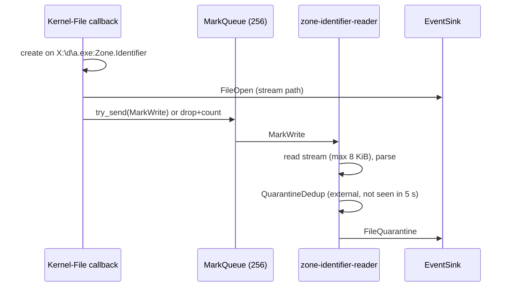

# ETW sensor: identity, paths and derived events

The raw ETW records carry a pid, a timestamp and a few provider fields. Everything else an event carries (image path, command line, user, incarnation stamp, container, normalized paths) is added by the [ETW sensor](etw.md) on the consumer thread, from caches and Win32 queries. This page explains each of those, and the derived events that need state across records: mark-of-the-web, BITS jobs, remote threads and LSASS access.

The rule for all of it: **every Win32 call is best-effort.** A failure degrades one field and the event is still emitted ([`winapi.rs`](../../../crates/sensors/windows/etw/src/winapi.rs)).

## Event metadata

[`SharedState::meta`](../../../crates/sensors/windows/etw/src/sensor.rs) builds the `EventMeta` of every ETW event:

| Field | Source | When it is unknown |
| --- | --- | --- |
| `pid` | record header or a payload field, depending on the provider | 0 |
| `ppid` | `ProcessStart` only; other events pass 0 | 0 |
| `comm` | basename of the pid store's image path, or a live lookup | event dropped for network events with no resolvable process |
| `user` | the process token: SID and integrity level ([`read_process_user`](../../../crates/sensors/windows/etw/src/winapi.rs)) | `User::Unknown`. The agent runs as SYSTEM, so it never falls back to its own token. |
| `process_generation` | the kernel's process sequence number | `None` (consumers read it as "cannot tell") |
| `parent_process_generation` | same, for the parent | `None` |
| `container` | server silo, named by the Host Compute Service | `None` for a host process or an unknown silo |

`read_process_user` opens the process and its token on every call. It runs on the consumer thread for each emitted event.

## The pid store

[`PidCache`](../../../crates/sensors/windows/etw/src/pid_cache.rs) maps pid to (image path, sequence number, server silo). It is a local copy of the `store::BoundedMap` design (sensor crates cannot depend on `store`): a `HashMap` plus a use counter, with the least-recently-used eighth evicted when the 16,384-entry cap is hit, and evictions counted.

- **Seeded** before the trace starts from a Toolhelp snapshot ([`seed_pid_store`](../../../crates/sensors/windows/etw/src/sensor.rs)), so events from already-running processes resolve and parent exclusions apply to them. The seed only knows file names, not full paths.
- **Filled** by every `ProcessStart`. An unknown image (`<unknown>`) is never cached as a path, because a hit would suppress later live lookups; the silo is still recorded.
- **Pruned** on `ProcessEnd`. This explicit removal is what handles pid reuse. The LRU cap is only a backstop for lost `ProcessEnd` records, which ETW does drop under buffer pressure.
- **Live fallback.** When a network event arrives before the process's start was handled, [`comm_for`](../../../crates/sensors/windows/etw/src/sensor.rs) resolves the pid with `QueryFullProcessImageNameW` ([`resolve_pid_live`](../../../crates/sensors/windows/etw/src/winapi.rs)) and inserts it.
- **Membership is a filter.** Kernel-File and image-load events are only emitted for pids in the store. Activity by pids that never appear there (kernel threads, the System process) is dropped.

### Incarnation stamps

`ProcessStart` v4 and later carries `ProcessSequenceNumber` and `ParentProcessSequenceNumber`, a per-boot unique id for each process. The exec event takes both from the record, so the parent stamp is the one the kernel recorded at that creation, not whatever process holds `ppid` in the store by then. Processes that predate the trace are read with `NtQueryInformationProcess` class 92 ([`read_process_sequence_number`](../../../crates/sensors/windows/etw/src/winapi.rs)). An older record version, an unreadable process or a 0 value leaves the stamp `None`. Unlike Linux, the value survives an agent restart.

## Command line

`ProcessStart` does not carry the command line. [`read_process_cmdline`](../../../crates/sensors/windows/etw/src/winapi.rs) reads it from the target: `NtQueryInformationProcess` for the PEB address, then `ReadProcessMemory` along `PEB -> ProcessParameters -> CommandLine` using x64 offsets. The read fails (and the image path is used instead) for protected processes, processes that already exited, and WOW64 processes whose layout does not match. The command line is unbounded on the agent side; `CreateProcess` itself caps it at 32,766 UTF-16 units, so `cmdline_truncated` is always false.

## Image file identity

For the T1204.002 gate, the exec event carries `image_file_id`, the `"{volume serial:016x}:{file id:032x}"` text form built by [`identity_token`](../../../crates/sensors/windows/etw/src/lib.rs). It is captured in the `ProcessStart` callback with one open (shared for delete, so it cannot block a rename) and one `FileIdInfo` query ([`image_file_id`](../../../crates/sensors/windows/etw/src/winapi.rs)). The enrichment worker later compares it with the file it hashed, which catches a dropper that renames itself and puts another file at its path.

It is captured only for `X:\...` paths ([`image_identity_is_capturable`](../../../crates/sensors/windows/etw/src/lib.rs)). A UNC, `\\?\` or `\Device\` path would make the open a network round trip on the consumer thread, and a dead SMB server would stall all process telemetry. No identity is recorded for those, and the gate then fails closed (the alert is raised). A mapped network drive letter cannot be told apart from a local one and is not excluded.

The agent's enrichment code writes the same format; a Windows test in the agent pins the two together. The remaining race (rename-and-replace faster than ETW delivery) is tracked in [#46](https://github.com/synthaea-lab/agent/issues/46).

## Paths

[`SharedState::normalize_path`](../../../crates/sensors/windows/etw/src/sensor.rs) runs two steps.

1. **Device to drive letter.** [`normalize_nt_path`](../../../crates/sensors/windows/etw/src/normalize.rs) does a longest-prefix match of `\Device\HarddiskVolumeN` against a map built from `QueryDosDeviceW` ([`build_volume_map`](../../../crates/sensors/windows/etw/src/winapi.rs)). A miss refreshes the map once (a newly mounted VHDX) and retries. A device still unknown keeps its raw path.
2. **8.3 expansion.** Kernel-File reports one file under both its short (`JIHAIR~1`) and long names, so string joins downstream would see two files. [`long_path::expand`](../../../crates/sensors/windows/etw/src/long_path.rs) rewrites short components with `GetLongPathNameW`. To stay cheap on the consumer thread it only touches local drive-letter paths containing `~`, caches each parent directory's expansion ([`LongPathCache`](../../../crates/sensors/windows/etw/src/long_path.rs), cleared when full), and keeps an alternate-data-stream suffix intact. Unresolvable paths (already deleted, access denied) stay raw, so consumers must still tolerate a mismatch.

## Containers

Process-isolated Windows containers run in a *server silo* on the host kernel, so the session already sees their processes. [`silo.rs`](../../../crates/sensors/windows/etw/src/silo.rs) adds the attribution in three steps, each degrading to `container: None`:

1. **pid to silo** at `ProcessStart` ([`read_server_silo_id`](../../../crates/sensors/windows/etw/src/winapi.rs), `ProcessMembershipInformation`). A process already gone takes its parent's silo ([`exec_silo`](../../../crates/sensors/windows/etw/src/silo.rs)): a child is created in its parent's silo and cannot leave it. 0 is the host. On builds without the query (before Windows 11 22H2 / Server 2025) the first "invalid info class" answer disables it for the run.
2. **silo to container id** on the `silo-resolver` thread ([`run_resolver`](../../../crates/sensors/windows/etw/src/silo.rs)). It lists compute systems through [`Hcs`](../../../crates/sensors/windows/etw/src/hcs.rs) and probes up to four processes per container until one is found in a silo ([`match_containers`](../../../crates/sensors/windows/etw/src/silo.rs)). The probe checks the image name too, so a pid from a Hyper-V container's own kernel cannot claim an unrelated host process. A silo claimed by two containers stays unmapped. Until resolved, events carry the provisional id `silo:<n>`, so they still say "containerized". Unresolved silos ask again after 10 s.
3. **Teardown.** A Kernel-Process silo create/terminate record (EIDs 23-26) forgets the mapping, since silo ids are reused. A resolver pass that overlaps a forget discards what it found ([`resolved_since`](../../../crates/sensors/windows/etw/src/silo.rs)).

`computecore.dll` is loaded from System32 on first use only, so a host without it (or without containers) never needs it. HCS calls time out after 5 s; a hung service delays attribution, never an event. Hyper-V-isolated containers have their own kernel and are invisible to this sensor by design.

Status: built and unit-tested, lab validation tracked in [#39](https://github.com/synthaea-lab/agent/issues/39).

## Mark-of-the-web

A browser, mail client or archiver writes a `Zone.Identifier` alternate data stream next to a download. It is the Windows counterpart of macOS's quarantine attribute, and both become `FileQuarantineEvent`.

- The read-back happens on a worker ([`run_mark_reader`](../../../crates/sensors/windows/etw/src/zone_identifier.rs)), never on the consumer thread.
- [`parse`](../../../crates/sensors/windows/etw/src/zone_identifier.rs) reads the `[ZoneTransfer]` INI section, accepts UTF-16LE or UTF-8, and never fails. Stream content is attacker-controlled, and the URLs end up in alert text, so control characters, line separators and bidi controls are percent-encoded. Values are capped at 2,048 characters.
- Only external marks are reported ([`is_external`](../../../crates/sensors/windows/etw/src/zone_identifier.rs)): an unknown zone counts as external, since something wrote the stream.
- One write produces two or three Kernel-File records. [`QuarantineDedup`](../../../crates/sensors/windows/etw/src/zone_identifier.rs) remembers a mark only once it is reported, keyed by the case-folded host path and a keyed digest of the stream content. A local-zone write therefore never hides a later internet download of the same path, and an empty read that raced the writer does not hide the complete read that follows. The digest key is random per instance so a stream author cannot craft a collision. At worst a duplicate is reported, never a lost mark.
- Deleting the stream (`Unblock-File`, Explorer's "Unblock") is reported as a `FileDelete` of the stream path ([`mark_removal`](../../../crates/sensors/windows/etw/src/zone_identifier.rs)), T1553.005.

## BITS jobs

The BITS service does the download itself, so its network activity is attributed to `svchost`. The Bits-Client provider ties the job back to its client. Not every record carries what the event needs:

| EID | Meaning | Client pid | URL / local path |
| --- | --- | --- | --- |
| 16403 | file added to a job | yes | yes |
| 4 | job completed | no | no |
| 5 | job cancelled | yes | no |
| 61 | transfer error | no | URL only |

[`BitsJobs`](../../../crates/sensors/windows/etw/src/bits.rs) remembers each job's files from their 16403 records and turns a completion or cancellation into one `BitsJob` event per file, each attributed to the client that added it. Files from Microsoft update hosts are never remembered ([`is_microsoft_update_url`](../../../crates/sensors/windows/etw/src/bits.rs)). The host list ([`MICROSOFT_UPDATE_HOSTS`](../../../crates/sensors/windows/etw/src/bits.rs)) is deliberately narrow: BITS follows redirects, and broad domains have user-content subdomains. A host with any character outside `[A-Za-z0-9.-]` never matches, and the URL authority ends at `\` as WinHTTP parses it. The job owner is not a filter: a SYSTEM-owned job to an unknown host is what a SYSTEM-level implant looks like. Local paths are rewritten into exec-path form ([`local_path_for_join`](../../../crates/sensors/windows/etw/src/bits.rs)) so the T1197 join can match.

## Remote threads

Kernel-Process EID 3 (`ThreadStart`) gives the creator (header pid) and the owner (`ProcessID` field). [`forward_remote_thread`](../../../crates/sensors/windows/etw/src/providers.rs) reports a thread started in another user process as `RemoteThreadEvent`, the native equivalent of Sysmon event 8. Most cross-process starts are benign and are dropped before an event is built:

- a thread started by its own process, or by the kernel (pid 0 or 4);
- **the initial thread of a new process**, which its creator starts as part of creating it. [`ThreadOrigins`](../../../crates/sensors/windows/etw/src/cross_process.rs) pairs it with the `ProcessStart`, whichever arrives first. A start is remembered for 60 s, and the first cross-process thread of that pid inside the window is the initial one; later ones are remote. A thread that arrives before its owner's start counts as initial only once, and only if the owner did not exist before the window (pid store, then process creation time). A process that predates the trace has no initial thread to excuse.

What is left is deduplicated per (creator, owner, 64 KiB start-address bucket) per minute and budgeted at 32 per creator per 10 s ([`admit_remote_thread`](../../../crates/sensors/windows/etw/src/cross_process.rs)). A thread into LSASS is never dropped by the budget. The start address is the user-mode `Win32StartAddr` when present ([`start_address`](../../../crates/sensors/windows/etw/src/cross_process.rs)); it is chosen by the creator and is not resolved to a module.

Known gap: a process started within the last minute whose `ProcessStart` was lost, and which was also evicted from the pid store, excuses one injected thread.

## LSASS access

Kernel-Audit-API-Calls EID 5 (`PsOpenProcess`) gives the caller (header pid), `TargetProcessId`, `DesiredAccess` and `ReturnCode`. An idle host produces hundreds of opens per second, so [`audit_api_provider`](../../../crates/sensors/windows/etw/src/providers.rs) filters on the target first. It keeps only opens that ([`lsass_open_is_reported`](../../../crates/sensors/windows/etw/src/cross_process.rs)):

- target the tracked LSASS;
- come from another user process (not LSASS, not the kernel);
- ask for a right that reaches memory, as passed and before generic mapping ([`reaches_memory`](../../../crates/sensors/windows/etw/src/cross_process.rs)): VM read/write/operation, create thread, duplicate handle, create process (clone and read the clone), or `GENERIC_READ`/`GENERIC_WRITE`/`GENERIC_ALL`/`MAXIMUM_ALLOWED`.

Denied opens are kept with their status. The event carries the caller's full image path ([`full_image_path`](../../../crates/sensors/windows/etw/src/providers.rs)), never the bare file name from the startup seed, since a renamed dumper controls its file name. An identical (caller, mask, status) is reported once per minute.

**Which process is LSASS.** Anyone can start a copy of `System32\lsass.exe`, and a copy that took the tracked pid and then exited would blind this provider until reboot. [`is_system_lsass`](../../../crates/sensors/windows/etw/src/cross_process.rs) requires the image at `%SystemRoot%\System32\lsass.exe`, session 0, and `%SystemRoot%\System32\wininit.exe` as the parent. [`LsassTracker`](../../../crates/sensors/windows/etw/src/cross_process.rs) takes a pid only while the slot is empty, a copy can neither take nor clear it, and the end of the tracked LSASS triggers a new lookup ([`find_lsass`](../../../crates/sensors/windows/etw/src/sensor.rs)).

Not visible to either filter: a handle to LSASS duplicated from another process, injection that starts no thread, and kernel-mode activity. Tracked in [#32](https://github.com/synthaea-lab/agent/issues/32).
