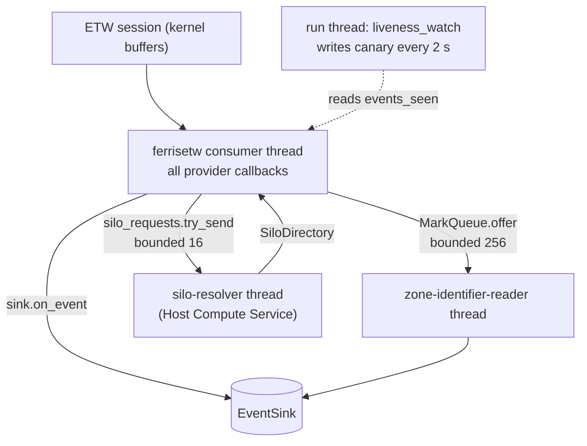

# ETW sensor

`sensor-windows` ([`crates/sensors/windows/etw`](../../../crates/sensors/windows/etw/src/lib.rs)) is the primary Windows sensor. It runs one real-time ETW session with 14 providers enabled and turns their records into `schema` events. This page covers the session, the providers, threading and back-pressure. How events get their process identity, paths and container is in [etw-enrichment.md](etw-enrichment.md).

## Components

| Module | Responsibility |
| --- | --- |
| [`sensor.rs`](../../../crates/sensors/windows/etw/src/sensor.rs) | `WindowsSensor`: builds `SharedState`, cleans up orphaned sessions, starts the trace, runs the liveness loop |
| [`providers.rs`](../../../crates/sensors/windows/etw/src/providers.rs) | One builder per provider (GUID, keyword mask, callback). The callbacks filter, spend budgets and emit. |
| [`payload.rs`](../../../crates/sensors/windows/etw/src/payload.rs) | How the DNS, registry, PowerShell, WMI, .NET, SMB, LDAP and NTLM records become events, decided on their named fields alone (`PayloadFields`) |
| [`normalize.rs`](../../../crates/sensors/windows/etw/src/normalize.rs) | Pure helpers: FILETIME conversion, NT and registry path rewriting, session-name generation, orphan selection, diagnosis text |
| [`etw_sessions.rs`](../../../crates/sensors/windows/etw/src/etw_sessions.rs) | Native session enumeration (`QueryAllTracesW`) and provider-enablement lookup (`EnumerateTraceGuidsEx`) |
| [`budget.rs`](../../../crates/sensors/windows/etw/src/budget.rs) | `PidBudget` (N events per process per window) and `KeyDedup` (one event per key per window) |
| [`amsi.rs`](../../../crates/sensors/windows/etw/src/amsi.rs) | AMSI buffer decoding and `AmsiGate` (hash dedup plus per-process budget) |
| [`cross_process.rs`](../../../crates/sensors/windows/etw/src/cross_process.rs) | Remote-thread and LSASS-open filters |
| [`bits.rs`](../../../crates/sensors/windows/etw/src/bits.rs) | BITS job tracking and the Microsoft-update host filter |
| [`zone_identifier.rs`](../../../crates/sensors/windows/etw/src/zone_identifier.rs) | Mark-of-the-web parsing, read-back worker and dedup |
| [`pid_cache.rs`](../../../crates/sensors/windows/etw/src/pid_cache.rs), [`long_path.rs`](../../../crates/sensors/windows/etw/src/long_path.rs), [`silo.rs`](../../../crates/sensors/windows/etw/src/silo.rs), [`hcs.rs`](../../../crates/sensors/windows/etw/src/hcs.rs), [`winapi.rs`](../../../crates/sensors/windows/etw/src/winapi.rs) | Identity and path enrichment, see [etw-enrichment.md](etw-enrichment.md) |

Modules marked `#[cfg(any(windows, test))]` in [`lib.rs`](../../../crates/sensors/windows/etw/src/lib.rs) hold platform-independent logic and are unit-tested on Linux and macOS CI too. Only the ETW plumbing and Win32 calls are Windows-only.

## Session lifecycle

[`WindowsSensor::run`](../../../crates/sensors/windows/etw/src/sensor.rs) does the following, in order:

1. Starts two worker threads: the `Zone.Identifier` reader and the silo resolver (see [threading](#threading)).
2. Builds `SharedState`, seeds the pid store from a Toolhelp snapshot ([`seed_pid_store`](../../../crates/sensors/windows/etw/src/sensor.rs)) and finds the system LSASS ([`find_lsass`](../../../crates/sensors/windows/etw/src/sensor.rs)).
3. Stops every orphaned session under the agent's prefix ([`stop_all_orphaned_sessions`](../../../crates/sensors/windows/etw/src/sensor.rs)).
4. Creates a session with a fresh random name and enables all providers on it (`ferrisetw::UserTrace`), through [`start_or_stop_session`](../../../crates/sensors/windows/etw/src/normalize.rs).
5. Runs [`liveness_watch`](../../../crates/sensors/windows/etw/src/sensor.rs) on the calling thread until `stop()` or a liveness failure.
6. Stops the trace and deletes the canary file.

### Session names and orphan cleanup

Named ETW sessions are kernel objects. They outlive the process that created them, so after a crash or `taskkill /f` the session is still running, and a restart with the same name would fail with `AlreadyExist`. The sensor therefore:

- names each session `<prefix><random suffix>` ([`random_session_name`](../../../crates/sensors/windows/etw/src/normalize.rs)). The prefix comes from the agent ([`EtwNames`](../../../crates/sensors/windows/etw/src/sensor.rs), `wtrace-` today) because this crate cannot read the agent's identity constants. The random suffix keeps the name from being a fixed, documented kill target. It is not a secret: an attacker can list sessions by the same prefix.
- at startup, enumerates running sessions with `QueryAllTracesW` ([`running_sessions`](../../../crates/sensors/windows/etw/src/etw_sessions.rs)) and stops every one under the prefix. No state is persisted between runs, so this catches any number of orphans from consecutive unclean shutdowns.
- falls back to parsing `logman query -ets` ([`parse_orphaned_sessions`](../../../crates/sensors/windows/etw/src/normalize.rs)) when `QueryAllTracesW` fails, or when its 64-entry buffer came back full and may have hidden sessions ([`select_orphaned_sessions`](../../../crates/sensors/windows/etw/src/normalize.rs)). The parser takes the first column only, which `logman` never translates, so it works on any display language.
- stops the session itself if `start_and_process` fails half-way ([`start_or_stop_session`](../../../crates/sensors/windows/etw/src/normalize.rs)). `ferrisetw` creates the session before enabling providers, and a failure after that point returns without a `Drop` that would stop it. Without this, each retry by the watchdog would leak one live session.

**Single-instance assumption.** Cleanup stops every session under the prefix, including one that belongs to another live agent instance. This is correct only while at most one agent runs per host. Two overlapping instances would blind the older one, which its own liveness check then reports. The check for "another instance is running" would have to live in the agent or watchdog, since this crate depends only on `schema`.

## Providers

All providers are enabled on the one session, each for the event ids its callback handles ([`enabled_for`](../../../crates/sensors/windows/etw/src/providers.rs)), in two layers:

- **Event-id filter** ("Event IDs kept"): ETW drops every other id before delivery (`EVENT_FILTER_TYPE_EVENT_ID`, Windows 8.1+). It is the same list the callback checks, so it changes no output; a filter the OS ignores only costs the delivery it was meant to save.
- **Keyword mask** ("Keywords", match-any): where the manifest has a keyword that isolates the kept ids, the provider is not asked for anything else, so it does not even write the rest. This matters most for DotNETRuntime, whose other keywords (GC, JIT, stacks) make every .NET process on the host do work. "none isolates" means the kept ids carry only their channel's keyword bit, so all keywords stay enabled and the id filter does the work.

Keyword values come from the installed manifests (`Get-WinEvent -ListProvider <name>`, Windows 11 26300, 2026-11-12). The `#[ignore]` real-session tests under [Testing](#testing) check them against a live session.

| Provider | Keywords | Event IDs kept | Emits | Volume control |
| --- | --- | --- | --- | --- |
| Kernel-Process | `0x4070` (process, thread, image, job/silo) | 1 start, 2 end, 3 thread start, 5 image load, 23-26 silo | `Exec`, `ImageLoad`, `RemoteThread` | 4 (thread stop) filtered out by id; image loads only for tracked pids |
| Kernel-Audit-API-Calls | none declared by the manifest | 5 `PsOpenProcess` | `ProcessAccess` | only opens of LSASS with a memory-reaching right; dedup |
| Kernel-Network | `0x30` (IPv4, IPv6) | 42/12 TCP v4, 58/26 TCP v6, 14 UDP send v4 | `Connect`, `UdpSend` | `ConnectDedup` per flow |
| Kernel-File | `0x80 \| 0x400 \| 0x1000` | 12 create, 30 create-new, 26 delete-path | `FileOpen`, `FileDelete`, `FileQuarantine` (via worker) | tracked pids only, read-only opens dropped, deletes only for Zone.Identifier |
| DNS-Client | none isolates | 3008 query completed | `DnsQuery` | none |
| Kernel-Registry | `0x100` (`SetValueKey`) | 5 `SetValueKey` | `RegistrySet` | value writes only |
| PowerShell | `0x1` (`Runspace`) | 4104 script block | `ScriptBlock` | none (each fragment is one event) |
| AMSI | `0x1` (`Event1`) | 1101 scan | `AmsiContent` | `AmsiGate` |
| LDAP-Client | `0x1` (`search`) | 30 search | `LdapSearch` | `PidBudget` 128 per 10 s |
| NTLM | none isolates | 4020-4023, 4026, 4027 | `NtlmAuth` | `KeyDedup` 60 s |
| WMI-Activity | none isolates | 23 `ExecQuery`, 24 `ExecMethod` | `WmiActivity` | none |
| DotNETRuntime | `0x8` (`LoaderKeyword`) | 154 `AssemblyLoad`, dynamic only | `AssemblyLoad` | file-backed loads dropped |
| SMBClient | none isolates | 30704 connected | `SmbConnect` | none |
| Bits-Client | none isolates | 16403, 4, 5, 61 | `BitsJob` | Microsoft update hosts dropped |

GUIDs, keyword constants and per-provider field notes (field names and types as observed on specific Windows builds) are in [`providers.rs`](../../../crates/sensors/windows/etw/src/providers.rs). [`ALL_PROVIDERS`](../../../crates/sensors/windows/etw/src/providers.rs) lists them by name for the blind-session diagnosis.

Provider-specific behavior worth knowing:

- **Process start.** [`process_provider`](../../../crates/sensors/windows/etw/src/providers.rs) reads the real command line from the target's PEB, since `ProcessStart` does not carry it. It falls back to the image path when the read fails, never to a placeholder. `argv` is left empty (Windows has a flat command line) and hashes, signatures and version-resource fields are filled later by the agent's enrichment stage.
- **Network.** `TcpClient` emits no EID 42, so EID 12 (send) also counts as a connect. [`ConnectDedup`](../../../crates/sensors/windows/etw/src/normalize.rs) keys on `(pid, sport, daddr, dport)` over 60 s, so a connection produces one `Connect` while parallel connections stay distinct. Receives are not used: they would count the same connection on the receiver side.
- **File.** Only pids in the pid store produce events, which removes pure kernel activity and untracked churn. The create disposition (high byte of `CreateOptions`) is mapped to POSIX-style `O_WRONLY|O_CREAT` flags by [`disposition_to_flags`](../../../crates/sensors/windows/etw/src/normalize.rs) so file rules are shared with Linux; a read-only open (flags 0) is dropped. General delete and rename semantics are not available from this provider; they come from the [minifilter](minifilter.md).
- **Mark-of-the-web.** A create on `file:Zone.Identifier` is queued for a background read-back ([`MarkQueue`](../../../crates/sensors/windows/etw/src/zone_identifier.rs)); a delete of that stream (`Unblock-File`, T1553.005) becomes a `FileDelete` of the stream path ([`forward_mark_removal`](../../../crates/sensors/windows/etw/src/providers.rs)). The stream check runs on the raw path first, so the expensive path normalization and token lookup only run for the rare match. Details in [etw-enrichment.md](etw-enrichment.md#mark-of-the-web).
- **PowerShell 4104.** Long scripts are split by the provider into fragments sharing a `ScriptBlockId`. Each fragment is its own `ScriptBlock` event; consumers reassemble on `script_block_id` + `message_number`.
- **AMSI 1101.** The buffer is decoded as UTF-16LE text ([`decode_text`](../../../crates/sensors/windows/etw/src/amsi.rs)), capped at 16 Ki characters with a `text_truncated` flag. Buffers with more than 10 % control characters (assemblies, VBA p-code) are not reported as text.
- **Registry 5.** EID 5 is `SetValueKey`; EID 4 is `QueryKey`, a read, which the sensor took for the write until [#91](https://github.com/synthaea-lab/agent/issues/91). `CapturedData` is what the kernel captured of the value, so long data arrives as a prefix. Only `REG_SZ` and `REG_EXPAND_SZ` data is decoded ([`registry_set`](../../../crates/sensors/windows/etw/src/payload.rs)); other types carry no value. Key paths are rewritten to `HKLM\...`/`HKU\...` by [`normalize_registry_key`](../../../crates/sensors/windows/etw/src/normalize.rs).
- **BITS.** The BITS service does the network I/O, so the job's *client* process is reported as the actor. See [etw-enrichment.md](etw-enrichment.md#bits-jobs).

## Threading

- **Consumer thread.** `ferrisetw` delivers every record of every provider on one thread. Anything slow done in a callback delays every provider and, if it lasts, makes ETW drop buffers. That is why callbacks avoid network round trips (UNC paths are never resolved or opened, see [`image_identity_is_capturable`](../../../crates/sensors/windows/etw/src/lib.rs) and [`long_path`](../../../crates/sensors/windows/etw/src/long_path.rs)), defer normalization until a record is known to be interesting, and move file reads and HCS calls to workers.
- **Shared state.** [`SharedState`](../../../crates/sensors/windows/etw/src/sensor.rs) holds every cache and gate behind its own `Mutex`, plus the `events_seen` atomic counter.
- **Workers exit on their own** when the last sender is dropped (the trace's callbacks and `SharedState`), so they are not joined.

## Bounds and back-pressure

The sensor never blocks the consumer thread waiting for a consumer. Every queue is bounded with `try_send`, and every map has a cap.

| Structure | Bound | At the bound | Constant |
| --- | --- | --- | --- |
| Pid store | 16,384 pids | LRU batch eviction of 1/8, counted | [`PID_CACHE_CAP`](../../../crates/sensors/windows/etw/src/sensor.rs) |
| 8.3 directory cache | 4,096 dirs | cleared, counted | [`LONG_PATH_CACHE_CAP`](../../../crates/sensors/windows/etw/src/sensor.rs) |
| Mark read-back queue | 256 marks | mark dropped, counted | [`MARK_QUEUE_CAPACITY`](../../../crates/sensors/windows/etw/src/sensor.rs) |
| Quarantine dedup | 5 s window, 1,024 paths | reported without dedup | [`QUARANTINE_DEDUP_WINDOW_NS`](../../../crates/sensors/windows/etw/src/sensor.rs) |
| Silo lookup requests | 16 | dropped, asked again on the silo's next event | [`SILO_REQUEST_CAPACITY`](../../../crates/sensors/windows/etw/src/sensor.rs) |
| AMSI | dedup 300 s on AMSI's SHA-256 (4,096 hashes), 64 per process per 10 s | refused, counted | [`DEDUP_WINDOW_NS`, `PER_PID_LIMIT`](../../../crates/sensors/windows/etw/src/amsi.rs) |
| LDAP | 128 per process per 10 s | refused, counted | [`LDAP_PER_PID_LIMIT`](../../../crates/sensors/windows/etw/src/sensor.rs) |
| NTLM | one per (direction, account, target, address, version) per 60 s | duplicate counted | [`NTLM_DEDUP_WINDOW_NS`](../../../crates/sensors/windows/etw/src/sensor.rs) |
| Remote threads | one per (creator, owner, 64 KiB start bucket) per 60 s; 32 per creator per 10 s | refused, counted | [`REMOTE_THREAD_*`](../../../crates/sensors/windows/etw/src/sensor.rs) |
| LSASS opens | one per (caller, mask, status) per 60 s | duplicate counted | [`LSASS_OPEN_DEDUP_WINDOW_NS`](../../../crates/sensors/windows/etw/src/sensor.rs) |
| Connect dedup | 60 s per flow | duplicate suppressed | [`ConnectDedup`](../../../crates/sensors/windows/etw/src/normalize.rs) |
| BITS | 1,024 jobs, 200 files per job | oldest forgotten, counted | [`MAX_TRACKED_JOBS`, `MAX_FILES_PER_JOB`](../../../crates/sensors/windows/etw/src/bits.rs) |

`PidBudget` and `KeyDedup` in [`budget.rs`](../../../crates/sensors/windows/etw/src/budget.rs) share one design: a map capped at 1,024 pids or 4,096 keys. When the map is full, expired entries are pruned first. If it is still full of live entries, the whole map is cleared and the number of forgotten entries is added to `flushed`. A flush means some processes get a fresh budget early, or some repeats get reported twice: more volume, never a lost event. Refusals and flushes are logged when the counter crosses a power of two, so a sustained flood writes O(log n) lines.

`KeyDedup::is_repeat` and `record` are separate so a caller can check the budget between them: a remote thread refused by the budget does not mark its key as seen, so an injector spending its budget on decoys does not also silence the pair it was refused on.

## Liveness canary and blind-session diagnosis

A quiet host produces no guaranteed ETW events, so "no events for 30 s" alone would not tell a healthy idle host from a stopped trace. [`liveness_watch`](../../../crates/sensors/windows/etw/src/sensor.rs) makes it deterministic:

- every 2 s it writes a canary file in the temp directory (`<canary prefix><pid>`). The agent's own pid is in the pid store and the write passes the Kernel-File filter, so it **must** produce an event. The file provider drops canary events before emitting them.
- the Kernel-Process, Kernel-Network and Kernel-File callbacks increment `events_seen`. If it does not move for 15 consecutive checks (30 s), `run` returns an error.

The error message is built by [`silent_session_diagnosis`](../../../crates/sensors/windows/etw/src/sensor.rs) so the operator knows where to look:

- **Is our session still listed?** "Stopped from outside" and "running but blind" need different investigations ([`describe_silent_session`](../../../crates/sensors/windows/etw/src/normalize.rs)). A truncated native listing cannot prove absence, so in that case `logman` is asked ([`listing_is_conclusive`](../../../crates/sensors/windows/etw/src/normalize.rs)).
- **Our own loss counters** (`EventsLost`, `RealTimeBuffersLost`, `LogBuffersLost`) from `QueryAllTracesW` ([`describe_session_losses`](../../../crates/sensors/windows/etw/src/normalize.rs)).
- **Foreign sessions that enable our providers**, from [`provider_enablements`](../../../crates/sensors/windows/etw/src/etw_sessions.rs), at most three named ([`describe_foreign_sessions`](../../../crates/sensors/windows/etw/src/normalize.rs)). A real-time session with no buffer written is flagged: a real-time session that nobody consumes stalls real-time delivery for every consumer on the host, which has been observed to blind this sensor.

The agent then restarts nothing by itself: the run returns the error, [`hold_after_primary`](../../../apps/agent/src/commands/windows.rs) keeps the supplementary sensors alive, and the `windows-etw` heartbeat raises the silence alert.

## Failure modes

| Failure | Behavior |
| --- | --- |
| Not elevated | `start_and_process` fails, any half-created session is stopped, `run` returns `ETW startup error`. |
| Session stopped from outside (`logman stop`) | Canary silence for 30 s, error with diagnosis. Loud, not silent. |
| Session starved by a foreign real-time session | Same, with the foreign session named. |
| `logman` missing | Orphan fallback and diagnosis degrade to "unknown"; logged. |
| A Win32 enrichment call fails | One field degrades (`User::Unknown`, image path as command line, no container); the event is still emitted. See [etw-enrichment.md](etw-enrichment.md). |
| TDH cannot find a schema for a record | Record skipped (`locator.event_schema` error). |
| ETW drops buffers under pressure | `ProcessEnd` records can be lost, which is why the pid store has an LRU backstop. Loss counts appear in the diagnosis only. |

## Configuration

The sensor has no configuration file of its own. The agent passes [`EtwNames`](../../../crates/sensors/windows/etw/src/sensor.rs):

| Field | Value today | Constraint |
| --- | --- | --- |
| `session_prefix` | `wtrace-` | Must stay the same across starts on a host, or orphans of the previous prefix are never stopped. |
| `canary_prefix` | `synthaea-canary-` | Followed by the agent pid, in `%TEMP%`. |

Everything else (provider set, keyword masks, budgets, windows) is a constant in [`sensor.rs`](../../../crates/sensors/windows/etw/src/sensor.rs), [`providers.rs`](../../../crates/sensors/windows/etw/src/providers.rs) and the gate modules.

## Capabilities reported

[`WindowsSensor::capabilities`](../../../crates/sensors/windows/etw/src/sensor.rs) claims exec, file, connect, user attribution and parent lineage. It does not claim auth events: logons come from the [Event Log sensor](eventlog.md).

## Testing

- **Unit tests on every OS** for the pure modules: `normalize`, `payload`, `budget`, `amsi`, `cross_process`, `bits`, `zone_identifier`, `silo`, `pid_cache`, `long_path`, and the identity helpers in `lib.rs`.
- **Never-panic suite** [`tests/robustness.rs`](../../../crates/sensors/windows/etw/tests/robustness.rs): seeded pseudo-random bytes into `zone_identifier::parse` and `bits::is_microsoft_update_url`, both of which read attacker-chosen input on the consumer thread.
- **Real-session tests**, `#[ignore]` because they need an elevated Windows process: [`kernel_process_keyword_mask.rs`](../../../crates/sensors/windows/etw/tests/kernel_process_keyword_mask.rs) and [`kernel_file_keyword_mask.rs`](../../../crates/sensors/windows/etw/tests/kernel_file_keyword_mask.rs) check that the providers honor the keyword masks the sensor relies on; [`kernel_registry_set_value.rs`](../../../crates/sensors/windows/etw/tests/kernel_registry_set_value.rs) that a value write arrives as EID 5 under the `SetValueKey` keyword, with its key path, value name and data; [`dotnet_event_filter.rs`](../../../crates/sensors/windows/etw/tests/dotnet_event_filter.rs) that a user-mode provider honors both layers (`LoaderKeyword` plus the filter on 154 deliver an in-memory assembly load and nothing else).
- **Payload decoding** of the DNS, registry, PowerShell, WMI, .NET, SMB, LDAP and NTLM records is tested in [`payload`](../../../crates/sensors/windows/etw/src/payload.rs) against an in-memory `PayloadFields`, including a property test that arbitrary field values of any type never panic. What those tests cannot check is that a provider really writes the field names and types they assume: those come from lab captures or, where a field note says so, from the installed manifest only (Kernel-Registry), recorded as field notes in `providers.rs`.
- Clippy for this crate must be run with `--target x86_64-pc-windows-msvc`; host-only clippy does not compile the Windows-gated modules.

## Known gaps

- Injection without a new thread (APC, thread hijack), handle duplication into LSASS and kernel-mode activity are not visible to ETW from a non-PPL session. They need the driver work tracked in [#32](https://github.com/synthaea-lab/agent/issues/32) and [#27](https://github.com/synthaea-lab/agent/issues/27).
- The image file identity is taken in the `ProcessStart` callback, so a rename-and-replace faster than ETW delivery still wins: [#46](https://github.com/synthaea-lab/agent/issues/46).
