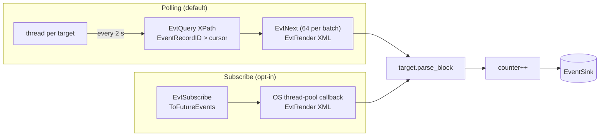

# Event Log sensor

`sensor-windows-eventlog` ([`crates/sensors/windows/eventlog`](../../../crates/sensors/windows/eventlog/src/lib.rs)) reads a fixed allowlist of Windows Event Log channels and event ids and normalizes them into `schema` events. It is a supplementary, driverless sensor: it carries what ETW cannot give this agent (logons, service and task persistence, policy decisions, session lifecycle), and its failure never stops the ETW sensor.

## Why the Event Log reader API, not ETW

Two of the most important events cannot be consumed through a live ETW subscription created by a third-party process:

- **System 7045** (service installed) comes from "Service Control Manager", a classic (non-manifest) provider. TDH cannot resolve its schema: `event_id()` reads 0 and `event_schema()` fails with error 1168.
- **Security 4698** (scheduled task created) comes from "Microsoft-Windows-Security-Auditing", which is manifest-based, but an ad-hoc ETW consumer never receives its events even with the right GUID, keywords and `SeSecurityPrivilege`.

The Event Log reader API (`EvtQuery`/`EvtNext`/`EvtRender`, the same API `wevtutil qe` wraps) reads the channels after the fact and is not affected by either problem. The cost is up to one poll interval (2 s) of latency, which does not matter for persistence detection: the artifact already exists when the event is written.

The reader renders XML in UTF-16 ([`query_events`](../../../crates/sensors/windows/eventlog/src/query.rs)). An earlier implementation spawned `wevtutil` and read its redirected stdout, which is written in the ANSI code page, so account names outside that code page reached the rules as `?`.

## Poll targets

Every source is a [`PollTarget`](../../../crates/sensors/windows/eventlog/src/sensor.rs): a channel, an `EventID` filter, a parser that turns one `<Event>` XML block into a [`BlockOutcome`](../../../crates/sensors/windows/eventlog/src/targets/mod.rs), the counter it increments, an optional `auditpol` enablement and the config switch that gates it. The machinery (cursor, query, normalize, count, sink) exists once. Adding a source is one entry in [`TARGETS`](../../../crates/sensors/windows/eventlog/src/sensor.rs).

| Target (`label`) | Channel | Event ids | Emits | Switch |
| --- | --- | --- | --- | --- |
| `service-install` | System | 7045 | `FileOpen` + `FLAG_PERSISTENCE_ARTIFACT` | `service_installs_enabled` |
| `scheduled-task` | Security | 4698 | `FileOpen` + `FLAG_PERSISTENCE_TASK_ARTIFACT` | `scheduled_tasks_enabled` |
| `scheduled-task-update` | Security | 4702 | `FileOpen` + `FLAG_PERSISTENCE_TASK_UPDATE_ARTIFACT` | `scheduled_tasks_enabled` |
| `account-creation` | Security | 4720 | `FileOpen` + `FLAG_PERSISTENCE_ACCOUNT_ARTIFACT` | `account_creations_enabled` |
| `logon` | Security | 4624, 4625, 4648, 4672 | `Auth` | `logon_events_enabled` |
| `applocker-block`, `applocker-msi-script`, `applocker-packaged-execution`, `applocker-packaged-deployment` | AppLocker EXE and DLL, MSI and Script, Packaged app-Execution, Packaged app-Deployment | 8003/8004, 8006/8007, 8021/8022, 8024/8025 | `PolicyDenial` (`POLICY_MECHANISM_APPLOCKER`) | `applocker_blocks_enabled` |
| `task-scheduler-op` | TaskScheduler/Operational | 106 | `FileOpen` + task flag | `task_scheduler_op_enabled` |
| `defender` | Windows Defender/Operational | 1116, 1117, 5001, 5007, 5010, 5012 | `Defender` | `defender_enabled` |
| `wdac` | CodeIntegrity/Operational | 3076, 3077 | `PolicyDenial` (`POLICY_MECHANISM_WDAC`) | `wdac_enabled` |
| `session-lifecycle` | TerminalServices-LocalSessionManager/Operational | 21, 23, 24, 25 | `Session` | `terminal_sessions_enabled` |
| `rdp-connection` | TerminalServices-RemoteConnectionManager/Operational | 1149 | `Session` | `terminal_sessions_enabled` |
| `security-log-cleared` / `log-file-cleared` | Security / System | 1102 / 104 | `LogCleared` | `log_clears_enabled` |
| `kerberos-delegation-failure` | Kerberos/Operational | 201, 202 | `KerberosDelegationFailure` | `kerberos_delegation_failures_enabled` |

Exact channel names and filters are in the `static ... : PollTarget` definitions in [`sensor.rs`](../../../crates/sensors/windows/eventlog/src/sensor.rs).

### Notes per source

- **Persistence as `FileOpen`.** Service installs, task creations and updates, and account creations reuse `FileOpenEvent` with a persistence flag rather than a dedicated event type ([`persistence_file_open`](../../../crates/sensors/windows/eventlog/src/sensor.rs)). The consuming rules match on the flag. A 7045 with no service name or image path is skipped.
- **4702 (task updated)** reports an existing task whose action was rewritten. Windows rewrites its own tasks routinely, so the consuming rule adds a suspicious-action-path gate.
- **4720** covers local SAM accounts only. A domain account creation is logged on the domain controller.
- **Logons.** [`to_auth_event`](../../../crates/sensors/windows/eventlog/src/sensor.rs) maps 4624 to a logon, 4625 to a failure, 4648 to explicit credentials (reported as `Success` meaning "the attempt was observed": its outcome is a separate 4624/4625), and 4672 to a privileged session. For 4624/4625 the `Subject*` fields are normally SYSTEM, so the account is taken from `Target*`; 4672 has no `Target*` and uses `Subject*` ([`LogonEvent`](../../../crates/sensors/windows/eventlog/src/xml/records/logon.rs)). `comm` is `lsass.exe`, the process that writes these events.
- **Task Scheduler 106** has no task XML. The sensor reads the actions back from the task definition under `%SystemRoot%\System32\Tasks` ([`normalize_task_registered_from`](../../../crates/sensors/windows/eventlog/src/sensor.rs)) and reports a placeholder action when the file is gone. A task seen on both 4698 and 106 is deduplicated by the rules layer, not here.
- **Defender.** The channel is localized, so only numeric fields are read. 5007 (configuration changed) is most of the channel's volume, so only changes to exclusions, `Disable*` switches and Tamper Protection are forwarded ([`is_security_relevant_setting`](../../../crates/sensors/windows/eventlog/src/sensor.rs)).
- **WDAC.** 3033 is not subscribed (DLL-load noise).
- **AppLocker** allowed events are filtered out. Packaged-app deployment decisions use action `install`; paths are expanded from AppLocker's `%OSDRIVE%`-style variables ([`expand_applocker_path`](../../../crates/sensors/windows/eventlog/src/xml/records/applocker.rs)).
- **Log clears.** The Event Log service writes 1102 or 104 itself after emptying a log, so these catch `EvtClearLog` and .NET `ClearLog`, not only `wevtutil cl`.

### Audit policy enablement

Some events are only written if an audit subcategory is on. Before polling, each enabled target's `enable_audit` runs `auditpol /set /subcategory:<GUID> /success:enable /failure:enable` once ([`enable_audit_subcategory`](../../../crates/sensors/windows/eventlog/src/sensor.rs)). GUIDs are used instead of names because `auditpol` matches names against the localized label.

| Subcategory | Needed by | Default policy |
| --- | --- | --- |
| Other Object Access Events | 4698, 4702 | off: this call is the primary enablement |
| Logon | 4624, 4625, 4648 | on |
| Special Logon | 4672 | on |
| User Account Management | 4720 | on |

A failure is logged with the coverage lost and the manual command, and the sensor keeps going. Enablement does not depend on the transport.

### Disabled channels

A disabled channel answers queries with no events and no error, so it looks like a quiet, healthy channel. At startup, [`warn_about_disabled_channels`](../../../crates/sensors/windows/eventlog/src/sensor.rs) reads each enabled target's channel `Enabled` property ([`channel::is_enabled`](../../../crates/sensors/windows/eventlog/src/channel.rs)), logs one warning per disabled channel naming the affected targets, and increments `EventLogCounters::disabled_channels`. It never enables a channel. Task Scheduler Operational and Kerberos Operational are off on a default install. A channel switched off while the agent runs is not detected.

## Transports

Both transports use the same targets, parsers and counters. Only delivery differs.

### Polling

[`poll`](../../../crates/sensors/windows/eventlog/src/sensor.rs) runs one thread per enabled target:

1. **Cursor.** The first tick reads the newest matching `EventRecordID` already in the channel ([`last_known_record_id`](../../../crates/sensors/windows/eventlog/src/sensor.rs)). Only events written after startup are reported, as with every other sensor. If the channel is unreadable at startup, the cursor stays unset and the read is retried each tick: falling back to record 0 would replay the whole history once the channel becomes readable.
2. **Tick.** [`poll_once`](../../../crates/sensors/windows/eventlog/src/sensor.rs) queries `*[System[(<filter>) and (EventRecordID><cursor>)]]` oldest first, parses each block, counts and forwards the normalized events, and moves the cursor to the newest record id seen.
3. **Errors.** A failed query (access denied on Security, an invalid channel) is an error, never an empty result, so a blinded channel is not mistaken for a quiet one. The thread warns once per failure streak and logs recovery.

`EvtNext` waits at most 30 s ([`NEXT_TIMEOUT_MS`](../../../crates/sensors/windows/eventlog/src/query.rs)); a hung call fails the tick instead of freezing the thread.

**Parse outcomes** ([`BlockOutcome`](../../../crates/sensors/windows/eventlog/src/targets/mod.rs)): `Unparseable` (does not advance the cursor), `Filtered { record_id }` (parsed but unusable, advances the cursor without counting), `Event { record_id, event }` (counted and forwarded). Event handles are closed by an RAII guard even when rendering fails.

### Subscribe

[`subscribe`](../../../crates/sensors/windows/eventlog/src/subscribe.rs) registers one `EvtSubscribe` per enabled target with `EvtSubscribeToFutureEvents` and no bookmark. Events arrive on an OS thread-pool thread, so the callback context holds only `Arc`s and `'static` data.

- **Lifetime.** [`SubscriptionHandle`](../../../crates/sensors/windows/eventlog/src/subscribe.rs) owns the subscription handle and the boxed callback context. `Drop` calls `EvtClose` first, which waits for in-flight callbacks, and only then frees the context. The reverse order would let a running callback read freed memory.
- **Errors.** A subscription that fails to register is logged and skipped; other targets keep running. A non-`Deliver` action in the callback is logged and the subscription stays open. A render failure drops that one event (the handle is only valid during the callback). The callback always returns success, because a non-zero return ends the subscription.
- **Stop.** After the stop flag is set, events delivered before the handles close are discarded.
- **Gaps.** There is no bookmark, so events written while the agent is down, or between startup and registration, are not delivered. There is no liveness signal either (see below).

The agent always selects `Polling` today ([`eventlog_config`](../../../apps/agent/src/commands/windows.rs)); `Subscribe` is not reachable from configuration yet.

## Liveness

[`EventLogSensor::liveness`](../../../crates/sensors/windows/eventlog/src/sensor.rs) returns one counter per enabled target, named `windows-eventlog:<target>`, incremented on every successful poll tick whether or not it found events. A quiet channel stays live; a refused or broken one goes dark. Counters are per target because one shared counter would let a healthy System poll hide a Security channel that stopped answering. The agent registers each one with a 60 s deadline.

Under `Subscribe` the list is empty: a push subscription has no tick, so a counter would never move on a quiet channel and would raise a false silence alert.

## Counters

[`EventLogCounters`](../../../crates/sensors/windows/eventlog/src/sensor.rs) holds one `Relaxed` atomic per target group, incremented once per event actually forwarded (not per XML block), plus `disabled_channels`. A handle is available from [`EventLogSensor::counters`](../../../crates/sensors/windows/eventlog/src/sensor.rs). Nothing in the agent reads them yet.

## Configuration

[`EventLogConfig`](../../../crates/sensors/windows/eventlog/src/sensor.rs) is this crate's own type, because sensor crates cannot depend on `policy`. The agent converts `policy::EventLogPolicy` into it in [`eventlog_config`](../../../apps/agent/src/commands/windows.rs). A disabled target is never queried.

| Field | Default | Set by the agent from |
| --- | --- | --- |
| `transport` | `Polling` | hard-coded `Polling` |
| `service_installs_enabled` | true | `EventLogPolicy` |
| `scheduled_tasks_enabled` | true | `EventLogPolicy` |
| `account_creations_enabled` | true | `EventLogPolicy` |
| `logon_events_enabled` | true | `EventLogPolicy` |
| `applocker_blocks_enabled`, `task_scheduler_op_enabled`, `defender_enabled`, `wdac_enabled`, `terminal_sessions_enabled`, `log_clears_enabled`, `kerberos_delegation_failures_enabled` | true | hard-coded `true` |

The agent currently uses `EventLogPolicy::default()` (every group on); no policy document is loaded into it yet.

[`capabilities`](../../../crates/sensors/windows/eventlog/src/sensor.rs) reports `file_events` when any of the `FileOpen`-producing groups is on and `auth_events` when logons are on. Policy denials, Defender, sessions and log clears have no capability flag.

## XML parsing

The [`xml`](../../../crates/sensors/windows/eventlog/src/xml/mod.rs) module is platform-independent and extracts fields by substring (`<Data Name='...'>`), without an XML parser dependency. `xml/scan.rs` holds the scanning primitives, `xml/time.rs` the `TimeCreated` conversion, and `xml/records/` one parser per record shape. The shape is the one `EvtRender(EvtRenderEventXml)` and `wevtutil qe /f:xml` both produce. Entities are unescaped. All field values here come from whoever caused the event (a file name, an account name, a task action), so the parsers must never panic on any input.

## Testing

- Unit tests in `sensor.rs` (`config_tests` and per-normalizer tests) and the `xml` modules, with fixtures trimmed from real captures; these run on every OS.
- Never-panic robustness suites: [`applocker_robustness.rs`](../../../crates/sensors/windows/eventlog/tests/applocker_robustness.rs), [`session_robustness.rs`](../../../crates/sensors/windows/eventlog/tests/session_robustness.rs), [`log_cleared_robustness.rs`](../../../crates/sensors/windows/eventlog/tests/log_cleared_robustness.rs), [`kerberos_delegation_failure_robustness.rs`](../../../crates/sensors/windows/eventlog/tests/kerberos_delegation_failure_robustness.rs), [`xml_parser_robustness.rs`](../../../crates/sensors/windows/eventlog/tests/xml_parser_robustness.rs).
- Windows-only tests in [`channel.rs`](../../../crates/sensors/windows/eventlog/src/channel.rs) read real channel configuration.

## Known gaps

- The per-channel switches beyond the four policy-backed ones, and the transport, are not configurable from policy.
- `Subscribe` has no liveness signal and no bookmark, which is why it is not the default.
- A channel disabled after startup is not detected.
- Event Log events carry no user token, container or process incarnation stamp.
