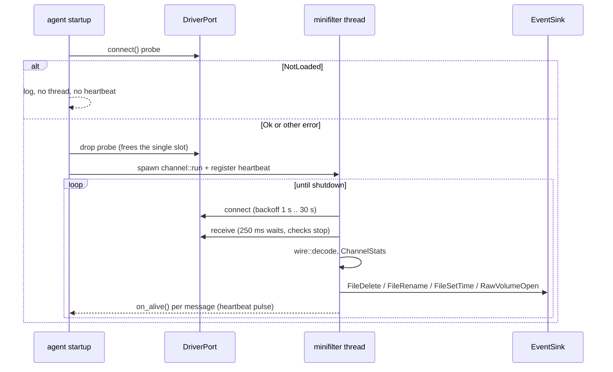

# Minifilter driver and event channel

File deletes and renames are the main ransomware signal, and ETW from user mode does not report them reliably. The `SynthaeaFilter` file-system minifilter reports them from the kernel, and the `sensor-windows-minifilter` crate receives them in the agent.

| Part | Path | Language | Built by |
| --- | --- | --- | --- |
| Driver | [`crates/sensors/windows/driver/minifilter`](../../../crates/sensors/windows/driver/minifilter/SynthaeaFilter.c) | C, classic WDK | `msbuild` with the WDK, on a Windows host. Not a Cargo member and not built by CI. |
| Client | [`crates/sensors/windows/minifilter`](../../../crates/sensors/windows/minifilter/src/lib.rs) | Rust | Cargo, part of the workspace |

The driver is C because the Rust driver bindings did not support the Filter Manager for production use when it was started. Only the kernel binary is C; everything past the communication port is Rust.

## Design rules for the driver

- **Thin kernel side.** Collect and forward only. No detection logic in kernel mode.
- **User-mode input is hostile.** The driver registers no message callback, so user mode cannot send it anything; the connect context is validated.
- **The kernel never waits on user mode.** File I/O threads never call `FltSendMessage`; they enqueue into a bounded queue.
- **One client, the agent only.** The port's security descriptor allows SYSTEM and Administrators, it accepts a single connection, and the connect callback requires the `NT SERVICE\SynthaEDR` service SID in the caller's token.
- Static analysis (`/analyze`, SAL), Driver Verifier on the test VM, and two-person review for C changes.

## What is reported

The driver registers pre- and post-operation callbacks for `IRP_MJ_CREATE` and `IRP_MJ_SET_INFORMATION` ([`SynthaeaCallbacks`](../../../crates/sensors/windows/driver/minifilter/SynthaeaFilter.c)).

| Kind | Operation | Reported when |
| --- | --- | --- |
| 1 delete | `FileDispositionInformation(Ex)` with delete set, or a create with `FILE_DELETE_ON_CLOSE` | post-op succeeded (not `STATUS_REPARSE`) |
| 2 rename | `FileRenameInformation(Ex)` and the `...BypassAccessCheck` classes (used by kernel callers such as the SMB server) | post-op succeeded |
| 3 set-time | explicit timestamps through `FileBasicInformation` | post-op succeeded |
| 4 raw volume open | a create that opens a mounted logical volume (`FO_VOLUME_OPEN`), with the requested access mask | post-op succeeded |
| 0 heartbeat | queue idle for 5 s | always, from the sender thread |

Semantics to keep in mind when writing rules:

- A delete is reported when it is **requested and accepted**, not when the file disappears. The file goes away at the last handle close, another handle can still cancel the delete, and a non-empty directory delete can still fail at cleanup.
- The name is the normalized name at the time of the request.
- Hard links are not reported: creating a name is neither a delete nor a rename.
- A create that is only a reparse (a junction) is not reported; the re-issued create on the resolved path is.
- Set-time values are the caller's requested raw FILETIMEs: 0 means unchanged, -1 and -2 are Windows auto-update sentinels. The event does not claim the time was persisted.
- The raw-volume mask is the requested access, not the granted access. Opens of physical disks that bypass the file system are out of scope.
- Paging I/O, operations without a file object, and the agent's own process are skipped before any work.

## Kernel data path

```mermaid
flowchart LR
    IO["I/O thread<br/>pre-op (PASSIVE)"] -->|name query, allocate record| CTX["completion context"]
    CTX --> POST["post-op<br/>(may be DISPATCH_LEVEL)"]
    POST -->|success: push O(1)| Q[["queue<br/>8,192 records / 16 MiB"]]
    POST -->|failure: free| X((drop))
    Q --> SND["sender system thread"]
    SND -->|FltSendMessage, 100 ms timeout| PORT["\\SynthaeaPort"]
    PORT --> AGENT["agent: channel::run"]
```

- **Names are queried in the pre-op.** `FltGetFileNameInformation` is only safe at `PASSIVE_LEVEL`/`APC_LEVEL`, and post-ops can run at `DISPATCH_LEVEL`. The pre-op allocates one non-paged record sized to the names and fills it; the post-op either links that record into the queue or frees it. No allocation or name query happens in the post-op.
- **Bounded queue.** Capped at 8,192 records **and** 16 MiB ([`SYNTHAEA_MAX_QUEUE_RECORDS`, `SYNTHAEA_MAX_QUEUE_BYTES`](../../../crates/sensors/windows/driver/minifilter/SynthaeaFilter.c)). The byte cap is the one that matters: a record with two maximal paths is about 16 KiB. Over either cap the record is dropped and counted. The pre-op checks the caps before allocating.
- **Sender thread.** Pops records and sends with a 100 ms timeout. A timeout or error drops the record and counts it. A hung or suspended agent therefore fills the queue and moves the counters, never stalls a file operation.
- **Paths** are UTF-16, capped at 4,096 code units each; a longer path is truncated and flagged.
- **Port lifetime.** Sends run under rundown protection tied to the connection. Disconnect waits for in-flight sends (bounded by the send timeout), closes the client port, and re-arms for the next client.
- **Queued records survive a disconnect** (within the caps). After a reconnect the agent can receive older records. Their timestamps are from the file operation; their sequence numbers are assigned when sent. Time windows must use the event timestamp, not the receive time.
- **Unload** is allowed (development needs load/unload cycles). It closes the port, stops the sender thread, frees queued records, then unregisters.

## Wire format (protocol v5)

Fixed 108-byte little-endian header, then `old_path` and `new_path` in UTF-16LE, not NUL-terminated. The layout is pinned with `C_ASSERT`s in the driver and decoded by [`wire::decode`](../../../crates/sensors/windows/minifilter/src/wire.rs).

| Offset | Field | Type | Notes |
| --- | --- | --- | --- |
| 0 | `kind` | u16 | 0 heartbeat, 1 delete, 2 rename, 3 set-time, 4 raw-volume open |
| 2 | `flags` | u16 | bit 0 delete-on-close, bit 1 old path truncated, bit 2 new path truncated |
| 4 | `seq` | u64 | per connection, starts at 1 |
| 12 | `timestamp` | i64 | `KeQuerySystemTimePrecise`, 100 ns since 1601 |
| 20 | `pid`, `tid` | u64 × 2 | from the pre-op |
| 36 | `dropped_queue_full` | u64 | cumulative since load |
| 44 | `dropped_send_failed` | u64 | cumulative since load |
| 52 | `not_connected` | u64 | cumulative since load, upper bound |
| 60 | `old_path_len`, `new_path_len` | u16 × 2 | UTF-16 code units |
| 64 | `dropped_capture_failed` | u64 | cumulative since load |
| 72 | creation, last access, last write, change time | i64 × 4 | set-time only |
| 104 | `desired_access` | u32 | raw-volume open only |
| 108 | paths | UTF-16LE | |

The connect context is `{ magic: "SYNT", version: 5 }` ([`connect_context`](../../../crates/sensors/windows/minifilter/src/lib.rs)). The driver refuses any other version, so a mismatched driver and agent fail at connect instead of misreading each other. **The driver and the client must change together**; the constants in [`lib.rs`](../../../crates/sensors/windows/minifilter/src/lib.rs) and [`wire.rs`](../../../crates/sensors/windows/minifilter/src/wire.rs) mirror the `#define`s in [`SynthaeaFilter.c`](../../../crates/sensors/windows/driver/minifilter/SynthaeaFilter.c).

The decoder treats the bytes as hostile even though they come from the kernel. Every read is bounds-checked, every length is validated before use, and an unknown kind or flag, a length that does not match the kind, a path above the cap, a zero sequence, a pre-1970 or overflowing timestamp, or fields set for the wrong kind are all [`WireError`](../../../crates/sensors/windows/minifilter/src/wire.rs)s. Nothing is partially returned.

## Loss accounting

Loss is visible from both sides ([`ChannelStats`](../../../crates/sensors/windows/minifilter/src/stats.rs)), because neither side alone sees everything: a record lost between the queue and the read shows only as a sequence gap, and a record never queued shows only in the driver's counters.

| Counter | Side | Meaning |
| --- | --- | --- |
| `dropped_queue_full` | driver | queue over a cap |
| `dropped_send_failed` | driver | `FltSendMessage` failed or timed out |
| `not_connected` | driver | qualifying attempts while no agent was connected. Counted in the pre-op before the result is known, so it is an upper bound. |
| `dropped_capture_failed` | driver | operation succeeded but its names or record could not be obtained |
| `lost_by_sequence` | agent | gaps between received sequence numbers |
| `decode_errors` | agent | messages refused by the decoder |
| `truncated_paths` | agent | file messages not forwarded because a path was cut |
| `connections` | agent | more than one means the driver was reloaded or the connection dropped |

Details that keep the counts honest:

- Queue-full and capture-failure accounting is deferred to the post-op, so failed file operations do not inflate them. Nothing is counted while an instance is draining or the driver is unloading.
- A heartbeat the sender cannot deliver is not a loss: the sender takes its sequence number back, so the agent sees no gap.
- A failed send normally appears both as a gap and in `dropped_send_failed`; [`total_lost`](../../../crates/sensors/windows/minifilter/src/stats.rs) reconciles them so it is not counted twice. A driver counter that decreases is treated as a driver reload.

[`channel::run`](../../../crates/sensors/windows/minifilter/src/channel.rs) logs loss at most once a minute, and only when the figures rose. The health beacon does not carry these counters yet.

## Agent side



- [`spawn_minifilter`](../../../apps/agent/src/commands/windows.rs) probes the port once. **Not loaded** is the normal case today: nothing starts and no heartbeat is registered, so there is no false silence alert. Any other connect error (the previous agent still holds the single slot after a restart, access denied, protocol mismatch) starts the thread anyway with the heartbeat registered, so a driver that stays unreachable becomes a silence alert after 30 s.
- [`DriverPort::connect`](../../../crates/sensors/windows/minifilter/src/port.rs) maps the HRESULT to [`ConnectError`](../../../crates/sensors/windows/minifilter/src/lib.rs): `NotLoaded`, `AccessDenied` (not elevated, or not running as the service), `AlreadyConnected`, `Refused` (version mismatch), `Other`.
- [`DriverPort::receive`](../../../crates/sensors/windows/minifilter/src/port.rs) uses overlapped `FilterGetMessage` into an 8-byte-aligned buffer sized for the largest message, waiting in 250 ms slices so the stop flag is honored. Any receive error means the connection is unusable: drop it and reconnect.
- [`channel::run`](../../../crates/sensors/windows/minifilter/src/channel.rs) reconnects with a backoff from 1 s doubling to 30 s. The backoff resets only after a connection delivered a message, so a driver that accepts connections but fails every read is retried at the capped rate, not in a tight loop.
- [`to_event`](../../../crates/sensors/windows/minifilter/src/events.rs) maps messages to `FileDelete`, `FileRename`, `FileSetTime` and `RawVolumeOpen`. Device paths go through [`VolumeMap`](../../../crates/sensors/windows/minifilter/src/events.rs), the same drive-letter rewrite as the ETW sensor, refreshed at most every 30 s on a miss. A message with a truncated path is counted and not forwarded, so a partial name never reaches a rule as if it were complete.
- **Attribution is minimal.** The driver knows pid and thread only. Minifilter events carry an empty `comm`, `ppid` 0 and `User::Unknown`, and nothing in the agent fills them in yet, so rules on these events must key on `pid`.

## Building and running

Build with Visual Studio 2022, the Spectre-mitigated MSVC libraries and WDK 10.0.26100.x from a developer prompt (`msbuild SynthaeaFilter.sln /p:Configuration=Debug /p:Platform=x64`). The build test-signs with a local WDK certificate. Load it only on a dedicated VM with test signing on and Secure Boot off. Lab helper scripts are in [`driver/test`](../../../crates/sensors/windows/driver/test/port-check.ps1): `port-check.ps1` pins each connect HRESULT, `run-as-agent.ps1` runs a process with the agent's service identity. The examples [`channel_probe.rs`](../../../crates/sensors/windows/minifilter/examples/channel_probe.rs) and [`port_probe.rs`](../../../crates/sensors/windows/minifilter/examples/port_probe.rs) exercise the client against a loaded driver.

The INF uses altitude 370020 (FSFilter Activity Monitor range, taken from the Microsoft sample) and demand start. A production altitude must be requested from Microsoft. The driver files are derived from Microsoft's `nullFilter` sample and are under MS-PL, see the license file next to them.

## Testing

- Platform-independent unit tests and `proptest` properties for the decoder ([`wire.rs`](../../../crates/sensors/windows/minifilter/src/wire.rs)), the loss accounting ([`stats.rs`](../../../crates/sensors/windows/minifilter/src/stats.rs)) and the event mapping ([`events.rs`](../../../crates/sensors/windows/minifilter/src/events.rs)), run on every OS. A test-only encoder writes messages the way the driver does. There is no `cargo-fuzz` target for the decoder.
- The driver itself is not compiled in CI (no WDK on the runners). A driver change is checked by a WDK build and a lab run.

## Status and gaps

- Built: deletes, renames, timestamp requests and raw volume opens with loss accounting (protocol v5).
- Not yet: ADS and named pipes, process/image/handle kernel callbacks, ELAM/PPL and production signing ([#27](https://github.com/synthaea-lab/agent/issues/27), [#58](https://github.com/synthaea-lab/agent/issues/58)), handle-access telemetry ([#32](https://github.com/synthaea-lab/agent/issues/32)), and kernel-side image identity at process creation ([#46](https://github.com/synthaea-lab/agent/issues/46)).
- Unload is allowed, so the driver offers no tamper resistance yet.
