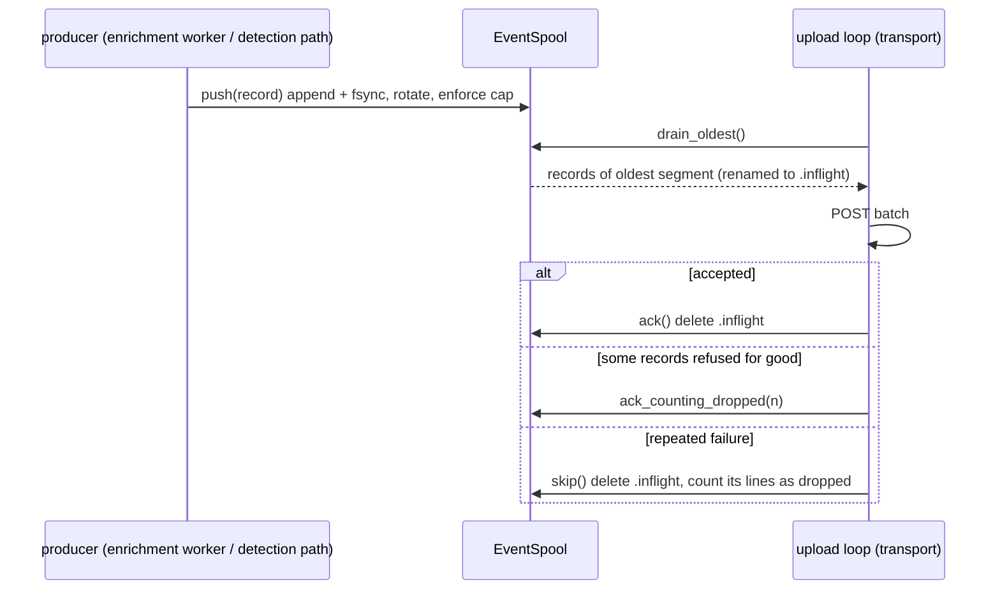

# State and storage

The agent runs for months on a host it does not control, and it can be fed
attacker-chosen input. The `store` crate holds the two kinds of local state
that must stay bounded in that setting:

- [`BoundedMap`](../crates/store/src/bounded.rs): an LRU-bounded map for
  detection-engine state (entity tables, belief states, pid caches, pending
  joins).
- [`EventSpool`](../crates/store/src/spool.rs): a durable store-and-forward
  queue on disk for events and detections waiting to be uploaded.

Both follow the same rule: **no unbounded growth, and loss is counted, never
silent.** The crate depends only on `serde`, `serde_json` and `tracing`, and is
a leaf crate. Detection crates may depend on it, and sensors may not.

## BoundedMap

### Mechanism

`BoundedMap<K, V>` is a `HashMap<K, (V, u64)>` plus a monotonic `tick` counter.
Every use stamps the entry with the next tick. When an insert pushes the length
past `cap`, [`evict_batch`](../crates/store/src/bounded.rs) sorts entries by
tick and removes the oldest ones in one batch:

```text
batch = (len - cap) + max(cap / 8, 1) - 1        (at least 1)
```

At the cap, roughly one eighth of the entries go at once, so the O(n log n)
pass runs about once every `cap/8` inserts instead of on every insert. The map
has no dependencies by design. At the sizes detection state uses (tens of
thousands of entries), the amortized cost is small.

| Method | Touches recency? | Notes |
|---|---|---|
| `insert`, `extend` | yes | may trigger a batch eviction |
| `get`, `get_mut` | yes | a read is a use |
| `get_or_insert_with` | yes | never evicts the entry it returns: a batch is always smaller than the map, and the new entry has the highest tick |
| `peek`, `iter` | no | for inspection and scans keyed on something other than the map key |
| `remove` | n/a | for one-shot pending state that must not match twice |
| `evicted()` | n/a | entries evicted over the map's lifetime |

### Invariants

- `len() <= cap` after every operation. `new(0)` panics, because a zero-capacity
  LRU is a programming error, not a runtime condition.
- Eviction drops the least recently used entries first.
- `evicted()` only grows. Callers export it as a health counter, so a full map
  shows up as a number rather than as missing detections. For example, the
  Linux parent-image cache splits its evictions into live and dead processes in
  the health beacon (`parent_image_evicted_live` and `parent_image_evicted_dead`
  in [`HealthBeacon`](../crates/schema/src/lib.rs)).

### Concurrency

`BoundedMap` has no internal locking. Even `get` takes `&mut self`, because a
read moves the entry's recency. Each owner wraps it in its own `Mutex` or keeps
it on a single thread. Users include the rule state machines in `crates/rules`,
the correlator engine, `enrich`, `verdict`, the YARA memory scanner, and several
agent-side joins.

### Tests

Unit tests in [`bounded.rs`](../crates/store/src/bounded.rs): the cap holds
under 100,000 inserts, LRU order is respected, `get_or_insert_with` counts as a
use, and `remove` takes the entry out.

## EventSpool

### Layout on disk

One spool instance owns one directory:

```text
<dir>/
  spool-000000000041.inflight   # handed to the uploader, not yet acknowledged (at most one)
  spool-000000000042.jsonl      # sealed segment
  spool-000000000043.jsonl      # active segment (head), appended to
```

Each segment is JSON Lines: one serialized record per line. A segment is sealed
(the head moves to the next sequence number) when it reaches its record limit
(`SEGMENT_RECORDS` = 1024 by default) or when the next record would push it
past `SEGMENT_MAX_BYTES` (1 MiB). A single record larger than 1 MiB still goes
into a segment of its own.

### Two-phase drain



- [`push`](../crates/store/src/spool.rs) serializes the record, appends it,
  calls `sync_data`, then rotates and enforces the byte cap. Every record is
  durable when `push` returns.
- [`drain_oldest`](../crates/store/src/spool.rs) reads the lowest-numbered
  segment and renames it to `.inflight`. If that segment was the active head,
  the head moves on so new records go to a fresh segment. A second call before
  `ack` delivers the same segment again, so a retry after a failed upload is
  idempotent.
- [`ack`](../crates/store/src/spool.rs) deletes the `.inflight` file. If the
  delete fails, the segment stays in flight and the next `ack` tries again.
- [`ack_counting_dropped`](../crates/store/src/spool.rs) acknowledges and adds
  `n` records to the loss counter. The uploader uses it when the server
  accepted the batch but permanently refused some individual records.
- [`skip`](../crates/store/src/spool.rs) throws the in-flight segment away and
  counts its lines as dropped. Without it, a poison segment would block all
  later telemetry.
- [`open`](../crates/store/src/spool.rs) renames any leftover `.inflight` back
  to `.jsonl` (a crash between drain and ack) and starts a new head after the
  highest existing sequence number. Segments from before a restart drain first.

Delivery is therefore **at least once**. A crash after a successful upload but
before `ack` re-sends that segment, and the server must tolerate duplicates.

### Bounds and back-pressure

There is no back-pressure on producers. `push` never blocks waiting for upload.
When the spool exceeds `max_bytes`, [`enforce_cap`](../crates/store/src/spool.rs)
deletes **whole oldest sealed segments** until the total (sealed + in-flight +
head) fits, and adds their line counts to `dropped_records`. It never deletes
the in-flight segment or the active head. So on a very small cap the spool can
temporarily hold up to one in-flight segment plus one head beyond the cap.
Telemetry from an outage therefore keeps the most recent data and loses the
oldest.

[`SpoolStats`](../crates/store/src/spool.rs) reports the bytes on disk
(including the in-flight file) and `dropped_records`.

### How the agent uses it

[`upload::start`](../agent/src/upload.rs) opens two spools, both as siblings of
the `--alerts` file:

| Directory | Segment size | Content | Why |
|---|---|---|---|
| `spool/` | 1024 records | redacted events, pushed by the enrichment worker in [`sink/mod.rs`](../agent/src/sink/mod.rs) | batching |
| `detection-spool/` | 1 record | redacted detections | a detection the server refuses for good is skipped alone, without the valid detections beside it |

Each spool is opened with `storage.spool_max_mb` as its cap
([`spool_cap_bytes`](../agent/src/upload.rs)), so the worst case on disk is
**twice** that value. Each spool sits behind an `Arc<Mutex<EventSpool>>` shared
between its producer and its upload thread. The health beacon reports the sum of
both spools as `spool_bytes` and `spool_dropped`
([`SpoolHealth`](../agent/src/upload.rs)).

Retry limits belong to transport, not to the spool. The spool exports
[`MAX_DRAIN_ATTEMPTS`](../crates/store/src/spool.rs) (5) as a suggestion.
`transport` repeats the value as `DEFAULT_MAX_DRAIN_ATTEMPTS` (two leaf crates
cannot import from each other) for consecutive 5xx responses, and allows a
larger budget, `DEFAULT_MAX_NETWORK_DRAIN_ATTEMPTS` (20), for pure connectivity
failures. Both are in [`crates/transport/src/lib.rs`](../crates/transport/src/lib.rs).

Records written to the spool are always the **redacted** copies (see
[Redaction](redaction.md)). The in-memory event that detection evaluated is
never written as is.

### Failure modes

| Situation | Behaviour |
|---|---|
| Crash in the middle of an append | The torn last line fails to parse on drain. It is logged and skipped. Other records in the segment are delivered. |
| A corrupt line in the middle of a segment | Same: logged and skipped. **Not** added to `dropped_records`. |
| Crash between drain and ack | `open` restores the segment, and it is delivered again. |
| `push` fails (disk full, permission) | The `io::Error` goes back to the caller. The enrichment worker logs it and keeps the event local only (alert log and events file). |
| Control plane down for a long time | The spool grows to its cap, then sheds the oldest segments, counted. Transport may also skip a segment after its connectivity budget. |
| Agent restart | Spool contents survive. The `dropped_records` counter does **not**: it lives in memory and starts again at zero. |

### Tests

Unit tests in [`spool.rs`](../crates/store/src/spool.rs) cover FIFO round trips,
survival across reopen, byte-cap shedding with counted loss, torn tail lines,
two-phase redelivery after a crash, idempotent re-drain, poison-segment skip,
in-flight protection from the cap, in-flight bytes in stats, one-record
segments, and `ack_counting_dropped` accounting. The agent-side wiring is tested
in [`agent/src/upload.rs`](../agent/src/upload.rs).

## Cost notes

- Every `push` calls `fsync` and lists the spool directory (`enforce_cap` sums
  segment sizes). That is acceptable at the agent's upload rates, but the spool
  is not built for very high throughput.
- `stats()` also lists the directory. Call it at beacon cadence, not per event.
