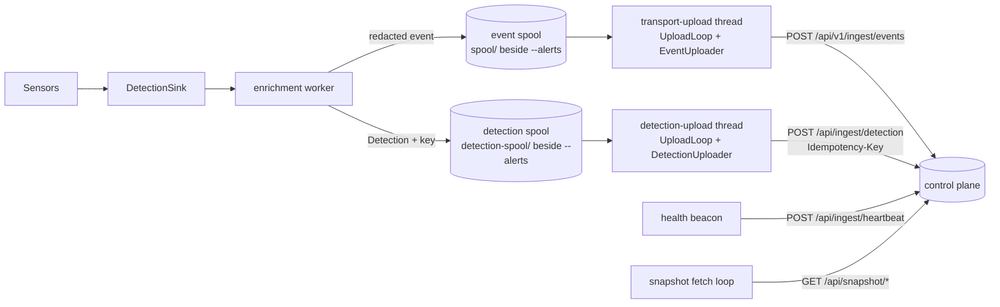
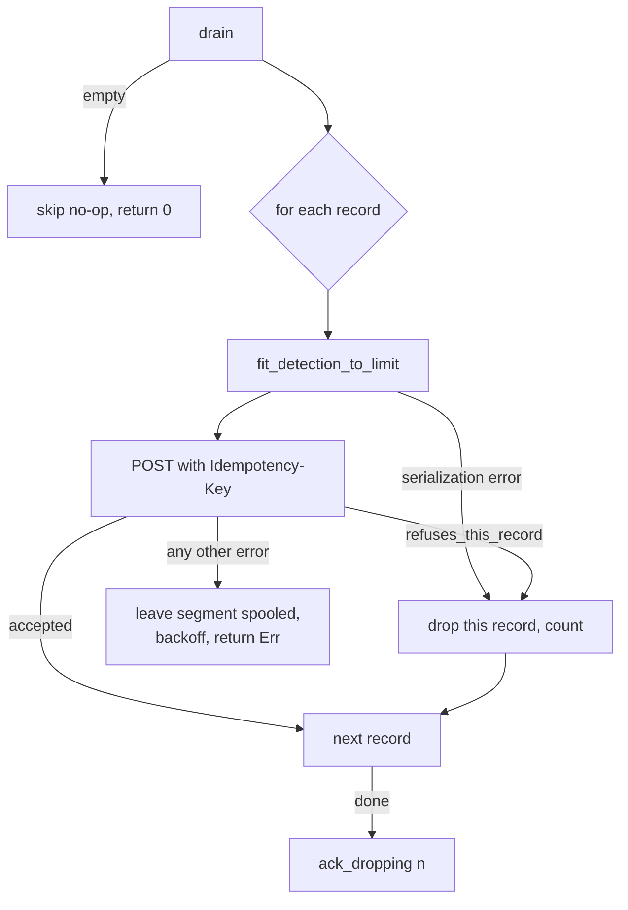

# Transport: talking to the control plane

The agent detects locally and reports to a control plane. Everything it sends (raw
events, structured detections, health beacons, decoy-credential hashes) and the
signed manifests and artifacts it fetches go through the `transport` crate, an HTTP client
over rustls with optional mTLS. This page explains how that channel works: what is sent,
in which order, what happens when the server is slow, wrong or gone, and which limits keep
the agent from being wedged or flooded.

Fetching and verifying releases, content and keys is covered in
[Updates and releases](updates-and-releases.md). The local admin channel (`ipc`, `cli`)
and the local JSONL outputs are covered in [Local interfaces](local-interfaces.md).

## Where the code lives

| Piece | Role |
| --- | --- |
| [`TransportClient`](../crates/transport/src/client.rs) | One blocking `ureq` agent per instance: TLS setup, POST/GET helpers, error mapping. |
| [`TransportConfig`](../crates/transport/src/config.rs) | Server URL, certificate paths, endpoints, batch size, retry and attempt budgets. |
| [`EventUploader`](../crates/transport/src/upload.rs) / [`EventDrain`](../crates/transport/src/upload.rs) | Store-and-forward upload of redacted events from a two-phase spool. |
| [`DetectionUploader`](../crates/transport/src/detection_upload.rs) / [`DetectionDrain`](../crates/transport/src/detection_upload.rs) | Store-and-forward upload of structured detections, one record at a time, with idempotency keys. |
| [`fit_batches`](../crates/transport/src/event_limit.rs), [`fit_detection_to_limit`](../crates/transport/src/detection_upload.rs) | Keep every request body under the server's size limit by shortening, never by dropping. |
| [`UploadLoop`](../crates/transport/src/upload.rs) | The blocking loop that drives either uploader, with backoff and a prompt, bounded stop. |
| [`TransportError`](../crates/transport/src/error.rs) | Error taxonomy: which failures are retryable, which are pure connectivity. |
| [`apps/agent/src/upload.rs`](../apps/agent/src/upload.rs) | Composition in the binary: opens the two spools, adapts them to the drain traits, spawns the upload threads. |
| [`store::EventSpool`](../crates/store/src/spool.rs) | The durable segment spool both uploaders drain (owned by the `store` crate). |

`transport` is a leaf crate: it depends only on `schema` and may not depend on `store`,
`updater` or any other leaf. That is why the spool is reached through the
[`EventDrain`](../crates/transport/src/upload.rs) and
[`DetectionDrain`](../crates/transport/src/detection_upload.rs) traits and why
[`get_json`](../crates/transport/src/client.rs) is generic over the response type: the
binary supplies the concrete spool and manifest types where it composes the crates.

## Data flow

- Events are appended to the spool by the enrichment worker, never by a sensor's capture
  thread, and only after [`redact_event`](../apps/agent/src/redact.rs) has run on them (see the
  worker closure in [`DetectionSink::new`](../apps/agent/src/sink/mod.rs)). A spool write is file
  I/O, and file I/O must not stall capture.
- Detections get a random UUIDv4 idempotency key at the moment they are spooled
  ([`persist_detection`](../apps/agent/src/upload.rs)). The key is stored in the same spool
  record as the detection ([`QueuedDetection`](../crates/transport/src/detection_upload.rs)),
  so a retry after a crash reuses it.
- [`upload::start`](../apps/agent/src/upload.rs) builds three clients from one config: one
  consumed by the event uploader, one by the detection uploader, one shared (`Arc`) by the
  health beacon, the snapshot fetch loop and decoy registration.

All of this is opt-in: `agent run --standalone`, or a configuration that resolves to no
control plane, spools nothing and starts no upload thread.

## Endpoints

Paths are constants in [`lib.rs`](../crates/transport/src/lib.rs) and URL builders on
[`TransportConfig`](../crates/transport/src/config.rs). Every URL is `server_url` + path.

| Purpose | Method and path | Builder |
| --- | --- | --- |
| Raw events | `POST /api/v1/ingest/events` | `ingest_url` |
| Structured detection | `POST /api/ingest/detection` | `detection_url` |
| Health beacon | `POST /api/ingest/heartbeat` | `heartbeat_url` |
| Decoy credential hashes | `POST /api/ingest/decoy` | `decoy_url` |
| Content manifest for a ring | `GET /api/content/manifest/{ring}` | `content_manifest_url` |
| Content artifact | `GET /api/content/artifact?path=&sha256=` | `content_artifact_url` |
| Release manifest | `GET /api/release/manifest` | `release_manifest_url` |
| Release artifact | `GET /api/release/artifact?release_version=&path=&sha256=` | `release_artifact_url` |
| Key-rotation manifest | `GET /api/release/key-rotation` (404 when none) | `key_rotation_url` |
| Common-set snapshot | `GET /api/snapshot/manifest`, `GET /api/snapshot/artifact?sha256=` | `snapshot_manifest_url`, `snapshot_artifact_url` |

The ingest routes sit under `/api/ingest/`, the prefix the server's reverse proxy gates with
mTLS. The heartbeat and decoy paths are checked against the real server routes by contract
tests (`the_heartbeat_endpoint_is_a_real_server_route` and
`the_decoy_endpoint_is_a_real_server_route` in [`client.rs`](../crates/transport/src/client.rs)),
which read the `server` sibling checkout (see [Development](development.md#sibling-repositories)).
Release, rotation and snapshot routes carry no ring or tenant in the path: the server decides
what to offer from the agent's mTLS identity, and the agent trusts only the signature.

Query parameters are added through [`get_bytes`](../crates/transport/src/client.rs), which
lets `ureq` percent-encode them. A manifest `path` is attacker-influenced until its signature
has been checked, so callers pass the raw string and never build the query by hand.

## TLS and identity

[`build_agent`](../crates/transport/src/client.rs) sets a global request timeout
(`request_timeout`, 30 s by default) and the `User-Agent`. A custom TLS configuration is
built only when a client certificate or a CA bundle is configured; otherwise `ureq`'s
built-in public roots apply.

- **Pinned CA.** When `ca_cert_path` is set, [`load_ca_roots`](../crates/transport/src/client.rs)
  makes the certificates of that PEM bundle the *only* trust roots. An unreadable file or a
  bundle with no certificate is a [`TransportError::Config`](../crates/transport/src/error.rs)
  at construction, never a silent fallback to public roots: the operator asked for a pin.
- **Client certificate.** Both the certificate and key are read as PEM at construction; a
  missing file names the file in the error. A passphrase-protected key (PKCS#8
  `ENCRYPTED PRIVATE KEY` or the legacy `Proc-Type: 4,ENCRYPTED` header) is refused with an
  explicit message by `is_encrypted_pem`, because the parser's own error would not say why.
  `server.mtls_passphrase` is parsed by the configuration but not used by the transport.
- **User-Agent.** The crate sets none by default; every client the agent builds starts from
  [`transport_config_for`](../apps/agent/src/upload.rs), which names the product and the agent
  version.

Which certificate goes to which server is decided once, in
[`resolve_run_target`](../apps/agent/src/upload.rs):

| Invocation | Server | Client certificate | CA |
| --- | --- | --- | --- |
| `agent run --standalone` | none | none | none |
| `agent run --server URL` | `URL` | only `--cert`/`--key` if given; never the configured one | `--ca-cert`, else `server.ca_cert` |
| `agent run` | `server.control_plane_url` | `--cert`/`--key`, else `server.mtls_cert`/`mtls_key` | `--ca-cert`, else `server.ca_cert` |

A certificate is a credential and is not handed to a server the operator typed by hand. A CA
is a trust anchor, not a credential, so it applies to either.

## The spool contract

Both uploaders drain a [`store::EventSpool`](../crates/store/src/spool.rs): append-only JSONL
segments, rotated at 1024 records or 1 MiB, with a total byte cap enforced by deleting the
oldest segment and counting the loss. The detection spool is opened with one record per
segment ([`open_with_segment_records`](../crates/store/src/spool.rs) in
[`upload::start`](../apps/agent/src/upload.rs)), so a segment is exactly one detection.

The drain traits encode a two-phase protocol:

| Call | Meaning | Who calls it |
| --- | --- | --- |
| `drain()` | Return the oldest segment and mark it in flight. A second call before `ack`/`skip` returns the same segment again. | uploader, every pass |
| `ack()` | Every record of the in-flight segment reached the server; delete it. | uploader, only after full success |
| `skip()` | Discard the in-flight segment without uploading it (poison escape hatch); counted as dropped. | uploader, on permanent rejection or exhausted budget |
| `ack_dropping(n)` | Detections only: delete the segment and count `n` records the server refused individually. | detection uploader |

Invariants that follow:

- **At-least-once.** Nothing is deleted until `ack`. A crash between upload and `ack`
  re-delivers the segment on restart (the spool renames `.inflight` back on `open`). The
  server must tolerate duplicates; for detections, the idempotency key makes them free.
- **At most one segment in flight**, so "consecutive failures" is the same as "attempts on
  this segment" for as long as it keeps failing.
- **An empty drain is never acknowledged.** Acknowledging an empty drain would delete
  whatever the next drain would have returned (`empty_drain_is_never_acked` in
  [`upload.rs`](../crates/transport/src/upload.rs)).
- **Bounded disk.** `storage.spool_max_mb` caps *each* of the two spools, so the worst case
  on disk is twice that value ([`spool_cap_bytes`](../apps/agent/src/upload.rs)). Past the cap the
  oldest segment is shed and counted; the capture path never blocks.

## Event upload

[`EventUploader::upload_once`](../crates/transport/src/upload.rs) does one pass:

1. Drain the oldest segment. Empty: return `Ok(0)`.
2. [`fit_batches`](../crates/transport/src/event_limit.rs) splits the events into batches of
   at most `batch_size` events (100 by default) and at most the body budget in bytes, keeping
   order, and shortens any oversized event (see [Body-size bounds](#body-size-bounds)).
3. POST each batch. Classify the first failure (table below) and stop.
4. If every batch was accepted and nothing was left out, `ack` and reset the counters.

A segment that splits into several batches is uploaded or re-sent as a whole: a partial
success re-delivers every batch, so the server may see duplicates but never a gap.

### Failure classification

| Error | `is_retryable` | Counter it advances | Budget | On exhaustion |
| --- | --- | --- | --- | --- |
| `ServerError` 4xx (non-retryable) | no | none | none | `skip` immediately |
| `ServerError` 5xx | yes | server | `max_drain_attempts` (5) | `skip` |
| `InvalidResponse` (answered, body not the expected JSON) | yes | server | `max_drain_attempts` (5) | `skip` |
| `Network` / `Unreachable` (DNS, refused, timeout) | yes | network | `max_network_drain_attempts` (20) | `skip` |
| `Unsendable` (an event could not be shortened enough) | yes | server | `max_drain_attempts` (5) | `skip` |
| `Serialization` and other non-retryable errors | no | none | none | `skip` immediately |

The two budgets are separate on purpose. A 5xx or a malformed answer is evidence that the
segment itself may be poison. A connectivity failure means the server was never reached; it
is just as consistent with a VPN reconnect or a routine server restart, so it gets a longer
allowance: at the 60 s backoff cap, 20 attempts is about 15 minutes. During a genuine long
outage, expect one segment to be skipped roughly every 15 minutes; that is the network
budget running out, not the server rejecting data. Skipping does not restore progress in
that case (the next segment fails the same way); the budget mainly guards against a segment
that itself causes the network error, such as one that always times out.

Every transport-level failure of a POST that produced no HTTP status (DNS, refused connection,
timeout, and also a TLS handshake failure) is mapped to `Network`; configuration and certificate
loading errors happen earlier, when the client is built.

`InvalidResponse` is distinct from `Network` because a reverse proxy answering 200 with an
HTML page is deterministic: it must not get the longer network budget.

The counters reset in exactly two places: after `ack` and after `skip`. They are **not**
reset when one batch of a multi-batch segment succeeds. Resetting there would erase the
history of earlier failed passes on the same still-unacknowledged segment whenever a batch
before the failing one landed, and the budget would never run out unless the poison record
sat in the first batch (`poison_batch_not_in_the_first_slot_still_reaches_max_drain_attempts`
in [`http_path.rs`](../crates/transport/tests/http_path.rs)).

When some events of a segment were `Unsendable`, the batches that fit are still sent, but the
segment is not acknowledged: it is delivered again like after a 5xx until the server budget
skips it, and that skip is the only loss, logged with the count.

### Backoff

[`backoff_duration`](../crates/transport/src/upload.rs) is
`min(retry_base * 2^(failures-1), retry_max)`, with the exponent capped at 10: 1 s, 2 s,
4 s, ... up to 60 s. `failures` is the total consecutive failures of the current segment
(network and server combined).

## Detection upload

[`DetectionUploader::upload_once`](../crates/transport/src/detection_upload.rs) uploads one
record at a time, each with its own key, through
[`upload_detection_bytes`](../crates/transport/src/client.rs). Unlike the other POST helpers,
this one reads the error body so it can tell *what* was refused.

[`refuses_this_record`](../crates/transport/src/detection_upload.rs) decides whether an error
is about the record or about the whole agent:

| Answer | About | Action |
| --- | --- | --- |
| `400` with error `Invalid payload` (the route's validation failure) | this record | drop the record, continue |
| `409` (key reused for a different body), `413` (too large), `422` | this record | drop the record, continue |
| record cannot be serialized | this record | drop the record, continue |
| `400` with any other reason (certificate subject, a proxy's HTML for a bad client cert) | the agent | keep spooled, back off |
| `401`, `403`, `404`, `429`, 5xx, TLS, network, configuration | the agent or the server | keep spooled, back off |

The asymmetry with the event path is deliberate. A failure that says nothing about the record
(a rotated CA, an expired client certificate, a missing route) would, if it skipped, erase
every detection behind it within seconds. Detections stay spooled; if the condition lasts,
the spool's byte cap sheds the oldest. Dropped records are counted once, when the segment is
acknowledged with [`ack_dropping`](../crates/transport/src/detection_upload.rs), so a retry of
the same segment does not count them twice. `ack_dropping` has no default implementation so
that a drain cannot silently forget the count.

A validation `400` after a rolling upgrade (a newer agent field an older server refuses) lands
in the per-record branch too; each dropped record is logged with its key.

`upload_once` returns the number of records handled, accepted or dropped. It returns `0` only
for an empty spool, because the loop sleeps a poll interval on `0`, and a segment made only of
refused records must not look empty.

## Body-size bounds

A process controls some fields of the events recorded about it: it can pad its command line to
megabytes. If an oversized body were simply rejected with a permanent `413`, dropping the
segment would let that process erase the record of its own execution. So every body is
shortened to fit, never dropped, and the fields that identify the event are cut last or never.

| Limit | Value | Mirrors | Where |
| --- | --- | --- | --- |
| Events request body | 4 MiB (minus 1 KiB envelope slack) | the events route's own body limit (the reverse proxy allows 8 MiB, the handler is the binding limit) | `MAX_EVENT_BODY_BYTES`, `ENVELOPE_SLACK_BYTES` in [`event_limit.rs`](../crates/transport/src/event_limit.rs) |
| One event kept as is | 1 MiB (same as a spool segment) | design choice: any one-event batch then fits | `MAX_EVENT_BYTES` |
| Detection request body | 8 MiB | the proxy's body limit on ingest locations | [`MAX_DETECTION_BODY_BYTES`](../crates/transport/src/detection_upload.rs) |
| Detection title | 64 KiB | the server's title limit, which cuts the end | `TITLE_MAX_BYTES` |
| Error body kept from a response | 2 KiB | none | `ERROR_BODY_LIMIT` in [`client.rs`](../crates/transport/src/client.rs) |
| GET body | caller's `max_bytes` (inclusive) | the manifest's declared size, or a constant | [`get_bytes`](../crates/transport/src/client.rs) |

These are mirrors, not negotiated values: when the server's limit changes, change the constant.
A smaller server limit is still caught by the per-record `413` handling; a larger one only
means bodies are shortened more than necessary.

**Protected keys.** `type`, `meta`, `sha256`, `signature`, `image_path`, `parent_image_path`,
`path`, `old_path`, `new_path`, `comm`, `pcomm`, `parent_comm`, `target_user`. These identify the
event; the image hash and paths also feed the server's hash check and image prevalence, which a
cut value would break.

**Events** ([`shorten_event`](../crates/transport/src/event_limit.rs)) go through six steps,
stopping as soon as the event fits: strings capped at 8192, 2048, 512, 128, then 32 bytes and
arrays at 1024, 256, 64, 16, then 4 items, protected keys untouched; the last step also cuts
protected strings to 4096 bytes, so an event whose image path alone is over the limit is still
sent with a prefix of it. A cut string ends with `…` and is cut on a character boundary. An
event that still does not fit is left out and counted as `Unsendable`.

**Detections** ([`fit_detection_to_limit`](../crates/transport/src/detection_upload.rs)):

1. cut the events' strings and arrays (8192/1024 down to 32/4), never under protected keys;
2. drop events from the end, keeping the first, measuring each event once;
3. replace the first event by its identity (protected keys only, strings cut to 256 bytes);
4. remove the events.

Before step 1 the title is cut to the server's limit and prefixed with
`[events shortened from N bytes]`, and techniques, attributions and source are bounded, which
is what makes step 4 always enough. The result is never over the limit (an impossible case is a
serialization error the caller drops and counts). The function is pure, so a retry sends the
same bytes: the server hashes the body against the idempotency key and would answer `409` to
different bytes under the same key. The agent logs the original and sent sizes when it shortens.

## Upload loop and shutdown

[`UploadLoop::run`](../crates/transport/src/upload.rs) blocks on its own thread
(`transport-upload` and `detection-upload`, spawned in [`upload::start`](../apps/agent/src/upload.rs)):

- `Ok(0)`: sleep the poll interval (`UPLOAD_POLL_INTERVAL`, 5 s, in
  [`apps/agent/src/upload.rs`](../apps/agent/src/upload.rs)). Uploads are latency-tolerant; detection
  happens locally.
- `Ok(n)`: immediately try the next segment.
- `Err`: sleep [`backoff_duration`](../crates/transport/src/upload.rs).

Stopping uses a shared `AtomicBool` from [`stop_handle`](../crates/transport/src/upload.rs)
(a `&mut self` stop would be uncallable while `run` blocks). Sleeps are sliced in 50 ms steps
(`STOP_POLL_SLICE`), so the loop notices the flag promptly even in a 60 s backoff. After the
flag is seen, the loop makes one best-effort final drain bounded by
[`DEFAULT_FINAL_DRAIN_BUDGET`](../crates/transport/src/upload.rs) (3 s): it stops at the first
empty drain, the first failure, or the deadline, and loses nothing by stopping (the spool
re-delivers on next start). The only unbounded wait left is a request already in flight, which
the client's global timeout bounds.

The [`UploadStep`](../crates/transport/src/upload.rs) trait exists so this shutdown behavior is
tested without a server.

## Error responses

`ureq`'s own status error discards the response body, so the operator would see
`http status: 423` instead of the server's reason. [`send_get`](../crates/transport/src/client.rs)
and `upload_detection_bytes` therefore disable status-as-error and read up to 2 KiB of the body:

- `error_reason` takes the `error`, `message` or `reason` string of a JSON object, else the
  plain text. `leading_error_string` recovers `{"error":"..."` from a body cut at 2 KiB, which
  happens when a validation `400` carries many details.
- `server_error` removes control characters and Unicode bidirectional controls from the reason
  before it reaches a terminal or a log.
- [`locked_reason`](../crates/transport/src/error.rs) exposes a `423 Locked` reason: the server
  halted a content ring, an intended temporary state the content command reports as such.

The event POST path (`post_json_with_key`) still uses `ureq`'s status error, so its messages
carry only the status.

## Degraded behavior

| Situation | Behavior |
| --- | --- |
| Control plane unreachable | Events and detections keep spooling up to the cap; uploads back off to 60 s; segments skipped only by the network budget (events) or never (detections). |
| Spool full | Oldest segment shed and counted (`spool_dropped` in the health beacon); capture never blocks. |
| Spool append fails (real I/O error) | Logged; the event stays local-only. |
| Upload cannot be set up (unreadable or encrypted key, missing CA bundle, spool directory) | With `server.offline_fallback = true` (default) the agent keeps detecting, prints and emits an `UPLOAD-DISABLED` alert; with `false`, `run` fails. See [`start_or_disable`](../apps/agent/src/upload.rs). |
| Certificate rotated or rejected | Event segments: an HTTP 4xx (such as a proxy's `400` for a client certificate that does not verify) skips the segment at once; a rejection during the TLS handshake counts against the network budget. Detection segments: stay spooled, backoff. |
| Shutdown | Linux: final drain up to 3 s. Other platforms: the threads end with the process; the spool re-delivers. |

The offline fallback exists because a failure here is usually configuration, not the network.
If it stopped `run`, a fresh install without certificates would detect nothing, restart in a
loop, and the watchdog's release probation (which only sees a heartbeat that never advances)
would roll back and ban an otherwise healthy release.

## Configuration

From `agent.toml` ([`ServerConfig`, `StorageConfig`](../crates/config/src/schema.rs)) and
`agent run` flags ([`apps/agent/src/main.rs`](../apps/agent/src/main.rs)):

| Knob | Default | Effect |
| --- | --- | --- |
| `server.control_plane_url` | required, `https://` | Upload target when no `--server` is given. |
| `server.mtls_cert`, `server.mtls_key` | required | Client certificate for the configured control plane. |
| `server.ca_cert` | unset | Only trust root for the control plane's certificate. |
| `server.offline_fallback` | `true` | Keep detecting when upload cannot be set up. |
| `server.mtls_passphrase` | required reference | Parsed, **not used**: encrypted keys are refused. |
| `storage.spool_max_mb` | 4096 | Cap of each spool (events, detections), in MiB. |
| `resources.max_reconnect_backoff_ms` | see config | Parsed, **not read** by the transport; the backoff cap is `retry_max`. |
| `--server`, `--standalone`, `--cert`/`--key`, `--ca-cert` | | See [TLS and identity](#tls-and-identity). |

[`TransportConfig`](../crates/transport/src/config.rs) fields that the agent leaves at their
defaults (not exposed in `agent.toml`):

| Field | Default |
| --- | --- |
| `batch_size` | 100 events |
| `retry_base` / `retry_max` | 1 s / 60 s |
| `request_timeout` | 30 s |
| `max_drain_attempts` | 5 (mirrors `store::MAX_DRAIN_ATTEMPTS`; duplicated because the two leaf crates cannot import each other) |
| `max_network_drain_attempts` | 20 |
| `heartbeat_interval` | 30 s, **not wired**: the beacon cadence is [`health::BeaconInterval`](../apps/agent/src/health.rs); kept so existing configurations are not refused |

## Observability

- Health beacon fields `spool_bytes` and `spool_dropped` sum both spools
  ([`SpoolHealth`](../apps/agent/src/upload.rs)). `spool_dropped` counts records shed at the cap,
  skipped as poison, and refused individually by the server.
- Warnings carry structured fields: `attempt`, `network_attempt`, `server_attempt`, `dropped`,
  `original_bytes`/`sent_bytes`, and the detection `key`.
- The heartbeat request body (`{"agent_id": ..., "beacon": {...}}`) is pinned by
  `heartbeat_body_is_the_documented_wire_shape` in
  [`client.rs`](../crates/transport/src/client.rs); a change there is a contract change with
  the server.

## Platform differences

The crate is platform-neutral and runs the same on Linux, Windows and macOS. Differences are in
the binary's wiring:

- The graceful-shutdown final drain is registered only on Linux
  ([`TransportHandle::register_shutdown`](../apps/agent/src/upload.rs)).
- The health beacon is sent on Linux and Windows; macOS does not send one yet.

## Testing

| Test | What it proves |
| --- | --- |
| Unit tests in [`upload.rs`](../crates/transport/src/upload.rs) | Backoff curve, unsendable handling, shutdown promptness, final-drain bounds. |
| Unit tests in [`event_limit.rs`](../crates/transport/src/event_limit.rs) and [`detection_upload.rs`](../crates/transport/src/detection_upload.rs) | Shortening keeps identity, splits by bytes and count, classifies per-record errors. |
| [`tests/http_path.rs`](../crates/transport/tests/http_path.rs) | Real HTTP against canned in-process TCP servers: ack/skip/redelivery, both budgets, poison segments, idempotency keys, per-record refusals, oversize detections. |
| [`tests/private_ca.rs`](../crates/transport/tests/private_ca.rs) | CA pinning accepts the pinned CA, refuses public-only and wrong pins, fails at construction on a bad bundle. |
| Contract tests in [`client.rs`](../crates/transport/src/client.rs) | Heartbeat and decoy routes exist in the `server` sibling; wire shapes are pinned. |
| Tests in [`apps/agent/src/upload.rs`](../apps/agent/src/upload.rs) | Target resolution, CA/certificate plumbing, offline fallback both ways. |

Run them with `cargo test -p transport` and `cargo test -p agent upload`.
