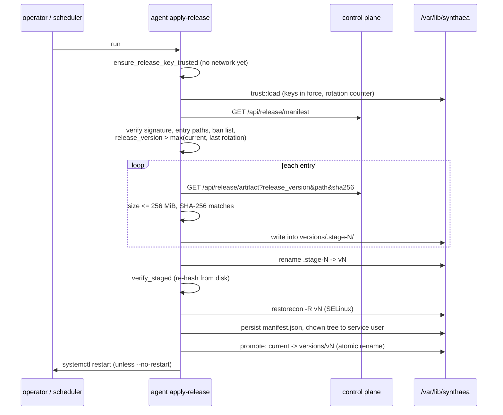
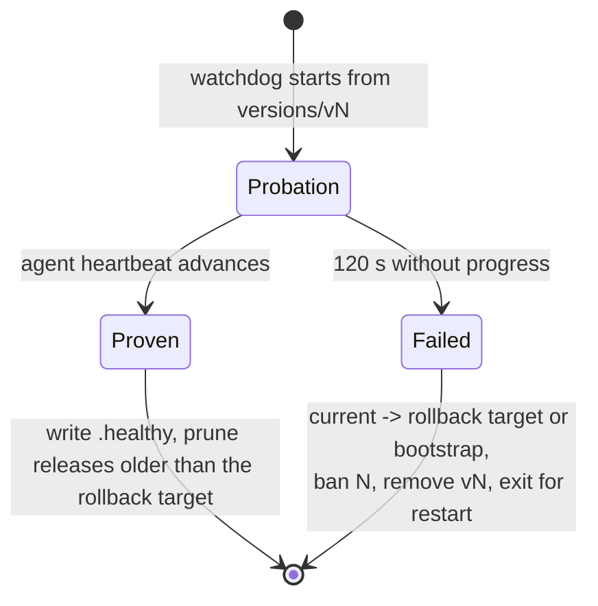

# Updates and releases

An agent that cannot be updated is one an attacker gets to keep, and an agent that accepts any
update is one an attacker can take over. This page explains how the agent receives new binaries,
new detection content, the fleet common-set snapshot and key rotations, how each is verified,
how a bad binary release is rolled back, and how releases are built and signed offline.

The HTTP side of every fetch is described in [Transport](transport.md). How installers lay out
the files the updater manages is in [Packaging](packaging.md).

## What is delivered, and how

| Delivery | Command or loop | Signed by role | Platforms |
| --- | --- | --- | --- |
| Binary release (agent, watchdog, cli) | `agent apply-release` (one shot) | `release` | Linux |
| Detection content (rules, models, policy, IOC feeds) per ring | `agent apply-content-manifest` / `check-content-manifest` (one shot) | `content` | all |
| Fleet common-set snapshot | loop inside `agent run` | `snapshot` | all |
| Key rotation (new `release` and/or `content` key) | `agent apply-key-rotation` (one shot) | `recovery` | all (release counter read on Linux only) |

Every delivery follows the same rules:

- The server never verifies or holds a private key; **every agent verifies every manifest**
  against public keys compiled into the binary.
- A manifest is checked for schema version, signature and path safety **before anything is
  downloaded**.
- Every artifact is bounded in size before it is read and hash-checked before it is written.
- A monotone `release_version` (per ring for content) blocks replay of an older signed
  manifest.

Nothing triggers `apply-release` or `apply-content-manifest` periodically yet; an operator or an
external scheduler runs them (a timer is tracked in
[#44](https://github.com/synthaea-lab/agent/issues/44)).

The crate split mirrors the dependency rules: [`updater`](../crates/updater/src/lib.rs) is a leaf
crate with verification, layout and state logic only, and cannot depend on `transport`. The
fetch-verify-apply compositions live in the binary: [`release.rs`](../apps/agent/src/release.rs),
[`content.rs`](../apps/agent/src/content.rs), [`rotation.rs`](../apps/agent/src/rotation.rs),
[`snapshot_fetch.rs`](../apps/agent/src/snapshot_fetch.rs), with the post-promotion health gate in
the watchdog ([`probation.rs`](../apps/watchdog/src/probation.rs)).

## The trust set

[`key.rs`](../crates/updater/src/key.rs) embeds four Ed25519 public keys, each with one job:

| Static | Verifies | Rotatable |
| --- | --- | --- |
| `RELEASE_PUBLIC_KEY` | binary release manifests | yes, by a key rotation |
| `CONTENT_PUBLIC_KEY` | content manifests | yes, by a key rotation |
| `SNAPSHOT_PUBLIC_KEY` | the common-set snapshot manifest only | no |
| `RECOVERY_PUBLIC_KEY` | key-rotation manifests only (held offline) | no; a lost recovery key means reinstall |

Splitting roles means a leaked `content` key cannot ship binaries, and a leaked `release` key can
be replaced over the air by a rotation that only `recovery` can sign.

**Production keys.** A build without the `test-key` feature reads the keys from
`crates/updater/keys/*.pub` (one line of 64 hex characters). Since 2026-11-12 those files hold
**temporary** keys (generated outside the ADR-0027 ceremony, no custody, to be replaced). A file
that says `unprovisioned` makes its static `None` and every verification of that role fails with
[`SigningKeyUnprovisioned`](../crates/updater/src/error.rs): the build fails closed instead of
trusting a public seed. A build that embeds the temporary keys refuses anything signed by the
public test seed. A release refuses to build while a key file is still marked `TEMPORARY`
(`tools/check-no-temporary-keys.sh`, release job `temporary-key-guard`; see
[packaging.md](packaging.md)). Real provisioning is tracked in
[#43](https://github.com/synthaea-lab/agent/issues/43).

**Test keys.** With the `test-key` feature (on by default for development) or under `cfg(test)`,
the keys are derived from public seeds checked into the repository (`[0x42; 32]` for
release/content, `0x43` recovery, `0x44` snapshot). In that set `release` and `content` are one
key, which a rotation refuses to reproduce. The feature also links a marker string
(`SYNTHAEA-PUBLIC-TEST-KEY-SET-V1`) into the binary, which the packaging and release checks look
for (see [Packaging](packaging.md#test-key-exclusion)).

**Refusal before contact.** [`trust::ensure_key_trusted`](../apps/agent/src/trust.rs) runs before any
network or disk work: a test-key build acts only with `--allow-test-key` (a flag that exists only
in such a build), and a build with no key says that nothing can be verified instead of failing
later at the signature. The keys in force are loaded fresh from the state directory for every
command ([`trust::load`](../apps/agent/src/trust.rs)), so a rotation applied by another process is in
force at the next check.

## Manifest signing

All four manifest types ([`ReleaseManifest`](../crates/updater/src/manifest.rs),
[`ContentManifest`](../crates/updater/src/content.rs),
[`SnapshotManifest`](../crates/updater/src/snapshot.rs),
[`KeyRotationManifest`](../crates/updater/src/rotation.rs)) share one canonicalization:

- the struct's fields are declared in **alphabetical order**, and the signed bytes are
  `serde_json::to_vec_pretty` of the struct (2-space indent) with `signature` set to `""`;
- maps are `BTreeMap`s, so entry order is sorted regardless of insertion;
- the signature is lowercase hex of the 64-byte Ed25519 signature.

Do not reorder fields of these structs: it changes the signed bytes and every existing signature
stops verifying. Each type has `sign_with(closure)`, which hands the canonical bytes to a signer
that never exposes its private key (the PKCS#11 path), and an unknown `schema_version` is rejected
before any other check.

Path safety ([`is_safe_content_path`](../crates/updater/src/content.rs),
[`ReleaseManifest::validate_entry_paths`](../crates/updater/src/manifest.rs)) rejects empty,
absolute, backslash or NUL-containing paths and any segment that is empty, `.`, `..`, contains
`:` (a Windows drive or NTFS alternate data stream), ends in `.` or space (silently trimmed by
Win32), or is a Windows device name (`CON`, `NUL.txt`, `COM1`, superscript variants, `CONIN$`...).
A valid signature proves who signed a manifest, not that its paths are safe to write.

## Binary self-update

`agent apply-release --server URL [--cert --key] [--ca-cert] [--no-restart]` runs
[`apply_release`](../apps/agent/src/release.rs). It is Linux-only; elsewhere it returns an error.



Points that are easy to miss:

- **Day 0 is trusted by the package manager, not the updater.** `bootstrap/` is installed by the
  package and never written by the updater; the first verified state is the first update. A tree
  without `bootstrap/` is refused as "not a packaged install".
- **Rotations share the release counter.** The offer must be newer than both the installed
  release and the last applied key rotation; a release numbered at or below a rotation is a
  rollback of it.
- **Staging is all-or-nothing.** Entries download into `versions/.stage-N` and are renamed to
  `versions/vN` in one step, so a crash never leaves a partial `vN` that could later be picked as
  a rollback target. Any failure removes the staging directory, so a server that keeps failing
  cannot leave a release's worth of bytes per attempt. A leftover staging path from a crash is
  removed first, as a link if it is a symlink. An existing `vN` is complete by construction and is
  reused without downloading, but still re-verified.
- **Size bound.** A release manifest has no signed per-entry size, so downloads are bounded by
  the constant `MAX_RELEASE_ARTIFACT_BYTES` (256 MiB) in [`release.rs`](../apps/agent/src/release.rs).
- **SELinux.** Files written into `versions/vN/` inherit `var_lib_t`, which `init_t` may not
  execute (the unit then dies with `203/EXEC`). [`restore_selinux_labels`](../apps/agent/src/release.rs)
  runs `restorecon -R` on the staged release. Under Enforcing, a missing or failing `restorecon`
  refuses the release and leaves `current` untouched; under Permissive it warns and promotes.
- **Ownership.** `apply-release` usually runs as root, but the watchdog runs as the service user
  and must later write `.healthy` into the release and delete it on rollback.
  [`Layout::adopt_service_ownership`](../crates/updater/src/layout.rs) hands `versions/` and the
  release tree to the owner of the base directory. The walk is descriptor-relative
  (`openat`/`fchownat` with `AT_SYMLINK_NOFOLLOW`, `O_NOFOLLOW` on directories, depth capped by
  `MAX_ADOPT_DEPTH`): the service user owns the parent directory and could swap an entry for a
  symlink between listing and re-owning, which would otherwise make a root process re-own an
  arbitrary target.
- **Promotion is last.** Nothing after the symlink swap can fail the command; a failed
  `systemctl restart` is a warning (the release starts at the next service start).

### On-disk layout

[`Layout`](../crates/updater/src/layout.rs) manages, under `/var/lib/synthaea` in production:

```text
bootstrap/            package-owned; never written by the updater
current -> bootstrap  or -> versions/vN; changed only by rename(2)
versions/vN/          one release; manifest.json; .healthy once proven
versions/.stage-N/    a download in progress
banned_versions.json  releases refused on this install (absent until the first rollback)
key-rotations.json    applied key rotations (absent until the first rotation)
```

- [`promote`](../crates/updater/src/layout.rs) / `reset_to_bootstrap` create the new symlink at
  `.current.tmp` and `rename(2)` it over `current`: a crash leaves the old or the new target, never
  a half-written link.
- [`resolve_active_dir`](../crates/updater/src/layout.rs) never fails: a missing, unreadable, or
  out-of-tree `current` resolves to `bootstrap/`, the one path guaranteed to exist.
- Only directories named `v<number>` count as releases
  ([`installed_versions`](../crates/updater/src/layout.rs)).

### Probation and rollback

The watchdog is started from `current/watchdog`, so it knows its own release from its executable
path ([`Probation::detect`](../apps/watchdog/src/probation.rs)). A release is on probation when it runs
from `versions/vN/`, has no `.healthy` marker, and is still what `current` points at. A run from
`bootstrap/` is never on probation: bootstrap is the floor.



- The proof is the progress-backed heartbeat file the agent writes, which advances only when an
  event goes end to end through the pipeline ([`heartbeat.rs`](../apps/agent/src/heartbeat.rs)), not a
  process-alive check. The deadline, [`PROBATION_DEADLINE`](../apps/watchdog/src/probation.rs), is
  120 s, the same silence deadline every sensor gets; progress seen in the same poll as the
  deadline counts as life.
- The rollback target ([`rollback_target`](../crates/updater/src/layout.rs)) is the newest
  installed release older than the failed one that is **proven** (`.healthy`) and **not banned**;
  otherwise `bootstrap/`. Landing on an unproven release would just run another possibly bad one.
- [`updater::rollback`](../crates/updater/src/lib.rs) repoints `current` first, then bans, then
  removes the failed directory. If the ban write fails, `current` has still moved off the bad
  release, which matters more. A failed directory removal is reported
  ([`RollbackReport::cleanup_error`](../crates/updater/src/lib.rs)), not fatal.
- A stale watchdog cannot undo a newer promotion: `roll_back` does nothing if `current` no longer
  points at its release.
- On success, `prove` writes `.healthy` and prunes releases older than the rollback target, so
  steady state keeps two release trees. A failed prune costs disk, not safety.
- Before every service start, `ExecStartPre` runs the package's `bootstrap/watchdog recover`
  ([`recovery.rs`](../apps/watchdog/src/recovery.rs)): it probes `current/watchdog --help`, and if that
  release cannot even execute, rolls back and bans it the same way. Probation cannot catch a
  watchdog that never starts.

**Ban list** ([`BannedVersions`](../crates/updater/src/banlist.rs)): a bare JSON array of release
numbers, unsigned. It can only narrow what the install accepts, so forging it gains nothing; it
lives in a root-owned state directory. There is no un-ban command: remove the entry by hand.

**Integrity checks reuse the release manifest.** `persist_manifest` keeps the signed manifest in
`versions/vN/manifest.json`; the periodic self-integrity check
([`integrity.rs`](../apps/agent/src/integrity.rs)) re-verifies its signature (against any key in the
release lineage, since a promoted release was signed by the key in force at the time) and re-hashes
the files.

## Content delivery

Content is versioned per ring, independently of binaries. Rings are `canary_0`, `canary_1`,
`canary_2`, `prod` ([`CONTENT_RINGS`](../crates/config/src/schema.rs)); which ring an install is in
comes from `--ring` or `updates.ring`, and with neither the command refuses rather than silently
landing the agent in `prod`. Promotion between rings and automatic halts are server decisions.

[`apply_content_manifest`](../apps/agent/src/content.rs):

1. Load the keys in force; build the client; `GET /api/content/manifest/{ring}`.
2. [`plan_with_key`](../apps/agent/src/content.rs) (pure, no I/O): schema version, signature against
   the `content` key, `ring` equals the requested ring (a valid signature does not prove it is the
   manifest *for this ring*), `release_version` newer than this ring's last applied release, entry
   paths safe. It returns which entries are missing or stale and which applied files the new
   release no longer lists.
3. [`download_and_apply`](../apps/agent/src/content.rs): each entry is fetched with
   `max_bytes = declared size`, after the declared size itself is checked against
   `MAX_CONTENT_ARTIFACT_BYTES` (100 MiB; otherwise a signed but huge `size` would drive the
   allocation), hash-checked, written atomically under the content directory, and recorded in the
   state file **after each entry**, so a failure later keeps earlier progress. The release is
   marked applied only when every entry landed. Files no longer listed are removed one by one, the
   state persisted after each.
4. Notify a running `agent run` over IPC with `ReloadContent` (see
   [Local interfaces](local-interfaces.md#local-control-channel)). If no agent is listening, the
   content is on disk and loads at next start; this is not an error.

The local state ([`ContentState`](../apps/agent/src/content.rs), default
`<state_dir>/content-state.json`) is unsigned: it is the agent's own record, the same trust boundary
as the ban list. It is, however, the only thing between the agent and a replayed older manifest, so
`--content-dir` and `--state` must resolve under `storage.state_dir`; the command refuses any other
path before doing network or disk work.

**Halted rings.** When the server halts a ring it answers `423 Locked` with a reason. The command
prints that reason and exits with `EXIT_RING_HALTED` (75, `EX_TEMPFAIL`), distinct from a failure
(exit 1), so a scheduler can treat it as success. Entries already applied stay recorded.

**Withdrawing content.** The agent never applies a lower release number, so a server that rolls a
ring back to an older release cannot take content off an agent that already applied the newer one;
the command reports such an offer as older than the applied release, not as "up to date"
([`describe_unchanged_offer`](../apps/agent/src/content.rs)). Content is withdrawn by a **corrective
release**: a new, higher-numbered manifest that carries the earlier content, built with
`release-tool roll-forward` ([`roll_forward.rs`](../tools/release/src/roll_forward.rs)). Agents
then fetch what differs and delete what is no longer listed.

## Common-set snapshot

[`snapshot_fetch.rs`](../apps/agent/src/snapshot_fetch.rs) runs a loop inside `agent run` that polls
`/api/snapshot/manifest` (every 6 h, jittered; `SYNTHAEA_SNAPSHOT_POLL_SECS` overrides it, clamped to
at least 5 s), downloads the artifact only when `built_at` moved, verifies size and hash, writes
`snapshots/common-set.bin` atomically and asks the sink to reload it.

- The loop starts only if a `snapshot` key is embedded; a production build has none until
  [#43](https://github.com/synthaea-lab/agent/issues/43) is resolved.
- A bad signature, a stale or future `built_at` (15 min skew tolerance), a size or hash mismatch, or
  an unparseable artifact leaves the snapshot in force untouched and is logged.
- The snapshot in force ages out on its own after
  [`DEFAULT_MAX_AGE_SECS`](../crates/updater/src/snapshot.rs) (3 days), so a server that stops
  publishing cannot keep a stale set alive.

## Key rotation

A [`KeyRotationManifest`](../crates/updater/src/rotation.rs) names a new `release` and/or `content`
key and the key each one retires, and is signed only by `recovery`. `agent apply-key-rotation`
fetches it from `/api/release/key-rotation` (404: nothing pending) or reads `--file`, verifies it and
records it ([`rotation::apply`](../apps/agent/src/rotation.rs)).

[`KeyRotationManifest::verify`](../crates/updater/src/rotation.rs) checks, in order:

1. shape ([`validate`](../crates/updater/src/rotation.rs)): schema version; at least one role; each
   role with both retired and new key; keys are 64 lowercase hex and not all zeros; no key replaced
   by itself; not the same new key for both roles; reason non-empty and at most 256 bytes; window
   non-empty and at most 30 days ([`MAX_VALIDITY_SECS`](../crates/updater/src/rotation.rs));
2. the `recovery` signature;
3. the window at the caller's clock: not expired, `issued_at` at most 15 min in the future;
4. `release_version` above the installed release and every applied rotation;
5. each retired key equals the key in force. This makes a rotation apply once and to one state: a
   replay finds the retired key gone;
6. the result does not put `release` and `content` on one key, nor either on the `recovery` key.

**How an install holds rotated keys** ([`trust_state.rs`](../crates/updater/src/trust_state.rs)).
The embedded keys are compile-time statics and never change. What is recorded in
`key-rotations.json` is the **signed rotation manifests**, not the resulting keys. Every load replays
them from the embedded keys and re-verifies each under the embedded `recovery` key, so the file
cannot introduce a key `recovery` did not sign. For each role a recorded rotation changes:

- the key in force is the one it retires: apply it;
- the key in force is already the one it installs, or one a later rotation installs (a newer build
  embeds keys the record is behind): skip it;
- anything else: the record does not lead from these keys, refused.

A missing file is a fresh install (embedded keys). A file that exists and cannot be trusted is an
error ([`TrustStateCorrupt`](../crates/updater/src/error.rs)), never a fallback, because the
embedded keys may have been rotated away from. The residual risk is deletion: removing the file
puts the embedded, retired keys back in force, which requires root on the state directory. At most
[`MAX_ROTATIONS`](../crates/updater/src/trust_state.rs) (64) are recorded; beyond that, reinstall.

## Building and signing releases (`release-tool`)

[`release-tool`](../tools/release/src/main.rs) is an offline binary: it runs on the release
manager's machine, never on an endpoint or the control plane, and no CI job signs a manifest.

| Command | Does |
| --- | --- |
| `manifest --release-version N --dir DIR` | Hash a directory into an unsigned release manifest ([`manifest_dir.rs`](../tools/release/src/manifest_dir.rs)). |
| `roll-forward --from OLD --release-version N --released-at T [--current CUR]` | Build an unsigned corrective content release; with `--current`, report what it removes and which bytes must be put back in the artifact store. |
| `rotation --release-version N --reason R --new-*-key --retire-*-key [--valid-for-days 7]` | Build an unsigned rotation manifest (at most 30 days). |
| `sign --kind release\|content\|rotation (--key-file F \| --pkcs11 MOD ... \| --test-key \| --test-recovery-key) FILE` | Sign. |
| `public-key (...)` | Print the hex public key to commit under `crates/updater/keys/`. |

[`sign`](../tools/release/src/sign.rs) takes the manifest kind explicitly (guessing from content
would let a wrong file be signed unnoticed), refuses a manifest the agent would reject whatever its
signature (unsafe paths, unsupported schema), checks the produced signature against the signer's own
public key, and reports whether this build's embedded key would accept it.

Key sources ([`KeySource`](../tools/release/src/main.rs)):

- `--pkcs11 MODULE --pkcs11-token LABEL --pkcs11-key LABEL` is the production path
  ([`pkcs11.rs`](../tools/release/src/pkcs11.rs)): the private key stays on the token (sensitive,
  not extractable), the tool sends the canonical bytes and receives a pure Ed25519 signature
  (`CKM_EDDSA`). Tokens are found by label, not slot number (slots renumber). The PIN comes from
  `RELEASE_TOOL_PKCS11_PIN` or `--pkcs11-pin-file`, never an argument (it would show in `ps`).
- `--key-file` (64 hex characters, mode 0600, [`keyfile.rs`](../tools/release/src/keyfile.rs)) is
  for lab releases: a key readable from a file is not a production key.
- `--test-key` / `--test-recovery-key` exist only in a `test-key` build and print a warning.

## Failure modes

| Failure | Result |
| --- | --- |
| Bad signature, unknown schema, unsafe path, wrong ring | Refused before any download; nothing changes. |
| Offer not newer | Release: "up to date". Content: reported; an older offer is called out. |
| Banned release offered | Refused even though newer. |
| Artifact hash mismatch or over the size bound | Release: staging removed, `current` untouched. Content: earlier entries stay applied, release not marked applied. |
| Crash mid-download | Release: `.stage-N` removed at the next run. Content: state file reflects entries already written. |
| New release never shows progress | Rolled back to the last proven release or bootstrap, banned. |
| New watchdog cannot execute | `recover` rolls back and bans before the service starts. |
| Corrupt `key-rotations.json` | Every verifying command refuses until an operator removes the file on purpose. |
| Production build, a key file `unprovisioned` | Every verification of that role fails closed with an explicit message. |

## Platform differences

- Binary self-update, probation and recovery are Linux-only: the layout and its symlink swap are
  POSIX-shaped. Windows and macOS self-update are tracked in
  [#60](https://github.com/synthaea-lab/agent/issues/60); the platform exception that lets
  `updater` contain `cfg(target_os)` code is scoped to this.
- Content delivery, snapshot fetch and key rotation run on every OS. `apply-key-rotation` reads the
  installed release number from the layout on Linux only (`installed_release` in
  [`rotation.rs`](../apps/agent/src/rotation.rs)).

## Configuration

| Knob | Used by |
| --- | --- |
| `storage.state_dir` | content dir and state, key-rotation record, layout base for `apply-release` |
| `updates.ring` | default ring for content commands |
| `server.control_plane_url`, `mtls_cert`, `mtls_key`, `ca_cert` | default server for content and rotation commands (`apply-release` takes `--server` explicitly) |
| `--allow-test-key` | acknowledge the public test keys (test-key builds only) |
| `--no-restart` | `apply-release`: promote without restarting |
| `SYNTHAEA_SNAPSHOT_POLL_SECS` | lab override of the snapshot poll interval |

## Testing

| Test | What it proves |
| --- | --- |
| [`updater` unit and integration tests](../crates/updater/src/lib.rs) | Sign/stage/verify/promote/rollback/ban end to end; anti-rollback; reported cleanup failure. |
| [`tests/unprovisioned_build.rs`](../crates/updater/tests/unprovisioned_build.rs), [`tests/test_key_build.rs`](../crates/updater/tests/test_key_build.rs) | The packaged trust set fails closed; the test set is what test builds use (CI runs `cargo test -p updater --no-default-features`). |
| Tests in [`apps/agent/src/release.rs`](../apps/agent/src/release.rs) | Against a local HTTP server: promotion, tampered artifact, mid-download failure, bad signature, escaping path, bans, rotations, SELinux cases, reuse of a staged release. |
| Tests in [`apps/watchdog/src/probation.rs`](../apps/watchdog/src/probation.rs) and [`recovery.rs`](../apps/watchdog/src/recovery.rs) | Probation detection, rollback targets, bans, pruning, stale watchdog. |
| Tests in [`apps/agent/src/content.rs`](../apps/agent/src/content.rs) | Plan, hash mismatch, progress preservation, removal, halted rings. |
| Tests in [`apps/agent/src/rotation.rs`](../apps/agent/src/rotation.rs) and [`trust_state.rs`](../crates/updater/src/trust_state.rs) | Rotation survives restart, replay and forgery refused, corrupt vs missing record. |
| [`tools/release/tests/pkcs11_softhsm.rs`](../tools/release/tests/pkcs11_softhsm.rs) | Signing through a SoftHSM token, wrong token/PIN/key refused (run by `tools/test-pkcs11.sh` in CI). |
